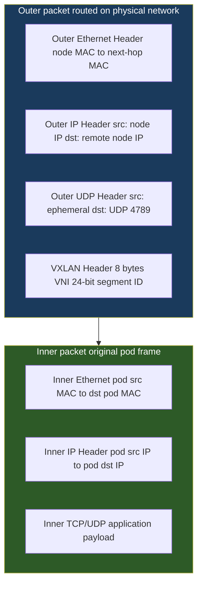
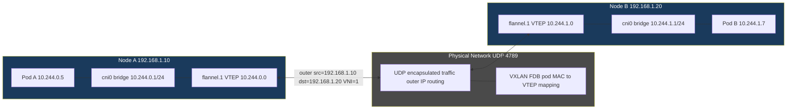
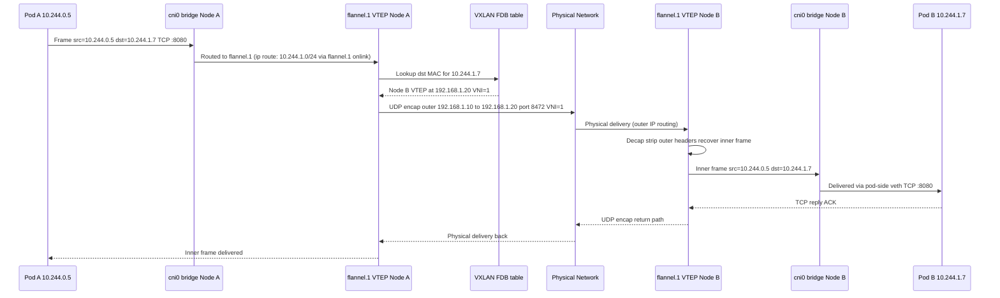

# Lesson 05 — VXLAN and Overlay Networks

> **Track:** Network Foundation — Bare Metal & Cloud · **Prereqs:** [Lesson 02 — IP Routing and Forwarding](02-ip-routing-and-forwarding.md) · **Time:** ~2 hours

> **Goal:** Build a working VXLAN tunnel between two Linux hosts, explain how the FDB maps pod MACs to VTEP IPs, and calculate the correct pod MTU to prevent silent fragmentation.


**Jump to:** [Theory](#theory) · [Practice](#practice) · [Troubleshooting](#troubleshooting) · [Production Checklist](#production-checklist) · [Quick Reference](#quick-reference) · [Check Your Understanding](#check-your-understanding)

---

## Theory

## 1. The Problem Overlay Networks Solve

Kubernetes assigns pods IPs from a private CIDR (e.g., `10.244.0.0/16`). These IPs are not routable on the underlying physical network. Without overlays, cross-node pod traffic would need:
- Routes programmed on every physical switch/router (BGP), **or**
- VPC-level route tables updated for every node (cloud), **or**
- An overlay that wraps pod-IP packets inside routable packets.

Overlay networks choose the third option: **encapsulate first, route second**.

> **See also:** [Lesson 02 — IP Routing and Forwarding](02-ip-routing-and-forwarding.md) for how CNI plugins using Flannel host-gw or Calico BGP avoid encapsulation entirely by programming the physical routing layer instead.


---

## 2. VXLAN Fundamentals

**VXLAN (Virtual eXtensible LAN)** encapsulates L2 Ethernet frames inside UDP packets.

### Packet Structure



Key facts:
- VNI (VXLAN Network Identifier): 24-bit = up to 16 million segments (vs 4096 VLANs)
- UDP destination port: **4789** (IANA standard); Flannel legacy uses **8472**
- Each node runs a **VTEP** (VXLAN Tunnel Endpoint) — a virtual NIC that handles encapsulation and decapsulation
- Overhead: **50 bytes** (outer Ethernet 14 + IP 20 + UDP 8 + VXLAN 8)

### Architecture: Two-Node VXLAN Overlay



---

## 3. Creating a VXLAN Interface

```bash
# Create a VXLAN interface (VTEP)
ip link add vxlan0 type vxlan \
  id 100 \             # VNI
  dstport 4789 \       # UDP port
  local 192.168.1.10 \ # local node IP (tunnel source)
  dev eth0             # interface to use for outer IP

ip link set vxlan0 up
ip addr add 10.244.0.1/16 dev vxlan0

# Check interface details
ip -d link show vxlan0
# → vxlan id 100 local 192.168.1.10 dev eth0 srcport 0 0 dstport 4789
```

---

## 4. VXLAN FDB (Forwarding Database)

The VTEP needs to know which remote node has which pod MAC address.

```bash
# View the VXLAN FDB
bridge fdb show dev vxlan0

# Output example:
# 00:00:00:00:00:00 dst 192.168.1.20 self permanent  ← flood to this VTEP
# aa:bb:cc:dd:ee:01 dst 192.168.1.20 self            ← specific pod MAC

# Add a unicast FDB entry (Flannel/Calico do this via their daemons)
bridge fdb add aa:bb:cc:dd:ee:01 dev vxlan0 dst 192.168.1.20

# Add an anycast entry (flood unknown MACs to all VTEPs)
bridge fdb add 00:00:00:00:00:00 dev vxlan0 dst 192.168.1.20
bridge fdb add 00:00:00:00:00:00 dev vxlan0 dst 192.168.1.30
```

Flannel uses the Kubernetes API (node annotations) to watch node CIDRs and program FDB entries. When a new node joins, flanneld adds its VTEP MAC and node IP to the FDB of every other node.

---

## 5. Flannel VXLAN Mode — How It Works

```
Node A (192.168.1.10) podCIDR=10.244.0.0/24  flannel.1=10.244.0.0
Node B (192.168.1.20) podCIDR=10.244.1.0/24  flannel.1=10.244.1.0

Pod A (10.244.0.5) → Pod B (10.244.1.7)
```

### Packet Journey: Pod A to Pod B



---

## 6. MTU — The Most Common VXLAN Problem

VXLAN adds **50 bytes** of overhead (outer Ethernet + IP + UDP + VXLAN header).

```
Physical NIC MTU: 1500 bytes
VXLAN overhead:    - 50 bytes
Pod/container MTU: 1450 bytes  ← must be configured explicitly
```

If pods use MTU 1500 (the default), large packets get fragmented or silently dropped (if the DF bit is set).

```bash
# Check MTU on VXLAN interface
ip link show flannel.1 | grep mtu

# Check pod-side MTU (inside pod namespace)
kubectl exec -it <pod> -- ip link show eth0 | grep mtu

# Test actual MTU with ping (don't fragment)
kubectl exec -it <pod> -- ping -M do -s 1422 <other-pod-ip>
# -M do = don't fragment, -s = payload size
# 1422 + 28 (ICMP+IP headers) = 1450 → succeeds
# 1423 + 28 = 1451 → fragmented or ICMP message too big received

# Fix: set CNI MTU in ConfigMap (Flannel example)
kubectl edit cm -n kube-system kube-flannel-cfg
# NET_CONF_JSON: "MTU": 1450
```

### MTU Reference by Environment

| Environment | Physical MTU | VXLAN Overhead | Correct Pod MTU |
|-------------|-------------|----------------|----------------|
| Standard Ethernet | 1500 | 50 | **1450** |
| AWS (most instances) | 9001 (jumbo) | 50 | **8951** |
| GCP VPC | 1460 | 50 | **1410** |
| Azure VNet | 1500 | 50 | **1450** |
| On-prem jumbo frames | 9000 | 50 | **8950** |
| Geneve (instead of VXLAN) | 1500 | 54 | **1446** |

---

## 7. Geneve — The Modern Alternative

Geneve (Generic Network Virtualization Encapsulation) is similar to VXLAN but with extensible option headers. OVN, OpenShift, and Cilium support Geneve.

```bash
# Create a Geneve interface
ip link add geneve0 type geneve \
  id 100 \
  remote 192.168.1.20 \
  dstport 6081

ip link set geneve0 up
```

Cilium uses Geneve or VXLAN depending on configuration:
```bash
cilium config view | grep tunnel
# tunnel-protocol: vxlan  (or geneve)
```

## 8. Bare Metal vs Cloud Overlay Considerations

### Bare Metal
- Full control of MTU (configure jumbo frames end-to-end for best performance)
- Overlay overhead matters more at 10/25/100 GbE
- Consider native routing (BGP, host-gw) for performance-sensitive workloads
- Ensure UDP 4789/8472 is allowed on host firewall rules

```bash
# Allow VXLAN on firewall (if using ufw/iptables)
ufw allow 4789/udp
# or:
iptables -I INPUT -p udp --dport 4789 -j ACCEPT
```

### Cloud (AWS/GCP/Azure)
- VPC Security Groups / Firewall Rules must allow UDP 4789 between nodes
- NACLs (AWS) must allow it in both directions
- Cloud load balancers don't forward raw UDP 4789 — VXLAN must be node-to-node
- Some cloud providers offer native overlay bypass (AWS VPC CNI, GKE Dataplane v2)

```bash
# AWS: check Security Group allows VXLAN
aws ec2 describe-security-groups --group-ids sg-xxxxx \
  --query 'SecurityGroups[0].IpPermissions[?FromPort==`4789`]'
```

---

## 9. Performance Tuning

```bash
# Enable hardware offload for VXLAN (if NIC supports it)
ethtool -k eth0 | grep tx-udp_tnl
# tx-udp_tnl-segmentation: on

# Enable checksum offload
ethtool -K eth0 tx-checksum-ip-generic on

# Increase UDP receive buffer for VTEP
sysctl -w net.core.rmem_max=16777216
sysctl -w net.core.wmem_max=16777216

# Use RSS (Receive Side Scaling) so VXLAN decap is spread across CPUs
ethtool -l eth0
ethtool -L eth0 combined 8
```

---

### Industry Applications

| Company / Project | Context | Technology from this lesson | Outcome |
|---|---|---|---|
| Flannel (on-prem K8s) | Flannel VXLAN mode is the default CNI for most on-premises Kubernetes deployments, connecting pods across nodes that are not on the same L2 | VXLAN encapsulation + FDB with Kubernetes API for MAC-to-VTEP mapping | Simple overlay that works on any IP-routable network; widely deployed as the default in kubeadm clusters |
| AWS VPC networking | AWS VPC uses VXLAN-like tunneling internally to provide per-VPC isolation across shared physical infrastructure | VXLAN-style L2-over-UDP encapsulation between hypervisors | Millions of VPC tenants share hardware with full L2 isolation; ENIs get dedicated VNIs |
| WeaveNet CNI | WeaveNet uses VXLAN for multi-host pod networking with its own control plane for FDB population | VXLAN with dynamic FDB population via gossip protocol | No external control plane required; works across cloud providers and on-prem without BGP |
| Cilium Geneve mode | Cilium uses Geneve (54-byte overhead vs VXLAN 50-byte) for its overlay mode, allowing extensible option headers for future telemetry | Geneve UDP :6081 with extensible VNI header | Supports future metadata embedding in tunnel headers for observability without separate sidecar |

---

## Practice

### Environment Setup

```bash
# Two terminals:
# Terminal 1 — minikube Linux node
minikube ssh
ip link show | grep -E "vxlan|tunl|cali"

# Terminal 2 — Mac, kubectl
kubectl get pods -A -o wide   # see pod IPs and nodes
```

### Hands-On Lab

Build a VXLAN overlay between two Linux hosts (or VMs).

```bash
### On Host A (192.168.1.10)
ip link add vxlan10 type vxlan id 10 dstport 4789 \
  local 192.168.1.10 dev eth0
ip link set vxlan10 up
ip addr add 10.0.0.1/24 dev vxlan10

bridge fdb add 00:00:00:00:00:00 dev vxlan10 dst 192.168.1.20
ip route add 10.0.0.0/24 dev vxlan10

### On Host B (192.168.1.20)
ip link add vxlan10 type vxlan id 10 dstport 4789 \
  local 192.168.1.20 dev eth0
ip link set vxlan10 up
ip addr add 10.0.0.2/24 dev vxlan10

bridge fdb add 00:00:00:00:00:00 dev vxlan10 dst 192.168.1.10
ip route add 10.0.0.0/24 dev vxlan10
```

#### Step-by-step Observation

```bash
### From Host A

# Verify VTEP interface details
ip -d link show vxlan10
# → vxlan id 10 local 192.168.1.10 dev eth0 srcport 0 0 dstport 4789 ...

# Confirm FDB flood entry
bridge fdb show dev vxlan10
# → 00:00:00:00:00:00 dst 192.168.1.20 self permanent

# Test overlay reachability
ping -c5 10.0.0.2
# → PING 10.0.0.2: 5 packets transmitted, 5 received, 0% packet loss

# Inspect encapsulated traffic on the physical interface
tcpdump -i eth0 -n udp port 4789 -X
# → UDP packets visible; inner IP addresses 10.0.0.1→10.0.0.2 visible in hex

# Verify MTU: largest payload that passes without fragmentation
ping -M do -s 1422 10.0.0.2   # → succeeds (1422+28 = 1450 ≤ 1500-50)
ping -M do -s 1452 10.0.0.2   # → fails: "Frag needed" or message too big
```

#### Verification

```bash
# After first ping, FDB should have learned remote MAC
bridge fdb show dev vxlan10
# → 00:00:00:00:00:00 dst 192.168.1.20 self permanent  (flood entry)
# → aa:bb:cc:11:22:33 dst 192.168.1.20 self            (learned entry for 10.0.0.2)

# Confirm no fragmentation occurs at correct MTU
ip -s link show vxlan10
# → RX: bytes/packets should match TX with 0 drops
```

### Configuration Reference

| Parameter | Default | Effect | When to change |
|-----------|---------|--------|----------------|
| VNI (`id`) | — | 24-bit segment identifier | Use different VNIs to isolate tenant networks |
| UDP port (`dstport`) | 4789 (IANA) | Destination UDP port for encapsulated traffic | Use 4789 unless hardware offload requires 8472 (Flannel legacy) |
| `local` IP | — | Source IP of outer UDP header | Set to the node's primary IP; must be reachable from all other nodes |
| MTU on vxlan device | inherited | Maximum frame size on the VTEP | Set to `physical_MTU - 50`; CNI must propagate this to pods |
| `learning` flag | on | VTEP learns remote MAC→VTEP mappings via flood-and-learn | Disable (`nolearning`) when CNI uses explicit FDB population |
| `proxy` flag | off | Respond to ARP on behalf of remote pods | Enable (`proxy`) with `l2miss`/`l3miss` for ARP suppression |
| UDP receive buffer | system default | Receive buffer for VTEP socket | Increase `net.core.rmem_max` to `16777216` on high-throughput nodes |

---

## Troubleshooting

| Symptom | Likely Cause | Diagnostic Command | Fix |
|---------|-------------|-------------------|-----|
| Cross-node pod traffic 100% loss | UDP 4789 blocked by firewall/security group | `tcpdump -i eth0 -n udp port 4789` on both nodes | Open UDP 4789 in firewall; check AWS SG / Azure NSG |
| Large requests fail, small ones work | MTU mismatch — pod MTU not set to `physical_MTU - 50` | `kubectl exec -- ping -M do -s 1422 <pod>` | Set CNI MTU in flannel/calico ConfigMap; restart CNI daemonset |
| `bridge fdb show` shows no entries | FDB not populated; flannel/calico daemon not running | `kubectl get pod -n kube-system | grep flannel` | Restart CNI daemon; check logs for API access errors |
| VXLAN tunnel works but very high CPU | Hardware offload disabled; all encap/decap in software | `ethtool -k eth0 | grep tx-udp_tnl` | Enable offload: `ethtool -K eth0 tx-udp_tnl-segmentation on` |
| Intermittent drops under load | UDP receive buffer overflow on VTEP | `netstat -su | grep errors` | Increase `net.core.rmem_max` and `rmem_default` |
| `ip -d link show vxlan0` shows wrong VNI | Flannel used different VNI than expected | `ip -d link show flannel.1` | Confirm VNI in flannel ConfigMap; recreate interface if mismatched |
| ARP not resolving across VTEPs | Flood-and-learn disabled but explicit FDB not populated | `bridge fdb show dev flannel.1 | wc -l` vs node count | Add zero-MAC flood entries or enable `l2miss`/`l3miss` with ARP proxy |

---

## Production Checklist

- [ ] Pod MTU set to `physical_MTU - 50` (VXLAN) or `physical_MTU - 54` (Geneve) in CNI ConfigMap before cluster goes live
- [ ] UDP 4789 (or 8472 for Flannel legacy) explicitly allowed between all nodes in firewall rules, security groups, and NACLs
- [ ] Hardware VXLAN offload verified on the NIC model in use (`ethtool -k eth0 | grep tx-udp_tnl`) for performance-critical clusters
- [ ] `net.core.rmem_max` and `wmem_max` raised to `16777216` on nodes expected to handle > 10 Gbps overlay throughput
- [ ] FDB entry count monitored — unexpectedly low count means CNI daemon has lost sync with the cluster state
- [ ] Jumbo frame configuration confirmed end-to-end (NIC → switch → NIC) before using MTU > 1500 to avoid hidden fragmentation
- [ ] Cloud-specific MTU verified: GCP VPC uses 1460 baseline requiring pod MTU 1410, not 1450

---

## Common Anti-Patterns

| What people do | Why it breaks | Correct approach |
|----------------|--------------|-----------------|
| Leave pod MTU at default 1500 on a VXLAN overlay | Large packets get fragmented or dropped; throughput collapses; hard to diagnose because small packets work fine | Set CNI MTU to `physical_MTU - 50` in the CNI ConfigMap; verify with `ping -M do` |
| Use Flannel VXLAN on bare metal with jumbo frames but keep default CNI MTU | Wastes jumbo frame benefit; pods limited to 1450 when they could use 8950 | Set `flannel.MTU: 8950` in kube-flannel-cfg when physical MTU is 9000 |
| Allow only TCP in firewall rules between nodes | VXLAN runs over UDP 4789; all overlay traffic is blocked | Allow UDP 4789 (and 8472 for legacy) in both directions between node security groups |
| Mix VNIs across clusters sharing the same physical network | Different clusters use the same VNI; MAC/ARP entries bleed across cluster boundaries | Assign a unique VNI range per cluster; use `id` parameter in VXLAN link creation |
| Rely on flood-and-learn in large clusters | Each unknown MAC causes a flood to all VTEPs; broadcast storm at scale | Configure CNI daemon to use unicast FDB population (Flannel directRouting, Calico VXLAN with explicit FDB) |

---

## Quick Reference

| Use Case | Command |
|----------|---------|
| Create VXLAN VTEP interface | `ip link add vxlan0 type vxlan id <VNI> dstport 4789 local <node-ip> dev eth0` |
| Show VTEP details | `ip -d link show vxlan0` |
| View VXLAN FDB | `bridge fdb show dev vxlan0` |
| Add unicast FDB entry | `bridge fdb add <mac> dev vxlan0 dst <remote-node-ip>` |
| Add flood FDB entry | `bridge fdb add 00:00:00:00:00:00 dev vxlan0 dst <remote-node-ip>` |
| Test overlay reachability | `ping -c5 <overlay-ip>` |
| Test MTU (no fragment) | `ping -M do -s 1422 <dst-ip>` |
| Inspect encapsulated traffic | `tcpdump -i eth0 -n udp port 4789 -X` |
| Check hardware VXLAN offload | `ethtool -k eth0 \| grep tx-udp_tnl` |
| Check MTU on flannel interface | `ip link show flannel.1 \| grep mtu` |
| Verify pod MTU | `kubectl exec <pod> -- ip link show eth0` |
| Check CNI MTU config (Flannel) | `kubectl get cm -n kube-system kube-flannel-cfg -o yaml \| grep MTU` |

---

## Summary

| Concept | Detail |
|---------|--------|
| VXLAN overhead | 50 bytes → subtract from physical MTU for pod MTU |
| FDB | Maps pod MAC → remote node VTEP IP |
| VNI | 24-bit segment ID; use unique values per cluster |
| Flannel VXLAN | Flood+learn or unicast FDB via Kubernetes API |
| Geneve | Extensible alternative (54 bytes overhead), used by OVN/Cilium |
| MTU mismatch | Most common VXLAN-related packet drop cause |
| Cloud firewall | Must allow UDP 4789 between all nodes |
| Hardware offload | `tx-udp_tnl-segmentation` reduces CPU for encap/decap |

---

## Check Your Understanding

1. **[Concept question]** VXLAN adds 50 bytes of overhead per packet. Explain where those 50 bytes come from, and what pod MTU you must configure when the physical NIC MTU is 1500 bytes to prevent silent fragmentation.

   <details><summary>Answer</summary>

   The 50-byte overhead breaks down as: outer Ethernet header (14 bytes) + outer IP header (20 bytes) + outer UDP header (8 bytes) + VXLAN header (8 bytes) = 50 bytes total. With a physical NIC MTU of 1500 bytes, the maximum pod payload is 1500 − 50 = **1450 bytes**. Pod interfaces must be configured with MTU 1450 — if left at the default 1500, any packet larger than 1450 bytes will either be fragmented (degrading performance) or silently dropped if the DF (Don't Fragment) bit is set.

   </details>

2. **[Scenario question]** Small HTTP requests between pods on different nodes succeed consistently, but large file transfers fail or hang partway through. VXLAN is in use with default configuration. No error messages appear in the application logs. What is the most likely cause, and how do you confirm it?

   <details><summary>Answer</summary>

   The most likely cause is an MTU mismatch — pod interfaces are configured at MTU 1500 but should be 1450 for VXLAN. Small packets fit within the limit, but large packets exceed 1450 bytes, causing fragmentation or silent drops when the DF bit is set. Confirm with `kubectl exec -- ping -M do -s 1422 <other-pod-ip>` — a payload of 1422 bytes + 28 bytes (ICMP + IP headers) = 1450, which should succeed; `ping -M do -s 1452` should fail or return "Frag needed."

   </details>

3. **[Practical question]** What command would you run to inspect the VXLAN FDB (Forwarding Database) on a Flannel node and verify that the remote VTEP for another node has been populated?

   <details><summary>Answer</summary>

   ```bash
   bridge fdb show dev flannel.1
   ```
   Look for entries mapping remote node VTEP MAC addresses to their node IPs (`dst` field). An entry like `00:00:00:00:00:00 dst 192.168.1.20 self permanent` is the flood entry for Node B. If the FDB is empty or missing entries for known nodes, the flanneld daemon is not syncing from the Kubernetes API.

   </details>

---

## Online Resources

| Resource | Type | What you practice |
|----------|------|-------------------|
| [Killercoda Playground](https://killercoda.com/) | Free playground | Create VXLAN interfaces, inspect FDB, test encapsulation with `tcpdump` live |
| [iximiuz: Container Networking from Scratch](https://labs.iximiuz.com/tutorials/container-networking-from-scratch) | Free interactive lab | Covers overlay mechanics that explain why VXLAN is needed |

---

**← Previous:** [Lesson 04 — Network Namespaces Deep Dive](04-network-namespaces-deep-dive.md)   |   **Next:** [Lesson 06 — BGP Fundamentals for Kubernetes](06-bgp-fundamentals.md)
