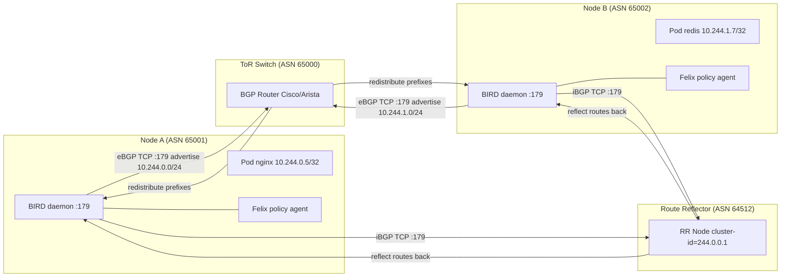
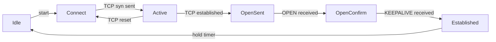
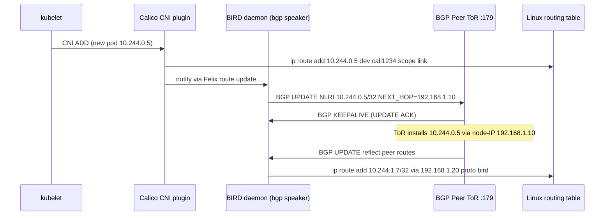
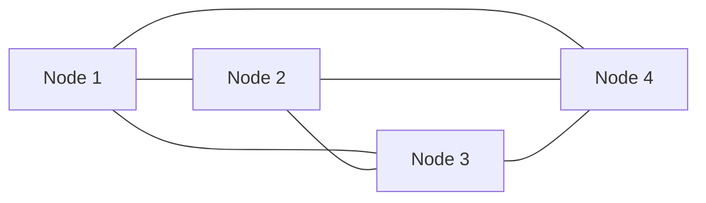

# Lesson 06 — BGP Fundamentals for Kubernetes

> **Track:** Network Foundation — Bare Metal & Cloud
> **Prereqs:** [Lesson 02 — IP Routing and Forwarding](02-ip-routing-and-forwarding.md)
> **Time:** ~2.5 hours

> **Goal:** Configure Calico with BGP peering to a ToR switch so pod routes are reachable from physical network infrastructure without any overlay tunnel.


**Jump to:** [Theory](#theory) · [Practice](#practice) · [Troubleshooting](#troubleshooting) · [Production Checklist](#production-checklist) · [Quick Reference](#quick-reference) · [Check Your Understanding](#check-your-understanding)

---

## Theory

## 1. BGP Fundamentals

BGP is a **path-vector protocol**: routers advertise reachability to IP prefixes along with the path (list of AS numbers) used to reach them.

| Term | Definition |
|------|-----------|
| AS (Autonomous System) | A network under single administrative control |
| ASN | 16-bit (1–65535) or 32-bit identifier; 64512–65534 = private |
| iBGP | BGP between peers in the **same** AS |
| eBGP | BGP between peers in **different** ASes |
| NLRI | Network Layer Reachability Information — the prefix being advertised |
| BGP Speaker | Any router/daemon running the BGP protocol |
| Hold Timer | Max seconds between keepalives before session resets (default 90s) |

### Architecture: Calico BGP on a Kubernetes Cluster



---

## 2. BGP Session Establishment

BGP uses TCP port 179. Peers must be manually configured — BGP does not auto-discover neighbors.

### Session State Machine



```bash
# Check BGP session states with BIRD (used by Calico)
birdc show protocols
# Name       Proto      Table      State  Since         Info
# Node_192_168_1_20  BGP  ---  up  2024-01-15  Established  # → healthy

# Check with FRRouting (used in some bare-metal setups)
vtysh -c "show bgp summary"

# Count established sessions
birdc show protocols | grep -c Established   # → number of peers up
```

---

## 3. How Calico Uses BGP

Calico runs a BGP agent (BIRD) on every node. Each node advertises the pod routes it owns.

```
Node A (ASN 64512) — podCIDR 10.244.0.0/24
Node B (ASN 64512) — podCIDR 10.244.1.0/24

Node A's BIRD advertises: 10.244.0.5/32 (each pod as a host route)
Node B receives this and installs: ip route add 10.244.0.5/32 via 192.168.1.10

No overlay needed — packets go directly at wire speed.
```

### Step-by-step: Pod Creation to Route Advertisement



---

## 4. BGP Topologies in Kubernetes

### Full Mesh (default Calico, up to ~50 nodes)
Every node peers with every other node. Session count grows as n*(n-1)/2.



### Route Reflector (50+ nodes)
Dedicated RR nodes relay routes between peers. All nodes peer only with the RR(s).

```bash
# Calico: designate a node as a Route Reflector
kubectl annotate node rr-node projectcalico.org/RouteReflectorClusterID=244.0.0.1

# BGPPeer config: nodes peer with the RR only
cat <<EOF | kubectl apply -f -
apiVersion: projectcalico.org/v3
kind: BGPPeer
metadata:
  name: peer-with-rr
spec:
  peerIP: 192.168.1.100   # RR IP
  asNumber: 64512
EOF
```

### eBGP with ToR (Top-of-Rack) Switches — Most Scalable

```yaml
apiVersion: projectcalico.org/v3
kind: BGPConfiguration
metadata:
  name: default
spec:
  asNumber: 65001
  serviceLoadBalancerIPs:
    - cidr: 10.0.0.0/24   # advertise LB IPs to the ToR
```

| Topology | Max Nodes | Sessions per Node | Use When |
|----------|-----------|------------------|----------|
| Full mesh | ~50 | n-1 | Small clusters, simple setup |
| Route Reflector | ~1000 | 2–4 (to RRs) | Medium clusters, same AS |
| eBGP with ToR | Unlimited | 2 (to ToR pair) | Production bare metal |

---

## 5. BGP Path Attributes

Understanding these attributes is key for traffic engineering:

| Attribute | Type | Use in Kubernetes |
|-----------|------|-----------------|
| AS_PATH | Well-known mandatory | Loop prevention; prefer shortest path |
| LOCAL_PREF | Well-known discretionary | iBGP preference (higher = preferred); not sent in eBGP |
| MED (MULTI_EXIT_DISC) | Optional non-transitive | Suggest preferred entry to external AS |
| NEXT_HOP | Well-known mandatory | Next router to reach the prefix |
| COMMUNITY | Optional transitive | Tag routes for policy (e.g., "no-export") |
| WEIGHT | Cisco-proprietary | Local-only preference (highest wins) |

```bash
# View BGP routes with attributes in BIRD
birdc show route all
birdc show route for 10.244.0.5

# In FRRouting
vtysh -c "show bgp ipv4 unicast 10.244.0.5"
```

---

## 6. BGP Communities for Kubernetes

BGP communities are 32-bit tags attached to routes. Calico and MetalLB use them for policy.

```yaml
# MetalLB: advertise LoadBalancer IPs with a community tag
apiVersion: metallb.io/v1beta1
kind: BGPAdvertisement
metadata:
  name: example
spec:
  communities:
    - my-community
---
apiVersion: metallb.io/v1beta1
kind: Community
metadata:
  name: my-community
spec:
  communities:
    - name: web-tier
      value: "64512:100"
```

Upstream router policy on the ToR:
```
If route has community 64512:100 → set LOCAL_PREF 200
```

---

## 7. BFD — Bidirectional Forwarding Detection

BFD provides subsecond failure detection for BGP sessions. Important for fast pod rerouting on bare metal.

```yaml
# Calico BGP peer with BFD
apiVersion: projectcalico.org/v3
kind: BGPPeer
metadata:
  name: node-to-tor
spec:
  peerIP: 192.168.1.1
  asNumber: 65000
  bfdEnabled: true
```

| Mechanism | Detection Time | CPU Cost | Use When |
|-----------|---------------|----------|----------|
| Hold timer (default 90s) | 90 seconds | Zero | Never in production |
| Tuned hold timer (9s) | 9 seconds | Minimal | Acceptable if BFD unavailable |
| BFD (300ms interval) | ~1 second | Low | Always — production bare metal |
| BFD (50ms interval) | ~150ms | Medium | Critical latency-sensitive paths |

---

## 8. Advertising Service IPs via BGP

One powerful pattern on bare metal: advertise Service LoadBalancer or ExternalIP ranges via BGP so they are reachable from the rest of the network.

**Calico:**
```yaml
apiVersion: projectcalico.org/v3
kind: BGPConfiguration
metadata:
  name: default
spec:
  serviceLoadBalancerIPs:
    - cidr: 10.100.0.0/24   # LB IP range
  serviceExternalIPs:
    - cidr: 10.200.0.0/24   # External IP range
  serviceClusterIPs:
    - cidr: 10.96.0.0/12    # cluster IP range (optional)
```

**MetalLB (BGP mode):**
```yaml
apiVersion: metallb.io/v1beta1
kind: BGPPeer
metadata:
  name: tor-switch
spec:
  myASN: 64512
  peerASN: 65000
  peerAddress: 192.168.1.1
```

---

## 9. ECMP via BGP Multipath

ECMP (Equal-Cost Multi-Path) allows traffic to be distributed across multiple BGP paths, distributing pod traffic across all nodes advertising a service VIP.

```yaml
# Enable ECMP in Calico BGP config
apiVersion: projectcalico.org/v3
kind: BGPConfiguration
metadata:
  name: default
spec:
  asNumber: 64512
  listenPort: 179
```

```bash
# Verify ECMP routes on the ToR (FRRouting)
vtysh -c "show bgp ipv4 unicast 10.100.0.100/32"
# Should show multiple NEXT_HOPs (one per node running the service)

# Check ECMP on Linux kernel
ip route show 10.100.0.100
# 10.100.0.100 proto bird
#   nexthop via 192.168.1.10 dev eth0 weight 1
#   nexthop via 192.168.1.11 dev eth0 weight 1
```

---

## 10. Cloud Provider BGP Considerations

BGP is typically not available in public cloud VPCs — cloud providers abstract away routing via their SDN. However:

- **AWS Direct Connect / Transit Gateway**: BGP is used between on-prem and AWS. Kubernetes pod routes can be injected here via Calico or a transit VPC pattern.
- **GCP Cloud Router**: supports BGP for Dedicated Interconnect and VPN — not for internal pod routing in GKE.
- **Azure ExpressRoute**: BGP between on-prem and Azure. Azure CNI with BGP is possible in some hybrid scenarios.
- **Bare-metal in cloud (Equinix Metal, etc.)**: full BGP support — treat exactly like on-premises.

---

### Industry Applications

| Company / Project | Context | Technology from this lesson | Outcome |
|---|---|---|---|
| Calico / Tigera (US Air Force) | USAF uses Calico with eBGP peering to Arista ToR switches for classified Kubernetes workloads on bare metal | eBGP with ToR + per-pod /32 host routes + BFD | Wire-speed pod routing without overlay; BFD detects node failure in <1s for mission-critical workloads |
| Cloudflare | Anycast routing distributes traffic across 300+ PoPs using BGP route injection from edge servers | eBGP route advertisement + BGP community tags + ECMP | Any client IP reaches the closest healthy PoP; communities control route propagation scope |
| LinkedIn | LinkedIn's data center fabric uses BGP to distribute pod routes across a spine-leaf topology with ECMP across all spine nodes | iBGP with Route Reflectors + BGP multipath ECMP | Scales to thousands of nodes; spine ECMP provides automatic load balancing and fast failover |
| MetalLB (open source) | Kubernetes-native LoadBalancer implementation that advertises service VIPs via BGP to upstream routers | BGP service advertisement + BGP community + ECMP multipath | Bare-metal clusters get external IP reachability identical to cloud load balancers without cloud dependency |

---

## Practice

### Environment Setup

```bash
# Terminal 1 — inside minikube node (Linux kernel commands)
minikube ssh

# Terminal 2 — Mac / local (Calico and kubectl commands)
# Install calicoctl if not present
curl -L https://github.com/projectcalico/calico/releases/latest/download/calicoctl-linux-amd64 -o calicoctl
chmod +x calicoctl && sudo mv calicoctl /usr/local/bin/
```

> **See also:** [Lesson 07 — Bare Metal Network Infrastructure](07-bare-metal-network-infrastructure.md) for how BGP integrates with LACP bonding, VLAN segmentation, and spine-leaf switching fabrics.

### Hands-On Lab

Inspect BGP session state and route advertisement in a running Calico cluster.

```bash
# --- Terminal 2 (Mac) ---

# Check overall Calico node status including BGP session states
calicoctl node status
# Expected output shows each BGP peer with state: Established

# List BGP peers configured in the cluster
calicoctl get bgppeer -o wide

# Show BGP configuration (AS number, service IP advertisement)
kubectl get bgpconfiguration default -o yaml

# --- Terminal 1 (minikube ssh) ---

# Check BIRD daemon BGP protocol states
sudo birdc show protocols
# Name       Proto    Table    State  Since    Info
# Node_...   BGP      ---      up     ...      Established

# Show all BGP routes in BIRD's routing table
sudo birdc show route

# Show the specific route for a pod IP
sudo birdc show route for 10.244.0.5

# Show routes with full path attributes (AS_PATH, NEXT_HOP, LOCAL_PREF)
sudo birdc show route all

# View kernel routes injected by BIRD
ip route show proto bird

# Confirm TCP session on port 179
ss -tnp | grep 179

# Capture BGP keepalive traffic (should see every 30s)
sudo tcpdump -i eth0 tcp port 179 -n -c 10

# Test TCP/179 reachability to a peer
telnet <peer-ip> 179
```

#### Step-by-step Observation

```bash
# 1. Watch BGP session state in real time (keep this running)
watch -n5 'sudo birdc show protocols | grep BGP'

# 2. In another window, delete and recreate a pod
kubectl delete pod <pod-name> && kubectl run test-pod --image=nginx

# 3. Watch the host routing table update as the new pod gets a /32 route
ip monitor route | grep proto

# 4. Verify the new pod route appeared via BGP
ip route show proto bird | grep 10.244
```

#### Verification

```bash
# All BGP sessions must be Established
sudo birdc show protocols | grep -c Established
# → should equal the number of configured BGP peers

# BGP routes must be present in kernel table
ip route show proto bird | head -5

# Calico IPAM blocks must align with advertised routes
calicoctl ipam show --show-blocks
```

### Configuration Reference

| Parameter | Default | Effect | When to change |
|-----------|---------|--------|----------------|
| `holdTime` | 90s | Seconds between keepalives before session resets | Reduce to 9s for faster detection without BFD |
| `keepaliveTime` | 30s | Interval for KEEPALIVE messages | Usually 1/3 of holdTime |
| `connectRetryTime` | 120s | Delay before retrying failed connections | Reduce on stable links |
| `bfdEnabled` | false | Enable BFD for sub-second failure detection | Always true in production |
| `password` | (none) | MD5 TCP session authentication | Required in multi-tenant environments |

---

## Troubleshooting

| Symptom | Likely Cause | Diagnostic Command | Fix |
|---------|-------------|-------------------|-----|
| BGP session stuck in `Active` | TCP port 179 blocked | `telnet <peer-ip> 179` | Open firewall rule for TCP/179 between peers |
| Session flaps every 90 seconds | Hold timer expiry, no BFD | `birdc show protocols all` | Tune hold timer or enable BFD |
| Pod routes missing on peer node | BIRD not advertising route | `birdc show route for <pod-ip>` | Check Felix is running; `calicoctl node status` |
| BGP `Established` but no routes | Route policy filtering | `birdc show route import <proto>` | Check import/export filters in BGP config |
| `BIRD: Unable to open configuration file` | Config syntax error | `birdc configure check` | Validate BIRD config syntax |
| ToR not receiving service IPs | `serviceLoadBalancerIPs` not set | `kubectl get bgpconfiguration default -o yaml` | Add CIDR to `serviceLoadBalancerIPs` |
| Session connects then immediately drops | ASN mismatch or OPEN message rejected | `tcpdump -i eth0 tcp port 179 -n` | Match `asNumber` in both peer configs |

---

## Production Checklist

- [ ] BGP hold timer reduced to ≤9s or BFD enabled on all BGP peers
- [ ] Route Reflectors deployed (≥2 for HA) for clusters with more than 50 nodes
- [ ] eBGP peering configured with ToR switches using per-node unique private ASNs (64512–65534)
- [ ] `serviceLoadBalancerIPs` and `serviceExternalIPs` CIDRs published to ToR for external reachability
- [ ] BGP MD5 authentication configured on all external-facing peers
- [ ] ECMP multipath enabled on ToR switches for load distribution across nodes
- [ ] Monitoring alert configured when any BGP session leaves `Established` state

---

## Common Anti-Patterns

| What people do | Why it breaks | Correct approach |
|----------------|--------------|-----------------|
| Leave default hold timer at 90s | Pod rerouting takes 90+ seconds after node failure | Enable BFD or set `holdTime: 9` and `keepaliveTime: 3` |
| Use full mesh on 100+ node cluster | n*(n-1)/2 = 4950 sessions; BIRD CPU spikes on route churn | Deploy 2 Route Reflectors per failure domain |
| Give all nodes the same ASN in eBGP with ToR | ToR sees AS_PATH loop and rejects routes | Assign each node a unique private ASN (Calico supports `perNodeLabels` for this) |
| Advertise entire podCIDR block instead of host routes | /16 advertisement hides individual pod failures | Let Calico advertise per-pod /32 host routes (default behavior) |
| Enable BGP without firewall rules | Any host on the management network can peer | Restrict TCP/179 to known peer IPs via iptables or switch ACL |

---

## Quick Reference

| Use Case | Command |
|----------|---------|
| Check all BGP session states | `birdc show protocols` |
| Show all BGP routes | `birdc show route` |
| Show route for specific pod IP | `birdc show route for 10.244.0.5` |
| Show routes with full attributes | `birdc show route all` |
| Check Calico BGP status | `calicoctl node status` |
| Reload BIRD config | `birdc configure` |
| List IPAM blocks (Calico) | `calicoctl ipam show --show-blocks` |
| Test TCP/179 reachability | `telnet <peer-ip> 179` |
| Capture BGP packets | `tcpdump -i eth0 tcp port 179 -n` |
| Show BGP summary (FRRouting) | `vtysh -c "show bgp summary"` |
| Show specific prefix (FRRouting) | `vtysh -c "show bgp ipv4 unicast <prefix>"` |
| View kernel routes from BGP | `ip route show proto bird` |

---

## Summary

| Concept | Kubernetes Application |
|---------|----------------------|
| BGP speaker | BIRD agent on each node (Calico) |
| iBGP full mesh | Default Calico (<50 nodes) |
| Route Reflector | Scalable Calico for 50+ nodes |
| eBGP with ToR | Enterprise bare-metal, wire-speed pod routing |
| BGP community | Traffic engineering, MetalLB policy |
| BFD | Fast failure detection (<1s) |
| Service advertisement | Make LB IPs routable from physical network |
| ECMP multipath | Distribute service traffic across multiple nodes |

---

## Check Your Understanding

1. **[Concept question]** What is a BGP Route Reflector, and at what cluster size does Calico's documentation recommend switching from a full BGP mesh to a Route Reflector topology?

   <details><summary>Answer</summary>

   In a full BGP mesh every node peers with every other node, resulting in n*(n-1)/2 sessions — 4,950 sessions in a 100-node cluster. A Route Reflector (RR) is a dedicated node that receives BGP routes from all peers and re-advertises (reflects) them back out to all other peers. This reduces each non-RR node to only 2–4 sessions (one per RR). Calico recommends switching to RR topology at approximately 50 nodes, where the mesh overhead begins causing BIRD CPU spikes on route churn.

   </details>

2. **[Scenario question]** A Calico node's BGP session is stuck in the `Active` state and never transitions to `Established`. The peer IP is reachable via `ping`. What is the most likely cause, and what command confirms it?

   <details><summary>Answer</summary>

   The most likely cause is TCP port 179 being blocked by a firewall or security group between the nodes. BGP uses TCP port 179 for session establishment — ICMP (ping) may work while TCP 179 is blocked. Confirm with `telnet <peer-ip> 179`; if it hangs or refuses, the port is blocked. A secondary cause is an ASN mismatch in the BGP peer configuration, which would cause the OPEN message to be rejected immediately after TCP connects.

   </details>

3. **[Practical question]** What command would you run on a Calico node to verify that all BGP sessions are in the `Established` state?

   <details><summary>Answer</summary>

   ```bash
   calicoctl node status
   ```
   The output shows each BGP peer, their IP address, ASN, and session state. All peers should show `Established` in the `INFO` column. Any peer showing `Active`, `Connect`, or `Idle` indicates a problem. You can also run `kubectl exec -n calico-system calico-node-xxxxx -- birdcl show protocols` to see the raw BIRD BGP protocol states.

   </details>

---

## Online Resources

| Resource | Type | What you practice |
|----------|------|-------------------|
| [Killercoda Playground](https://killercoda.com/) | Free playground | Run Calico with BIRD; use `birdc show protocols` and `ip route show proto bird` on a real cluster |
| [KodeKloud: Kubernetes Networking Deep Dive](https://www.kodekloud.com/learning-path/kubernetes) | Paid course (free trial) | Covers BGP in the context of Calico CNI configuration |

---

**← Previous:** [Lesson 05 — VXLAN and Overlay Networks](05-vxlan-and-overlay-networks.md)   |   **Next:** [Lesson 07 — Bare Metal Network Infrastructure for Kubernetes](07-bare-metal-network-infrastructure.md)
