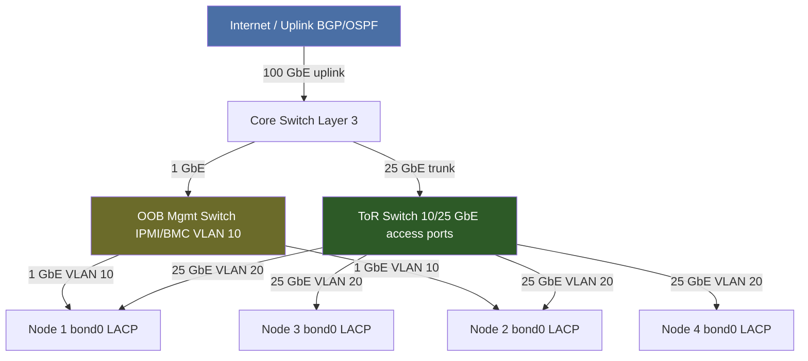
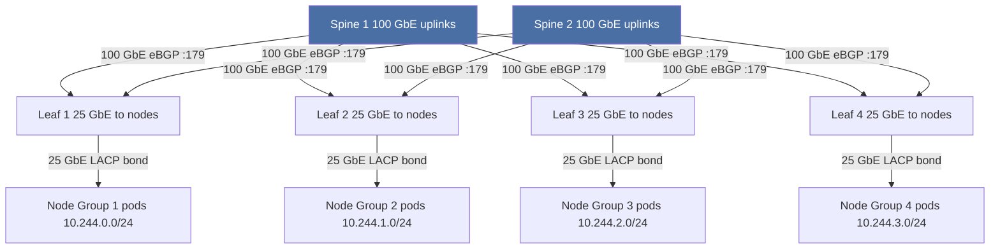
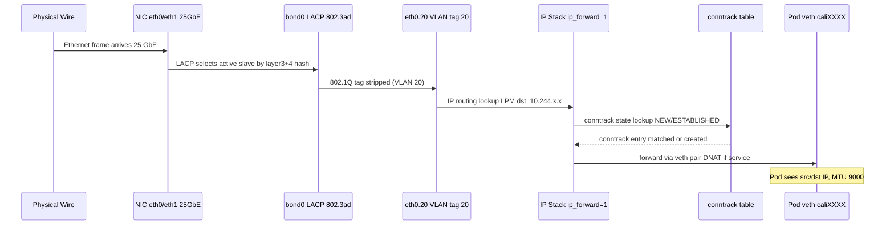

# Lesson 07 — Bare Metal Network Infrastructure for Kubernetes

> **Track:** Network Foundation — Bare Metal
> **Prereqs:** [Lesson 05 — VXLAN](05-vxlan-and-overlay-networks.md), [Lesson 06 — BGP](06-bgp-fundamentals.md)
> **Time:** ~3 hours

> **Goal:** Design and validate a spine-leaf Kubernetes cluster network with LACP bonding, VLAN segmentation, jumbo frames, and MetalLB load balancing so production bare-metal pods achieve wire-speed native routing.


**Jump to:** [Theory](#theory) · [Practice](#practice) · [Troubleshooting](#troubleshooting) · [Production Checklist](#production-checklist) · [Quick Reference](#quick-reference) · [Check Your Understanding](#check-your-understanding)

---

## Theory

## 1. Physical Network Topology

### Single Rack (dev/small clusters, up to ~20 nodes)



### Spine-Leaf (production, 20–1000+ nodes)



Each Leaf uplinks to every Spine (full mesh). Nodes connect only to their Leaf. Provides predictable latency and no STP convergence issues.

| Topology | Max Nodes | Failure Domain | Use When |
|----------|-----------|---------------|----------|
| Single ToR | ~20 | Single switch | Dev, edge, small clusters |
| Dual ToR (MLAG) | ~50 | Switch pair | Medium clusters, redundancy |
| Spine-Leaf | 1000+ | Single leaf | Production, any scale |

**Kubernetes recommendation: Spine-Leaf with ECMP** — symmetric routing, no oversubscription bottleneck, no STP.

---

## 2. NIC Configuration and Bonding

### Packet Flow: NIC to Pod



### Single NIC (dev/small)
Simple but no redundancy.

### LACP Bond (802.3ad) — Recommended for Production

```bash
# Check NIC speed and driver
ethtool eth0 | grep -E "Speed|Duplex|Link"
ethtool -i eth0 | grep driver

# Create a bond
ip link add bond0 type bond mode 802.3ad
ip link set eth0 master bond0
ip link set eth1 master bond0
ip link set bond0 up

# Verify bond status
cat /proc/net/bonding/bond0
# Active slaves, LACP state, link speeds   # → both slaves should be "up"

# Check LACP negotiation
cat /proc/net/bonding/bond0 | grep -E "802.3ad|LACP|Partner"
```

Switch side: configure the ports as a port-channel / LAG with LACP mode active.

### SR-IOV (High Performance)
SR-IOV partitions a physical NIC into Virtual Functions (VFs), each passed directly into a pod or VM.

```bash
# Check SR-IOV capability
cat /sys/bus/pci/devices/<pci-addr>/sriov_totalvfs

# Enable 8 VFs
echo 8 > /sys/bus/pci/devices/<pci-addr>/sriov_numvfs

# VFs appear as additional PCI devices
lspci | grep -i ethernet                 # → VFs listed alongside PF
```

Kubernetes integration: use the SR-IOV Network Device Plugin + SR-IOV CNI for DPDK/low-latency workloads.

---

## 3. VLAN Design

VLANs segment traffic on the same physical switches. Common Kubernetes VLAN design:

| VLAN | Purpose | MTU | Notes |
|------|---------|-----|-------|
| 10 | Management (SSH, iDRAC/iLO, BMC, IPMI) | 1500 | Out-of-band; restrict to ops team |
| 20 | Kubernetes node traffic (podCIDR routing, BGP) | 9000 | Main data plane |
| 30 | Storage (Ceph OSD, NFS, iSCSI) | 9000 | Jumbo frames required for RDMA |
| 40 | Tenant / application separation | 9000 | Optional; use NetworkPolicy otherwise |

```bash
# Configure VLAN on a node interface
ip link add link eth0 name eth0.20 type vlan id 20
ip link set eth0.20 up
ip addr add 192.168.20.10/24 dev eth0.20

# Or configure the switch to present VLAN 20 untagged to the port (access port)
# Node then uses eth0 directly
```

Switch config (Cisco NX-OS example):
```
interface Ethernet1/1
  switchport mode access
  switchport access vlan 20
  spanning-tree port type edge
  no shutdown
```

---

## 4. MTU and Jumbo Frames

Production bare metal should use **jumbo frames (MTU 9000)** end-to-end.

```bash
# Set jumbo frames on NIC
ip link set eth0 mtu 9000

# Persist in network config (varies by distro)
# /etc/netplan/01-netcfg.yaml (Ubuntu)
network:
  ethernets:
    eth0:
      mtu: 9000

# Verify end-to-end (ping with DF bit)
ping -M do -s 8972 192.168.1.20
# 8972 + 28 = 9000 — if this works, jumbo frames are working end-to-end

# Verify from inside a pod
kubectl exec -it <pod> -- ping -M do -s 8972 <other-pod-ip>

# Set CNI MTU accordingly (subtract overlay overhead)
# VXLAN on 9000 MTU: 9000 - 50 = 8950
# Native routing on 9000 MTU: 9000 (no overhead)
```

Switch configuration: enable jumbo frames globally:
```
# Cisco NX-OS
policy-map type network-qos jumbo
  class type network-qos class-default
    mtu 9216
system qos
  service-policy type network-qos jumbo
```

### MTU Reference Table

| Scenario | NIC MTU | CNI MTU | Overhead |
|----------|---------|---------|----------|
| Native routing (no overlay) | 9000 | 9000 | 0 bytes |
| VXLAN overlay | 9000 | 8950 | 50 bytes |
| IP-IP overlay | 9000 | 8980 | 20 bytes |
| WireGuard encryption | 9000 | 8940 | 60 bytes |
| Cloud (AWS default) | 9001 | 8951 | 50 bytes VXLAN |

---

## 5. Load Balancers on Bare Metal

Cloud Kubernetes gets cloud-native LBs for free. Bare metal needs an alternative.

### MetalLB

MetalLB implements LoadBalancer service type for bare metal using BGP or L2 (ARP/NDP).

```yaml
# MetalLB L2 mode (simple, no BGP required)
apiVersion: metallb.io/v1beta1
kind: IPAddressPool
metadata:
  name: production
  namespace: metallb-system
spec:
  addresses:
    - 192.168.100.100-192.168.100.200
---
apiVersion: metallb.io/v1beta1
kind: L2Advertisement
metadata:
  name: example
  namespace: metallb-system
```

```yaml
# MetalLB BGP mode (recommended for production)
apiVersion: metallb.io/v1beta2
kind: BGPPeer
metadata:
  name: tor-switch
  namespace: metallb-system
spec:
  myASN: 64512
  peerASN: 65000
  peerAddress: 192.168.1.1
---
apiVersion: metallb.io/v1beta1
kind: BGPAdvertisement
metadata:
  name: example
  namespace: metallb-system
spec:
  ipAddressPools:
    - production
```

### kube-vip
Alternative to MetalLB: uses VRRP/ARP for HA virtual IPs.

```yaml
# kube-vip as a DaemonSet for LoadBalancer services
env:
  - name: vip_leasename
    value: plndr-svcs-lock
  - name: lb_enable
    value: "true"
  - name: lb_port
    value: "80"
```

| Solution | Mode | ECMP | HA | Use When |
|----------|------|------|----|----------|
| MetalLB L2 | ARP/NDP | No | Single speaker | Simple setups, no BGP on switches |
| MetalLB BGP | BGP | Yes | Via BGP multipath | Production with BGP-capable ToR |
| kube-vip | VRRP | No | Active/standby | Control plane VIP + services |

---

## 6. External DNS and IP Planning

Plan your IP ranges before deploying:

```
Physical Network:    192.168.0.0/16
  Node management:   192.168.1.0/24   (node SSH, kubelet API)
  LoadBalancer VIPs: 192.168.100.0/24 (MetalLB pool)

Kubernetes Internal:
  Pod CIDR:          10.244.0.0/16    (never routable externally)
  Service CIDR:      10.96.0.0/12     (never routable externally)
  Node CIDR mask:    /24              (256 pods per node max)
```

```bash
# Calculate how many nodes fit in a pod CIDR
# podCIDR=10.244.0.0/16, nodeMask=/24
# 2^(24-16) = 256 nodes × 254 usable IPs/node
python3 -c "print(2**(24-16), 'nodes,', 2**8-2, 'IPs/node')"
# → 256 nodes, 254 IPs/node
```

---

## 7. Node Network Configuration at Scale

For consistent bare-metal node networking, use automation:

### Netplan (Ubuntu)
```yaml
# /etc/netplan/01-k8s-node.yaml
network:
  version: 2
  renderer: networkd
  ethernets:
    eth0:
      mtu: 9000
  bonds:
    bond0:
      interfaces: [eth0, eth1]
      mtu: 9000
      parameters:
        mode: 802.3ad
        lacp-rate: fast
        mii-monitor-interval: 100
        transmit-hash-policy: layer3+4
      addresses: [192.168.1.10/24]
      routes:
        - to: default
          via: 192.168.1.1
      nameservers:
        addresses: [8.8.8.8, 8.8.4.4]
```

### NMState (Red Hat / OpenShift)
```yaml
# NMState declarative network config
interfaces:
  - name: bond0
    type: bond
    state: up
    ipv4:
      address:
        - ip: 192.168.1.10
          prefix-length: 24
      enabled: true
    link-aggregation:
      mode: 802.3ad
      port:
        - eth0
        - eth1
```

---

## 8. RDMA and High-Performance Networking

For AI/ML workloads requiring InfiniBand or RoCE:

```bash
# Check RDMA devices
rdma dev
# Shows InfiniBand and RoCE devices with GIDs

# Install RDMA CNI plugin
# Use Multus + RDMA device plugin for secondary interfaces with RDMA
kubectl get pods -n kube-system | grep rdma

# Check RDMA queue pairs
rdma stat show
```

---

### Industry Applications

| Company / Project | Context | Technology from this lesson | Outcome |
|---|---|---|---|
| SAP BTP bare metal | SAP Business Technology Platform runs Kubernetes on bare-metal nodes in Equinix and SAP-owned data centers with strict network isolation requirements | Spine-leaf topology + LACP bonding + VLAN segmentation (management/data/storage) | Deterministic latency, full VLAN isolation between tenant clusters, zero cloud dependency for data-residency compliance |
| Equinix Metal (bare-metal cloud) | Equinix Metal provisions bare-metal servers with BGP-enabled ToR switches; customers run any Kubernetes distribution directly on physical hardware | eBGP with ToR + MetalLB BGP mode + jumbo frames MTU 9000 | Full BGP route advertisement from day 1; MetalLB advertises service VIPs to Equinix edge routers for global reachability |
| Rackspace managed Kubernetes | Rackspace deploys bare-metal Kubernetes clusters with LACP bonds to dedicated ToR switches, using MetalLB L2 for simple customer deployments and BGP for enterprise-tier | LACP 802.3ad + VLAN per-tenant + MetalLB L2/BGP | Multi-tenant network isolation; MetalLB mode selection per cluster tier; unified IP management via IPAM integration |
| On-premises GPU clusters (AI/ML) | GPU training clusters require InfiniBand or RoCE with jumbo frames for collective operations (NCCL, MPI); Kubernetes pod scheduling must co-locate with RDMA NICs | SR-IOV VFs passed to pods + MTU 9000 + Multus secondary interfaces | Near-native InfiniBand bandwidth inside Kubernetes pods; collective allreduce at line rate across GPU nodes |

---

## Practice

### Environment Setup

```bash
# Terminal 1 — minikube Linux node
minikube ssh
ip link show bonding_masters 2>/dev/null || echo "No bonding on this node"
bridge vlan show 2>/dev/null
ip link show type vlan

# Terminal 2 — Mac (kubectl)
kubectl get nodes -o wide
kubectl describe node minikube | grep -A5 "Addresses\|Capacity"
```

> **See also:** [Lesson 06 — BGP Fundamentals](06-bgp-fundamentals.md) for configuring the BGP sessions between nodes and ToR switches in this topology.

### Hands-On Lab

Inspect node network configuration, simulate VLAN setup, and deploy MetalLB.

```bash
# --- Terminal 1 (minikube ssh) ---

# Check NIC details and link state
ethtool eth0 | grep -E "Speed|Duplex|Link"
ethtool -i eth0 | grep driver

# Simulate LACP bond (minikube has single NIC; observe the commands)
ip link add bond0 type bond mode 802.3ad 2>/dev/null || echo "bond0 already exists"
cat /proc/net/bonding/bond0 2>/dev/null || echo "No bond on minikube (expected)"

# Create a VLAN interface (simulate VLAN 20 — Kubernetes data)
ip link add link eth0 name eth0.20 type vlan id 20
ip link set eth0.20 up
ip addr add 192.168.20.100/24 dev eth0.20
ip link show eth0.20

# Test jumbo frames (minikube uses 1500 by default; test the concept)
ip link show eth0 | grep mtu
ping -M do -s 1472 -c3 $(ip route show default | awk '{print $3}')
# 1472 + 28 header = 1500 — should succeed on MTU 1500

# Clean up
ip addr del 192.168.20.100/24 dev eth0.20
ip link del eth0.20

# --- Terminal 2 (Mac) ---

# Deploy MetalLB
kubectl apply -f https://raw.githubusercontent.com/metallb/metallb/v0.14.8/config/manifests/metallb-native.yaml
kubectl wait -n metallb-system deployment/controller --for=condition=Available --timeout=90s
```

#### Step-by-step Observation

```bash
# --- Terminal 2 (Mac) ---

# Configure MetalLB L2 mode with an IP pool
cat <<EOF | kubectl apply -f -
apiVersion: metallb.io/v1beta1
kind: IPAddressPool
metadata:
  name: example-pool
  namespace: metallb-system
spec:
  addresses:
    - 192.168.49.200-192.168.49.210
---
apiVersion: metallb.io/v1beta1
kind: L2Advertisement
metadata:
  name: example
  namespace: metallb-system
EOF

# Create a service with LoadBalancer type
kubectl create deployment nginx --image=nginx
kubectl expose deployment nginx --port=80 --type=LoadBalancer

# Watch for EXTERNAL-IP assignment from MetalLB pool
kubectl get service nginx --watch
# → Should show EXTERNAL-IP from 192.168.49.200-210 range

# View MetalLB speaker logs (shows ARP announcement)
kubectl logs -n metallb-system -l component=speaker --tail=20
```

#### Verification

```bash
# MetalLB controller and speakers must be running
kubectl get pods -n metallb-system
# All pods must be Running

# Service must have an EXTERNAL-IP
kubectl get service nginx | grep -v pending
# → EXTERNAL-IP should not be <pending>

# Test reachability (from minikube node)
minikube ssh -- curl -s -o /dev/null -w "%{http_code}" http://$(kubectl get svc nginx -o jsonpath='{.status.loadBalancer.ingress[0].ip}')
# → 200

# Clean up
kubectl delete deployment nginx
kubectl delete service nginx
kubectl delete -f https://raw.githubusercontent.com/metallb/metallb/v0.14.8/config/manifests/metallb-native.yaml
```

### Configuration Reference

| Parameter | Value | Effect | When to change |
|-----------|-------|--------|----------------|
| `mode` | `802.3ad` | Active LACP negotiation | Use `active-backup` if switch does not support LACP |
| `lacp-rate` | `fast` | 1s LACP PDUs (vs 30s slow) | Always use `fast` for faster failover |
| `mii-monitor-interval` | `100` (ms) | Link state polling interval | 50ms for critical nodes |
| `xmit-hash-policy` | `layer3+4` | Hashing for load distribution | `layer3+4` for IP/port-based distribution |
| `min-links` | `1` | Min active slaves before bond goes down | Set to `2` for strict HA |

---

## Troubleshooting

| Symptom | Likely Cause | Diagnostic Command | Fix |
|---------|-------------|-------------------|-----|
| Nodes can't reach each other | VLAN mismatch between node and switch | `tcpdump -i eth0 -n vlan` | Verify switch port VLAN config matches node VLAN config |
| Pod traffic drops silently | MTU mismatch (black-hole routing) | `ping -M do -s 8972 <remote-ip>` | Set consistent MTU on all NIC, bond, VLAN, and CNI interfaces |
| Bond shows only one active slave | Switch not configured for LACP | `cat /proc/net/bonding/bond0` | Configure switch port-channel with `channel-group N mode active` |
| MetalLB service VIP unreachable | BGP session not established | `kubectl logs -n metallb-system -l app=metallb` | Verify ASN and peer IPs in BGPPeer config |
| iperf3 bandwidth low between nodes | Only one LACP slave hashing to flow | `ethtool -S bond0 \| grep slave` | Tune `xmit-hash-policy` to `layer3+4` on both bond and switch |
| PXE boot fails at DHCP | Management VLAN not assigned to port | `tcpdump -i eth0 port 67 or 68` | Add VLAN 10 as native VLAN on switch port |
| SR-IOV VF not visible in pod | VF not created or device plugin not running | `echo 8 > .../sriov_numvfs` then `lspci` | Create VFs at node boot and ensure SR-IOV device plugin DaemonSet is running |

---

## Production Checklist

- [ ] Spine-leaf topology deployed with no leaf-to-leaf direct links and full spine redundancy
- [ ] LACP bonding (802.3ad) active on all nodes with `lacp-rate fast` and `layer3+4` hashing
- [ ] Jumbo frames (MTU 9000) set end-to-end: NIC, bond, switch ports, and CNI MTU adjusted accordingly
- [ ] Separate VLANs for management, Kubernetes data, and storage traffic
- [ ] MetalLB or kube-vip deployed with an IP pool plan that does not overlap pod/service CIDRs
- [ ] Out-of-band management (IPMI/BMC) accessible on a dedicated VLAN with restricted firewall rules
- [ ] Node network configuration managed by Netplan/NMState and version-controlled, not set manually

---

## Common Anti-Patterns

| What people do | Why it breaks | Correct approach |
|----------------|--------------|-----------------|
| Run all traffic on a single flat VLAN | Storage floods degrade node communication; no blast radius isolation | Separate VLANs 10/20/30 with ACLs between them |
| Set MTU 1500 on storage NIC | iSCSI/Ceph performance degrades 30–50% due to fragmentation | Set MTU 9000 on storage VLAN end-to-end before deploying Ceph |
| Use MetalLB L2 mode in production | Single speaker is a bottleneck; no ECMP; ARP failover is slow (~10s) | Use MetalLB BGP mode with ToR peering for ECMP and fast convergence |
| Connect leaf switches to each other | Creates STP loops and unpredictable latency; defeats spine-leaf design | In spine-leaf, leaves ONLY connect to spines — never to each other |
| Configure IP manually on each node | Config drift leads to duplicate IPs and debugging nightmares | Use Netplan/NMState templates applied by Ansible or cloud-init |

---

## Quick Reference

| Use Case | Command |
|----------|---------|
| Check bond status and active slaves | `cat /proc/net/bonding/bond0` |
| Show NIC speed and link state | `ethtool eth0 \| grep -E "Speed\|Link"` |
| Check NIC driver | `ethtool -i eth0 \| grep driver` |
| Test jumbo frame path | `ping -M do -s 8972 <remote-ip>` |
| Show VLAN interfaces | `ip link show type vlan` |
| Show bridge VLAN table | `bridge vlan show` |
| Check IP forwarding | `sysctl net.ipv4.ip_forward` |
| Test inter-node bandwidth | `iperf3 -c <node2-ip> -t 30 -P 4` |
| Check for duplicate IPs | `arping -D -I eth0 <ip>` |
| View MetalLB logs | `kubectl logs -n metallb-system -l app=metallb` |
| Check RDMA devices | `rdma dev` |
| Verify LACP PDU exchange | `tcpdump -i eth0 ether proto 0x8809 -n` |

---

## Summary

| Component | Bare Metal Decision |
|-----------|-------------------|
| Topology | Spine-Leaf preferred for scale, ECMP routing |
| NIC | LACP bond (802.3ad) for redundancy; SR-IOV for DPDK/low-latency |
| MTU | Jumbo frames (9000) end-to-end; adjust CNI MTU per overlay |
| VLANs | Separate management (10), Kubernetes (20), storage (30) |
| Load Balancer | MetalLB BGP mode for ECMP; L2 for simple setups |
| IP planning | Separate physical, pod, service, and VIP ranges; plan before deploy |
| Pod routing | Native BGP preferred (no overhead); VXLAN for simpler setup |

---

## Check Your Understanding

1. **[Concept question]** What is the purpose of LACP (802.3ad) bonding on a bare-metal Kubernetes node, and what does the `xmit-hash-policy: layer3+4` setting control?

   <details><summary>Answer</summary>

   LACP bonding aggregates two or more physical NICs into a single logical interface (`bond0`), providing both link redundancy (if one NIC or switch port fails, the bond continues on the remaining link) and increased bandwidth. The `xmit-hash-policy: layer3+4` setting determines how outbound packets are distributed across the active slave links — using a hash of source IP, destination IP, source port, and destination port. This ensures that multiple concurrent flows are spread across both links rather than all going to the same NIC, maximizing bandwidth utilization.

   </details>

2. **[Scenario question]** Two nodes in a spine-leaf cluster cannot reach each other. The bond interface on both nodes shows only one active slave instead of two. LACP is configured on the bond. What is the most likely cause, and what command on the node confirms it?

   <details><summary>Answer</summary>

   The most likely cause is that the switch ports are not configured for LACP (port-channel with `channel-group N mode active`). When the switch does not send LACP PDUs, the bond falls back to only one active slave. Confirm on the node with `cat /proc/net/bonding/bond0` — look at the "MII Status" of each slave and the "Partner Key" field; if the Partner Key is `0`, the switch is not negotiating LACP. Run `tcpdump -i eth0 ether proto 0x8809` to verify LACP PDUs are (or are not) being exchanged.

   </details>

3. **[Practical question]** What command would you run to verify that jumbo frames (MTU 9000) are working end-to-end between two bare-metal Kubernetes nodes?

   <details><summary>Answer</summary>

   ```bash
   ping -M do -s 8972 <remote-node-ip>
   ```
   The `-M do` flag sets the Don't Fragment bit and `-s 8972` sends a payload of 8972 bytes. Adding the 28-byte ICMP and IP header overhead gives 9000 bytes total — the maximum for a jumbo frame MTU of 9000. A successful reply confirms end-to-end jumbo frame support. If you receive "Frag needed" or the ping times out, an intermediate interface (switch port, NIC, or bond) has not been configured for MTU 9000.

   </details>

---

## Online Resources

| Resource | Type | What you practice |
|----------|------|-------------------|
| [Killercoda Playground](https://killercoda.com/) | Free playground | Inspect bonding, bridge VLAN tables, and MetalLB on a real Linux node |
| [KodeKloud: Kubernetes Networking Deep Dive](https://www.kodekloud.com/learning-path/kubernetes) | Paid course (free trial) | Bare-metal load balancing and node network configuration labs |

---

**← Previous:** [Lesson 06 — BGP Fundamentals for Kubernetes](06-bgp-fundamentals.md)   |   **Next:** [Lesson 08 — Cloud Provider Networking Basics](08-cloud-provider-networking.md)
