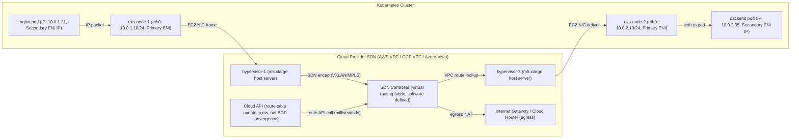
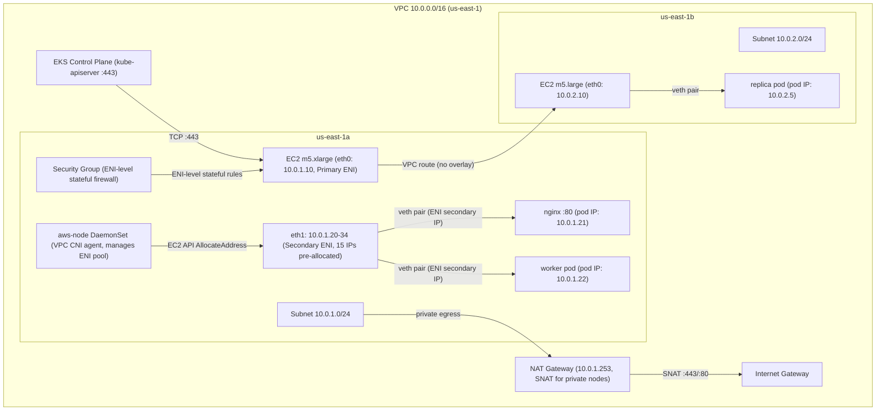
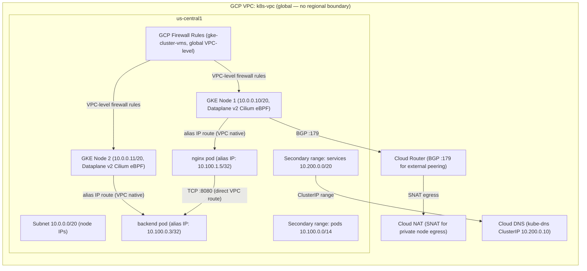
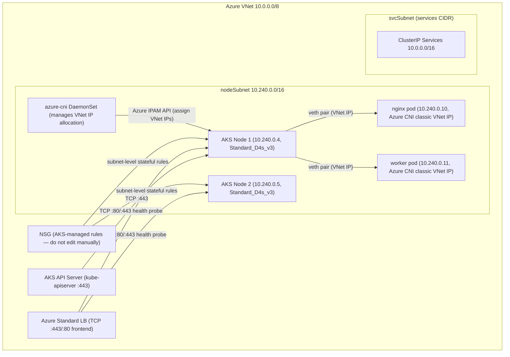

# Lesson 08 — Cloud Provider Networking Basics

> **Track:** Network Foundation — Cloud Provider
> **Prereqs:** [Lesson 02 — IP Routing and Forwarding](02-ip-routing-and-forwarding.md)
> **Time:** ~3 hours

> **Goal:** Explain how AWS VPC CNI, GKE Alias IPs, and Azure CNI assign pod IPs from cloud network resources, and configure security group and load balancer integrations for each provider.


**Jump to:** [Theory](#theory) · [Practice](#practice) · [Troubleshooting](#troubleshooting) · [Production Checklist](#production-checklist) · [Quick Reference](#quick-reference) · [Check Your Understanding](#check-your-understanding)

---

## Theory

## 1. The SDN Abstraction

Cloud VPCs implement routing in software, not on physical switches.



This means:
- Routes are enforced by the hypervisor/network fabric — you do not configure ToR switches
- IP-in-IP or VXLAN tunnels may already be used underneath (invisible to you)
- Routing changes propagate in seconds (API calls), not minutes (BGP convergence)
- Security is enforced at the VM NIC level (Security Groups, NACLs)

---

## 2. AWS Networking for Kubernetes

### VPC Architecture



### AWS VPC CNI (amazon-vpc-cni-k8s)
Pods get **real VPC IPs** from secondary ENI private IPs.

```
Node (m5.xlarge): 2 ENIs × 15 IPs/ENI = 30 pod IPs max
                                         (limits vary by instance type)
```

```bash
# Check ENIs and secondary IPs on a node
aws ec2 describe-instances --instance-ids <id> \
  --query 'Reservations[0].Instances[0].NetworkInterfaces'

# View pod IPs assigned via VPC CNI
kubectl get pods -o wide -A | head -20

# Check AWS VPC CNI version
kubectl get ds -n kube-system aws-node \
  -o jsonpath='{.spec.template.spec.containers[0].image}'

# VPC CNI configuration
kubectl get cm -n kube-system amazon-vpc-cni -o yaml

# Step-by-step: trace a pod IP back to its ENI
POD_IP=$(kubectl get pod <pod> -o jsonpath='{.status.podIP}')
echo "Pod IP: $POD_IP"                            # → 10.0.1.21
aws ec2 describe-network-interfaces \
  --filters "Name=private-ip-address,Values=${POD_IP}" \
  --query 'NetworkInterfaces[0].{ENI:NetworkInterfaceId,Node:PrivateIpAddress}'
# → shows which ENI owns this pod IP
```

**Source/Destination Check** must be disabled (EKS does this automatically):
```bash
aws ec2 modify-instance-attribute \
  --instance-id <id> \
  --no-source-dest-check
```

### AWS Security Groups

Security Groups are stateful firewalls at the ENI level.

```bash
# Check which SGs are on a node
aws ec2 describe-instances --instance-ids <id> \
  --query 'Reservations[0].Instances[0].SecurityGroups'

# EKS creates these SGs automatically:
# - Cluster SG (control plane ↔ nodes)
# - Node SG (node ↔ node, pod ↔ pod)
```

For pod-level security groups (Security Groups for Pods):
```yaml
# SecurityGroupPolicy CRD (requires VPC CNI trunk ENI mode)
apiVersion: vpcresources.k8s.aws/v1beta1
kind: SecurityGroupPolicy
metadata:
  name: web-sg-policy
spec:
  podSelector:
    matchLabels:
      app: web
  securityGroups:
    groupIds:
      - sg-0123456789abcdef0
```

### AWS Load Balancer Integration
```yaml
# NLB (Network Load Balancer) — L4
service:
  type: LoadBalancer
  annotations:
    service.beta.kubernetes.io/aws-load-balancer-type: "external"
    service.beta.kubernetes.io/aws-load-balancer-nlb-target-type: "ip"
    service.beta.kubernetes.io/aws-load-balancer-scheme: "internet-facing"
```

```yaml
# ALB (Application Load Balancer) — L7, via AWS Load Balancer Controller
apiVersion: networking.k8s.io/v1
kind: Ingress
metadata:
  annotations:
    kubernetes.io/ingress.class: alb
    alb.ingress.kubernetes.io/scheme: internet-facing
    alb.ingress.kubernetes.io/target-type: ip
```

---

## 3. GCP Networking for Kubernetes

### VPC Architecture

GCP VPC is **global** (no regional boundary) and uses custom-mode subnets.



### GKE Networking

GKE uses **Alias IP ranges** — each node gets a /24 from the pod range, and pod IPs are real VPC addresses.

```bash
# View node pod CIDR allocations
kubectl get nodes -o jsonpath='{range .items[*]}{.metadata.name}{"\t"}{.spec.podCIDR}{"\n"}{end}'
# → gke-node-1    10.100.0.0/24
# → gke-node-2    10.100.1.0/24

# GKE Dataplane v2 (uses Cilium eBPF under the hood)
kubectl get cm -n kube-system cilium-config -o yaml 2>/dev/null

# Check Dataplane version
gcloud container clusters describe <cluster> \
  --format='value(networkConfig.datapathProvider)'
# ADVANCED_DATAPATH = Dataplane v2 (eBPF/Cilium)
# LEGACY_DATAPATH = iptables kube-proxy

# Observe ip-masq-agent config
kubectl get configmap -n kube-system ip-masq-agent -o yaml
```

### GCP Firewall Rules

GCP firewall rules are **global**, applied at the VPC level, not per-instance.

```bash
# View firewall rules for the cluster
gcloud compute firewall-rules list --filter="name~gke-"

# GKE auto-creates:
# gke-<cluster>-master      — kubelet API access from control plane
# gke-<cluster>-vms         — node ↔ node traffic
# gke-<cluster>-inkubelet   — control plane to nodes
```

### GCP Load Balancer Integration
```yaml
# External passthrough NLB (default)
service:
  type: LoadBalancer

# Internal L4
service:
  type: LoadBalancer
  annotations:
    networking.gke.io/load-balancer-type: "Internal"

# Global L7 via GKE Ingress
apiVersion: networking.k8s.io/v1
kind: Ingress
metadata:
  annotations:
    kubernetes.io/ingress.class: "gce"
```

---

## 4. Azure Networking for Kubernetes

### VNet Architecture



### Azure CNI

Two modes:

**Azure CNI (classic):** Pods get IPs from the VNet subnet.
```bash
# Each node pre-allocates pod IPs from the subnet
az aks show --resource-group rg --name aks \
  --query networkProfile.podCidr
```

**Azure CNI Overlay:** Pods get IPs from a separate overlay CIDR (less VNet IP exhaustion).
```bash
az aks show --resource-group rg --name aks \
  --query networkProfile.networkMode
# overlay

# View node's pod CIDR in overlay mode
kubectl get nodes -o jsonpath='{range .items[*]}{.metadata.name}{"\t"}{.spec.podCIDR}{"\n"}{end}'
```

### NSG (Network Security Group)

NSGs filter traffic at the subnet or NIC level.

```bash
# View NSG rules applied to AKS nodes
az network nsg rule list \
  --resource-group <node-resource-group> \
  --nsg-name <nsg-name>

# IMPORTANT: AKS manages these NSG rules — manual edits will be overwritten
```

### Azure Load Balancer Integration
```yaml
# External LoadBalancer (Azure Standard LB)
service:
  type: LoadBalancer

# Internal
service:
  type: LoadBalancer
  annotations:
    service.beta.kubernetes.io/azure-load-balancer-internal: "true"
    service.beta.kubernetes.io/azure-load-balancer-internal-subnet: "internal-subnet"
```

---

## 5. Cross-Provider Comparison

| Feature | AWS (EKS) | GCP (GKE) | Azure (AKS) |
|---------|-----------|-----------|-------------|
| Pod IP model | VPC secondary IPs (ENI) | Alias IP ranges | VNet IPs (Azure CNI) |
| Pod IP limit per node | Instance type dependent | Node /24 from range | Subnet size dependent |
| eBPF dataplane | Possible (Cilium on EKS) | Dataplane v2 (default) | Cilium option |
| L4 LB | NLB | Passthrough NLB | Azure Standard LB |
| L7 LB | ALB (Controller) | Cloud LB (GCE Ingress) | App Gateway Ingress |
| Security model | Security Groups (ENI) | VPC Firewall Rules | NSG |
| Node-to-node | VPC routing | VPC routing | VNet routing |
| IP exhaustion risk | ENI limit per instance | Pre-sized secondary range | Azure CNI classic uses VNet IPs |

---

## 6. Networking Gotchas per Provider

### AWS
```bash
# Gotcha 1: ENI limit → pod density limit
# m5.large: 3 ENIs × 10 IPs = 30 pods max (minus 1 per ENI for node)
# Check limits: https://docs.aws.amazon.com/AWSEC2/latest/UserGuide/using-eni.html

# Gotcha 2: Prefix delegation (increases pod density)
kubectl set env ds -n kube-system aws-node ENABLE_PREFIX_DELEGATION=true

# Gotcha 3: externalTrafficPolicy=Local required for client IP preservation with NLB
kubectl patch svc <svc> -p '{"spec":{"externalTrafficPolicy":"Local"}}'
```

### GCP
```bash
# Gotcha 1: Default firewalls allow all internal traffic — add deny rules for segmentation
# Gotcha 2: Alias IP ranges must be sized before cluster creation (can't shrink)
# Gotcha 3: GKE uses MASQUERADE for pod egress by default
kubectl get configmap -n kube-system ip-masq-agent -o yaml
```

### Azure
```bash
# Gotcha 1: Azure CNI classic exhausts VNet IPs quickly
# 110 pods/node × 100 nodes = 11,000 IPs needed in subnet

# Gotcha 2: AKS requires pre-planned subnet for Azure CNI
# Use Overlay mode for large clusters
az aks create --network-plugin azure --network-plugin-mode overlay ...

# Gotcha 3: NSG rules are managed by AKS — manual edits get overwritten
```

### Industry Applications

| Company / Project | Context | Technology from this lesson | Outcome |
|---|---|---|---|
| AWS EKS (Amazon.com) | Runs millions of containers for retail, Prime Video, and core AWS services globally | AWS VPC CNI assigns pods real ENI IPs from VPC subnets; no overlay tunnel needed | Pods participate natively in VPC routing and security groups; near-zero networking overhead at massive scale |
| GKE Autopilot (Google) | Google's fully-managed Kubernetes mode; default for new GKE clusters since 2022 | Alias IP ranges per node with Dataplane v2 (Cilium eBPF under the hood) | Zero-maintenance pod networking with sub-millisecond latency for GCP-native workloads |
| Azure AKS + CNI Overlay (Microsoft) | Azure's managed Kubernetes for enterprise workloads with 1000+ node clusters | Azure CNI Overlay separates pod CIDR from VNet IPs to prevent address exhaustion | Clusters avoid VNet IP exhaustion; standard enterprise AKS deployments now default to Overlay mode |
| Shopify | Multi-cloud Kubernetes platform serving high-traffic flash sales with burst traffic patterns | Cloud-native CNI with direct VPC routing and cloud load balancer integration | Deterministic pod-to-pod latency with no tunnel overhead during peak traffic spikes |
| Regulated EU bank (AKS) | Core-banking migration on AKS: 2000 pods across 20 nodes exhausted a /24 subnet using Azure CNI classic, triggering an emergency overlay mode migration mid-rollout | Azure CNI classic assigns each pod a VNet IP from the node subnet; a /24 provides only 251 usable addresses, far below the 2000 pods required | Cluster was migrated to Azure CNI Overlay mode; pod IPs moved to a separate overlay CIDR, freeing VNet IPs for nodes and preventing further address exhaustion |

---

## Practice

### Environment Setup

```bash
# Terminal 1 — kubectl (Mac)
kubectl get nodes -o wide
kubectl get pods -A -o wide | head -20

# Terminal 2 — cloud CLI (optional, Mac)
kubectl get cm -n kube-system amazon-vpc-cni -o yaml 2>/dev/null || echo "Not on AWS EKS"
kubectl get cm -n kube-system ip-masq-agent -o yaml 2>/dev/null || echo "Not on GKE"
```

> **See also:** [Lesson 09 — CNI Specification](09-cni-specification.md) for how the cloud-specific CNI binaries plug into the kubelet ADD/DEL lifecycle.

### Hands-On Lab

```bash
# Any cloud cluster — trace a pod's IP back to the cloud resource

# Step 1: Get pod IP
POD_IP=$(kubectl get pod <pod> -o jsonpath='{.status.podIP}')
echo "Pod IP: $POD_IP"                                      # → 10.0.1.21

# Step 2: Find which node
NODE=$(kubectl get pod <pod> -o jsonpath='{.spec.nodeName}')
echo "Node: $NODE"                                          # → ip-10-0-1-10.ec2.internal

# Step 3: AWS — find the ENI that owns this secondary IP
NODE_IP=$(kubectl get node $NODE \
  -o jsonpath='{.status.addresses[?(@.type=="InternalIP")].address}')
aws ec2 describe-network-interfaces \
  --filters "Name=private-ip-address,Values=${POD_IP}" \
  --query 'NetworkInterfaces[0].{ENI:NetworkInterfaceId,Node:PrivateIpAddress}'
# → {"ENI": "eni-0abc123", "Node": "10.0.1.10"}

# Step 4: Verify security groups allow the traffic
aws ec2 describe-network-interface-attribute \
  --network-interface-id <eni-id> \
  --attribute groupSet

# GKE: verify alias IP assignment on the node
gcloud compute instances describe $NODE --format='value(networkInterfaces[0].aliasIpRanges)'
# → [{cidrRange: 10.100.1.0/24, subnetworkRangeName: pods}]
```

### Configuration Reference

#### ENI Limits per Instance Type

| Instance | ENIs | IPs/ENI | Max Pods | With Prefix Delegation |
|----------|------|---------|----------|----------------------|
| t3.medium | 3 | 6 | 15 | 54 |
| m5.large | 3 | 10 | 27 | 90 |
| m5.xlarge | 4 | 15 | 44 | 120 |
| m5.4xlarge | 8 | 30 | 232 | 480 |
| c5.18xlarge | 15 | 50 | 737 | 750 |

#### AWS VPC CNI Parameters

| Parameter | Default | Effect | When to change |
|-----------|---------|--------|----------------|
| `WARM_IP_TARGET` | 1 | IPs pre-warmed per node | Increase for faster pod startup |
| `MINIMUM_IP_TARGET` | 0 | Min IPs always allocated | Set to expected pod count per node |
| `ENABLE_PREFIX_DELEGATION` | false | Allocate /28 blocks instead of single IPs | Enable for high pod density nodes |
| `WARM_PREFIX_TARGET` | 1 | /28 blocks pre-warmed | Tune for burst workloads |
| `AWS_VPC_K8S_CNI_EXTERNALSNAT` | false | Use VPC NAT for pod egress | Set true when using NAT Gateway for pod egress |

```bash
# Enable prefix delegation for higher pod density
kubectl set env ds -n kube-system aws-node ENABLE_PREFIX_DELEGATION=true
kubectl set env ds -n kube-system aws-node WARM_PREFIX_TARGET=1
```

---

## Troubleshooting

| Symptom | Likely Cause | Diagnostic Command | Fix |
|---------|-------------|-------------------|-----|
| Pods stuck in `ContainerCreating` on EKS | ENI limit reached (no IPs available) | `kubectl describe node <node> \| grep -i eni` | Scale to larger instance type or enable prefix delegation |
| AWS pod can't reach external internet | Source/destination check enabled on ENI | `aws ec2 describe-instances --instance-ids <id> --query '...SourceDestCheck'` | Disable source/dest check or use NAT Gateway |
| GKE pods can't communicate across nodes | Firewall rule blocking node-to-node traffic | `gcloud compute firewall-rules list --filter="name~gke-"` | Verify `gke-<cluster>-vms` rule exists and targets node tag |
| AKS pod IPs exhausted | Azure CNI classic used too many VNet IPs | `az aks show --query networkProfile.networkMode` | Migrate to Azure CNI Overlay mode |
| NLB not reaching pods on AWS | `externalTrafficPolicy: Cluster` masquerades source IP | `kubectl get svc <svc> -o yaml \| grep externalTrafficPolicy` | Set `externalTrafficPolicy: Local` for NLB IP target mode |
| GKE pod can't egress to internet | Cloud NAT not configured for the subnet | `gcloud compute routers nats list --router=...` | Add Cloud NAT to Cloud Router for the node subnet |
| AKS NSG rule disappears | AKS CCM overwrites manual NSG rules | Check AKS nodeResourceGroup NSG | Use Kubernetes NetworkPolicy instead of direct NSG edits |

---

## Production Checklist

- [ ] Instance type selected with sufficient ENI/IP capacity for target pod density (AWS)
- [ ] Prefix delegation enabled on EKS for clusters with >30 pods/node
- [ ] Secondary IP range pre-sized for maximum cluster growth before cluster creation (GKE)
- [ ] Azure CNI Overlay mode enabled for clusters with more than 50 nodes (AKS)
- [ ] NetworkPolicy or Security Groups for Pods configured for pod-level isolation
- [ ] Cloud NAT / NAT Gateway provisioned for private node subnets requiring egress
- [ ] Load balancer health check ports opened in node security groups / firewall rules

---

## Common Anti-Patterns

| What people do | Why it breaks | Correct approach |
|----------------|--------------|-----------------|
| Use default ENI limits on large EKS nodes | Pod scheduling fails when ENI is full; no visible error until pods are stuck | Plan instance type based on max pods needed; enable prefix delegation |
| Size GKE secondary range too small at cluster creation | Pod CIDR exhaustion as cluster grows; cannot resize | Allocate a /14 secondary range (262k addresses) even for small clusters |
| Edit NSG/firewall rules manually on AKS/GKE | Cloud controller manager overwrites changes at next reconcile | Use Kubernetes NetworkPolicy; only add non-managed rules outside the node resource group |
| Use `externalTrafficPolicy: Cluster` with NLB on AWS | Client source IP is masqueraded; hops add latency | Use `externalTrafficPolicy: Local` with NLB and `ip` target type |
| Rely on Security Groups alone for pod-to-pod isolation on EKS | SGs apply at ENI (node) level, not pod level, without trunk ENI mode | Enable Security Groups for Pods with trunk ENI mode, or use Calico NetworkPolicy |

---

## Quick Reference

| Use Case | Command |
|----------|---------|
| Get pod IP | `kubectl get pod <pod> -o jsonpath='{.status.podIP}'` |
| List ENIs on EC2 instance (AWS) | `aws ec2 describe-instances --instance-ids <id> --query '...NetworkInterfaces'` |
| Enable prefix delegation (EKS) | `kubectl set env ds -n kube-system aws-node ENABLE_PREFIX_DELEGATION=true` |
| Check VPC CNI config (EKS) | `kubectl get cm -n kube-system amazon-vpc-cni -o yaml` |
| Check GKE dataplane version | `gcloud container clusters describe <c> --format='value(networkConfig.datapathProvider)'` |
| List GKE firewall rules | `gcloud compute firewall-rules list --filter="name~gke-"` |
| Check AKS network mode | `az aks show --query networkProfile.networkMode` |
| View node pod CIDRs | `kubectl get nodes -o jsonpath='{range .items[*]}{.metadata.name}{"\t"}{.spec.podCIDR}{"\n"}{end}'` |
| Check ip-masq-agent config (GKE) | `kubectl get cm -n kube-system ip-masq-agent -o yaml` |
| Find which ENI owns a pod IP (AWS) | `aws ec2 describe-network-interfaces --filters Name=private-ip-address,Values=<ip>` |
| Disable src/dst check on EC2 | `aws ec2 modify-instance-attribute --instance-id <id> --no-source-dest-check` |
| List Cloud NAT configs (GCP) | `gcloud compute routers nats list --router=<router>` |

---

## Summary

| Provider | Key Concept |
|----------|------------|
| AWS EKS | VPC CNI gives pods real ENI IPs; ENI limit caps pod density per node |
| GCP GKE | Alias IP ranges; Dataplane v2 uses Cilium eBPF; secondary ranges pre-sized at creation |
| Azure AKS | Azure CNI Overlay recommended for large clusters; NSG at subnet managed by AKS |
| All providers | Cloud LBs integrate via CCM (Cloud Controller Manager) annotations on Service objects |

---

## Check Your Understanding

1. **[Concept question]** How does the AWS VPC CNI plugin assign IP addresses to pods differently from an overlay-based CNI like Flannel, and what hardware resource on the EC2 instance limits the maximum number of pods per node?

   <details><summary>Answer</summary>

   The AWS VPC CNI plugin assigns pods real VPC IP addresses by using secondary private IPs on Elastic Network Interfaces (ENIs) attached to the EC2 instance. Each secondary IP becomes a pod IP, and routes inside the VPC fabric deliver traffic directly — no VXLAN or overlay tunnel is needed. The limiting factor is the number of ENIs the instance type supports and the number of secondary IPs per ENI. For example, an `m5.xlarge` supports 4 ENIs × 15 IPs/ENI = 60 total IPs, minus 1 per ENI for the primary node IP = 44 maximum pod IPs.

   </details>

2. **[Scenario question]** Pods on an EKS node are stuck in `ContainerCreating` with no IP assigned. `kubectl describe node` shows the node is Ready. The VPC CNI DaemonSet pods are running. What is the most likely cause?

   <details><summary>Answer</summary>

   The most likely cause is that the ENI warm IP pool is exhausted — the node has used all secondary IPs available on its attached ENIs and cannot allocate a new IP for the new pod. Check with `kubectl describe node <node> | grep -i eni` or inspect the VPC CNI logs (`kubectl logs -n kube-system -l k8s-app=aws-node`). The fix is either to scale to a larger instance type with more ENIs, or to enable prefix delegation (`ENABLE_PREFIX_DELEGATION=true`) which allocates `/28` blocks of 16 IPs at a time instead of single IPs, increasing pod density.

   </details>

3. **[Practical question]** What command would you run to find which ENI on an EC2 instance owns a specific pod IP address (e.g., `10.0.1.21`)?

   <details><summary>Answer</summary>

   ```bash
   aws ec2 describe-network-interfaces \
     --filters "Name=private-ip-address,Values=10.0.1.21" \
     --query 'NetworkInterfaces[0].{ENI:NetworkInterfaceId,Node:PrivateIpAddress}'
   ```
   The output shows the ENI ID that holds this secondary IP. This is useful for correlating pod IPs to ENI security group rules when debugging connectivity issues at the VPC level.

   </details>

---

## Online Resources

| Resource | Type | What you practice |
|----------|------|-------------------|
| [AWS EKS Workshop](https://www.eksworkshop.com/) | Free workshop (small AWS cost ~$3) | Hands-on VPC CNI, ENI secondary IPs, Security Groups for Pods — the AWS half of this lesson |
| [AWS Skill Builder — Amazon EKS](https://skillbuilder.aws/) | Free (simulated labs) | Official AWS labs for EKS networking with no AWS account cost for simulations |
| [Killercoda Playground](https://killercoda.com/) | Free playground | Inspect CNI configs and pod networking on a local cluster |

---

**← Previous:** [Lesson 07 — Bare Metal Network Infrastructure for Kubernetes](07-bare-metal-network-infrastructure.md)   |   **Next:** [Lesson 09 — CNI Specification and Plugin Architecture](09-cni-specification.md)
