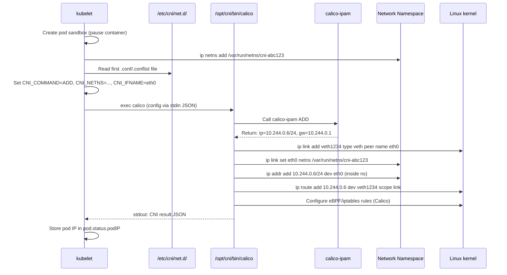

# Lesson 09 — CNI Specification and Plugin Architecture

> **Track:** Network Foundation — Bare Metal & Cloud
> **Prereqs:** [Lesson 04 — Network Namespaces](04-network-namespaces-deep-dive.md)
> **Time:** ~2 hours

> **Goal:** Trace a Kubernetes pod creation through the full CNI ADD lifecycle — from kubelet invocation to IP assignment — and manually execute a CNI plugin to verify your understanding of the stdin/stdout JSON protocol.

---

## Practice Setup

```bash
# Terminal 1 — minikube node (inspect CNI config and binaries)
minikube ssh
ls /etc/cni/net.d/        # CNI config files (first alphabetically is used)
ls /opt/cni/bin/          # CNI plugin binaries

# Terminal 2 — kubectl (Mac)
kubectl get pods -A | grep calico   # the running CNI
```

> **See also:** [Lesson 10 — eBPF and XDP](10-ebpf-xdp.md) for how Cilium replaces iptables-based CNI plumbing with eBPF TC programs loaded during the ADD operation.

---

## 1. What CNI Is

CNI is a **specification + set of libraries** defining how container runtimes configure network interfaces for containers. It is intentionally minimal:

- A CNI plugin is **an executable** (binary) placed in `/opt/cni/bin/`
- It receives configuration via **stdin** (JSON)
- It receives environment variables for context
- It outputs results on **stdout** (JSON)
- The runtime calls it on `ADD` (create pod), `DEL` (delete pod), and `CHECK` (verify) operations

### Architecture: CNI Plugin Ecosystem

```mermaid
flowchart LR
    subgraph node["Kubernetes Node"]
        KL[kubelet]
        subgraph cni_bin["/opt/cni/bin/"]
            CALICO[calico]
            BRIDGE[bridge]
            IPAM[host-local]
            BW[bandwidth]
            PM[portmap]
        end
        subgraph cni_conf["/etc/cni/net.d/"]
            CONF[10-calico.conflist]
        end
        subgraph netns["Network Namespaces"]
            NS1[/var/run/netns/cni-abc<br/>Pod eth0: 10.244.0.6]
        end
    end
    subgraph ipam_backends["IPAM Backends"]
        HL[host-local<br/>/var/lib/cni/networks/]
        CIPAM[calico-ipam<br/>Kubernetes CRDs]
        WA[whereabouts<br/>Cluster-wide]
        VPCNI[aws-vpc-cni<br/>EC2 ENI secondary IPs]
    end

    KL -- "reads first conf" --> CONF
    KL -- "exec with env vars" --> CALICO
    CALICO -- "calls IPAM" --> CIPAM
    CALICO -- "creates veth in" --> NS1
    CIPAM --> WA
    CALICO -.chain.-> BW
    CALICO -.chain.-> PM
```

---

## 2. CNI Environment Variables

```
CNI_COMMAND      ADD | DEL | CHECK | VERSION
CNI_CONTAINERID  Unique ID of the container (pod)
CNI_NETNS        Path to the network namespace: /var/run/netns/<id>
CNI_IFNAME       Interface name to create inside the container: eth0
CNI_ARGS         Extra K=V args (not widely used)
CNI_PATH         Colon-separated list of directories to search for CNI plugins
```

| Variable | Example Value | Notes |
|----------|--------------|-------|
| `CNI_COMMAND` | `ADD` | One of ADD / DEL / CHECK / VERSION |
| `CNI_CONTAINERID` | `a1b2c3d4e5f6...` | Sandbox container ID from kubelet |
| `CNI_NETNS` | `/var/run/netns/cni-abc123ef` | Pre-created by kubelet before CNI call |
| `CNI_IFNAME` | `eth0` | Always `eth0` for primary pod interface |
| `CNI_PATH` | `/opt/cni/bin` | Colon-separated; chained plugins also searched here |

---

## 3. CNI Configuration File

Stored in `/etc/cni/net.d/`. The first file (alphabetically) is used.

```json
{
  "cniVersion": "1.0.0",
  "name": "my-network",
  "type": "bridge",
  "bridge": "cni0",
  "isGateway": true,
  "ipMasq": true,
  "ipam": {
    "type": "host-local",
    "ranges": [
      [{"subnet": "10.244.0.0/24"}]
    ],
    "routes": [
      {"dst": "0.0.0.0/0"}
    ]
  }
}
```

For chained plugins (multiple plugins in sequence, `.conflist` format):
```json
{
  "cniVersion": "1.0.0",
  "name": "k8s-pod-network",
  "plugins": [
    {
      "type": "calico",
      "ipam": {"type": "calico-ipam"}
    },
    {
      "type": "bandwidth",
      "ingressRate": 10485760,
      "egressRate": 10485760
    },
    {
      "type": "portmap",
      "capabilities": {"portMappings": true}
    }
  ]
}
```

### Configuration Reference

| Field | Required | Default | Effect |
|-------|----------|---------|--------|
| `cniVersion` | Yes | — | CNI spec version; must match plugin support |
| `name` | Yes | — | Network name; used as key for IPAM state |
| `type` | Yes | — | Binary filename in `CNI_PATH` to execute |
| `ipam.type` | Yes (usually) | — | IPAM plugin name; called by main plugin |
| `isGateway` | No | false | Assign gateway IP to bridge interface |
| `ipMasq` | No | false | Add iptables MASQUERADE for pod egress |
| `plugins` | Conflist only | — | Array of plugins to chain in sequence |

---

## 4. CNI ADD Operation Flow

### Step-by-step: kubelet to Running Pod Network



---

## 5. CNI Result Format

```json
{
  "cniVersion": "1.0.0",
  "interfaces": [
    {
      "name": "eth0",
      "mac": "0a:58:0a:f4:00:06",
      "sandbox": "/var/run/netns/cni-abc123"
    }
  ],
  "ips": [
    {
      "interface": 0,
      "address": "10.244.0.6/24",
      "gateway": "10.244.0.1"
    }
  ],
  "routes": [
    {"dst": "0.0.0.0/0", "gw": "10.244.0.1"}
  ],
  "dns": {
    "nameservers": ["10.96.0.10"]
  }
}
```

---

## 6. IPAM Plugins

IPAM (IP Address Management) plugins handle IP allocation, called by the main CNI plugin.

### host-local
Allocates IPs from a range, stored in flat files on each node.
```bash
# IPAM state files
ls /var/lib/cni/networks/my-network/
# Files named after each allocated IP, containing container ID

# Check all allocated IPs
ls /var/lib/cni/networks/k8s-pod-network/
# → 10.244.0.2  10.244.0.3  10.244.0.6  last_reserved_ip.0
```

### calico-ipam
Uses Calico's IPAM blocks (by default /26 per node) with central coordination via Kubernetes CRDs.
```bash
calicoctl ipam show --show-blocks
# → shows which /26 blocks are allocated to each node
calicoctl ipam show --ip 10.244.0.6
# → pod and node that owns this IP
```

### whereabouts
Cluster-wide IPAM with no per-node allocation boundaries (useful for Multus secondary networks).
```bash
kubectl get ippools.whereabouts.cni.cncf.io
kubectl get overlappingrangeipreservations.whereabouts.cni.cncf.io
```

### AWS VPC CNI IPAM
Allocates IPs from EC2 secondary ENI IPs; keeps a warm pool pre-provisioned.
```bash
kubectl get cm -n kube-system amazon-vpc-cni -o yaml | grep WARM_IP_TARGET
# Increasing WARM_IP_TARGET reduces pod startup time
```

| IPAM Plugin | Scope | State Storage | Use When |
|-------------|-------|--------------|----------|
| `host-local` | Per-node | Node filesystem | Simple setups, Flannel |
| `calico-ipam` | Cluster | Kubernetes CRDs | Calico CNI |
| `whereabouts` | Cluster | etcd / Kubernetes | Multus secondary interfaces |
| `aws-vpc-cni` | Per-node | EC2 ENI API | EKS only |
| `dhcp` | External | DHCP server | Bare metal with existing DHCP infra |

---

## 7. Multus — Multiple CNI Plugins Per Pod

Multus is a meta-CNI that calls multiple CNI plugins for a single pod, giving it multiple network interfaces.

```yaml
# Pod with extra SR-IOV NIC
apiVersion: v1
kind: Pod
metadata:
  annotations:
    k8s.v1.cni.cncf.io/networks: '[
      {
        "name": "sriov-net",
        "interface": "net1"
      }
    ]'
spec:
  containers:
    - name: app
      image: app:latest
```

```bash
# Check Multus installation
kubectl get pods -n kube-system | grep multus
ls /etc/cni/net.d/00-multus.conf    # Multus must be first alphabetically

# View network attachment definitions
kubectl get network-attachment-definitions -A

# Verify multi-NIC pod
kubectl exec -it <pod> -- ip addr
# → eth0: primary (from default CNI)
# → net1: secondary (from SR-IOV CNI)
```

---

## 8. Debugging CNI

```bash
# CNI logs (location varies by plugin)
journalctl -u kubelet | grep -i cni
cat /var/log/calico/cni/cni.log
cat /var/log/aws-routed-eni/ipamd.log

# Manually run a CNI plugin (simulate ADD operation)
export CNI_COMMAND=ADD
export CNI_CONTAINERID=test-container
export CNI_NETNS=/var/run/netns/test-ns
export CNI_IFNAME=eth0
export CNI_PATH=/opt/cni/bin

ip netns add test-ns                             # → create test namespace
echo '{"cniVersion":"1.0.0","name":"test","type":"bridge","bridge":"cni-test","ipam":{"type":"host-local","ranges":[[{"subnet":"10.99.0.0/24"}]]}}' \
  | /opt/cni/bin/bridge
# → stdout shows CNI result JSON with assigned IP   # → 10.99.0.2/24

# Verify the interface was created in the namespace
ip netns exec test-ns ip addr show eth0          # → 10.99.0.2/24

# Cleanup
ip netns del test-ns
# DEL the bridge
CNI_COMMAND=DEL CNI_CONTAINERID=test-container CNI_NETNS=/var/run/netns/test-ns \
  CNI_IFNAME=eth0 CNI_PATH=/opt/cni/bin \
  echo '{"cniVersion":"1.0.0","name":"test","type":"bridge","bridge":"cni-test","ipam":{"type":"host-local","ranges":[[{"subnet":"10.99.0.0/24"}]]}}' \
  | /opt/cni/bin/bridge

# Common CNI failure modes:
# 1. Binary not found in CNI_PATH
# 2. Network namespace not created yet
# 3. IPAM pool exhausted (host-local: check /var/lib/cni/networks/)
# 4. Interface name conflict (eth0 already exists in namespace)
# 5. Missing kernel modules (vxlan, bridge)

# Check if kernel modules are loaded
lsmod | grep -E "vxlan|bridge|8021q"
modprobe bridge vxlan
```

---

## 9. CNI Plugin Comparison

| Plugin | Overlay | BGP | NetworkPolicy | eBPF | Cloud Support |
|--------|---------|-----|--------------|------|--------------|
| Flannel | VXLAN/host-gw | No | No (needs plugin) | No | Yes |
| Calico | VXLAN/IP-IP | Yes | Yes | Yes (eBPF mode) | Yes |
| Cilium | VXLAN/Geneve | No (uses eBPF) | Yes | Yes | Yes |
| Weave | VXLAN mesh | No | Yes | No | Yes |
| AWS VPC CNI | No (native) | No | Via SGs | Possible | AWS only |
| Azure CNI | No/Overlay | No | Via NSG | Cilium option | Azure only |

---

## Troubleshooting

| Symptom | Likely Cause | Diagnostic Command | Fix |
|---------|-------------|-------------------|-----|
| Pod stuck in `ContainerCreating` | CNI binary not found or exits non-zero | `journalctl -u kubelet --since "5m ago" \| grep cni` | Check binary exists in `CNI_PATH` and is executable |
| `failed to allocate for range 0` | IPAM pool exhausted | `ls /var/lib/cni/networks/<name>/` | Remove stale IPAM entries for deleted containers |
| `eth0 already exists in namespace` | Previous DEL failed; namespace reused | `ip netns exec <ns> ip link del eth0` | Manually clean up stale namespace before retry |
| Multus pod missing `net1` interface | `NetworkAttachmentDefinition` not found in pod namespace | `kubectl get net-attach-def -n <ns>` | Create NAD in same namespace as pod |
| CNI version mismatch error | Plugin supports older `cniVersion` | `CNI_COMMAND=VERSION /opt/cni/bin/<plugin>` | Upgrade CNI plugin binary to match conflist version |
| Pod gets wrong IP subnet | Wrong `.conflist` file being read (not alphabetically first) | `ls -1 /etc/cni/net.d/` | Rename files so desired config sorts first alphabetically |
| `failed to dial Felix` (Calico) | Felix not running; IPAM depends on it | `kubectl get pods -n calico-system` | Restart Calico node DaemonSet; check Felix logs |

---

## Production Checklist

- [ ] CNI binaries version-pinned and distributed via DaemonSet init container (not host package)
- [ ] IPAM pool sized for maximum expected pod count with 20% headroom
- [ ] Stale IPAM entries cleaned up during node drain/delete via lifecycle hooks
- [ ] `cniVersion` in conflist matches the installed binary's supported versions
- [ ] Kernel modules (bridge, vxlan, ip_tables) confirmed loaded at node boot
- [ ] CNI log rotation configured to prevent disk exhaustion on high-churn clusters
- [ ] Multus `NetworkAttachmentDefinition` CRDs in the correct namespace for each workload

---

## Common Anti-Patterns

| What people do | Why it breaks | Correct approach |
|----------------|--------------|-----------------|
| Leave multiple `.conf` files in `/etc/cni/net.d/` | CNI uses only the first alphabetically; leftover files from old CNIs cause confusion | Remove old CNI config files when switching CNI plugins |
| Install CNI binaries via host package manager | Binaries can be updated or removed by OS updates outside Kubernetes lifecycle | Use an init DaemonSet to copy versioned CNI binaries to `/opt/cni/bin/` |
| Ignore IPAM exhaustion warnings | Pod scheduling fails silently when pool is full | Monitor IPAM utilization with `calicoctl ipam show` or alert on `failed to allocate` in CNI logs |
| Use `host-local` IPAM on large multi-node clusters | Per-node flat files have no cluster-wide leak detection | Use `calico-ipam` or `whereabouts` for cluster-wide coordination and stale entry cleanup |
| Forget to delete CNI state when removing nodes | Stale IPs remain allocated; causes IP conflicts if address reused | Run `calicoctl ipam release` or delete host-local state files during node decommission |

---

## Quick Reference

| Use Case | Command |
|----------|---------|
| List CNI config files (sorted) | `ls -1 /etc/cni/net.d/` |
| List CNI binaries | `ls /opt/cni/bin/` |
| Check CNI logs (Calico) | `cat /var/log/calico/cni/cni.log` |
| Check CNI logs (kubelet) | `journalctl -u kubelet \| grep -i cni` |
| Show IPAM blocks (Calico) | `calicoctl ipam show --show-blocks` |
| Check specific IP ownership | `calicoctl ipam show --ip <ip>` |
| Check IPAM state files | `ls /var/lib/cni/networks/<name>/` |
| List Multus NADs | `kubectl get network-attachment-definitions -A` |
| List whereabouts IP pools | `kubectl get ippools.whereabouts.cni.cncf.io` |
| Simulate CNI ADD manually | `CNI_COMMAND=ADD CNI_NETNS=... CNI_IFNAME=eth0 ... echo '{...}' \| /opt/cni/bin/<plugin>` |
| Check plugin supported versions | `CNI_COMMAND=VERSION /opt/cni/bin/<plugin>` |
| Check kernel modules for CNI | `lsmod \| grep -E "vxlan\|bridge\|8021q"` |

---

## Summary

| Concept | Detail |
|---------|--------|
| CNI binary location | `/opt/cni/bin/` |
| CNI config location | `/etc/cni/net.d/` (first file alphabetically) |
| Triggered by | kubelet on pod ADD/DEL/CHECK |
| Protocol | Environment variables + stdin JSON config → stdout JSON result |
| IPAM | Subplugin handling IP allocation (host-local, calico-ipam, whereabouts, aws-vpc-cni) |
| Chaining | `.conflist` format runs plugins in sequence (main + bandwidth + portmap) |
| Multus | Meta-CNI for multiple interfaces per pod via NetworkAttachmentDefinition |
| Debug | CNI logs + manual binary execution with env vars |

---

## Check Your Understanding

1. **[Concept question]** What three environment variables does kubelet set when invoking a CNI plugin binary for the ADD operation, and what does each one convey to the plugin?

   <details><summary>Answer</summary>

   The three most critical variables are: `CNI_COMMAND=ADD` (which operation to perform — ADD, DEL, or CHECK); `CNI_NETNS=/var/run/netns/cni-<UUID>` (the path to the pre-created network namespace where the pod's interface should be configured); and `CNI_IFNAME=eth0` (the name to give the interface inside the namespace, always `eth0` for the primary pod interface). The plugin reads JSON configuration from stdin and writes the result JSON (including the assigned IP) to stdout.

   </details>

2. **[Scenario question]** A pod is stuck in `ContainerCreating`. The CNI plugin binary (`/opt/cni/bin/calico`) exists and is executable. `journalctl -u kubelet` shows a CNI error. What are the two most likely remaining causes, and how do you investigate each one?

   <details><summary>Answer</summary>

   The two most likely causes are: (1) The IPAM pool is exhausted — no IP addresses remain to allocate. Check with `calicoctl ipam show --show-blocks` to see block utilization, or inspect `/var/lib/cni/networks/<name>/` for host-local IPAM. (2) There is a stale `eth0` interface already present in the target namespace from a failed previous attempt, causing the CNI to fail with "interface already exists." Inspect the namespace with `nsenter -t <pause_pid> -n ip link` to see if `eth0` exists and manually delete it.

   </details>

3. **[Practical question]** What command would you run to check which CNI configuration file will be used by kubelet on a Kubernetes node?

   <details><summary>Answer</summary>

   ```bash
   ls -1 /etc/cni/net.d/
   ```
   kubelet uses the first file alphabetically in `/etc/cni/net.d/`. The file with the lowest sort order (e.g., `10-calico.conflist`) wins. If multiple files exist from old CNI installations, the unexpected one may be active. Use `cat /etc/cni/net.d/<first-file>` to confirm the plugin type and IPAM configuration.

   </details>

---

## Online Resources

| Resource | Type | What you practice |
|----------|------|-------------------|
| [Isovalent: Foundations — Kubernetes Networking and Cilium](https://isovalent.com/labs/getting-started-with-kubernetes-networking-and-cilium/) | Free interactive lab | Walks through CNI concepts, IPAM, and pod networking end-to-end in a real browser-based cluster |
| [KodeKloud: Kubernetes Networking Deep Dive](https://www.kodekloud.com/learning-path/kubernetes) | Paid course (free trial) | Structured labs covering CNI plugin installation, config files, and debugging |
| [Killercoda Playground](https://killercoda.com/) | Free playground | Inspect `/etc/cni/net.d/` and `/opt/cni/bin/` on a real node; manually trigger CNI ADD |

---

**Next:** [Lesson 10 — eBPF and XDP](10-ebpf-xdp.md)
