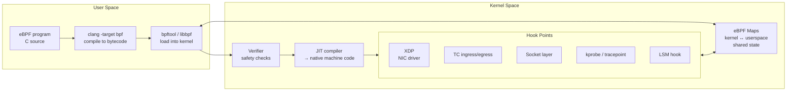
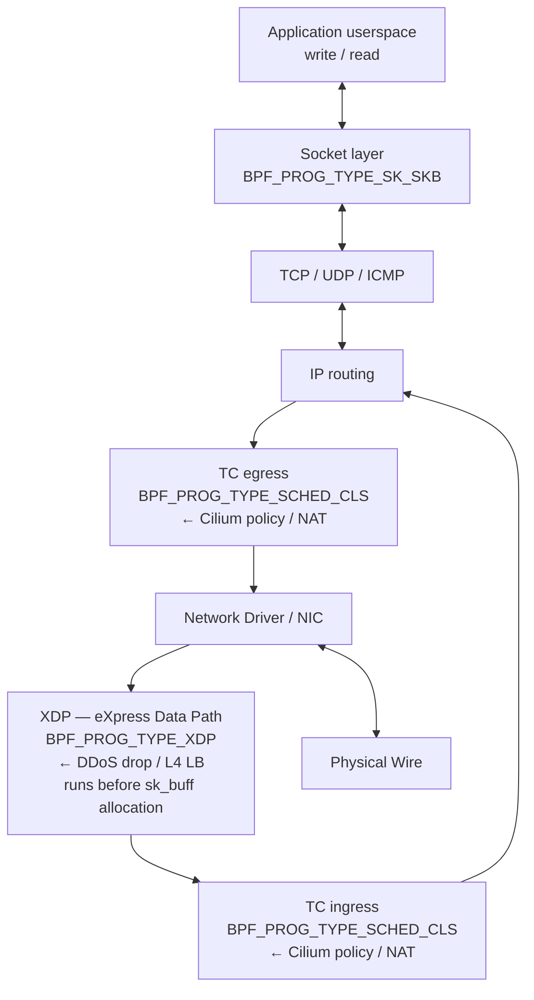
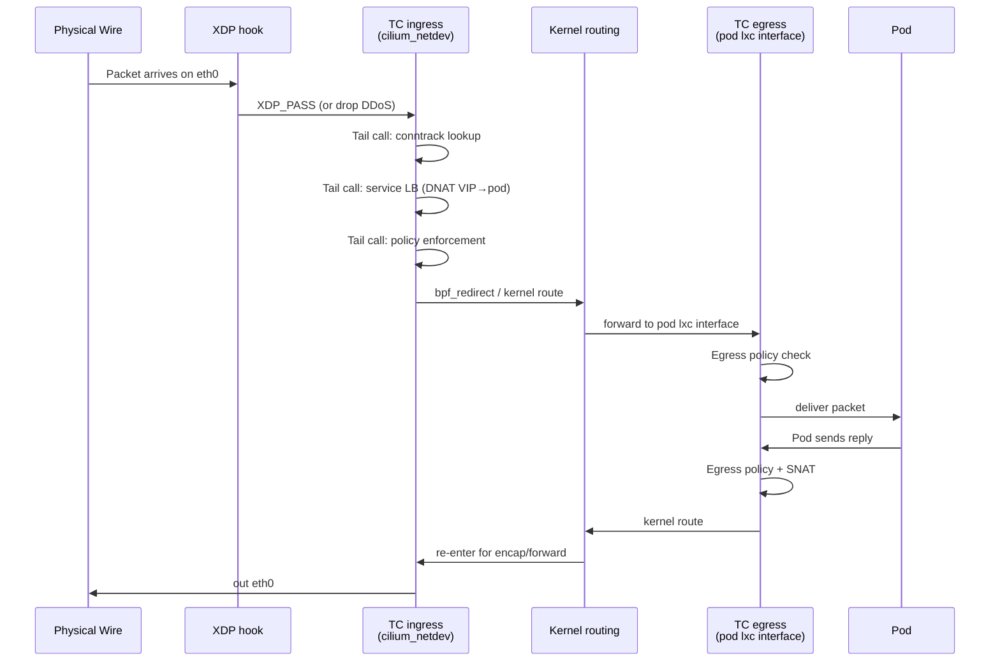

# Lesson 10 — eBPF and XDP in Kubernetes Networking

> **Track:** Network Foundation — Bare Metal & Cloud
> **Prereqs:** [Lesson 09 — CNI Specification](09-cni-specification.md), [Lesson 03 — iptables](03-iptables-and-netfilter.md)
> **Time:** ~2.5 hours

> **Goal:** Attach an XDP program to drop traffic and inspect Cilium's TC eBPF programs with bpftool so you understand how eBPF replaces iptables for Kubernetes network policy and service load balancing.

---

## Practice Setup

```bash
# Terminal 1 — minikube node
minikube ssh
uname -r                          # kernel version (5.4+ needed, 5.10+ recommended)
bpftool version 2>/dev/null || echo "bpftool not installed"
mount | grep bpf                  # BPF filesystem must be mounted

# Terminal 2 — kubectl (Mac)
kubectl get pods -n kube-system | grep cilium   # if using Cilium
```

> **See also:** [Lesson 03 — iptables](03-iptables-and-netfilter.md) for the legacy network stack that eBPF/Cilium replaces. [Lesson 09 — CNI Specification](09-cni-specification.md) for how the CNI ADD call loads eBPF programs onto new pod interfaces.

---

## 1. What eBPF Is

eBPF (extended Berkeley Packet Filter) is a sandboxed virtual machine in the Linux kernel. You write programs in a restricted C-like language, compile them to eBPF bytecode, and attach them to kernel hook points. The kernel verifier checks programs for safety before loading.



---

## 2. eBPF Hook Points

### Hook Positions on the Linux Network Stack



| Hook | Location | Program Type | Use in Kubernetes |
|------|----------|-------------|-----------------|
| XDP | NIC/driver receive path | `BPF_PROG_TYPE_XDP` | DDoS filter, L4 LB, fast packet drop |
| TC ingress | Before IP routing | `BPF_PROG_TYPE_SCHED_CLS` | Cilium network policy, service DNAT |
| TC egress | After IP routing | `BPF_PROG_TYPE_SCHED_CLS` | Cilium egress policy, source NAT |
| Socket | L4 socket layer | `BPF_PROG_TYPE_SK_SKB` | Cilium socket-level LB (bypass stack) |
| kprobe/tracepoint | Kernel function entry | `BPF_PROG_TYPE_KPROBE` | Tetragon security events, debugging |
| LSM | Linux Security Module | `BPF_PROG_TYPE_LSM` | Tetragon/Falco security enforcement |

---

## 3. XDP — eXpress Data Path

XDP runs before the kernel allocates an `sk_buff`. Fastest possible hook.

```c
// Simple XDP program: drop all ICMP
#include <linux/bpf.h>
#include <linux/if_ether.h>
#include <linux/ip.h>
#include <linux/icmp.h>
#include <bpf/bpf_helpers.h>

SEC("xdp")
int xdp_drop_icmp(struct xdp_md *ctx) {
    void *data = (void *)(long)ctx->data;
    void *data_end = (void *)(long)ctx->data_end;

    struct ethhdr *eth = data;
    if ((void *)(eth + 1) > data_end) return XDP_PASS;
    if (eth->h_proto != htons(ETH_P_IP)) return XDP_PASS;

    struct iphdr *ip = (void *)(eth + 1);
    if ((void *)(ip + 1) > data_end) return XDP_PASS;
    if (ip->protocol == IPPROTO_ICMP) return XDP_DROP;

    return XDP_PASS;
}

char LICENSE[] SEC("license") = "GPL";
```

```bash
# Compile with clang
clang -O2 -target bpf -c xdp_drop_icmp.c -o xdp_drop_icmp.o

# Attach to interface
ip link set dev eth0 xdp obj xdp_drop_icmp.o sec xdp

# Verify attachment
ip link show eth0 | grep xdp                     # → prog/xdp id <N> ...
bpftool net show dev eth0

# Test: ping from another node should now be dropped
ping -c3 <this-node-ip>                          # → 100% packet loss

# Detach
ip link set dev eth0 xdp off
```

### XDP Return Codes

| Return Code | Numeric | Action | Performance |
|-------------|---------|--------|-------------|
| `XDP_DROP` | 1 | Discard packet immediately | Fastest — no sk_buff allocated |
| `XDP_PASS` | 2 | Continue to normal network stack | Normal path |
| `XDP_TX` | 3 | Transmit packet back out same NIC | Hardware loop |
| `XDP_REDIRECT` | 4 | Redirect to another NIC or CPU | Used for L4 LB |
| `XDP_ABORTED` | 0 | Program error (like DROP + trace) | Debugging only |

### XDP Modes

| Mode | Where it runs | Requires | Performance |
|------|--------------|----------|-------------|
| Native XDP | NIC driver (before DMA) | Driver support | Highest (~25 Mpps) |
| Generic XDP | Software (after sk_buff alloc) | Linux 4.12+ | Lower; universal fallback |
| Offloaded XDP | SmartNIC hardware | SmartNIC support | Extreme (~100 Mpps) |

---

## 4. TC Hook Programs

TC (Traffic Control) hooks run after sk_buff allocation, allowing full packet manipulation.

```c
// TC egress: add a custom header
SEC("tc")
int tc_egress(struct __sk_buff *skb) {
    // Read packet data
    void *data = (void *)(long)skb->data;
    void *data_end = (void *)(long)skb->data_end;
    // ... packet manipulation
    return TC_ACT_OK;
}
```

```bash
# Attach TC eBPF program
tc qdisc add dev eth0 clsact
tc filter add dev eth0 egress bpf da obj tc_prog.o sec tc

# View TC filters
tc filter show dev eth0 egress
tc filter show dev eth0 ingress

# Cilium uses TC for all its per-pod programs
# View Cilium TC programs:
bpftool net show | grep cilium

# See programs on a specific pod interface
bpftool net show dev lxc1234abcd
```

| TC Return Code | Value | Action |
|---------------|-------|--------|
| `TC_ACT_OK` | 0 | Continue processing |
| `TC_ACT_SHOT` | 2 | Drop packet |
| `TC_ACT_REDIRECT` | 7 | Redirect to another interface |
| `TC_ACT_PIPE` | 3 | Pass to next filter in chain |

---

## 5. eBPF Maps

Maps are key-value stores shared between kernel eBPF programs and userspace.

```c
// Define a map in eBPF program
struct {
    __uint(type, BPF_MAP_TYPE_HASH);
    __uint(max_entries, 10000);
    __type(key, __u32);    // IP address
    __type(value, __u64);  // packet counter
} ip_counts SEC(".maps");
```

```bash
# List all eBPF maps
bpftool map list

# Inspect a map's contents
bpftool map dump id <map-id>

# Update a map entry
bpftool map update id <map-id> key hex 0a f4 00 06 value hex 00 01

# Cilium maps
cilium bpf map list
# Examples:
# cilium_lxc          — per-pod info (IP, MAC, endpoint ID)
# cilium_policy       — compiled policy rules
# cilium_lb4_services — service VIP → backend mapping
# cilium_ct_tcp4      — connection tracking
# cilium_nat          — NAT table

# View Cilium LB service map
cilium bpf lb list
```

### Common eBPF Map Types

| Map Type | Lookup | Use Case |
|----------|--------|----------|
| `BPF_MAP_TYPE_HASH` | O(1) hash | IP/port lookup tables, conntrack |
| `BPF_MAP_TYPE_ARRAY` | O(1) index | Per-CPU stats, config flags |
| `BPF_MAP_TYPE_LRU_HASH` | O(1) hash | Conntrack with auto-eviction |
| `BPF_MAP_TYPE_PERF_EVENT_ARRAY` | n/a | Stream events to userspace |
| `BPF_MAP_TYPE_RINGBUF` | n/a | High-throughput event streaming |
| `BPF_MAP_TYPE_LPM_TRIE` | Longest prefix | CIDR/routing lookups |
| `BPF_MAP_TYPE_PROG_ARRAY` | Index | Tail calls (program chaining) |

---

## 6. eBPF in Cilium — The Full Picture



```bash
# View all Cilium eBPF programs loaded
bpftool prog list | grep -i cilium | wc -l
# Expect hundreds of programs on a node with many pods

# View program attached to a specific interface
bpftool net show dev lxc1234abcd

# Dump Cilium service table
cilium bpf lb list

# Dump conntrack table
cilium bpf ct list global

# View per-endpoint policy
cilium endpoint list
cilium endpoint get <id>
```

---

## 7. Tetragon — eBPF Security

Tetragon enforces security policies at the kernel level using LSM and kprobes.

```bash
# Install Tetragon
helm repo add cilium https://helm.cilium.io/
helm install tetragon cilium/tetragon \
  --namespace kube-system

# Watch all process executions
kubectl exec -n kube-system ds/tetragon -- \
  tetra getevents -o compact | grep exec

# Watch network connections
kubectl exec -n kube-system ds/tetragon -- \
  tetra getevents -o compact | grep connect
```

```yaml
# TracingPolicy — alert on suspicious syscalls
apiVersion: cilium.io/v1alpha1
kind: TracingPolicy
metadata:
  name: detect-exec
spec:
  kprobes:
    - call: "sys_execve"
      syscall: true
      args:
        - index: 0
          type: "string"
      selectors:
        - matchArgs:
            - index: 0
              operator: "Equal"
              values:
                - "/bin/bash"
                - "/bin/sh"
          matchActions:
            - action: Sigkill   # kill the process
```

---

## 8. bpftool — Essential Debug Tool

```bash
# List all loaded programs
bpftool prog list

# Show program details (type, ID, name)
bpftool prog show id <id>

# Dump eBPF bytecode (before JIT)
bpftool prog dump xlated id <id>

# Dump JIT-compiled machine code
bpftool prog dump jited id <id>

# Profile eBPF program performance
bpftool prog profile id <id> duration 5

# List all maps
bpftool map list

# Dump a map's contents
bpftool map dump id <map-id>

# Update a map entry
bpftool map update id <map-id> key hex 0a f4 00 06 value hex 00 01

# View eBPF programs on network interfaces
bpftool net list

# Check all kernel BPF feature support
bpftool feature probe

# Pin a program to BPF filesystem for persistence
bpftool prog pin id <id> /sys/fs/bpf/my_prog
```

---

## 9. eBPF Kernel Requirements

```bash
# Check kernel version (5.4+ recommended, 5.10+ for all Cilium features)
uname -r

# Check eBPF feature support
bpftool feature probe

# Check BPF filesystem is mounted
mount | grep bpf
# bpf on /sys/fs/bpf type bpf       # → must show this

# Mount if missing
mount -t bpf bpf /sys/fs/bpf

# Check for required kernel config
grep -E "CONFIG_BPF|CONFIG_XDP|CONFIG_NET_CLS_BPF" /boot/config-$(uname -r)
# → all should show =y or =m
```

| Feature | Min Kernel | Notes |
|---------|-----------|-------|
| XDP (generic) | 4.12 | Software XDP, any NIC |
| XDP (native) | 4.8 + driver support | Requires NIC driver support |
| TC eBPF | 4.1 | `clsact` qdisc + classifier |
| BPF verifier maps | 4.6 | Per-socket maps, LPM trie |
| BTF (CO-RE) | 5.2 | Portable eBPF across kernel versions |
| LSM hooks | 5.7 | Security enforcement (Tetragon) |
| Cilium full features | 5.10 | Recommended for production |

---

## Troubleshooting

| Symptom | Likely Cause | Diagnostic Command | Fix |
|---------|-------------|-------------------|-----|
| `bpf: Operation not permitted` | BPF filesystem not mounted or missing `CAP_BPF` | `mount \| grep bpf` | `mount -t bpf bpf /sys/fs/bpf` |
| XDP program fails to load | Verifier rejected program (out-of-bounds access) | `bpftool prog load ... 2>&1` | Add bounds checks before every pointer dereference |
| XDP attach fails: `EINVAL` | NIC driver does not support native XDP | `ip link set dev eth0 xdpgeneric ...` | Use generic XDP mode (`xdpgeneric` instead of `xdp`) |
| Cilium pods crash on startup | Kernel too old (missing required features) | `uname -r` | Upgrade to kernel 5.10+ |
| `cilium bpf lb list` shows no entries | Cilium kube-proxy replacement not enabled | `cilium status \| grep KubeProxyReplacement` | Set `--kube-proxy-replacement=strict` in Cilium config |
| eBPF map full (`E2BIG`) | `max_entries` too small for traffic volume | `bpftool map show id <id>` | Increase `max_entries` and reload program |
| Tetragon not capturing events | TracingPolicy not applied or kprobe unavailable | `kubectl get tracingpolicy` | Check kernel symbol exists: `grep sys_execve /proc/kallsyms` |

---

## Production Checklist

- [ ] Kernel version 5.10 or higher on all nodes before deploying Cilium or XDP workloads
- [ ] BPF filesystem mounted at `/sys/fs/bpf` and persisted across reboots (via `/etc/fstab` or systemd unit)
- [ ] `bpftool feature probe` run on representative node to verify all required BPF map types are available
- [ ] Cilium `kube-proxy-replacement: strict` enabled to fully disable kube-proxy iptables chains
- [ ] eBPF map `max_entries` sized for peak concurrency (service count, connection count, pod count)
- [ ] Tetragon TracingPolicies reviewed and tested in audit mode before enabling `Sigkill` actions
- [ ] Node-level `ulimit -l` (locked memory) raised to accommodate all pinned eBPF maps

---

## Common Anti-Patterns

| What people do | Why it breaks | Correct approach |
|----------------|--------------|-----------------|
| Run Cilium on kernel 4.x | Missing LSM hooks, BTF, and map types; Cilium falls back to iptables silently | Enforce minimum kernel 5.10 in node provisioning; check with `uname -r` |
| Use XDP with virtual NICs (virtio, e1000) | Generic XDP runs but software overhead negates performance benefit | Use native XDP only on physical NICs with driver support; verify with `bpftool net show` |
| Load eBPF programs without verifier bounds checks | Kernel rejects program at load time with cryptic verifier error | Always check `data + sizeof(header) > data_end` before dereferencing |
| Mix Cilium and kube-proxy | Duplicate NAT rules cause connection tracking conflicts | Set `--kube-proxy-replacement=strict` and remove kube-proxy DaemonSet |
| Ignore `max_entries` defaults | Hash map silently drops entries when full (`E2BIG` returned to program) | Instrument maps with perf counters; size to 2x peak concurrency |

---

## Quick Reference

| Use Case | Command |
|----------|---------|
| List all loaded eBPF programs | `bpftool prog list` |
| List eBPF programs on interfaces | `bpftool net list` |
| Attach XDP program | `ip link set dev eth0 xdp obj prog.o sec xdp` |
| Detach XDP program | `ip link set dev eth0 xdp off` |
| Attach TC program (ingress) | `tc filter add dev eth0 ingress bpf da obj prog.o sec tc` |
| View TC filters | `tc filter show dev eth0 ingress` |
| List all eBPF maps | `bpftool map list` |
| Dump map contents | `bpftool map dump id <id>` |
| Probe kernel BPF features | `bpftool feature probe` |
| List Cilium BPF programs | `cilium bpf map list` |
| View Cilium service LB table | `cilium bpf lb list` |
| Watch Tetragon exec events | `kubectl exec -n kube-system ds/tetragon -- tetra getevents -o compact \| grep exec` |

---

## Summary

| Technology | Use Case in Kubernetes |
|-----------|----------------------|
| XDP | DDoS mitigation, fast packet drop, L4 LB offload before sk_buff allocation |
| TC hook (ingress/egress) | Cilium network policy, service DNAT, conntrack — full packet access |
| Socket hook | Socket-level LB — bypass loopback for intra-node pod-to-service traffic |
| eBPF maps | Shared state between programs: service tables, policy rules, conntrack, NAT |
| Tetragon | Security: exec/connect enforcement at kernel level, audit logging |
| bpftool | Inspect programs, dump maps, profile performance, verify attachments |
| JIT compiler | Converts eBPF bytecode to native machine code for near-native performance |

---

## Online Resources

| Resource | Cost | What you practice |
|----------|------|-------------------|
| [ebpf.io Interactive Lab](https://ebpf.io/labs/) | Free | Write and load a real eBPF program in your browser — no kernel setup; based on the `opensnoop` example |
| [xdp-project: XDP Tutorial](https://github.com/xdp-project/xdp-tutorial) | Free (runs locally) | Step-by-step labs writing XDP programs in C with automated test environments; covers every XDP return code from this lesson |
| [iximiuz: eBPF Beginner Challenge](https://labs.iximiuz.com/challenges/ebpf-beginner-challenge-89ffd924) | Free | Debug eBPF programs, explore `bpftool`, test BPF maps — interactive with auto-verification |
| [Isovalent: Build an eBPF Monitoring Tool for Kubernetes](https://isovalent.com/labs/ebpf-monitoring-tool-for-kubernetes/) | Free | Write a production-ready HTTP monitor using eBPF and Go inside a real Kubernetes cluster |
| [Brendan Gregg — BPF & bpftrace Tutorials](https://www.brendangregg.com/BPF/bpftrace-cheatsheet.html) | Free | The original BPF one-liners reference; use with `bpftool` commands from this lesson |

---

**Next:** [Lesson 11 — Calico CNI Deep Dive](11-calico-cni-deep-dive.md)
