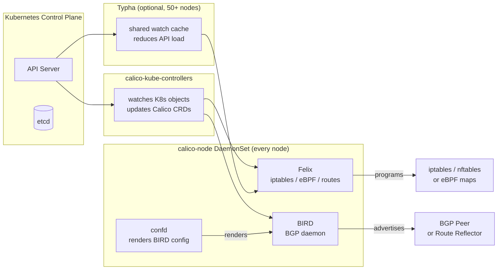
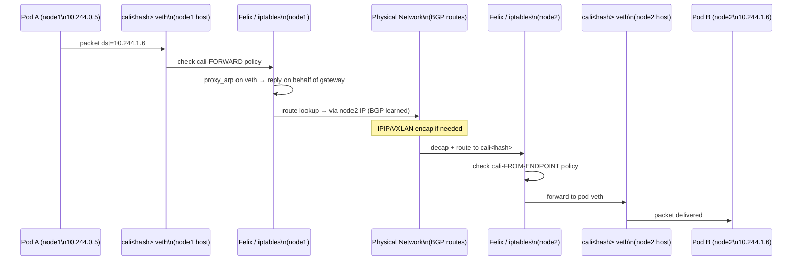

# Lesson 11 — Calico CNI Deep Dive

> **Track:** Network Foundation — Bare Metal & Cloud · **Prereqs:** [Lesson 06 — BGP](06-bgp-fundamentals.md), [Lesson 09 — CNI Specification](09-cni-specification.md) · **Time:** ~3 hours

> **Goal:** Configure Calico IP pools and BGP peering, enforce GlobalNetworkPolicy, and diagnose Felix/BIRD failures on a production node.

---

## Practice Setup

```bash
# Terminal 1 — minikube Linux node
minikube ssh
sudo calicoctl node status 2>/dev/null || echo "calicoctl not in PATH"
ip route show | grep -E "cali|bird|blackhole"
ip link show | grep cali

# Terminal 2 — Mac (kubectl + calicoctl)
kubectl get pods -n calico-system -o wide
kubectl get felixconfiguration default -o yaml 2>/dev/null
kubectl get ipamblocks 2>/dev/null | head -10
kubectl get ippool -o yaml
```

---

## 1. Architecture



> **See also:** [Lesson 06 — BGP Fundamentals](06-bgp-fundamentals.md) for BGP peer configuration concepts used by BIRD.

---

## 2. Packet Flow: Pod-to-Pod Cross-Node



---

## 3. Data Plane Modes

### Native Routing (BGP, no overlay)
Best performance. Requires L2 adjacency or BGP-capable switches.
```yaml
spec:
  calicoNetwork:
    ipPools:
      - encapsulation: None
        bgp: Enabled
```

### IPIP (IP-in-IP)
20-byte overhead. Lower than VXLAN.
```yaml
encapsulation: IPIP               # all traffic
encapsulation: IPIPCrossSubnet    # only cross-subnet traffic
```

### VXLAN
50-byte overhead. UDP encapsulation; works where IPIP is blocked.
```yaml
encapsulation: VXLAN
encapsulation: VXLANCrossSubnet
```

### eBPF Dataplane
Replaces kube-proxy and iptables entirely with eBPF programs.
```yaml
apiVersion: operator.tigera.io/v1
kind: Installation
spec:
  calicoNetwork:
    linuxDataplane: BPF
```

### Dataplane Mode Comparison

| Mode | Overhead | kube-proxy needed | Requires BGP switch | Best for |
|------|----------|-------------------|---------------------|----------|
| Native BGP | None | Yes | Yes | Bare metal, AWS with VPC BGP |
| IPIP | 20 bytes | Yes | No | On-prem, same-subnet nodes |
| VXLANCrossSubnet | 50 bytes cross-subnet | Yes | No | Mixed cloud/on-prem |
| eBPF | None | No (replaced) | No | Performance-critical |

---

## 4. Installation

```bash
# Install Calico via Tigera Operator (recommended)
kubectl create -f https://raw.githubusercontent.com/projectcalico/calico/v3.28.0/manifests/tigera-operator.yaml

kubectl apply -f - <<EOF
apiVersion: operator.tigera.io/v1
kind: Installation
metadata:
  name: default
spec:
  calicoNetwork:
    ipPools:
      - blockSize: 26
        cidr: 10.244.0.0/16
        encapsulation: VXLANCrossSubnet
        natOutgoing: Enabled
        nodeSelector: all()
EOF

# Verify operator is healthy
kubectl get tigerastatus
```

---

## 5. Felix — The Policy Engine

Felix is the per-node agent that programs the dataplane.

```bash
# Check Felix liveness probe (port 9099)
kubectl exec -n calico-system calico-node-xxxxx -- calico-node -felix-live
kubectl logs -n calico-system calico-node-xxxxx -c calico-node | grep felix

# Felix diagnostic snapshot (saves to /tmp)
kubectl exec -n calico-system calico-node-xxxxx -- calico-node -diags

# View Felix configuration
kubectl get felixconfigurations default -o yaml

# See iptables chains Felix has programmed
iptables -t filter -L cali-FORWARD -n -v        # forwarding policy
iptables -t nat -L cali-nat-outgoing -n -v      # masquerade rules
iptables -t filter -L cali-to-wl-dispatch -n    # workload dispatch chain
```

### Felix Key Configuration Parameters

| Parameter | Default | Effect | When to change |
|-----------|---------|--------|----------------|
| `logSeverityScreen` | `Info` | Log verbosity | Set `Debug` for troubleshooting; revert after |
| `iptablesRefreshInterval` | `90s` | How often Felix checks/repairs iptables | Lower if external tools modify iptables |
| `bpfEnabled` | `false` | Enable eBPF dataplane | Requires Linux 5.3+; set via Installation CRD |
| `wireguardEnabled` | `false` | Node-to-node WireGuard encryption | Enable for encrypted native routing |
| `healthPort` | `9099` | Felix HTTP health probe port | Change if port conflicts |
| `endpointReportingEnabled` | `true` | Felix reports workload endpoint status | Disable only if Typha is overloaded |

---

## 6. Pod Interface Naming

```bash
# Each pod gets a veth pair:
#   Host side: cali<hash>  (e.g., cali9abc1234)
#   Pod side:  eth0

# View all Calico interfaces on a node
ip link show | grep cali

# Calico uses proxy ARP on the host veth — pods use a /32 address
cat /proc/sys/net/ipv4/conf/cali9abc1234/proxy_arp
# 1

# Each pod gets a /32 host route on the node
ip route show | grep cali
# 10.244.0.6 dev cali9abc1234 scope link

# Map interface back to pod
ip link show cali9abc1234     # note index
# then: cat /sys/class/net/cali9abc1234/iflink
```

---

## 7. IP Pools and IPAM

Calico divides each IPPool into /26 blocks (default) assigned per node.

```bash
# View IP pools
calicoctl get ippool -o wide
kubectl get ippool -o yaml

# View IPAM blocks (how the pool is divided per node)
calicoctl ipam show --show-blocks
# +----------+-------------------+----------+----------+
# | GROUPING |       CIDR        | IPS USED | IPS FREE |
# +----------+-------------------+----------+----------+
# | IP Pool  | 10.244.0.0/16    |       48 |    65488 |
# | Block    | 10.244.0.0/26    |       16 |       48 |

# Which pod owns which IP?
calicoctl ipam show --ip 10.244.0.6

# Release a leaked IP (after pod deletion without cleanup)
calicoctl ipam release --ip=10.244.0.6

# View all allocations per node
calicoctl ipam show --show-borrowed
```

---

## 8. NetworkPolicy with Calico

Calico implements Kubernetes NetworkPolicy and also provides its own richer CRDs.

### Kubernetes NetworkPolicy
```yaml
apiVersion: networking.k8s.io/v1
kind: NetworkPolicy
metadata:
  name: web-allow-ingress
  namespace: default
spec:
  podSelector:
    matchLabels:
      app: web
  policyTypes:
    - Ingress
    - Egress
  ingress:
    - from:
        - podSelector:
            matchLabels:
              role: frontend
      ports:
        - protocol: TCP
          port: 80
  egress:
    - to:
        - namespaceSelector:
            matchLabels:
              kubernetes.io/metadata.name: kube-system
      ports:
        - protocol: UDP
          port: 53
```

### Calico GlobalNetworkPolicy (cluster-wide)
```yaml
apiVersion: projectcalico.org/v3
kind: GlobalNetworkPolicy
metadata:
  name: default-deny-all
spec:
  selector: all()
  types:
    - Ingress
    - Egress
  egress:
    - action: Allow
      protocol: UDP
      destination:
        ports: [53]        # DNS always allowed
```

### Calico NetworkSet (IP ranges in policy)
```yaml
apiVersion: projectcalico.org/v3
kind: GlobalNetworkSet
metadata:
  name: trusted-cidr
  labels:
    env: trusted
spec:
  nets:
    - 10.100.0.0/16
    - 192.168.50.0/24
---
apiVersion: projectcalico.org/v3
kind: GlobalNetworkPolicy
metadata:
  name: allow-trusted
spec:
  selector: all()
  ingress:
    - action: Allow
      source:
        selector: env == "trusted"
```

---

## 9. BGP Configuration

```bash
# View BGP status
calicoctl node status

# BGP peers
kubectl get bgppeers -o yaml

# Configure full mesh (default for small clusters)
kubectl apply -f - <<EOF
apiVersion: projectcalico.org/v3
kind: BGPConfiguration
metadata:
  name: default
spec:
  logSeverityScreen: Info
  nodeToNodeMeshEnabled: true
  asNumber: 64512
EOF

# Configure Route Reflector (recommended for 50+ nodes)
kubectl annotate node rr-node-01 \
  projectcalico.org/RouteReflectorClusterID=244.0.0.1

kubectl apply -f - <<EOF
apiVersion: projectcalico.org/v3
kind: BGPPeer
metadata:
  name: peer-with-rr
spec:
  nodeSelector: "!has(projectcalico.org/RouteReflectorClusterID)"
  peerSelector: "has(projectcalico.org/RouteReflectorClusterID)"
EOF

# Check BIRD routing tables (BGP learned routes)
kubectl exec -n calico-system calico-node-xxxxx -- birdcl show protocols
kubectl exec -n calico-system calico-node-xxxxx -- birdcl show route
```

---

## 10. Calico on Cloud Providers

### AWS EKS
```bash
# Install Calico for policy only (use AWS VPC CNI for networking)
kubectl apply -f https://raw.githubusercontent.com/aws/amazon-vpc-cni-k8s/master/config/master/calico-operator.yaml
```

### GKE
```bash
# Calico NetworkPolicy on GKE requires enabling at cluster creation
gcloud container clusters create ... --network-policy
```

### AKS
```bash
# Enable Calico NetworkPolicy on AKS
az aks create --network-policy calico --network-plugin azure ...
```

---

## Troubleshooting

| Symptom | Likely Cause | Diagnostic Command | Fix |
|---------|-------------|-------------------|-----|
| Pods can't reach each other cross-node | BIRD not advertising routes | `calicoctl node status` | Check BGP peer state; verify AS numbers match |
| `BIRD: Neighbor down` in logs | MTU mismatch or firewall blocking BGP (TCP 179) | `kubectl exec calico-node-xxx -- birdcl show protocols` | Open TCP 179 between nodes; fix MTU |
| NetworkPolicy not enforced | Felix not synced (`felixsyncState != InSync`) | `kubectl logs calico-node-xxx \| grep Sync` | Restart calico-node pod; check API connectivity |
| Pod IP address leaked after pod deletion | IPAM release failed | `calicoctl ipam show --show-blocks` | `calicoctl ipam release --ip=<ip>` |
| `iptables: No chain/target/match by that name` | Felix iptables modules not loaded | `iptables -t filter -L cali-FORWARD` | Load `xt_set`, `xt_mark`, `xt_rpfilter` modules |
| Felix health check failing (port 9099) | Felix crash loop | `kubectl describe pod calico-node-xxx` | Check kernel version (need 3.10+); check Typha connectivity |
| Calico eBPF mode: service IP not reachable | kube-proxy still running in parallel | `kubectl get cm -n kube-system kube-proxy -o yaml \| grep mode` | Remove kube-proxy DaemonSet when using eBPF mode |

---

## Production Checklist

- [ ] Use Typha when cluster has 50+ nodes (`spec.typhaDeployment.replicas >= 2`)
- [ ] Switch from node-to-node BGP mesh to route reflectors at 10+ nodes
- [ ] Set IPAM block size (`blockSize: 26`) to match expected pod density per node
- [ ] Enable WireGuard node-to-node encryption if the network is untrusted (`felixconfiguration: wireguardEnabled=true`)
- [ ] Configure GlobalNetworkPolicy default-deny before enabling Calico in production
- [ ] Set Felix log level back to `Info` after debugging (default); `Debug` generates GB/day
- [ ] Monitor IPAM block utilization; alert when a pool is >80% allocated

---

## Common Anti-Patterns

| What people do | Why it breaks | Correct approach |
|---------------|--------------|-----------------|
| Leave `nodeToNodeMeshEnabled: true` on 100-node cluster | O(N²) BGP sessions; each node peers with every other — unstable at scale | Deploy route reflectors, disable mesh |
| Set `blockSize: 24` (256 IPs/block) on small nodes | Reserves too many IPs per node; starves other nodes | Use `/26` (64 IPs) or `/27` (32 IPs) matched to max pods per node |
| Deploy GlobalNetworkPolicy `default-deny` without testing DNS egress | All pods lose DNS; app appears broken | Always add an egress rule allowing UDP 53 to kube-system namespace before applying default-deny |
| Run Felix in `Debug` log level permanently | Disk exhaustion and performance degradation | Use `Info` in production; switch to `Debug` briefly during incident |
| Skip `calicoctl ipam release` after pod disruption | IPAM blocks fill up; new pods cannot get IPs | Automate periodic `calicoctl ipam show` and alert on leaked IPs |

---

## Quick Reference

| Use Case | Command |
|---------|---------|
| Check overall Calico health | `kubectl get tigerastatus` |
| Felix sync state | `calicoctl node status` |
| BGP peer status | `kubectl exec calico-node-xxx -- birdcl show protocols` |
| List IPAM blocks per node | `calicoctl ipam show --show-blocks` |
| Find which pod owns an IP | `calicoctl ipam show --ip 10.244.0.6` |
| Release a leaked IP | `calicoctl ipam release --ip=10.244.0.6` |
| View all workload endpoints | `calicoctl get workloadendpoint -A` |
| View Felix iptables chains | `iptables -t filter -L cali-FORWARD -n -v` |
| Increase Felix log level | `kubectl patch felixconfiguration default --type merge -p '{"spec":{"logSeverityScreen":"Debug"}}'` |
| View BGP-learned routes | `kubectl exec calico-node-xxx -- birdcl show route` |
| Inspect pod's policy | `calicoctl get workloadendpoint -n default <pod> -o yaml` |
| Check wireguard encryption | `wg show` (inside calico-node pod with hostPID) |

---

## Summary

| Component | Role |
|-----------|------|
| Felix | Per-node agent: programs routes, iptables/eBPF, NetworkPolicy |
| BIRD | BGP daemon: advertises pod routes to peers |
| Typha | Scales Felix by providing a shared watch cache (needed at 50+ nodes) |
| calico-ipam | IP address management with per-node IPAM blocks (/26 default) |
| Tigera Operator | Installs and manages Calico components |
| GlobalNetworkPolicy | Cluster-wide policy (richer than K8s NetworkPolicy) |
| eBPF dataplane | Replaces kube-proxy; better performance, no iptables |

---

## Check Your Understanding

1. **[Concept question]** What is Calico's default IPAM block size, and why does setting an overly large block size (e.g., `/24`) cause IP address starvation across a cluster with many small nodes?

   <details><summary>Answer</summary>

   The default Calico IPAM block size is `/26`, which allocates 64 IP addresses per node. When a block is assigned to a node, all IPs in that block are reserved for that node — even if most are unused. With a `/24` block (256 IPs), a cluster where nodes run only 10–20 pods would waste 230+ IPs per node. A 100-node cluster with `/24` blocks needs a `/8` IP pool (16 million IPs) to avoid exhaustion. Using `/26` or `/27` blocks matched to the actual pods-per-node limit prevents IP starvation and allows more efficient pool utilization.

   </details>

2. **[Scenario question]** New pods cannot get IP addresses even though `calicoctl ipam show --show-blocks` shows blocks with available IPs. After investigation, you find that some IPs are allocated but have no corresponding running pods. How do you identify and release these leaked IPs?

   <details><summary>Answer</summary>

   Run `calicoctl ipam show --ip <ip>` for a suspected leaked IP — if it shows an allocation but the pod name no longer exists in Kubernetes, the IP has leaked. This happens when CNI DEL fails during pod deletion. Release the leaked IP with `calicoctl ipam release --ip=<ip>`. For bulk investigation, compare the allocated IPs in IPAM blocks against running pod IPs from `kubectl get pods -A -o wide`, or use `calicoctl ipam check` to automatically detect and optionally clean orphaned allocations.

   </details>

3. **[Practical question]** What command would you run to check the IPAM block allocation across all nodes in a Calico cluster and see how many IPs are used versus free per block?

   <details><summary>Answer</summary>

   ```bash
   calicoctl ipam show --show-blocks
   ```
   The output table shows each CIDR block, which node it is assigned to, the number of IPs used, and the number free. A block showing `IPS USED: 64, IPS FREE: 0` on a node is fully exhausted — new pods on that node will fail to get an IP until a new block is allocated or existing IPs are released.

   </details>

---

## Online Resources

| Resource | Cost | What you practice |
|----------|------|-------------------|
| [Killercoda Playground](https://killercoda.com/) | Free | Instant Kubernetes cluster with Calico; run `calicoctl node status`, `ip route show proto bird`, inspect `cali*` interfaces |
| [Isovalent: Foundations — Kubernetes Networking and Cilium](https://isovalent.com/labs/getting-started-with-kubernetes-networking-and-cilium/) | Free | Covers IPAM, CNI concepts, and pod networking — directly applicable to understanding Calico IPAM blocks |
| [Project Calico — Interactive Demos](https://www.tigera.io/learn/guides/kubernetes-networking/) | Free | Official Calico/Tigera learning resources including BGP and policy guides |

---

**Next:** [Lesson 12 — Cilium CNI and eBPF Dataplane](12-cilium-cni-ebpf.md)
