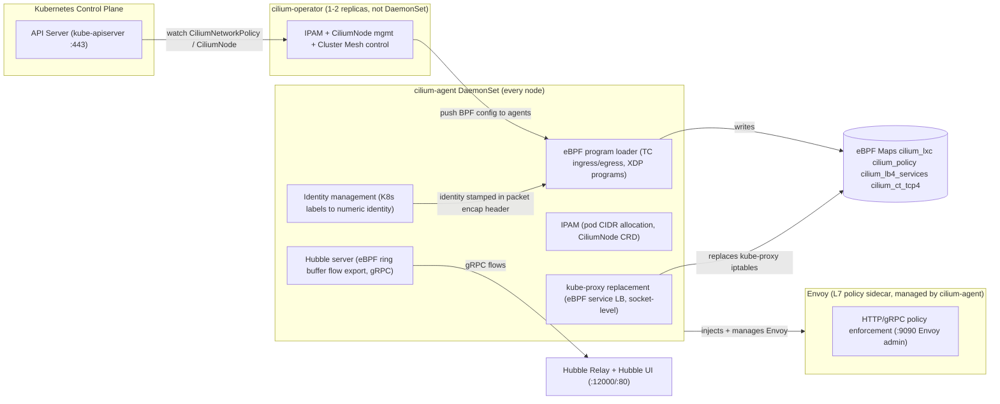
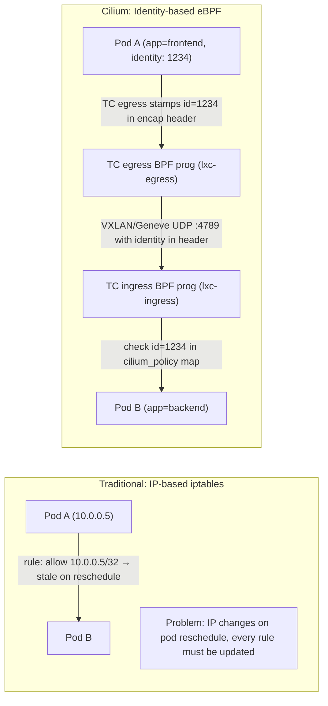
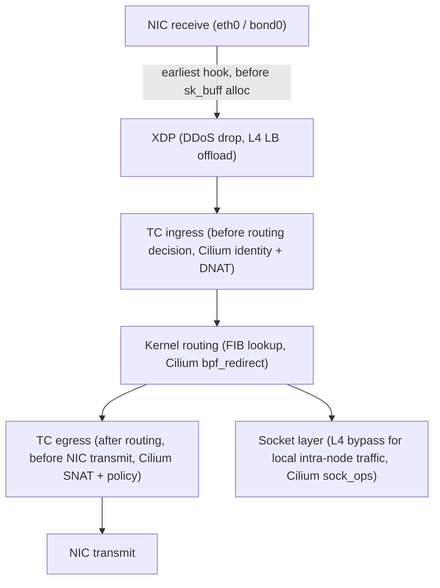
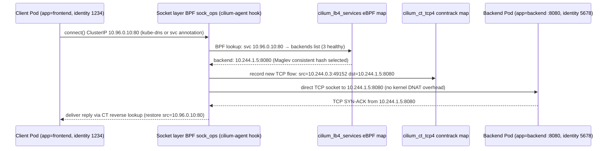

# Lesson 12 — Cilium CNI and eBPF Dataplane

> **Track:** Network Foundation — Bare Metal & Cloud · **Prereqs:** [Lesson 10 — eBPF and XDP](10-ebpf-xdp.md), [Lesson 09 — CNI Specification](09-cni-specification.md) · **Time:** ~3 hours

> **Goal:** Deploy Cilium with kube-proxy replacement, write L7 CiliumNetworkPolicy, and use Hubble to observe and debug live traffic flows.


**Jump to:** [Theory](#theory) · [Practice](#practice) · [Troubleshooting](#troubleshooting) · [Production Checklist](#production-checklist) · [Quick Reference](#quick-reference) · [Check Your Understanding](#check-your-understanding)

---

## Theory

## 1. Architecture



> **See also:** [Lesson 10 — eBPF and XDP](10-ebpf-xdp.md) for eBPF program types and BPF map internals referenced throughout this lesson.


---

## 2. Identity-Based Policy (vs IP-based)



Cilium assigns a **numeric identity** to every pod based on its labels. Policy is enforced per identity, not per IP — policy survives pod restarts.

```bash
# View endpoint identities
cilium endpoint list
# ENDPOINT  POLICY (ingress)  POLICY (egress)  IDENTITY  LABELS
# 1234      Enabled           Enabled          12345     app=web,env=prod

# View all identities in the cluster
cilium identity list

# What is identity 12345?
cilium identity get 12345
```

---

## 3. eBPF Hook Points



```bash
# View eBPF programs loaded by Cilium
bpftool prog list | grep cilium
cilium bpf prog list

# View eBPF maps (key-value stores shared between kernel and userspace)
cilium bpf map list
# Examples:
#   cilium_lxc          — per-pod identity and endpoint info
#   cilium_policy       — compiled policy rules
#   cilium_ct_tcp4      — connection tracking table
#   cilium_lb4_services — service load balancing table
#   cilium_nat          — NAT table

# View service LB rules in eBPF (kube-proxy replacement)
cilium service list
cilium bpf lb list
```

---

## 4. Installation

```bash
# Install Cilium with Helm
helm repo add cilium https://helm.cilium.io/
helm install cilium cilium/cilium \
  --namespace kube-system \
  --set kubeProxyReplacement=strict \
  --set k8sServiceHost=<API_SERVER_IP> \
  --set k8sServicePort=6443 \
  --set hubble.relay.enabled=true \
  --set hubble.ui.enabled=true

# Verify installation
cilium status --wait
cilium connectivity test   # end-to-end network tests (~5 min)
```

---

## 5. Networking Modes

### Tunnel (default — works everywhere)
```bash
# VXLAN tunnel (default)
cilium config view | grep tunnel
# tunnel-protocol: vxlan

# Switch to Geneve
helm upgrade cilium cilium/cilium --reuse-values \
  --set tunnel=geneve
```

### Native Routing (bare metal, cloud with routing support)
```bash
helm upgrade cilium cilium/cilium --reuse-values \
  --set tunnel=disabled \
  --set autoDirectNodeRoutes=true \
  --set ipv4NativeRoutingCIDR=10.244.0.0/16
```

### WireGuard Transparent Encryption
```bash
helm upgrade cilium cilium/cilium --reuse-values \
  --set encryption.enabled=true \
  --set encryption.type=wireguard

cilium encrypt status
```

---

## 6. CiliumNetworkPolicy (L3/L4/L7)

```yaml
# More expressive than standard NetworkPolicy
apiVersion: cilium.io/v2
kind: CiliumNetworkPolicy
metadata:
  name: web-policy
  namespace: default
spec:
  endpointSelector:
    matchLabels:
      app: web
  ingress:
    - fromEndpoints:
        - matchLabels:
            app: frontend
      toPorts:
        - ports:
            - port: "80"
              protocol: TCP
          rules:
            http:
              - method: "GET"
                path: "/api/.*"    # L7 HTTP rule (Envoy enforces)
  egress:
    - toFQDNs:
        - matchName: "api.example.com"   # FQDN-based policy
      toPorts:
        - ports:
            - port: "443"
              protocol: TCP
```

```yaml
# CiliumClusterwideNetworkPolicy (global, all namespaces)
apiVersion: cilium.io/v2
kind: CiliumClusterwideNetworkPolicy
metadata:
  name: default-deny
spec:
  endpointSelector: {}   # all pods
  ingress:
    - fromEntities:
        - cluster         # allow intra-cluster
  egress:
    - toEntities:
        - cluster
    - toFQDNs:
        - matchPattern: "*.amazonaws.com"
```

---

## 7. kube-proxy Replacement

Cilium implements Service load-balancing entirely in eBPF — no iptables, no kube-proxy process needed.



```bash
# Check if kube-proxy replacement is active
cilium status | grep KubeProxyReplacement
# KubeProxyReplacement: Strict

# View services handled by eBPF LB
cilium service list
# ID   Frontend               Service Type   Backend
# 1    10.96.0.1:443/TCP      ClusterIP      192.168.1.10:6443/TCP

# View backend set for a service
cilium bpf lb list | grep 10.96.0.1

# View NAT table (replaces conntrack for intra-cluster traffic)
cilium bpf nat list
```

---

## 8. Hubble — eBPF-Powered Observability

Hubble provides real-time flow visibility at the kernel level using eBPF ring buffers.

```bash
# Enable port-forward to Hubble relay
cilium hubble port-forward &

# Observe all flows in the cluster
hubble observe

# Filter by pod pair
hubble observe --from-pod default/frontend --to-pod default/backend

# Filter by policy verdict (dropped packets)
hubble observe --verdict DROPPED

# Filter by HTTP status
hubble observe --protocol http --http-status 500

# Output as JSON for processing
hubble observe -o json | jq '.flow | {src: .source.pod_name, dst: .destination.pod_name, verdict: .verdict}'

# Open Hubble UI
cilium hubble ui
```

---

## 9. Cluster Mesh

Connect multiple Kubernetes clusters so pods can communicate cross-cluster.

```bash
# Enable cluster mesh on cluster A
cilium clustermesh enable --service-type LoadBalancer
cilium clustermesh status

# Connect cluster A to cluster B
cilium clustermesh connect --context cluster-b

# Share a service across clusters
kubectl annotate svc my-service \
  service.cilium.io/global=true \
  service.cilium.io/shared=true
```

---

## 10. Cilium on Cloud Providers

```bash
# EKS — Cilium as CNI (replace aws-vpc-cni)
eksctl create cluster --config-file - <<EOF
apiVersion: eksctl.io/v1alpha5
kind: ClusterConfig
metadata:
  name: cilium-cluster
  region: us-east-1
addons:
  - name: vpc-cni
    # don't install — Cilium replaces it
EOF

# GKE — Dataplane v2 uses Cilium automatically
gcloud container clusters create ... \
  --dataplane-v2

# AKS — Cilium option
az aks create \
  --network-plugin azure \
  --network-plugin-mode overlay \
  --network-dataplane cilium
```

### Industry Applications

| Company / Project | Context | Technology from this lesson | Outcome |
|---|---|---|---|
| Google GKE Autopilot | Default CNI for all GKE Autopilot clusters since 2022; millions of pods per day | Cilium as CNI with Dataplane v2, identity-based policy, eBPF service LB replacing kube-proxy | Zero-maintenance pod networking at Google cloud scale; Hubble for mandatory audit logging of pod flows |
| Adobe Creative Cloud | Kubernetes platform serving 20M+ creative subscribers across on-prem and AWS | Cilium CNI with Hubble observability, CiliumNetworkPolicy for microservice isolation | Real-time flow visibility replaced expensive network TAPs; L7 HTTP policy without sidecar proxies |
| AWS EKS (Amazon.com) | Cilium available as an EKS add-on since 2023, used by customers replacing aws-vpc-cni | Cilium eBPF service LB (kube-proxy replacement), CiliumNetworkPolicy, Tetragon runtime security | 40% lower latency for intra-cluster service calls compared to iptables kube-proxy at high connection rates |
| Datadog | Runs 1M+ containers in production; migrated from Flannel + kube-proxy to Cilium | kube-proxy replacement with eBPF, Hubble for observability, identity-based policy replacing IP rules | 50% reduction in networking CPU overhead; policy rules survive pod restarts without IP-based rule updates |
| Hospital system (medtech) | HIPAA-regulated EHR platform running PHI workloads on Kubernetes; strict pod isolation required | CiliumNetworkPolicy for PHI namespace isolation; Hubble flow logs for compliance audit | A misconfigured allow rule opened the PHI namespace to all pods in the cluster; Hubble flow logs surfaced the exposure after 6 hours, enabling targeted remediation before external data left the cluster |

---

## Practice

### Environment Setup

```bash
# Terminal 1 — minikube Linux node
minikube ssh
sudo bpftool prog list | grep -i cil | head -10
ip link show | grep -E "cilium|lxc"

# Terminal 2 — Mac (kubectl + cilium CLI)
cilium status 2>/dev/null || echo "cilium CLI not installed: brew install cilium-cli"
kubectl get pods -n kube-system | grep -E "cilium|hubble"
hubble observe --last 10 2>/dev/null || echo "hubble not running"
```

### Hands-On Lab

```bash
# Step 1: Install Cilium with kube-proxy replacement
helm repo add cilium https://helm.cilium.io/
helm install cilium cilium/cilium \
  --namespace kube-system \
  --set kubeProxyReplacement=strict \
  --set k8sServiceHost=<API_SERVER_IP> \
  --set k8sServicePort=6443 \
  --set hubble.relay.enabled=true \
  --set hubble.ui.enabled=true

# Step 2: Wait for Cilium to be ready and run connectivity tests
cilium status --wait                                       # → All components OK
cilium connectivity test                                   # → all tests pass (~5 min)

# Step 3: Inspect eBPF programs and maps
bpftool prog list | grep cilium | wc -l                   # → ~2 programs per pod
cilium bpf map list                                        # → cilium_lxc, cilium_lb4_services, etc.
cilium bpf lb list                                         # → service VIP → backends

# Step 4: Verify identity-based policy
cilium endpoint list                                       # → identity per pod
cilium identity list                                       # → all identities in cluster
cilium policy trace --src-pod default/frontend --dst-pod default/backend --dport 80

# Step 5: Observe live flows with Hubble
cilium hubble port-forward &
hubble observe --verdict DROPPED                           # → see which flows are blocked
hubble observe --from-pod default/frontend --to-pod default/backend

# Step 6: Apply L7 HTTP policy and test enforcement
kubectl apply -f - <<EOF
apiVersion: cilium.io/v2
kind: CiliumNetworkPolicy
metadata:
  name: web-policy
  namespace: default
spec:
  endpointSelector:
    matchLabels:
      app: web
  ingress:
    - fromEndpoints:
        - matchLabels:
            app: frontend
      toPorts:
        - ports:
            - port: "80"
              protocol: TCP
          rules:
            http:
              - method: "GET"
                path: "/api/.*"
EOF
hubble observe --protocol http --verdict DROPPED           # → non-GET requests blocked
```

### Configuration Reference

#### Key Helm Parameters

| Parameter | Default | Effect | When to change |
|-----------|---------|--------|----------------|
| `kubeProxyReplacement` | `disabled` | eBPF service LB mode | Set `strict` to fully replace kube-proxy |
| `tunnel` | `vxlan` | Overlay protocol | Set `disabled` for native routing (needs BGP or same L2) |
| `autoDirectNodeRoutes` | `false` | Auto-add routes for same-L2 nodes | Enable with `tunnel=disabled` on bare metal |
| `hubble.relay.enabled` | `false` | Cross-node flow aggregation | Enable for multi-node Hubble visibility |
| `encryption.enabled` | `false` | WireGuard node-to-node encryption | Enable for untrusted networks |
| `loadBalancer.acceleration` | `disabled` | XDP-level service LB | Set `native` on supported NICs for best performance |
| `bpf.masquerade` | `false` | eBPF-based masquerade (replaces iptables MASQ) | Enable when kube-proxy is fully replaced |

---

## Troubleshooting

| Symptom | Likely Cause | Diagnostic Command | Fix |
|---------|-------------|-------------------|-----|
| `cilium status` shows agents not ready | Kernel version <4.9 or missing BPF filesystem | `cilium version; uname -r` | Upgrade kernel to 5.4+; mount bpffs: `mount bpffs /sys/fs/bpf -t bpf` |
| Policy not enforced — traffic passes that should be dropped | Policy not compiled or identity mismatch | `cilium policy trace --src-pod ns/pod-a --dst-pod ns/pod-b --dport 80` | Check endpoint selector label matches; re-apply policy |
| Services not reachable after enabling kube-proxy replacement | kube-proxy still running and conflicting | `cilium status \| grep KubeProxyReplacement` | Remove kube-proxy DaemonSet; ensure `kubeProxyReplacement=strict` |
| `hubble observe` shows no flows | Hubble relay not enabled | `cilium status \| grep Hubble` | Upgrade Cilium with `hubble.relay.enabled=true` |
| Intermittent connection drops between pods | conntrack table exhausted | `cilium metrics \| grep drop; cilium bpf ct list global \| wc -l` | Increase `bpf-ct-global-tcp-max` in Helm values |
| L7 HTTP policy not blocking requests | Envoy sidecar not injected | `kubectl logs cilium-pod -c cilium-envoy` | Check Envoy port 9090 is listening; verify CiliumNetworkPolicy has `http` rules |
| XDP acceleration not working | NIC driver not XDP-compatible | `cilium status \| grep XDP` | Use `loadBalancer.acceleration=disabled` or upgrade NIC drivers |

---

## Production Checklist

- [ ] Run `cilium connectivity test` after every Cilium upgrade before returning to production
- [ ] Set `kubeProxyReplacement=strict` and remove kube-proxy DaemonSet when enabling eBPF service LB
- [ ] Enable Hubble relay (`hubble.relay.enabled=true`) so flows are visible across all nodes
- [ ] Size the eBPF CT table for expected connection count (`bpf-ct-global-tcp-max`: default 512Ki)
- [ ] Tune `bpf.masquerade=true` to move masquerade off iptables once kube-proxy is replaced
- [ ] Deploy [Tetragon](35-tetragon-ebpf-runtime-security.md) alongside Cilium for runtime security audit of syscalls and file access
- [ ] Use `CiliumClusterwideNetworkPolicy` default-deny with `fromEntities: cluster` before cluster goes to production — see [Lesson 23 — Network Policy and Security Hardening](23-network-security-hardening.md) for hardening patterns

---

## Common Anti-Patterns

| What people do | Why it breaks | Correct approach |
|---------------|--------------|-----------------|
| Run kube-proxy alongside `kubeProxyReplacement=strict` | Both programs service VIPs; iptables rules conflict with eBPF maps causing intermittent drops | Remove kube-proxy DaemonSet completely when using strict replacement |
| Write standard `NetworkPolicy` and `CiliumNetworkPolicy` for the same pods | Both apply additively; unexpected intersections can over-restrict or leave gaps | Migrate entirely to `CiliumNetworkPolicy`; use standard only when CNI portability is needed |
| Use FQDN policy without DNS proxy enabled | FQDN rules require Cilium's DNS proxy to intercept responses; without it rules never fire | Ensure `--enable-dns-proxy=true` (default); verify with `cilium config view \| grep dns-proxy` |
| Enable cluster mesh without unique cluster names/IDs | Identity collisions across clusters cause policy bypasses | Set unique `cluster.name` and `cluster.id` in Helm values before connecting clusters |
| Leave `hubble.retention` at default on high-traffic cluster | Hubble ring buffer fills; oldest flows are dropped before they can be inspected | Tune `hubble.eventBufferCapacity` based on cluster throughput |

---

## Quick Reference

| Use Case | Command |
|---------|---------|
| Overall Cilium health | `cilium status` |
| Run connectivity tests | `cilium connectivity test` |
| List pod endpoints with identities | `cilium endpoint list` |
| Trace policy between two pods | `cilium policy trace --src-pod ns/pod-a --dst-pod ns/pod-b --dport 80` |
| Observe live flows | `hubble observe` |
| Observe dropped flows only | `hubble observe --verdict DROPPED` |
| List eBPF service LB rules | `cilium service list` |
| List eBPF backend map | `cilium bpf lb list` |
| List loaded eBPF programs | `bpftool prog list \| grep cilium` |
| Check WireGuard encryption status | `cilium encrypt status` |
| Get endpoint details | `cilium endpoint get <endpoint-id>` |
| View identity for a label set | `cilium identity list` |

---

## Summary

| Feature | Cilium Mechanism |
|---------|-----------------|
| Pod networking | eBPF programs at TC hook on each veth |
| kube-proxy replacement | eBPF service map + socket-level LB |
| NetworkPolicy | Identity-based eBPF programs (no IP dependency) |
| L7 policy (HTTP/gRPC) | Envoy sidecar managed by Cilium agent |
| Observability | Hubble (eBPF ring buffers → Hubble relay → UI) |
| Encryption | WireGuard or IPsec transparent node-to-node |
| Multi-cluster | Cilium Cluster Mesh (shared service discovery) |
| Runtime security | Tetragon (syscall-level eBPF audit) |

---

## Check Your Understanding

1. **[Concept question]** How does Cilium's identity-based network policy differ from traditional IP-based iptables rules, and why does this make policy more resilient to pod restarts and rescheduling?

   <details><summary>Answer</summary>

   Traditional IP-based iptables rules encode specific pod IP addresses — when a pod restarts or is rescheduled to a new node, it gets a new IP, and every rule referencing the old IP must be updated. Cilium assigns a numeric identity to each pod based on its Kubernetes labels (e.g., `app=frontend` → identity `1234`) and encodes that identity in the packet header during encapsulation. Policy enforcement compares identities, not IPs — so when a pod restarts with a new IP but the same labels, the same identity is assigned and all existing policies continue to apply without any rule updates.

   </details>

2. **[Scenario question]** You deploy a `CiliumNetworkPolicy` to block traffic from a pod labeled `app=attacker` to a pod labeled `app=web`, but traffic still flows through. `cilium endpoint list` shows both pods with correct labels. What is the first thing you should check?

   <details><summary>Answer</summary>

   Run `cilium policy trace --src-pod <ns>/attacker --dst-pod <ns>/web --dport 80` to simulate the policy decision. This shows whether the policy is compiled, which identity labels are being matched, and what the final verdict is. If the trace shows `allow`, the policy selector may not be matching the endpoint labels (check for label key/value typos or namespace scope issues). If `cilium status | grep KubeProxyReplacement` shows kube-proxy is still active, conflicting iptables rules could be allowing traffic that Cilium's eBPF programs block.

   </details>

3. **[Practical question]** What command would you run to observe all dropped network flows in real time using Hubble?

   <details><summary>Answer</summary>

   ```bash
   hubble observe --verdict DROPPED
   ```
   Each line shows the source pod, destination pod, destination port, and the policy that caused the drop. This is the most efficient way to debug NetworkPolicy issues in Cilium — it pinpoints exactly which flows are being blocked and by which policy, without requiring packet captures or guesswork about selector matching.

   </details>

---

## Online Resources

| Resource | Cost | What you practice |
|----------|------|-------------------|
| [Isovalent: Getting Started with Cilium](https://isovalent.com/labs/getting-started-with-cilium/) | Free | Install Cilium, use Hubble for traffic inspection, enable encryption — covers this entire lesson |
| [Isovalent: Foundations — Kubernetes Networking and Cilium](https://isovalent.com/labs/getting-started-with-kubernetes-networking-and-cilium/) | Free | Pod networking, CNI, IPAM, services, ingress, and network policies all with Cilium |
| [Killercoda Playground](https://killercoda.com/) | Free | Run `cilium status`, `hubble observe`, inspect BPF maps with `bpftool` on a real cluster |

---

See also: [Lesson 35 — Tetragon](35-tetragon-ebpf-runtime-security.md) · [Lesson 37 — Compliance Networking](37-compliance-networking.md) · [Lesson 40 — OpenTelemetry for K8s Network Engineers](40-opentelemetry-network-observability.md) — OBI v1.0 eBPF auto-instrumentation, Hubble OTLP integration

**← Previous:** [Lesson 11 — Calico CNI Deep Dive](11-calico-cni-deep-dive.md)   |   **Next:** [Lesson 13 — Kubernetes Services and kube-proxy](13-kubernetes-services-kube-proxy.md)
