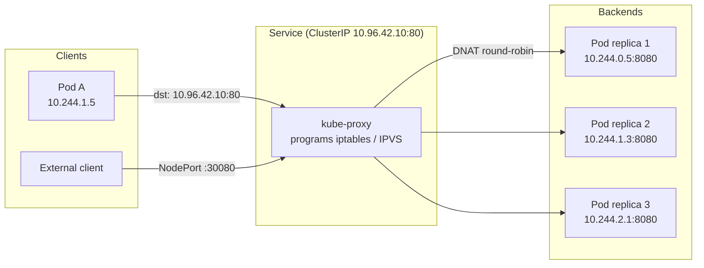
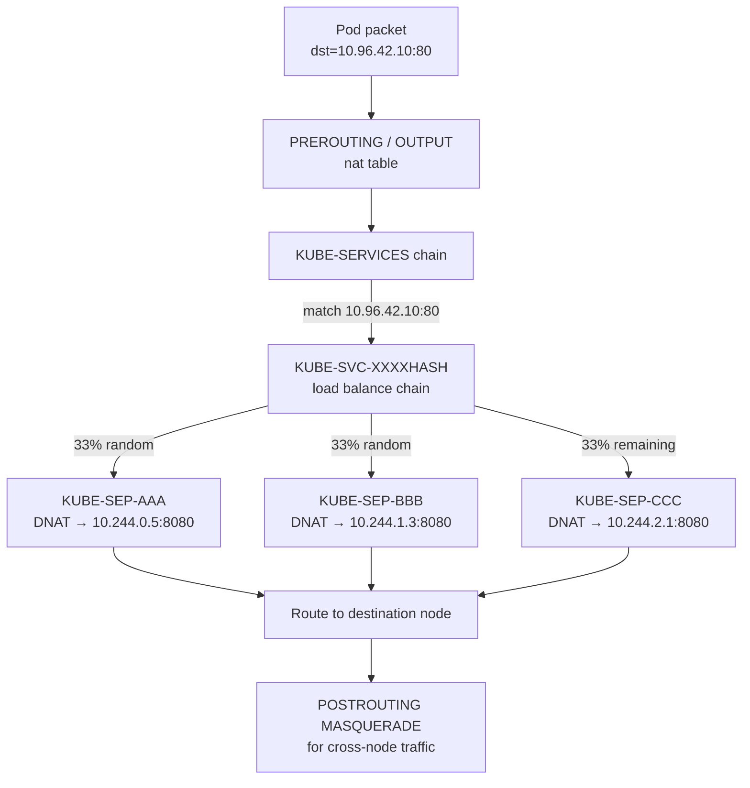

# Lesson 13 — Kubernetes Services and kube-proxy

> **Track:** Network Foundation — Bare Metal & Cloud · **Prereqs:** [Lesson 03 — iptables](03-iptables-and-netfilter.md), [Lesson 02 — IP Routing](02-ip-routing-and-forwarding.md) · **Time:** ~2.5 hours

> **Goal:** Trace a ClusterIP packet through iptables DNAT chains, choose between iptables and IPVS modes, and diagnose service connectivity failures at the packet level.

---

## Practice Setup

```bash
# Terminal 1 — minikube Linux node
minikube ssh
sudo iptables -t nat -L KUBE-SERVICES | head -20
sudo iptables -t nat -L KUBE-NODEPORTS 2>/dev/null | head -10
ipvsadm -Ln 2>/dev/null | head -20  # if IPVS mode

# Terminal 2 — Mac (kubectl)
kubectl get svc -A
kubectl get endpointslices -A | head -10
kubectl get cm -n kube-system kube-proxy -o yaml | grep mode
```

---

## 1. The Service Problem

Pods have ephemeral IPs that change on restart. Services provide a stable virtual IP (VIP) that:
- Never changes while the service exists
- Automatically load-balances across healthy pod replicas
- Is discoverable via DNS



> **See also:** [Lesson 14 — CoreDNS](14-coredns-service-discovery.md) for how the service name resolves to 10.96.42.10.

---

## 2. Service Types

### ClusterIP (default)
Virtual IP reachable only from within the cluster.
```yaml
apiVersion: v1
kind: Service
metadata:
  name: web
spec:
  type: ClusterIP
  selector:
    app: web
  ports:
    - port: 80
      targetPort: 8080
```

### NodePort
Exposes the service on a static port on every node's IP (range 30000–32767).
```yaml
spec:
  type: NodePort
  ports:
    - port: 80
      targetPort: 8080
      nodePort: 30080
```
```bash
curl http://<any-node-ip>:30080
```

### LoadBalancer
Provisions an external load balancer (cloud LB or MetalLB on bare metal).
```yaml
spec:
  type: LoadBalancer
  ports:
    - port: 80
      targetPort: 8080
```

### ExternalName
DNS CNAME alias to an external hostname (no kube-proxy rules involved).
```yaml
spec:
  type: ExternalName
  externalName: api.example.com
```

### Headless Service
No ClusterIP — DNS returns individual pod IPs directly.
```yaml
spec:
  clusterIP: None
  selector:
    app: db
```
```bash
# DNS returns all pod IPs directly (used by StatefulSets)
kubectl exec -it test -- nslookup db.default.svc.cluster.local
# Address: 10.244.0.5   ← pod IPs directly
# Address: 10.244.1.3
```

### Service Type Comparison

| Type | Reachable From | IP Assigned | Use Case |
|------|---------------|-------------|----------|
| ClusterIP | Inside cluster | Service CIDR | Internal microservice communication |
| NodePort | Outside (via node IP) | Service CIDR + node port | Dev/test, bare metal without LB |
| LoadBalancer | Outside (via LB IP) | External IP from cloud/MetalLB | Production external traffic |
| ExternalName | Inside cluster | DNS CNAME (no IP) | External service aliasing |
| Headless | Inside cluster (pod IPs) | None | StatefulSets, client-side LB |

---

## 3. Endpoints and EndpointSlices

The Service controller watches pods matching the selector and creates EndpointSlices.

```bash
# View legacy Endpoints (still present)
kubectl get endpoints web
# NAME   ENDPOINTS                       AGE
# web    10.244.0.5:8080,10.244.1.3:8080  5m

# Modern: EndpointSlices (default since K8s 1.21, 100 endpoints/slice)
kubectl get endpointslices -l kubernetes.io/service-name=web
kubectl get endpointslice web-xxxxx -o yaml

# Check if endpoints are populated (empty = no matching pods)
kubectl describe endpoints web
```

EndpointSlices cap at 100 endpoints per slice. At scale this dramatically reduces the iptables/IPVS update payload compared to a single large Endpoints object.

---

## 4. kube-proxy: iptables Mode



```bash
# View kube-proxy mode
kubectl get cm -n kube-system kube-proxy -o yaml | grep mode

# Trace the iptables chain for a service (10.96.42.10:80)
iptables -t nat -L KUBE-SERVICES -n | grep 10.96.42.10
# KUBE-SVC-XXXX  tcp  10.96.42.10:80

# Service chain (round-robin via probabilistic match)
iptables -t nat -L KUBE-SVC-XXXX -n
# KUBE-SEP-AAAA  all  --  statistic mode random probability 0.50000000000
# KUBE-SEP-BBBB  all  --  (second endpoint)

# Endpoint chain (DNAT)
iptables -t nat -L KUBE-SEP-AAAA -n
# DNAT  tcp  --  to:10.244.0.5:8080
```

---

## 5. kube-proxy: IPVS Mode

IPVS is a kernel load balancer — O(1) hash lookup vs O(N) iptables rule scan.

```bash
# Enable IPVS mode
kubectl edit cm -n kube-system kube-proxy
# mode: "ipvs"
# ipvs:
#   scheduler: "rr"  # rr=round-robin, lc=least-conn, dh, sh, lblc

# View IPVS rules
ipvsadm -L -n
# TCP  10.96.42.10:80 rr
#   -> 10.244.0.5:8080           Masq    1      0          0
#   -> 10.244.1.3:8080           Masq    1      0          0

# IPVS uses a dummy interface (kube-ipvs0) to hold all ClusterIPs
ip addr show kube-ipvs0
```

### Mode Comparison

| Aspect | iptables | IPVS |
|--------|----------|------|
| Lookup complexity | O(N) — linear chain scan | O(1) — kernel hash table |
| Scheduling options | Random, probabilistic | rr, lc, dh, sh, lblc, lblcr |
| Connection tracking | Linux conntrack | Linux conntrack |
| Health checking | None (relies on endpoints) | None (relies on endpoints) |
| Best for | <1000 services | >1000 services / high throughput |

---

## 6. External Traffic Policy

Controls SNAT behavior and node-local routing for external (NodePort/LoadBalancer) traffic.

```yaml
spec:
  type: LoadBalancer
  externalTrafficPolicy: Local    # or Cluster (default)
```

**Cluster (default):**
- Traffic forwarded to pods on any node
- Source IP replaced with node IP (SNAT)
- Load balances evenly across all pods

**Local:**
- Traffic only goes to pods on the node receiving the packet
- Source IP is **preserved** (no SNAT) — critical for logging real client IPs
- Load balancer must health-check each node; nodes without pods return unhealthy

```bash
# Check which nodes have local endpoints
kubectl get endpointslice -l kubernetes.io/service-name=web -o yaml | \
  grep -A5 "nodeName"
```

---

## 7. Service Topology and Traffic Distribution

```yaml
# Prefer same-zone backends (K8s 1.27+)
spec:
  trafficDistribution: PreferClose
```

```yaml
# Spread pods evenly across zones (reduce cross-zone traffic cost)
spec:
  topologySpreadConstraints:
    - maxSkew: 1
      topologyKey: topology.kubernetes.io/zone
      whenUnsatisfiable: DoNotSchedule
      labelSelector:
        matchLabels:
          app: web
```

---

## 8. Session Affinity

Stick sessions to the same pod (useful for stateful apps).

```yaml
spec:
  sessionAffinity: ClientIP
  sessionAffinityConfig:
    clientIP:
      timeoutSeconds: 3600
```

iptables implementation uses the `--recent` module to track source IPs and always DNAT to the same endpoint within the timeout window.

---

## 9. EndpointSlice Conditions and Graceful Drain

EndpointSlices carry per-endpoint health conditions that kube-proxy uses to handle pod termination gracefully.

```bash
# View EndpointSlice conditions
kubectl get endpointslice -l kubernetes.io/service-name=web -o yaml | \
  grep -A5 "conditions"
# conditions:
#   ready: true
#   serving: true
#   terminating: false

# A pod that is terminating has:
#   ready=false, serving=true, terminating=true
# kube-proxy keeps it in the LB table until ready=false AND serving=false
# This allows in-flight connections to drain before the pod is removed.
```

| Condition | ready | serving | terminating | kube-proxy behavior |
|-----------|-------|---------|-------------|---------------------|
| Healthy pod | true | true | false | Included in load balancing |
| Terminating pod | false | true | true | Kept for in-flight connections; excluded from new connections |
| Failed pod | false | false | false | Removed from load balancing immediately |

---

## 10. Services on Bare Metal vs Cloud

### Bare Metal
- **ClusterIP and NodePort** work identically
- **LoadBalancer** needs MetalLB or kube-vip
- Use BGP mode MetalLB to advertise VIPs to upstream router

### AWS EKS
```yaml
annotations:
  service.beta.kubernetes.io/aws-load-balancer-type: "external"
  service.beta.kubernetes.io/aws-load-balancer-nlb-target-type: "ip"
```

### GKE
```yaml
annotations:
  networking.gke.io/load-balancer-type: "Internal"
```

### AKS
```yaml
annotations:
  service.beta.kubernetes.io/azure-load-balancer-internal: "true"
```

---

## Troubleshooting

| Symptom | Likely Cause | Diagnostic Command | Fix |
|---------|-------------|-------------------|-----|
| ClusterIP unreachable from inside cluster | kube-proxy not running or iptables rules missing | `kubectl get pods -n kube-system -l k8s-app=kube-proxy` then `iptables -t nat -S \| grep <clusterIP>` | Restart kube-proxy; check node iptables policy allows forward |
| `<none>` in ENDPOINTS column | No pods match Service selector | `kubectl get pods -l app=web` | Fix label selector mismatch; verify pod labels |
| Endpoints present but connection refused | Pod ready check failing | `kubectl get pods -l app=web -o wide` (check READY column) | Fix pod readinessProbe; check targetPort matches pod port |
| NodePort not reachable from outside | Node firewall blocks port range 30000-32767 | `curl -v <node-ip>:30080` | Open NodePort range in security groups / firewall |
| External source IP lost (shows node IP) | `externalTrafficPolicy: Cluster` doing SNAT | `kubectl get svc web -o yaml \| grep externalTrafficPolicy` | Set `externalTrafficPolicy: Local`; ensure LB health checks nodes |
| Session affinity not working | iptables `--recent` module missing | `lsmod \| grep xt_recent` | Load `xt_recent` module; set `sessionAffinity: ClientIP` correctly |
| IPVS mode shows no virtual servers | ipvs kernel modules not loaded | `ipvsadm -Ln 2>&1` | Load modules: `modprobe ip_vs ip_vs_rr ip_vs_lc ip_vs_sh` |

---

## Production Checklist

- [ ] Switch to IPVS mode for clusters with >1000 services or high churn
- [ ] Set `externalTrafficPolicy: Local` on ingress-facing services to preserve client IPs for access logs
- [ ] Use `trafficDistribution: PreferClose` to minimize cross-AZ bandwidth costs (K8s 1.27+)
- [ ] Ensure NodePort range (30000-32767) is opened in node security groups / firewall rules
- [ ] Monitor EndpointSlice count per service; alert if any service has 0 endpoints
- [ ] Use headless services for StatefulSet pods so individual pod DNS names are resolvable
- [ ] Annotate LoadBalancer services with cloud-specific annotations before deploying (NLB vs ALB, internal vs external)

---

## Common Anti-Patterns

| What people do | Why it breaks | Correct approach |
|---------------|--------------|-----------------|
| Point Service selector at pods by name instead of labels | Selectors only support label matching, not pod names | Use consistent labels (`app: web`) on pods and match in Service selector |
| Use NodePort in production without a frontend LB | Direct NodePort exposure means client hits a specific node; if that node fails, client must try another IP | Put a cloud LB or MetalLB in front of NodePorts; use LoadBalancer type instead |
| Set `externalTrafficPolicy: Local` without health checks | LB routes to all nodes equally; nodes with no pods silently drop packets | Configure LB to use Kubernetes health check endpoint (kube-proxy health port 10256) |
| `clusterIP: None` on a service that apps expect to get a stable IP | Headless DNS returns pod IPs directly; each app connection may land on a different pod | Only use headless for StatefulSets or client-side LB scenarios; use ClusterIP for normal services |
| Ignore EndpointSlice max (100 endpoints/slice) in architecture | Services with >100 pods silently cap if old Endpoints API is used | Confirm `EndpointSlice` is used (`kubectl get endpointslices`); avoid code that reads only the Endpoints object |

---

## Quick Reference

| Use Case | Command |
|---------|---------|
| List all services and ClusterIPs | `kubectl get svc -A` |
| Check if endpoints are populated | `kubectl get endpoints <svc>` |
| View EndpointSlices for a service | `kubectl get endpointslices -l kubernetes.io/service-name=<svc>` |
| View kube-proxy mode | `kubectl get cm -n kube-system kube-proxy -o yaml \| grep mode` |
| Trace iptables DNAT chain | `iptables -t nat -L KUBE-SVC-XXXX -n` |
| View IPVS virtual servers | `ipvsadm -L -n` |
| Watch kube-proxy logs | `kubectl logs -n kube-system -l k8s-app=kube-proxy --tail=50 -f` |
| Test ClusterIP from debug pod | `kubectl run -it --rm debug --image=nicolaka/netshoot -- curl http://<clusterIP>:<port>` |
| Test NodePort from outside | `curl http://<node-ip>:<nodePort>` |
| Check external traffic policy | `kubectl get svc <svc> -o yaml \| grep externalTrafficPolicy` |
| Find services with no endpoints | `kubectl get ep -A \| grep '<none>'` |
| Dump all iptables KUBE-* rules | `iptables -t nat -S \| grep KUBE` |

---

## Summary

| Type | Reachable From | IP Assigned | kube-proxy rules |
|------|---------------|-------------|-----------------|
| ClusterIP | Inside cluster | Service CIDR | KUBE-SVC + KUBE-SEP chains |
| NodePort | Outside (via node IP) | Service CIDR + node port | KUBE-NODEPORTS → KUBE-SVC |
| LoadBalancer | Outside (via LB IP) | External IP from cloud/MetalLB | Cloud LB → NodePort → KUBE-SVC |
| ExternalName | Inside cluster | DNS CNAME (no IP) | No kube-proxy rules |
| Headless | Inside cluster (pod IPs) | None | No DNAT — DNS returns pod IPs |

---

## Online Resources

| Resource | Cost | What you practice |
|----------|------|-------------------|
| [Killercoda Playground](https://killercoda.com/) | Free | Create ClusterIP/NodePort services, inspect `iptables -t nat -L KUBE-SERVICES`, verify EndpointSlices live |
| [Isovalent: Foundations — Kubernetes Networking and Cilium](https://isovalent.com/labs/getting-started-with-kubernetes-networking-and-cilium/) | Free | Covers Kubernetes services section including ClusterIP internals and load balancing |
| [Kubernetes Official Interactive Tutorial](https://kubernetes.io/docs/tutorials/kubernetes-basics/expose/expose-intro/) | Free | Official browser-based K8s lab exposing a service — good warm-up before the iptables deep dive |

---

**Next:** [Lesson 14 — CoreDNS and Service Discovery](14-coredns-service-discovery.md)
