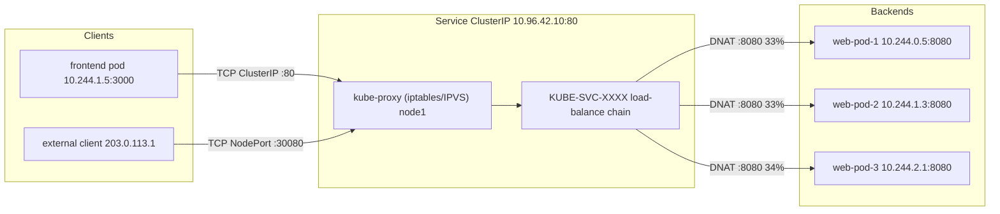
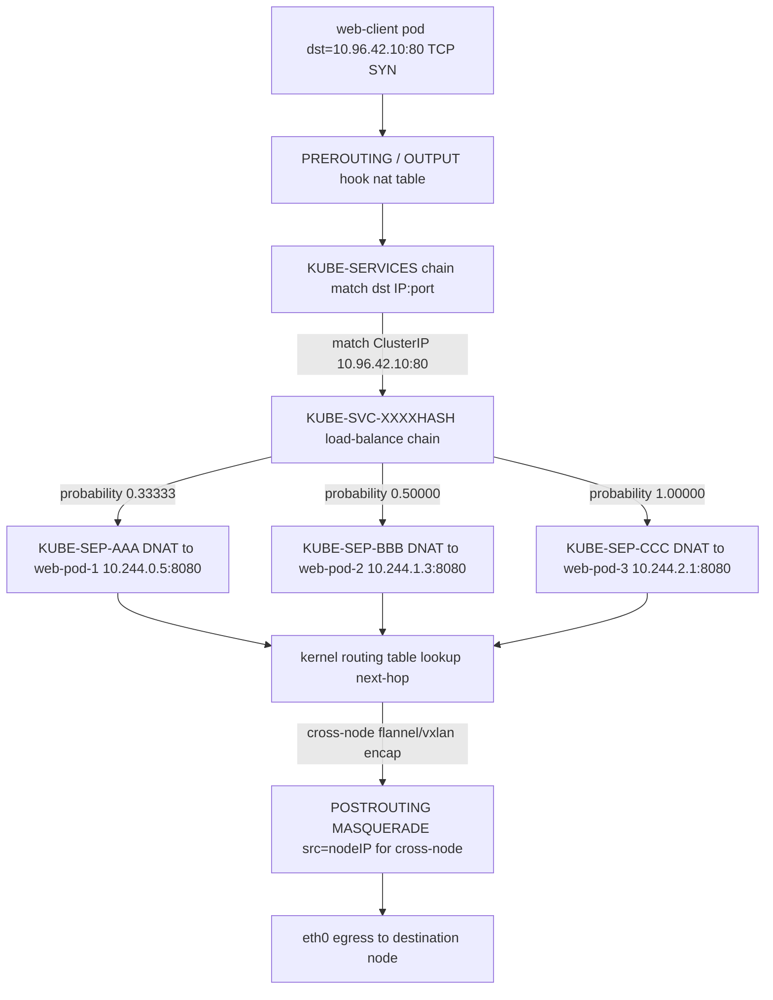
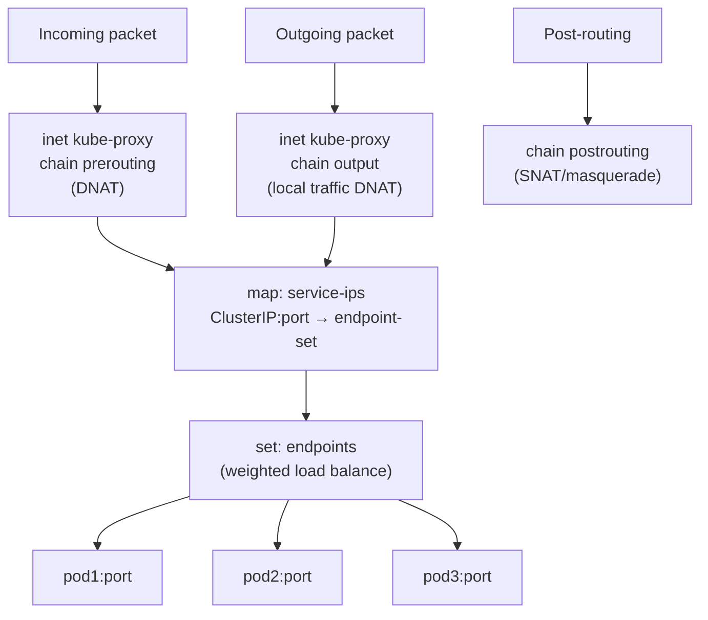

# Lesson 13 — Kubernetes Services and kube-proxy

> **Track:** Network Foundation — Bare Metal & Cloud · **Prereqs:** [Lesson 03 — iptables](03-iptables-and-netfilter.md), [Lesson 02 — IP Routing](02-ip-routing-and-forwarding.md) · **Time:** ~2.5 hours

> **Goal:** Trace a ClusterIP packet through iptables DNAT chains, choose between iptables and IPVS modes, and diagnose service connectivity failures at the packet level.


**Jump to:** [Theory](#theory) · [Practice](#practice) · [Troubleshooting](#troubleshooting) · [Production Checklist](#production-checklist) · [Quick Reference](#quick-reference) · [Check Your Understanding](#check-your-understanding)

---

## Theory

## 1. The Service Problem

Pods have ephemeral IPs that change on restart. Services provide a stable virtual IP (VIP) that:
- Never changes while the service exists
- Automatically load-balances across healthy pod replicas
- Is discoverable via DNS



> **See also:** [Lesson 14 — CoreDNS](14-coredns-service-discovery.md) for how the service name resolves to 10.96.42.10.


---

## 2. Service Types

### ClusterIP (default)
Virtual IP reachable only from within the cluster.
```yaml
apiVersion: v1
kind: Service
metadata:
  name: web
spec:
  type: ClusterIP
  selector:
    app: web
  ports:
    - port: 80
      targetPort: 8080
```

### NodePort
Exposes the service on a static port on every node's IP (range 30000–32767).
```yaml
spec:
  type: NodePort
  ports:
    - port: 80
      targetPort: 8080
      nodePort: 30080
```
```bash
curl http://<any-node-ip>:30080
```

### LoadBalancer
Provisions an external load balancer (cloud LB or MetalLB on bare metal).
```yaml
spec:
  type: LoadBalancer
  ports:
    - port: 80
      targetPort: 8080
```

### ExternalName
DNS CNAME alias to an external hostname (no kube-proxy rules involved).
```yaml
spec:
  type: ExternalName
  externalName: api.example.com
```

### Headless Service
No ClusterIP — DNS returns individual pod IPs directly.
```yaml
spec:
  clusterIP: None
  selector:
    app: db
```
```bash
# DNS returns all pod IPs directly (used by StatefulSets)
kubectl exec -it test -- nslookup db.default.svc.cluster.local
# Address: 10.244.0.5   ← pod IPs directly
# Address: 10.244.1.3
```

### Service Type Comparison

| Type | Reachable From | IP Assigned | Use Case |
|------|---------------|-------------|----------|
| ClusterIP | Inside cluster | Service CIDR | Internal microservice communication |
| NodePort | Outside (via node IP) | Service CIDR + node port | Dev/test, bare metal without LB |
| LoadBalancer | Outside (via LB IP) | External IP from cloud/MetalLB | Production external traffic |
| ExternalName | Inside cluster | DNS CNAME (no IP) | External service aliasing |
| Headless | Inside cluster (pod IPs) | None | StatefulSets, client-side LB |

---

## 3. Endpoints and EndpointSlices

The Service controller watches pods matching the selector and creates EndpointSlices.

```bash
# View legacy Endpoints (still present)
kubectl get endpoints web
# NAME   ENDPOINTS                       AGE
# web    10.244.0.5:8080,10.244.1.3:8080  5m

# Modern: EndpointSlices (default since K8s 1.21, 100 endpoints/slice)
kubectl get endpointslices -l kubernetes.io/service-name=web
kubectl get endpointslice web-xxxxx -o yaml

# Check if endpoints are populated (empty = no matching pods)
kubectl describe endpoints web
```

EndpointSlices cap at 100 endpoints per slice. At scale this dramatically reduces the iptables/IPVS update payload compared to a single large Endpoints object.

---

## 4. kube-proxy: iptables Mode



```bash
# View kube-proxy mode
kubectl get cm -n kube-system kube-proxy -o yaml | grep mode

# Trace the iptables chain for a service (10.96.42.10:80)
iptables -t nat -L KUBE-SERVICES -n | grep 10.96.42.10
# KUBE-SVC-XXXX  tcp  10.96.42.10:80

# Service chain (round-robin via probabilistic match)
iptables -t nat -L KUBE-SVC-XXXX -n
# KUBE-SEP-AAAA  all  --  statistic mode random probability 0.50000000000
# KUBE-SEP-BBBB  all  --  (second endpoint)

# Endpoint chain (DNAT)
iptables -t nat -L KUBE-SEP-AAAA -n
# DNAT  tcp  --  to:10.244.0.5:8080
```

---

## 5. kube-proxy: IPVS Mode

> **⚠️ Deprecation:** IPVS mode is deprecated since K8s **v1.35** (Dec 2025). It will be disabled by default from v1.40 (re-enable with `KubeProxyIPVS` feature gate) and **fully removed in v1.43**. Migrate to `nftables` mode — see [§ nftables Mode](#nftables-proxy-mode-alpha-k8s-v137) below.

IPVS is a kernel load balancer — O(1) hash lookup vs O(N) iptables rule scan.

```bash
# Enable IPVS mode
kubectl edit cm -n kube-system kube-proxy
# mode: "ipvs"
# ipvs:
#   scheduler: "rr"  # rr=round-robin, lc=least-conn, dh, sh, lblc

# View IPVS rules
ipvsadm -L -n
# TCP  10.96.42.10:80 rr
#   -> 10.244.0.5:8080           Masq    1      0          0
#   -> 10.244.1.3:8080           Masq    1      0          0

# IPVS uses a dummy interface (kube-ipvs0) to hold all ClusterIPs
ip addr show kube-ipvs0
```

### Mode Comparison

| Aspect | iptables | IPVS (deprecated v1.35) | nftables (Alpha v1.37) |
|--------|----------|--------------------------|------------------------|
| Lookup complexity | O(N) — linear chain scan | O(1) — kernel hash table | O(1) — nftables map lookup |
| Scheduling options | Random, probabilistic | rr, lc, dh, sh, lblc, lblcr | Random, probabilistic |
| Connection tracking | Linux conntrack | Linux conntrack | Linux conntrack |
| Health checking | None (relies on endpoints) | None (relies on endpoints) | None (relies on endpoints) |
| Atomic rule updates | No (rule-by-rule) | N/A | Yes (transaction-based) |
| Kernel requirement | Any | requires ip_vs modules | 5.13+ |
| Best for | <1000 services | >1000 services (deprecated) | All new deployments |

---

### nftables Proxy Mode (Alpha, K8s v1.37+)

nftables is the modern Linux packet-filtering framework that supersedes iptables (see [Lesson 03](03-iptables-and-netfilter.md)). kube-proxy's nftables mode uses the kernel's nftables API instead of legacy iptables chains — same semantics, cleaner atomic updates, better performance at scale.

**Status:** Alpha since K8s **v1.37** (August 2026); disabled by default. The default proxy mode remains `iptables` in v1.37 but will switch to `nftables` in a future release. Explicitly set your mode now to avoid unexpected changes on upgrade.

**Kernel requirement:** Linux kernel **5.13 or later** (nftables requires the `nf_tables` subsystem with set/map support).

```bash
# Check kernel version — must be ≥5.13
uname -r

# Check nftables support
nft list tables 2>/dev/null && echo "nftables available" || echo "nftables unavailable"
```

**Enable nftables mode — kube-proxy ConfigMap:**

```yaml
apiVersion: v1
kind: ConfigMap
metadata:
  name: kube-proxy
  namespace: kube-system
data:
  config.conf: |
    apiVersion: kubeproxy.config.k8s.io/v1alpha1
    kind: KubeProxyConfiguration
    mode: "nftables"       # replaces "iptables" or "ipvs"
    featureGates:
      NFTablesProxyMode: true   # required while Alpha
```

**Enable via kubeadm cluster config:**

```yaml
apiVersion: kubeadm.k8s.io/v1beta4
kind: ClusterConfiguration
---
apiVersion: kubeproxy.config.k8s.io/v1alpha1
kind: KubeProxyConfiguration
mode: "nftables"
featureGates:
  NFTablesProxyMode: true
```

**Inspect nftables rules set by kube-proxy:**

```bash
# List all nftables tables (kube-proxy creates table 'kube-proxy' in inet family)
nft list tables

# Dump all kube-proxy rules
nft list table inet kube-proxy

# Inspect the service verdict map (ClusterIP → endpoint set)
nft list table inet kube-proxy | grep -A5 'map service'

# Count rules (nftables uses sets/maps — far fewer rules than iptables chains)
nft list table inet kube-proxy | wc -l
```

**nftables chain structure for K8s services:**



Key differences from iptables:
- **One map lookup** instead of walking a chain of DNAT rules — O(1) regardless of service count
- **Atomic transactions** — all rules for a service update in a single commit; no partial state
- **Fewer kernel objects** — a single `map` per service replaces dozens of `KUBE-SVC-*` / `KUBE-SEP-*` chains

**Performance:**

Benchmarks from the K8s community show nftables mode processes service rule updates 30–60% faster than iptables mode at large scale (>5000 services), because:
- Rule sets are updated atomically via nftables transactions rather than appending/deleting individual iptables rules
- Packet path uses O(1) hash map lookups rather than O(N) chain traversal

> **K8s Engineer's Translation:** nftables replaces iptables as the kernel packet-filtering backend for kube-proxy — same end result (DNAT to a pod IP), but cleaner atomic rule updates and significantly faster convergence when services change. At <100 services the difference is imperceptible; at >5000 services nftables converges in milliseconds vs seconds. Start using it now while Alpha so you're ahead of the default-mode switch.

**IPVS deprecation timeline:**

| K8s Version | IPVS status |
|-------------|-------------|
| v1.35 (Dec 2025) | Deprecated |
| v1.37 (Aug 2026) | Still functional; nftables Alpha |
| v1.40 (~2027) | Disabled by default; re-enable with `KubeProxyIPVS` gate |
| v1.43 (~2028) | Fully removed |

If you are currently using IPVS mode, plan your migration to nftables now.

---

## 6. External Traffic Policy

Controls SNAT behavior and node-local routing for external (NodePort/LoadBalancer) traffic.

```yaml
spec:
  type: LoadBalancer
  externalTrafficPolicy: Local    # or Cluster (default)
```

**Cluster (default):**
- Traffic forwarded to pods on any node
- Source IP replaced with node IP (SNAT)
- Load balances evenly across all pods

**Local:**
- Traffic only goes to pods on the node receiving the packet
- Source IP is **preserved** (no SNAT) — critical for logging real client IPs
- Load balancer must health-check each node; nodes without pods return unhealthy

```bash
# Check which nodes have local endpoints
kubectl get endpointslice -l kubernetes.io/service-name=web -o yaml | \
  grep -A5 "nodeName"
```

---

## 7. Service Topology and Traffic Distribution

```yaml
# Prefer same-zone backends (K8s 1.27+)
spec:
  trafficDistribution: PreferClose
```

```yaml
# Spread pods evenly across zones (reduce cross-zone traffic cost)
spec:
  topologySpreadConstraints:
    - maxSkew: 1
      topologyKey: topology.kubernetes.io/zone
      whenUnsatisfiable: DoNotSchedule
      labelSelector:
        matchLabels:
          app: web
```

---

## 8. Session Affinity

Stick sessions to the same pod (useful for stateful apps).

```yaml
spec:
  sessionAffinity: ClientIP
  sessionAffinityConfig:
    clientIP:
      timeoutSeconds: 3600
```

iptables implementation uses the `--recent` module to track source IPs and always DNAT to the same endpoint within the timeout window.

---

## 9. EndpointSlice Conditions and Graceful Drain

EndpointSlices carry per-endpoint health conditions that kube-proxy uses to handle pod termination gracefully.

```bash
# View EndpointSlice conditions
kubectl get endpointslice -l kubernetes.io/service-name=web -o yaml | \
  grep -A5 "conditions"
# conditions:
#   ready: true
#   serving: true
#   terminating: false

# A pod that is terminating has:
#   ready=false, serving=true, terminating=true
# kube-proxy keeps it in the LB table until ready=false AND serving=false
# This allows in-flight connections to drain before the pod is removed.
```

| Condition | ready | serving | terminating | kube-proxy behavior |
|-----------|-------|---------|-------------|---------------------|
| Healthy pod | true | true | false | Included in load balancing |
| Terminating pod | false | true | true | Kept for in-flight connections; excluded from new connections |
| Failed pod | false | false | false | Removed from load balancing immediately |

---

## 10. Services on Bare Metal vs Cloud

### Bare Metal
- **ClusterIP and NodePort** work identically
- **LoadBalancer** needs MetalLB or kube-vip
- Use BGP mode MetalLB to advertise VIPs to upstream router

### AWS EKS
```yaml
annotations:
  service.beta.kubernetes.io/aws-load-balancer-type: "external"
  service.beta.kubernetes.io/aws-load-balancer-nlb-target-type: "ip"
```

### GKE
```yaml
annotations:
  networking.gke.io/load-balancer-type: "Internal"
```

### AKS
```yaml
annotations:
  service.beta.kubernetes.io/azure-load-balancer-internal: "true"
```

### Industry Applications

| Company / Project | Context | Technology from this lesson | Outcome |
|---|---|---|---|
| Shopify | 1M+ services on a monorepo-scale Kubernetes platform | Migrated from iptables to IPVS mode kube-proxy | Eliminated O(N) rule scan; sub-millisecond service lookup latency at scale |
| LinkedIn | High-churn microservices platform with thousands of services | IPVS kube-proxy with least-connection scheduler | Reduced CPU overhead of iptables rule processing; maintained sub-millisecond service latency |
| AWS EKS | Cloud-native Kubernetes workloads for enterprise customers | NLB-backed LoadBalancer services with `externalTrafficPolicy: Local` | Direct pod routing preserves client source IPs; elastic scaling without kube-proxy as bottleneck |
| Airbnb | Multi-AZ Kubernetes platform serving global traffic | `trafficDistribution: PreferClose` with zone-aware topology constraints | Reduced cross-AZ data transfer costs; improved p99 service latency for regional users |
| Hospital EHR platform (medtech) | HIPAA-regulated EHR system requiring real client IPs in audit logs | `externalTrafficPolicy: Local` on LoadBalancer service to suppress SNAT and preserve source IPs | Node failure caused the cloud LB to route traffic to nodes with no local pods; 30% of requests dropped for 90 seconds until LB health checks removed the unhealthy nodes — highlighting the need to configure kube-proxy health port 10256 as the LB health check endpoint |

---

## Practice

### Environment Setup

```bash
# Terminal 1 — minikube Linux node
minikube ssh
sudo iptables -t nat -L KUBE-SERVICES | head -20
sudo iptables -t nat -L KUBE-NODEPORTS 2>/dev/null | head -10
ipvsadm -Ln 2>/dev/null | head -20  # if IPVS mode

# Terminal 2 — Mac (kubectl)
kubectl get svc -A
kubectl get endpointslices -A | head -10
kubectl get cm -n kube-system kube-proxy -o yaml | grep mode
```

### Hands-On Lab

**Step 1 — Create a ClusterIP service and trace its iptables chain:**

```bash
# Deploy a test workload with 3 replicas
kubectl create deployment web --image=nginx --replicas=3
kubectl expose deployment web --port=80 --target-port=80

# Get the assigned ClusterIP
kubectl get svc web
# NAME   TYPE        CLUSTER-IP     EXTERNAL-IP   PORT(S)   AGE
# web    ClusterIP   10.96.42.10    <none>        80/TCP    10s

# On the node — find the KUBE-SVC chain for this ClusterIP
minikube ssh
sudo iptables -t nat -L KUBE-SERVICES -n | grep 10.96.42.10
# KUBE-SVC-XXXX  tcp  --  0.0.0.0/0  10.96.42.10  tcp dpt:80

# Follow the chain: view per-endpoint probabilistic rules
sudo iptables -t nat -L KUBE-SVC-XXXX -n
# KUBE-SEP-AAAA  all  statistic mode random probability 0.33333
# KUBE-SEP-BBBB  all  statistic mode random probability 0.50000
# KUBE-SEP-CCCC  all  (remaining traffic)

# Verify the DNAT target for each endpoint chain
sudo iptables -t nat -L KUBE-SEP-AAAA -n
# DNAT  tcp  --  to:10.244.0.5:80
```

**Step 2 — Verify EndpointSlices and test connectivity:**

```bash
# View EndpointSlices (modern API — 1 slice per 100 endpoints)
kubectl get endpointslices -l kubernetes.io/service-name=web
kubectl get endpointslice web-xxxxx -o yaml | grep -A5 "conditions"
# conditions:
#   ready: true
#   serving: true
#   terminating: false

# Test ClusterIP reachability from a debug pod
kubectl run -it --rm debug --image=nicolaka/netshoot -- \
  curl -s http://10.96.42.10/
# Expect: nginx welcome page
```

**Step 3 — Inspect IPVS mode (if enabled) or switch to it:**

```bash
# Check current mode
kubectl get cm -n kube-system kube-proxy -o yaml | grep mode

# If IPVS: view the kernel virtual server table (O(1) hash lookup)
ipvsadm -L -n
# TCP  10.96.42.10:80 rr
#   -> 10.244.0.5:80    Masq    1      0          0
#   -> 10.244.1.3:80    Masq    1      0          0

# IPVS keeps ClusterIPs on a dummy interface
ip addr show kube-ipvs0 | head -10
```

### Configuration Reference

| Parameter | Default | Effect | When to Change |
|-----------|---------|--------|----------------|
| `type: ClusterIP` | Default | Virtual IP reachable only inside cluster | Change to `NodePort` for direct node access or `LoadBalancer` for cloud LB |
| `type: NodePort` | — | Opens a port (30000-32767) on every node's IP | Dev/test environments or bare metal without MetalLB |
| `type: LoadBalancer` | — | Provisions cloud LB or MetalLB VIP | Production external traffic in cloud or bare metal with MetalLB |
| `externalTrafficPolicy: Local` | Cluster | Preserves client source IP; routes only to local node pods | Ingress-facing services where real client IPs are needed in access logs |
| `sessionAffinity: ClientIP` | None | Routes same source IP to same pod for the timeout window | Stateful applications that require session persistence |
| `trafficDistribution: PreferClose` | — | Routes to same-zone pods when available (K8s 1.27+) | Minimize cross-AZ bandwidth costs in multi-zone clusters |
| `clusterIP: None` | — | Headless service — DNS returns pod IPs directly | StatefulSets or client-side load balancing scenarios |
| kube-proxy `mode: ipvs` | iptables | O(1) hash table lookup instead of O(N) chain scan | **Deprecated v1.35 — migrate to nftables** |
| kube-proxy `mode: nftables` | iptables | Atomic rule updates, O(1) map lookups, kernel 5.13+ | New clusters on K8s v1.37+ |

---

## Troubleshooting

| Symptom | Likely Cause | Diagnostic Command | Fix |
|---------|-------------|-------------------|-----|
| ClusterIP unreachable from inside cluster | kube-proxy not running or iptables rules missing | `kubectl get pods -n kube-system -l k8s-app=kube-proxy` then `iptables -t nat -S \| grep <clusterIP>` | Restart kube-proxy; check node iptables policy allows forward |
| `<none>` in ENDPOINTS column | No pods match Service selector | `kubectl get pods -l app=web` | Fix label selector mismatch; verify pod labels |
| Endpoints present but connection refused | Pod ready check failing | `kubectl get pods -l app=web -o wide` (check READY column) | Fix pod readinessProbe; check targetPort matches pod port |
| NodePort not reachable from outside | Node firewall blocks port range 30000-32767 | `curl -v <node-ip>:30080` | Open NodePort range in security groups / firewall |
| External source IP lost (shows node IP) | `externalTrafficPolicy: Cluster` doing SNAT | `kubectl get svc web -o yaml \| grep externalTrafficPolicy` | Set `externalTrafficPolicy: Local`; ensure LB health checks nodes |
| Session affinity not working | iptables `--recent` module missing | `lsmod \| grep xt_recent` | Load `xt_recent` module; set `sessionAffinity: ClientIP` correctly |
| IPVS mode shows no virtual servers | ipvs kernel modules not loaded | `ipvsadm -Ln 2>&1` | Load modules: `modprobe ip_vs ip_vs_rr ip_vs_lc ip_vs_sh` |

---

## Production Checklist

- [ ] Use `nftables` proxy mode on K8s v1.37+ (kernel 5.13+); do NOT switch to IPVS (deprecated v1.35, removed v1.43)
- [ ] If currently on IPVS mode: plan migration to nftables before K8s v1.40
- [ ] Set `externalTrafficPolicy: Local` on ingress-facing services to preserve client IPs for access logs
- [ ] Use `trafficDistribution: PreferClose` to minimize cross-AZ bandwidth costs (K8s 1.27+)
- [ ] Ensure NodePort range (30000-32767) is opened in node security groups / firewall rules
- [ ] Monitor EndpointSlice count per service; alert if any service has 0 endpoints
- [ ] Use headless services for StatefulSet pods so individual pod DNS names are resolvable
- [ ] Annotate LoadBalancer services with cloud-specific annotations before deploying (NLB vs ALB, internal vs external)

---

## Common Anti-Patterns

| What people do | Why it breaks | Correct approach |
|---------------|--------------|-----------------|
| Point Service selector at pods by name instead of labels | Selectors only support label matching, not pod names | Use consistent labels (`app: web`) on pods and match in Service selector |
| Use NodePort in production without a frontend LB | Direct NodePort exposure means client hits a specific node; if that node fails, client must try another IP | Put a cloud LB or MetalLB in front of NodePorts; use LoadBalancer type instead |
| Set `externalTrafficPolicy: Local` without health checks | LB routes to all nodes equally; nodes with no pods silently drop packets | Configure LB to use Kubernetes health check endpoint (kube-proxy health port 10256) |
| `clusterIP: None` on a service that apps expect to get a stable IP | Headless DNS returns pod IPs directly; each app connection may land on a different pod | Only use headless for StatefulSets or client-side LB scenarios; use ClusterIP for normal services |
| Ignore EndpointSlice max (100 endpoints/slice) in architecture | Services with >100 pods silently cap if old Endpoints API is used | Confirm `EndpointSlice` is used (`kubectl get endpointslices`); avoid code that reads only the Endpoints object |

---

## Quick Reference

| Use Case | Command |
|---------|---------|
| List all services and ClusterIPs | `kubectl get svc -A` |
| Check if endpoints are populated | `kubectl get endpoints <svc>` |
| View EndpointSlices for a service | `kubectl get endpointslices -l kubernetes.io/service-name=<svc>` |
| View kube-proxy mode | `kubectl get cm -n kube-system kube-proxy -o yaml \| grep mode` |
| Trace iptables DNAT chain | `iptables -t nat -L KUBE-SVC-XXXX -n` |
| View IPVS virtual servers | `ipvsadm -L -n` (**deprecated** — migrate to nftables) |
| Dump nftables kube-proxy rules | `nft list table inet kube-proxy` |
| Enable nftables mode | Set `mode: nftables` + `NFTablesProxyMode: true` in kube-proxy ConfigMap |
| Watch kube-proxy logs | `kubectl logs -n kube-system -l k8s-app=kube-proxy --tail=50 -f` |
| Test ClusterIP from debug pod | `kubectl run -it --rm debug --image=nicolaka/netshoot -- curl http://<clusterIP>:<port>` |
| Test NodePort from outside | `curl http://<node-ip>:<nodePort>` |
| Check external traffic policy | `kubectl get svc <svc> -o yaml \| grep externalTrafficPolicy` |
| Find services with no endpoints | `kubectl get ep -A \| grep '<none>'` |
| Dump all iptables KUBE-* rules | `iptables -t nat -S \| grep KUBE` |

---

## Summary

| Type | Reachable From | IP Assigned | kube-proxy rules |
|------|---------------|-------------|-----------------|
| ClusterIP | Inside cluster | Service CIDR | KUBE-SVC + KUBE-SEP chains |
| NodePort | Outside (via node IP) | Service CIDR + node port | KUBE-NODEPORTS → KUBE-SVC |
| LoadBalancer | Outside (via LB IP) | External IP from cloud/MetalLB | Cloud LB → NodePort → KUBE-SVC |
| ExternalName | Inside cluster | DNS CNAME (no IP) | No kube-proxy rules |
| Headless | Inside cluster (pod IPs) | None | No DNAT — DNS returns pod IPs |

---

## Check Your Understanding

1. **[Concept question]** How does kube-proxy implement probabilistic load balancing across multiple endpoints for a ClusterIP service using iptables, and what chain structure does it use?

   <details><summary>Answer</summary>

   kube-proxy creates a three-level chain structure: `KUBE-SERVICES` matches the destination ClusterIP and port, jumping to a per-service `KUBE-SVC-<hash>` chain. Inside that chain, each endpoint gets a `KUBE-SEP-<hash>` rule with a probabilistic `statistic mode random probability` match — the first endpoint gets `0.33`, the second gets `0.5` (of remaining), and the last gets `1.0` (all remaining traffic). Each `KUBE-SEP-<hash>` chain contains the actual `DNAT` rule rewriting the destination to the pod's IP and port (e.g., `DNAT tcp to 10.244.0.5:8080`).

   </details>

2. **[Scenario question]** A ClusterIP service with two healthy endpoints is unreachable from pods on one specific node, but works fine from pods on all other nodes. `kubectl get endpoints` shows both pod IPs. What is the first thing you should check on the failing node?

   <details><summary>Answer</summary>

   Check whether the kube-proxy iptables rules exist on that specific node with `iptables -t nat -L KUBE-SERVICES -n | grep <cluster-ip>`. If the KUBE-SERVICES chain is missing entries for the service, kube-proxy on that node may have failed to sync. Check `kubectl get pods -n kube-system -l k8s-app=kube-proxy` for the node's kube-proxy pod status, and inspect its logs with `kubectl logs -n kube-system <kube-proxy-pod>` for sync errors. Also verify that `net.bridge.bridge-nf-call-iptables=1` is set on the failing node.

   </details>

3. **[Practical question]** What command would you run to find all iptables rules associated with a specific ClusterIP service (e.g., `10.96.42.10`) and see the DNAT targets for its endpoints?

   <details><summary>Answer</summary>

   ```bash
   iptables -t nat -S | grep 10.96.42.10
   ```
   This shows the `KUBE-SVC-<hash>` chain name. Then run `iptables -t nat -L KUBE-SVC-<hash> -n` to see the per-endpoint probabilistic rules, and `iptables -t nat -L KUBE-SEP-<hash> -n` for each endpoint chain to confirm the DNAT target IP and port.

   </details>

---

## Online Resources

| Resource | Cost | What you practice |
|----------|------|-------------------|
| [Killercoda Playground](https://killercoda.com/) | Free | Create ClusterIP/NodePort services, inspect `iptables -t nat -L KUBE-SERVICES`, verify EndpointSlices live |
| [Isovalent: Foundations — Kubernetes Networking and Cilium](https://isovalent.com/labs/getting-started-with-kubernetes-networking-and-cilium/) | Free | Covers Kubernetes services section including ClusterIP internals and load balancing |
| [Kubernetes Official Interactive Tutorial](https://kubernetes.io/docs/tutorials/kubernetes-basics/expose/expose-intro/) | Free | Official browser-based K8s lab exposing a service — good warm-up before the iptables deep dive |

---

**← Previous:** [Lesson 12 — Cilium CNI and eBPF Dataplane](12-cilium-cni-ebpf.md)   |   **Next:** [Lesson 14 — CoreDNS and Service Discovery](14-coredns-service-discovery.md)
