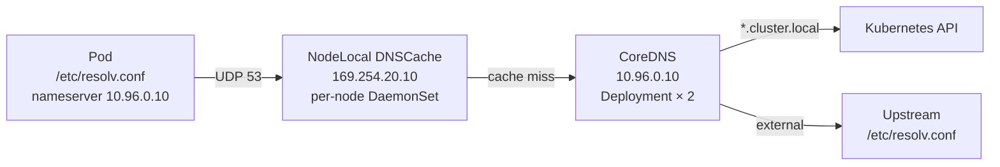
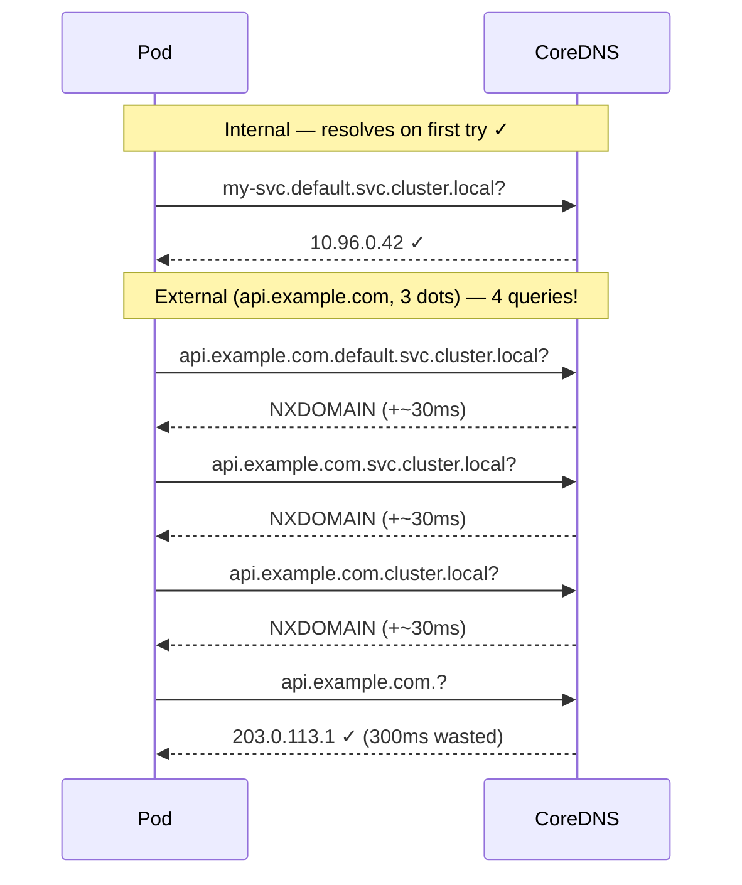

# Lesson 14 — CoreDNS and Service Discovery

> **Track:** Kubernetes Networking · **Prereqs:** [Lesson 13 — Services](13-kubernetes-services-kube-proxy.md) · **Time:** ~1h

> **Goal:** Debug ndots:5 latency, tune CoreDNS for your cluster, and deploy NodeLocal DNSCache.

---

## Practice Setup

```bash
# Terminal 1 — Mac (kubectl)
kubectl get cm -n kube-system coredns -o yaml
kubectl get svc -n kube-system kube-dns

# Terminal 2 — debug pod
kubectl run dns-test --image=nicolaka/netshoot --rm -it --restart=Never -- \
  sh -c "nslookup kubernetes && cat /etc/resolv.conf"
```

---

## 1. Architecture



```bash
kubectl get pods -n kube-system -l k8s-app=kube-dns   # CoreDNS pods
kubectl get svc  -n kube-system kube-dns               # ClusterIP 10.96.0.10
```

**DNS name formats:**

| Type | Format | Example |
|------|--------|---------|
| Service | `<svc>.<ns>.svc.cluster.local` | `web.default.svc.cluster.local` |
| StatefulSet pod | `<pod>.<svc>.<ns>.svc.cluster.local` | `db-0.db.default.svc.cluster.local` |
| Headless SVC | Same — returns pod IP directly | returns `10.244.1.5` |

---

## 2. The ndots:5 Latency Trap

Default `/etc/resolv.conf` in every pod:
```
nameserver 10.96.0.10
search default.svc.cluster.local svc.cluster.local cluster.local
options ndots:5
```

Any hostname with **fewer than 5 dots** triggers search-domain expansion before the absolute lookup. External names waste 3 round trips (~90–300 ms):



> **Fix:** Lower `ndots` per pod or use FQDNs (trailing dot: `api.example.com.`).

```yaml
# Per-pod dnsConfig
spec:
  dnsConfig:
    options:
      - name: ndots
        value: "1"
```

---

## 3. Corefile — Key Directives

```bash
kubectl get cm -n kube-system coredns -o yaml   # view current config
kubectl edit cm -n kube-system coredns           # edit (auto-reloads)
```

| Directive | What it does |
|-----------|-------------|
| `kubernetes cluster.local` | Answers `*.cluster.local` from K8s API |
| `forward . /etc/resolv.conf` | Sends external queries to node's upstream DNS |
| `cache 30` | Caches positive responses for 30 s |
| `health` / `ready` | `/health` :8080 and `/ready` :8181 probes |
| `prometheus :9153` | Metrics endpoint |
| `autopath @kubernetes` | Collapses search-list lookups into one query |
| `negative_ttl 5` | Caches NXDOMAIN for 5 s (reduces repeat failures) |

### Key Corefile Parameter Reference

| Parameter | Default | Effect | When to change |
|-----------|---------|--------|----------------|
| `cache <ttl>` | `30` s | TTL for positive responses | Increase to 300 s for stable external names; lower for rapid DNS changes |
| `cache denial <ttl>` | `5` s | TTL for NXDOMAIN responses | Raise to 30 s to reduce negative-query flood from bad hostnames |
| `forward . <addr>` | Node `/etc/resolv.conf` | Upstream DNS server | Point to corporate resolver or Route53 for split-horizon DNS |
| `health :8080` | port 8080 | HTTP health probe | Change port if 8080 conflicts with other workloads |
| `prometheus :9153` | port 9153 | Metrics scrape endpoint | Standard; leave unless you remap ports |
| `reload` | 30 s | Corefile hot-reload interval | Lower for faster config changes in dev |

**Stub zone** (forward a corporate domain to a private resolver):
```
corp.internal:53 {
    forward . 10.100.0.53
    cache 30
}
```

**Hosts override** (static entry):
```
.:53 {
    hosts {
        10.100.0.5  legacy.corp.internal
        fallthrough
    }
    # rest of config...
}
```

---

## 4. NodeLocal DNSCache

Runs as a DaemonSet on `169.254.20.10` (link-local). Pods hit the local node cache instead of a ClusterIP — no conntrack overhead, ~10× lower p99 latency for cached queries.

```bash
# Deploy (official manifest)
kubectl apply -f https://raw.githubusercontent.com/kubernetes/kubernetes/master/cluster/addons/dns/nodelocaldns/nodelocaldns.yaml

# Verify — one pod per node
kubectl get pods -n kube-system -l k8s-app=node-local-dns -o wide

# Confirm pod resolv.conf points to it
kubectl exec <pod> -- cat /etc/resolv.conf
# nameserver 169.254.20.10

# Check NodeLocal DNSCache metrics
kubectl exec -n kube-system node-local-dns-xxxxx -- \
  curl -s http://169.254.20.10:9253/metrics | grep coredns_cache_hits_total
```

> **Cloud note:** AWS EKS uses `169.254.20.10` with `aws-k8s-cni` automatically. GKE runs NodeLocal by default since 1.15. For bare metal, forward to your on-prem resolver: `forward . <corp-dns-ip>`.

---

## 5. Observing CoreDNS Live

```bash
# Enable query logging temporarily (adds "log" directive to Corefile)
kubectl edit cm -n kube-system coredns
# add "log" inside the .:53 block, then save

# Watch query logs in real time
kubectl logs -n kube-system -l k8s-app=kube-dns -f

# Count queries per second
kubectl exec -n kube-system coredns-xxxxx -- \
  curl -s http://localhost:9153/metrics | grep coredns_dns_requests_total

# Measure latency histogram
kubectl exec -n kube-system coredns-xxxxx -- \
  curl -s http://localhost:9153/metrics | grep coredns_dns_request_duration

# Verify autopath collapses search expansion
kubectl run -it --rm d --image=nicolaka/netshoot -- \
  sh -c "time nslookup github.com"
# With ndots:5 — slow (~300ms)
# After ndots:1 — fast (<10ms)
```

---

## 6. Pod DNS Policy Options

The `dnsPolicy` field on a pod spec controls how `/etc/resolv.conf` is constructed.

| dnsPolicy | Behavior | Use Case |
|-----------|----------|----------|
| `ClusterFirst` (default) | Cluster DNS first; unresolved queries forwarded upstream | Standard — use for all workloads needing service discovery |
| `ClusterFirstWithHostNet` | Same as ClusterFirst, but for pods using `hostNetwork: true` | Host-network pods that still need cluster DNS |
| `Default` | Inherits the node's `/etc/resolv.conf` directly | Pods that must use the same DNS as the node |
| `None` | No DNS config at all; must supply `dnsConfig` manually | Air-gapped, custom resolvers, or specific testing scenarios |

```yaml
# Custom DNS config example (dnsPolicy: None)
spec:
  dnsPolicy: "None"
  dnsConfig:
    nameservers:
      - 10.100.0.53          # corporate DNS
    searches:
      - corp.internal
      - default.svc.cluster.local
      - svc.cluster.local
      - cluster.local
    options:
      - name: ndots
        value: "2"
```

---

## 7. Complete Production Corefile

```
.:53 {
    errors
    health {
       lameduck 5s
    }
    ready
    kubernetes cluster.local in-addr.arpa ip6.arpa {
       pods insecure
       fallthrough in-addr.arpa ip6.arpa
       ttl 30
    }
    prometheus :9153
    forward . /etc/resolv.conf {
       max_concurrent 1000
    }
    cache 300 {
       denial 30
    }
    loop
    reload
    loadbalance
}

# Stub zone for corporate domain
corp.internal:53 {
    errors
    cache 30
    forward . 10.100.0.53 10.100.0.54
}
```

Key additions over the default:
- `cache 300` — 300 s TTL for external names (reduces upstream load)
- `denial 30` — caches NXDOMAIN for 30 s (stops bad-hostname storms)
- `max_concurrent 1000` — caps upstream inflight queries; prevents amplification
- `loop` — detects forwarding loops (always include)
- `loadbalance` — randomizes A record order for simple client-side LB

---

## 8. CoreDNS Scaling and High Availability

CoreDNS is a Deployment, not a DaemonSet — it has a fixed replica count.

```bash
# Check current replica count
kubectl get deploy -n kube-system coredns
# NAME      READY   UP-TO-DATE   AVAILABLE   AGE
# coredns   2/2     2            2           30d

# Scale up for large clusters
kubectl scale deploy -n kube-system coredns --replicas=4

# Spread replicas across nodes (prevent both on same node)
kubectl patch deploy -n kube-system coredns --type=merge -p '{
  "spec": {
    "template": {
      "spec": {
        "affinity": {
          "podAntiAffinity": {
            "requiredDuringSchedulingIgnoredDuringExecution": [{
              "labelSelector": {"matchLabels": {"k8s-app": "kube-dns"}},
              "topologyKey": "kubernetes.io/hostname"
            }]
          }
        }
      }
    }
  }
}'
```

### CoreDNS Resource Sizing

| Cluster size | Replicas | Memory limit | CPU request |
|-------------|----------|-------------|-------------|
| <100 nodes | 2 | 170 MiB | 100m |
| 100–500 nodes | 4 | 256 MiB | 200m |
| 500–1000 nodes | 6 | 512 MiB | 500m |
| >1000 nodes | NodeLocal DNSCache + 8+ replicas | 512 MiB each | 500m |

### Key Metrics to Alert On

```bash
# Cache hit rate (target: >80%)
kubectl exec -n kube-system coredns-xxxxx -- \
  curl -s http://localhost:9153/metrics | \
  grep -E "coredns_cache_hits_total|coredns_cache_misses_total"

# Error rate (SERVFAIL responses — target: <0.1%)
kubectl exec -n kube-system coredns-xxxxx -- \
  curl -s http://localhost:9153/metrics | \
  grep coredns_dns_responses_total | grep SERVFAIL

# Request latency p99 (target: <10ms for cluster.local)
kubectl exec -n kube-system coredns-xxxxx -- \
  curl -s http://localhost:9153/metrics | \
  grep coredns_dns_request_duration_seconds_bucket
```

---

## Troubleshooting

| Symptom | Likely Cause | Diagnostic Command | Fix |
|---------|-------------|-------------------|-----|
| External names slow (~300 ms) | ndots:5 search expansion | `kubectl exec <pod> -- cat /etc/resolv.conf` | Set `ndots:1` per pod or use FQDNs with trailing dot |
| CoreDNS OOMKilled | Traffic spike / cache overflow | `kubectl describe pod -n kube-system -l k8s-app=kube-dns` | Increase memory limits; add CoreDNS replicas |
| `i/o timeout` for `10.96.0.10` | kube-proxy DNAT rule for kube-dns missing | `iptables -t nat -S \| grep 10.96.0.10` | Restart kube-proxy; verify DNS service has endpoints |
| Intermittent NXDOMAIN for internal services | UDP conntrack race condition | `kubectl get pods -n kube-system -l k8s-app=kube-dns` | Deploy NodeLocal DNSCache to bypass conntrack |
| Corporate domain not resolving | Missing stub zone in Corefile | `kubectl get cm -n kube-system coredns -o yaml` | Add stub zone block forwarding to corporate resolver |
| `SERVFAIL` for external names | Upstream DNS unreachable from nodes | `kubectl exec coredns-xxx -- dig @1.1.1.1 github.com` | Check node egress firewall; set working upstream in Corefile |
| DNS works in some namespaces but not others | Search domain missing or wrong in resolv.conf | `kubectl exec <pod> -- cat /etc/resolv.conf` | Check `dnsPolicy` on pod spec; verify namespace is correct in search path |

---

## Production Checklist

- [ ] Deploy NodeLocal DNSCache before production launch (eliminates conntrack UDP race)
- [ ] Set `ndots:1` via pod `dnsConfig` for pods making many external calls
- [ ] Tune `cache 300` for stable external hostnames; monitor cache hit rate in CoreDNS metrics
- [ ] Add stub zones for all corporate/split-horizon domains before pods try to resolve them
- [ ] Set CoreDNS memory limit to at least 170 MiB; alert on memory >80% — OOMKill drops all DNS
- [ ] Run at least 2 CoreDNS replicas; use `PodAntiAffinity` to spread across nodes
- [ ] Temporarily enable the `log` directive during incident investigation; disable after (high CPU cost)

---

## Common Anti-Patterns

| What people do | Why it breaks | Correct approach |
|---------------|--------------|-----------------|
| Call external APIs with short names and ndots:5 | 3 extra NXDOMAIN queries per call add 90–300 ms of latency | Use fully qualified names (`api.example.com.`) or set `ndots:1` |
| Set CoreDNS memory limit too low (e.g., 64 MiB) | Cache fills up; OOMKill takes down all DNS, pods restart cluster-wide | Start at 170 MiB; monitor and tune upward; alert at 80% usage |
| Forward all queries including `cluster.local` to upstream | Leaks internal service names to external DNS; also breaks resolution | The `kubernetes` plugin must come before `forward`; use stub zones for corporate only |
| Use `dnsPolicy: None` without setting nameserver | Pod gets no DNS at all | Only use `dnsPolicy: None` when providing a complete `dnsConfig` block |
| Skip NodeLocal DNSCache and rely on ClusterIP DNS | UDP to ClusterIP requires conntrack; under load, conntrack races cause SERVFAIL | Always deploy NodeLocal DNSCache in production; it is a one-command install |

---

## Quick Reference

| Use Case | Command |
|---------|---------|
| View current Corefile | `kubectl get cm -n kube-system coredns -o yaml` |
| Edit Corefile (hot-reload) | `kubectl edit cm -n kube-system coredns` |
| Test internal DNS | `kubectl run -it --rm d --image=nicolaka/netshoot -- nslookup kubernetes` |
| Test external DNS | `kubectl run -it --rm d --image=nicolaka/netshoot -- nslookup github.com` |
| Check resolv.conf in a pod | `kubectl exec <pod> -- cat /etc/resolv.conf` |
| Verify NodeLocal DNSCache | `kubectl get pods -n kube-system -l k8s-app=node-local-dns -o wide` |
| Watch CoreDNS logs | `kubectl logs -n kube-system -l k8s-app=kube-dns -f` |
| Check CoreDNS metrics | `kubectl exec coredns-xxx -- curl -s http://localhost:9153/metrics` |
| Test corporate stub zone | `kubectl run -it --rm d --image=nicolaka/netshoot -- nslookup svc.corp.internal` |
| Check DNS service endpoints | `kubectl get endpoints -n kube-system kube-dns` |
| Measure ndots latency | `kubectl run -it --rm d --image=nicolaka/netshoot -- sh -c "time nslookup api.example.com"` |

---

## Summary

| Concept | Detail |
|---------|--------|
| CoreDNS ClusterIP | `10.96.0.10` (default) |
| Search domains | `<ns>.svc.cluster.local svc.cluster.local cluster.local` |
| ndots:5 | <5 dots → tries 3 search domains first (adds 90-300 ms for external names) |
| Fix ndots | `dnsConfig.options ndots: "1"` per pod, or use FQDNs with trailing dot |
| NodeLocal DNSCache | `169.254.20.10` per node — eliminates conntrack for DNS; ~10× lower p99 latency |
| Stub zone | `corp.internal:53 { forward . <ip> }` in Corefile |
| Negative caching | `cache denial 30` caches NXDOMAIN to reduce repeat lookups |
| autopath | Collapses search-list expansion into a single query (Corefile plugin) |

---

## Check Your Understanding

1. **[Concept question]** Why does `ndots:5` in a pod's `/etc/resolv.conf` cause up to 3 extra DNS queries for an external hostname like `api.example.com`, and what does each extra query attempt?

   <details><summary>Answer</summary>

   `ndots:5` means any hostname with fewer than 5 dots is expanded against each search domain before the absolute lookup is tried. `api.example.com` has 2 dots (fewer than 5), so the resolver first tries `api.example.com.default.svc.cluster.local` (gets NXDOMAIN, ~30ms), then `api.example.com.svc.cluster.local` (NXDOMAIN, ~30ms), then `api.example.com.cluster.local` (NXDOMAIN, ~30ms), and finally `api.example.com.` (the absolute name, which succeeds). That is 3 wasted round trips adding 90–300ms of latency before the external name resolves.

   </details>

2. **[Scenario question]** An application pod is making external API calls and experiencing 200–300ms of extra latency on every new connection. No network errors appear. DNS queries eventually succeed. What is the most likely cause, and what is the simplest fix that does not require changing application code?

   <details><summary>Answer</summary>

   The cause is `ndots:5` triggering search-domain expansion for external hostnames that have fewer than 5 dots. The simplest fix is to set `ndots:1` in the pod's `dnsConfig` — this means only hostnames with zero dots trigger search expansion, and `api.example.com` resolves directly on the first query. Add to the pod spec: `spec.dnsConfig.options: [{name: ndots, value: "1"}]`. Alternatively, use fully-qualified domain names with a trailing dot (`api.example.com.`) which bypass the ndots check entirely.

   </details>

3. **[Practical question]** What command would you run to verify that NodeLocal DNSCache is running on every node in the cluster?

   <details><summary>Answer</summary>

   ```bash
   kubectl get pods -n kube-system -l k8s-app=node-local-dns -o wide
   ```
   There should be one pod per node, all in Running state. The `-o wide` flag shows which node each pod is on. Additionally, verify that pods on those nodes have `nameserver 169.254.20.10` in their `/etc/resolv.conf` by running `kubectl exec <pod> -- cat /etc/resolv.conf`.

   </details>

---

## Online Resources

| Resource | Cost | What you practice |
|----------|------|-------------------|
| [Killercoda Playground](https://killercoda.com/) | Free | Edit CoreDNS ConfigMap live, run `nslookup` from pods, test ndots behavior, inspect NodeLocal DNSCache |
| [iximiuz: Container Networking from Scratch](https://labs.iximiuz.com/tutorials/container-networking-from-scratch) | Free | DNS resolution inside network namespaces — explains why CoreDNS sits at a ClusterIP address |

---

**Next:** [Lesson 15 — IPv6 and Dual-Stack Kubernetes](15-ipv6-dual-stack.md)
