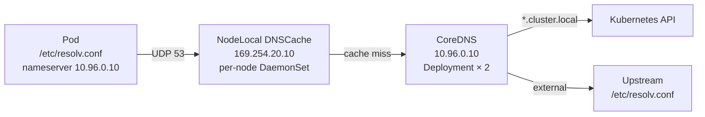
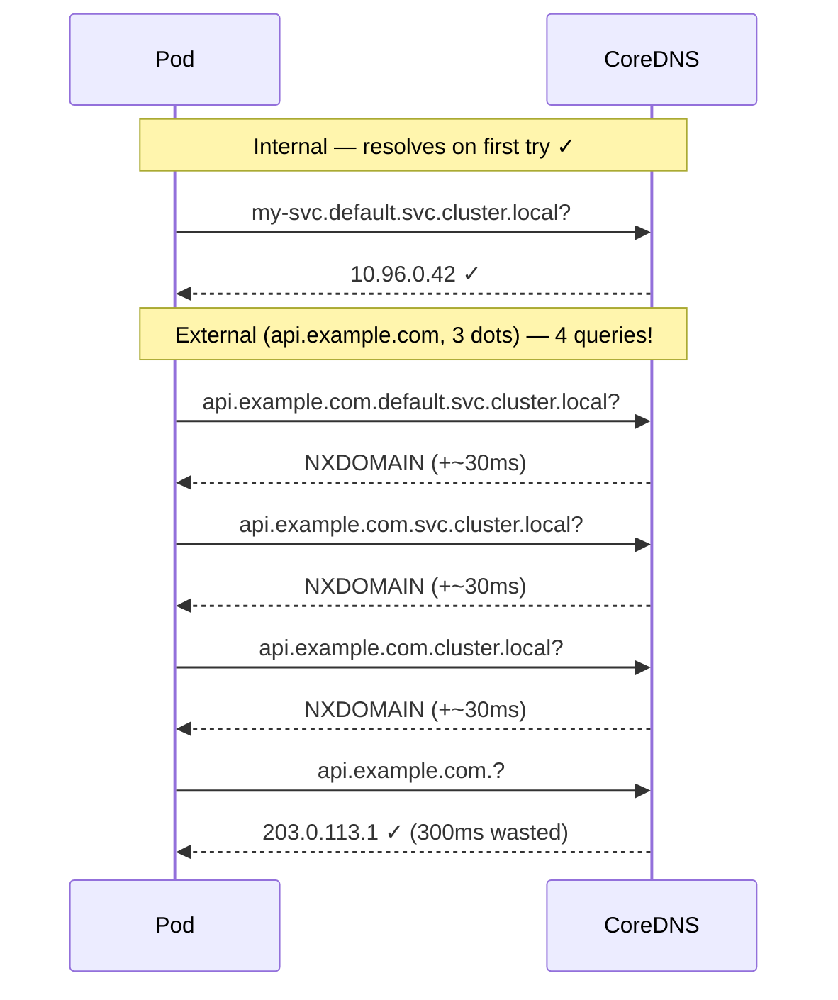

# Lesson 14 — CoreDNS and Service Discovery

> **Track:** Kubernetes Networking · **Prereqs:** [Lesson 13 — Services](13-kubernetes-services-kube-proxy.md) · **Time:** ~1h

> **Goal:** Debug ndots:5 latency, tune CoreDNS for your cluster, and deploy NodeLocal DNSCache.

---

## Practice Setup

```bash
# Terminal 1 — Mac (kubectl)
kubectl get cm -n kube-system coredns -o yaml
kubectl get svc -n kube-system kube-dns

# Terminal 2 — debug pod
kubectl run dns-test --image=nicolaka/netshoot --rm -it --restart=Never -- \
  sh -c "nslookup kubernetes && cat /etc/resolv.conf"
```

---

## 1. Architecture



```bash
kubectl get pods -n kube-system -l k8s-app=kube-dns   # CoreDNS pods
kubectl get svc  -n kube-system kube-dns               # ClusterIP 10.96.0.10
```

**DNS name formats:**

| Type | Format | Example |
|------|--------|---------|
| Service | `<svc>.<ns>.svc.cluster.local` | `web.default.svc.cluster.local` |
| StatefulSet pod | `<pod>.<svc>.<ns>.svc.cluster.local` | `db-0.db.default.svc.cluster.local` |
| Headless SVC | Same — returns pod IP directly | returns `10.244.1.5` |

---

## 2. The ndots:5 Latency Trap

Default `/etc/resolv.conf` in every pod:
```
nameserver 10.96.0.10
search default.svc.cluster.local svc.cluster.local cluster.local
options ndots:5
```

Any hostname with **fewer than 5 dots** triggers search-domain expansion before the absolute lookup. External names waste 3 round trips (~90–300 ms):



> **Fix:** Lower `ndots` per pod or use FQDNs (trailing dot: `api.example.com.`).

```yaml
# Per-pod dnsConfig
spec:
  dnsConfig:
    options:
      - name: ndots
        value: "1"
```

---

## 3. Corefile — Key Directives

```bash
kubectl get cm -n kube-system coredns -o yaml   # view current config
kubectl edit cm -n kube-system coredns           # edit (auto-reloads)
```

| Directive | What it does |
|-----------|-------------|
| `kubernetes cluster.local` | Answers `*.cluster.local` from K8s API |
| `forward . /etc/resolv.conf` | Sends external queries to node's upstream DNS |
| `cache 30` | Caches positive responses for 30 s |
| `health` / `ready` | `/health` :8080 and `/ready` :8181 probes |
| `prometheus :9153` | Metrics endpoint |

**Stub zone** (forward a corporate domain to a private resolver):
```
corp.internal:53 {
    forward . 10.100.0.53
    cache 30
}
```

**Hosts override** (static entry):
```
.:53 {
    hosts {
        10.100.0.5  legacy.corp.internal
        fallthrough
    }
    # rest of config...
}
```

---

## 4. NodeLocal DNSCache

Runs as a DaemonSet on `169.254.20.10` (link-local). Pods hit the local node cache instead of a ClusterIP — no conntrack overhead, ~10× lower p99 latency for cached queries.

```bash
# Deploy (official manifest)
kubectl apply -f https://raw.githubusercontent.com/kubernetes/kubernetes/master/cluster/addons/dns/nodelocaldns/nodelocaldns.yaml

# Verify — one pod per node
kubectl get pods -n kube-system -l k8s-app=node-local-dns -o wide

# Confirm pod resolv.conf points to it
kubectl exec <pod> -- cat /etc/resolv.conf
# nameserver 169.254.20.10
```

> **Cloud note:** AWS EKS uses `169.254.20.10` with `aws-k8s-cni` automatically. GKE runs NodeLocal by default since 1.15. For bare metal, forward to your on-prem resolver: `forward . <corp-dns-ip>`.

---

## 5. Troubleshooting

```bash
# 1 — CoreDNS healthy?
kubectl get pods -n kube-system -l k8s-app=kube-dns
kubectl logs -n kube-system -l k8s-app=kube-dns | grep -E "WARN|ERROR"

# 2 — Pod can reach CoreDNS?
kubectl run -it --rm d --image=nicolaka/netshoot -- nc -vzu 10.96.0.10 53

# 3 — Internal resolution works?
kubectl run -it --rm d --image=nicolaka/netshoot -- nslookup kubernetes

# 4 — External resolution works?
kubectl run -it --rm d --image=nicolaka/netshoot -- nslookup github.com

# 5 — Enable query logging (temporarily)
kubectl edit cm -n kube-system coredns   # add "log" inside the .:53 block
```

**Common causes:**

| Symptom | Likely cause | Fix |
|---------|-------------|-----|
| External names slow (~300ms) | ndots:5 search expansion | Set `ndots:1` or use FQDNs |
| CoreDNS OOMKilled | Traffic spike | Increase memory limits / add replicas |
| `i/o timeout` for `10.96.0.10` | kube-proxy DNAT rule missing | Restart kube-proxy |
| Intermittent NXDOMAIN | UDP conntrack race | Enable NodeLocal DNSCache |

---

## Summary

| Concept | Detail |
|---------|--------|
| CoreDNS ClusterIP | `10.96.0.10` (default) |
| Search domains | `<ns>.svc.cluster.local svc.cluster.local cluster.local` |
| ndots:5 | <5 dots → tries 3 search domains first |
| Fix ndots | `dnsConfig.options ndots: "1"` per pod |
| NodeLocal DNSCache | `169.254.20.10` per node — eliminates conntrack for DNS |
| Stub zone | `corp.internal:53 { forward . <ip> }` in Corefile |

---

## Online Resources

| Resource | Cost | What you practice |
|----------|------|-------------------|
| [Killercoda Playground](https://killercoda.com/) | Free | Edit CoreDNS ConfigMap live, run `nslookup` from pods, test ndots behavior, inspect NodeLocal DNSCache |
| [iximiuz: Container Networking from Scratch](https://labs.iximiuz.com/tutorials/container-networking-from-scratch) | Free | DNS resolution inside network namespaces — explains why CoreDNS sits at a ClusterIP address |

---

**Next:** [Lesson 15 — IPv6 and Dual-Stack Kubernetes](15-ipv6-dual-stack.md)
