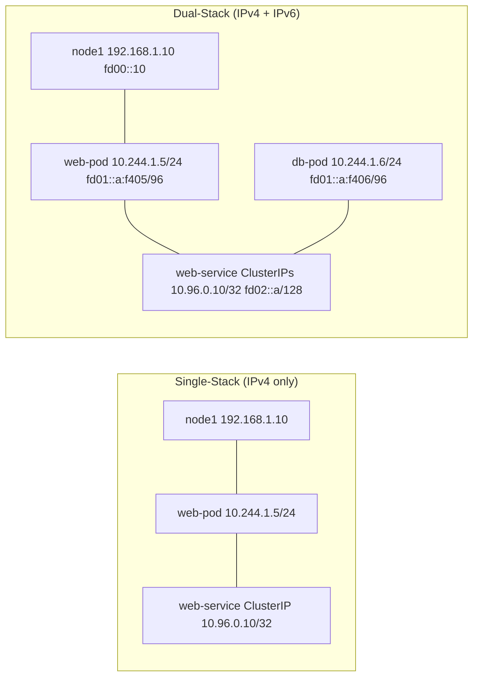
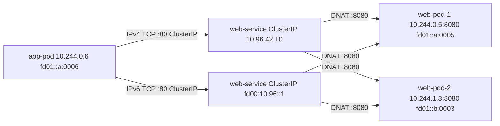

# Lesson 15 — IPv6 and Dual-Stack Kubernetes

> **Track:** Network Foundation — Bare Metal & Cloud · **Prereqs:** [Lesson 02 — IP Routing](02-ip-routing-and-forwarding.md), [Lesson 09 — CNI](09-cni-specification.md) · **Time:** ~2 hours

> **Goal:** Configure a dual-stack Kubernetes cluster, create dual-stack services with the correct ipFamilyPolicy, and diagnose IPv6 connectivity failures at the node and pod level.


**Jump to:** [Theory](#theory) · [Practice](#practice) · [Troubleshooting](#troubleshooting) · [Production Checklist](#production-checklist) · [Quick Reference](#quick-reference) · [Check Your Understanding](#check-your-understanding)

---

## Theory

## 1. Dual-Stack vs IPv6-Only



**Dual-stack:** Every pod and service has both an IPv4 and IPv6 address. Traffic uses IPv4 or IPv6 based on the caller's preference.

**IPv6-only:** No IPv4 at all. Less common, but increasingly required by some cloud regions, carriers, and mobile networks.

**NDP replaces ARP in IPv6:**
- IPv4: `ARP broadcast` — "who has 10.244.1.1?"
- IPv6: `ICMPv6 Neighbor Solicitation` — "who has fd01::1?" (multicast, not broadcast)

---

## 2. IPv6 Address Types

| Type | Prefix | Scope | Use in Kubernetes |
|------|--------|-------|-------------------|
| Link-local | `fe80::/10` | Same link only | NDP, router discovery; not routable |
| ULA (Unique Local) | `fc00::/7` | Private network | Pod CIDRs, service CIDRs in private clusters |
| Global unicast | `2000::/3` | Internet-routable | Public-facing node addresses, cloud-assigned |
| Loopback | `::1/128` | Host only | Localhost equivalent |
| Multicast | `ff00::/8` | Group | NDP neighbor solicitation uses `ff02::1:ff.../104` |

---

## 3. Enabling Dual-Stack at the Cluster Level

```bash
# kubeadm: enable dual-stack at init
cat <<EOF > kubeadm-config.yaml
apiVersion: kubeadm.k8s.io/v1beta4
kind: ClusterConfiguration
networking:
  podSubnet: "10.244.0.0/16,fd00:10:244::/56"      # IPv4 + IPv6 pod CIDR
  serviceSubnet: "10.96.0.0/12,fd00:10:96::/108"    # IPv4 + IPv6 service CIDR
EOF

kubeadm init --config kubeadm-config.yaml
```

Kubelet flags required (one IPv4, one IPv6 node address):
```
--node-ip=192.168.1.10,fd00::1
```

```bash
# Verify node has both pod CIDRs
kubectl get node <node> -o jsonpath='{.spec.podCIDRs}'
# ["10.244.0.0/24","fd00:10:244::/96"]
```

---

## 4. Dual-Stack CNI Configuration

### Calico
```yaml
apiVersion: operator.tigera.io/v1
kind: Installation
spec:
  calicoNetwork:
    ipPools:
      - cidr: 10.244.0.0/16
        encapsulation: VXLAN
      - cidr: fd00:10:244::/56
        encapsulation: VXLAN
```

### Cilium
```bash
helm install cilium cilium/cilium \
  --set ipv4.enabled=true \
  --set ipv6.enabled=true \
  --set tunnel=vxlan
```

### Flannel
```json
{
  "Network": "10.244.0.0/16",
  "IPv6Network": "fd00:10:244::/56",
  "EnableIPv6": true,
  "Backend": {"Type": "vxlan"}
}
```

---

## 5. Dual-Stack Services



```yaml
# Prefer IPv6, fall back to IPv4
apiVersion: v1
kind: Service
metadata:
  name: web
spec:
  ipFamilyPolicy: PreferDualStack   # SingleStack | PreferDualStack | RequireDualStack
  ipFamilies:
    - IPv6
    - IPv4
  selector:
    app: web
  ports:
    - port: 80
```

```bash
kubectl get svc web
# NAME   TYPE        CLUSTER-IP           CLUSTER-IPS                              PORT(S)
# web    ClusterIP   10.96.42.10          10.96.42.10,fd00:10:96::1               80/TCP
```

### ipFamilyPolicy Reference

| Policy | Behavior | Use Case |
|--------|----------|----------|
| `SingleStack` | One IP family (default) | Existing services; no migration needed |
| `PreferDualStack` | Dual-stack if cluster supports it; falls back to single | Gradual migration to dual-stack |
| `RequireDualStack` | Fails if cluster doesn't support dual-stack | Enforce dual-stack requirement in manifests |

---

## 6. Pod Dual-Stack Address Assignment

```bash
# Check pod has both addresses
kubectl get pod web-pod -o jsonpath='{.status.podIPs}'
# [{"ip":"10.244.0.6"},{"ip":"fd00:10:244::6"}]

# Inside the pod — verify both addresses visible
kubectl exec -it web-pod -- ip addr
# inet  10.244.0.6/24  brd 10.244.0.255 scope global eth0
# inet6 fd00:10:244::6/64 scope global dynamic

# Check IPv6 routing table inside pod
kubectl exec -it web-pod -- ip -6 route
# fd00:10:244::/64 dev eth0 proto kernel scope link src fd00:10:244::6
# default via fd00:10:244::1 dev eth0

# Ping a peer pod over IPv6
kubectl exec -it pod-a -- ping6 fd00:10:244::7
```

---

## 7. IPv6 Network Policies

```yaml
apiVersion: networking.k8s.io/v1
kind: NetworkPolicy
metadata:
  name: web-policy-v6
  namespace: default
spec:
  podSelector:
    matchLabels:
      app: web
  policyTypes:
    - Ingress
  ingress:
    - from:
        - ipBlock:
            cidr: fd00::/16    # IPv6 ULA CIDR
      ports:
        - port: 80
```

---

## 8. Bare Metal IPv6 Considerations

```bash
# Enable IPv6 forwarding on nodes (required)
sysctl net.ipv6.conf.all.forwarding=1
sysctl net.ipv6.conf.eth0.forwarding=1

# Allow iptables to see bridged IPv6 traffic
sysctl net.bridge.bridge-nf-call-ip6tables=1

# Check IPv6 routes
ip -6 route show

# Check NDP neighbor table (IPv6 ARP equivalent)
ip -6 neigh show

# NDP proxy (if needed for routing without BGP)
sysctl net.ipv6.conf.eth0.proxy_ndp=1
```

BGP with IPv6 (Calico):
```yaml
apiVersion: projectcalico.org/v3
kind: BGPPeer
metadata:
  name: v6-peer
spec:
  peerIP: "fd00::1"           # IPv6 BGP peer address
  asNumber: 65000
  sourceAddress: "fd00::10"
```

---

## 9. Cloud Provider Dual-Stack

### AWS EKS
```bash
# IPv6-only cluster (EKS 1.21+)
aws eks create-cluster \
  --name my-cluster \
  --kubernetes-network-config ipFamily=ipv6

kubectl get node -o jsonpath='{.items[0].status.addresses}'
# Type InternalIP: 2600:1f18:...
```

### GKE
```bash
# Dual-stack (GKE 1.21+)
gcloud container clusters create my-cluster \
  --enable-ip-alias \
  --stack-type=IPV4_IPV6

kubectl get node -o yaml | grep podCIDRs
# podCIDRs:
# - 10.100.0.0/24
# - fd20::/112
```

### AKS
```bash
# Dual-stack AKS (1.21+)
az aks create \
  --name my-aks \
  --ip-families IPv4 IPv6 \
  --pod-cidr "10.244.0.0/16,fd12:3456:789a::/56" \
  --service-cidr "10.96.0.0/16,fd12:3456:789b::/108"
```

### Cloud Support Matrix

| Cloud | Dual-Stack GA | IPv6-Only | Min K8s Version |
|-------|-------------|-----------|----------------|
| AWS EKS | IPv6-only only | Yes | 1.21 |
| GKE | Yes | No | 1.21 |
| AKS | Yes | No | 1.21 |
| Bare metal | Yes | Yes | 1.23 (GA) |

---

## 10. SLAAC vs DHCPv6

IPv6 nodes and pods can receive addresses through two mechanisms:

| Mechanism | How it works | Kubernetes usage |
|-----------|-------------|-----------------|
| SLAAC (Stateless Address Autoconfiguration) | Node derives address from router advertisement prefix + EUI-64 or random suffix | Node link-local and global addresses on bare metal |
| DHCPv6 Stateful | DHCP server assigns specific address + options | Enterprise environments requiring tracked address assignments |
| DHCPv6 Stateless | Router provides prefix; DHCP provides options only (NTP, DNS) | Hybrid — SLAAC for addresses, DHCP for config |
| Static | Manually configured via kubelet `--node-ip` | Recommended for Kubernetes nodes to ensure stable node IPs |

For Kubernetes pods, the CNI plugin handles IPv6 address assignment from the configured pod CIDR — SLAAC and DHCPv6 are not used for pod addresses.

```bash
# Check which address assignment method a node interface uses
ip -6 addr show eth0
# inet6 fd00::10/64 scope global dynamic   ← SLAAC/DHCPv6
# inet6 fd00::10/64 scope global           ← static (no "dynamic")

# Check router advertisements being received
rdisc6 eth0    # or: ip -6 route show | grep ra
```

---

## 11. Verification Steps

Verification steps are in the Practice lab below.

### Industry Applications

| Company / Project | Context | Technology from this lesson | Outcome |
|---|---|---|---|
| BT Group (UK telecom) | 5G core network functions running on Kubernetes | Full dual-stack cluster with ULA IPv6 pod CIDRs for 5G core NFs | Met 3GPP IPv6 requirements for 5G core; simplified integration with IPv6-native radio access nodes |
| AWS EKS | Cloud-native Kubernetes for telco and enterprise customers | IPv6-only cluster mode added in 2022 for EKS; each pod gets a unique VPC IPv6 address | Exhausted IPv4 space in large VPCs; IPv6-only pods scale to millions of endpoints per region |
| Comcast | Cable modem provisioning services on Kubernetes | IPv6-only pods used in DOCSIS provisioning infrastructure | Cable modems receive IPv6 from K8s pods without NAT; end-to-end IPv6 from CPE to provisioning server |
| GKE / Anthos | Google's managed Kubernetes platform | Dual-stack enabled by default since GKE 1.21; Cloud DNS handles AAAA records automatically | Zero-config dual-stack for all new clusters; transparent migration path for IPv4 workloads |
| Hospital network (medtech) | Migrating bedside device management to IPv6-only K8s pods to meet FDA cybersecurity guidance on network segmentation | IPv6-only pods per FDA network segmentation requirement; NDP neighbor discovery on a /64 subnet | NDP neighbor solicitations flooded the /64 subnet causing broadcast storms on legacy switches; resolved by switching to /80 per-pod subnets and enabling proxy NDP on the node interface |

---

## Practice

### Environment Setup

```bash
# Terminal 1 — Mac (kubectl)
kubectl get nodes -o jsonpath='{range .items[*]}{.metadata.name}{"\t"}{.status.addresses[*].address}{"\n"}{end}'
kubectl get pods -A -o wide | head -15
kubectl get svc -A | head -10

# Terminal 2 — minikube Linux node
minikube ssh
ip -6 addr show
ip -6 route show
ip -6 neigh show   # NDP neighbor table
```

### Hands-On Lab

**Step 1 — Verify dual-stack node and pod addressing:**

```bash
# Check nodes have both IPv4 and IPv6 addresses
kubectl get nodes -o custom-columns=\
"NAME:.metadata.name,ADDRESSES:.status.addresses[*].address"

# Check pods have both pod IPs
kubectl get pods -A -o custom-columns=\
"NS:.metadata.namespace,NAME:.metadata.name,IPs:.status.podIPs[*].ip" | head -20

# Check services have dual ClusterIPs
kubectl get svc -A -o custom-columns=\
"NS:.metadata.namespace,NAME:.metadata.name,CLUSTER-IPS:.spec.clusterIPs"
```

**Step 2 — Create a dual-stack service and verify:**

```bash
# Deploy a test workload
kubectl create deployment web --image=nginx --replicas=2
kubectl expose deployment web --port=80 --target-port=80

# Check if service got dual ClusterIPs (requires ipFamilyPolicy: PreferDualStack or RequireDualStack)
kubectl patch svc web -p '{"spec":{"ipFamilyPolicy":"PreferDualStack"}}'
kubectl get svc web -o jsonpath='{.spec.clusterIPs}'
# ["10.96.42.10","fd00:10:96::1"]

# Verify DNS AAAA record exists
kubectl run -it --rm dns-test --image=nicolaka/netshoot -- \
  nslookup -type=AAAA web.default.svc.cluster.local
```

**Step 3 — Test IPv6 pod-to-pod connectivity:**

```bash
# Get IPv6 addresses of two pods
kubectl get pods -o custom-columns="NAME:.metadata.name,IPs:.status.podIPs[*].ip"

# Ping between pods over IPv6
kubectl exec -it <pod-a> -- ping6 -c 3 <pod-b-ipv6-addr>
# Expected: 3 packets transmitted, 3 received, 0% packet loss

# Verify ip6tables has KUBE-SERVICES rules for IPv6 ClusterIPs
minikube ssh
sudo ip6tables -t nat -L KUBE-SERVICES -n | head -10
```

**Step 4 — Check NDP neighbor table (IPv6 ARP equivalent):**

```bash
# On the node — NDP should show pod IPv6 entries
minikube ssh
ip -6 neigh show
# fd01::a:0005 dev cni0 lladdr aa:bb:cc:dd:ee:01 REACHABLE
# fd01::a:0006 dev cni0 lladdr aa:bb:cc:dd:ee:02 REACHABLE

# Check IPv6 forwarding is enabled (required for cross-node traffic)
sysctl net.ipv6.conf.all.forwarding
# net.ipv6.conf.all.forwarding = 1
```

### Configuration Reference

| Parameter | Default | Effect | When to Change |
|-----------|---------|--------|----------------|
| `ipFamilyPolicy: SingleStack` | Default | One IP family only | Keep for existing services that do not need dual-stack |
| `ipFamilyPolicy: PreferDualStack` | — | Dual-stack if cluster supports it, falls back | Use for gradual migration; safe for clusters in both modes |
| `ipFamilyPolicy: RequireDualStack` | — | Fails if cluster is single-stack | Enforce dual-stack requirement in production manifests |
| `ipFamilies: [IPv6, IPv4]` | Cluster preference | IPv6 is preferred address family | Use when backend clients are IPv6-native |
| kubeadm `podSubnet` | IPv4 only | Pod IP range; add IPv6 CIDR with comma | Required at init time — cannot add IPv6 CIDR later without full re-init |
| kubeadm `serviceSubnet` | IPv4 only | Service IP range; add IPv6 CIDR with comma | Required at init time alongside podSubnet |
| `net.ipv6.conf.all.forwarding` | 0 (off) | Kernel forwards IPv6 between interfaces | Must be `1` on every node for cross-node IPv6 pod traffic |
| `net.bridge.bridge-nf-call-ip6tables` | 0 | ip6tables sees bridged IPv6 traffic | Must be `1` on every node for CNI IPv6 policy enforcement |

---

## Troubleshooting

| Symptom | Likely Cause | Diagnostic Command | Fix |
|---------|-------------|-------------------|-----|
| Pod missing IPv6 address | CNI doesn't have IPv6 pool configured | `kubectl get pod <pod> -o jsonpath='{.status.podIPs}'` | Add IPv6 pool to CNI config (Calico/Cilium/Flannel) |
| IPv6 ping between pods fails | IPv6 forwarding disabled on node | `sysctl net.ipv6.conf.all.forwarding` | Set `net.ipv6.conf.all.forwarding=1`; persist in `/etc/sysctl.d/` |
| Service has only one ClusterIP | ipFamilyPolicy is `SingleStack` | `kubectl get svc <svc> -o yaml \| grep ipFamily` | Update service to `ipFamilyPolicy: PreferDualStack` |
| ip6tables rules missing for service | kube-proxy not generating IPv6 rules | `ip6tables -t nat -L KUBE-SERVICES -n` | Verify `--cluster-cidr` includes IPv6 CIDR; restart kube-proxy |
| NDP resolution fails (neighbor unreachable) | IPv6 proxy NDP not configured | `ip -6 neigh show` and look for `FAILED` entries | Enable `proxy_ndp` on the interface or configure upstream router |
| DNS AAAA query returns nothing | CoreDNS doesn't have IPv6 ClusterIP | `kubectl get svc -n kube-system kube-dns -o jsonpath='{.spec.clusterIPs}'` | Re-install with dual-stack service CIDRs configured |
| Cloud VPC rejects IPv6 traffic | VPC doesn't have IPv6 CIDR block assigned | Cloud console: check VPC IPv6 CIDR block | Assign IPv6 CIDR to VPC and subnets in cloud console |

---

## Production Checklist

- [ ] Enable IPv6 forwarding persistently on all nodes (`/etc/sysctl.d/99-k8s-ipv6.conf`)
- [ ] Assign IPv6 CIDR blocks to cloud VPC and subnets before creating the cluster
- [ ] Configure CNI with both IPv4 and IPv6 pools before the first pod starts
- [ ] Set `ipFamilyPolicy: PreferDualStack` on new services as the migration baseline
- [ ] Verify `ip6tables` KUBE-SERVICES rules exist alongside iptables rules after kube-proxy starts
- [ ] Test AAAA DNS resolution from pods: `nslookup -type=AAAA web.default.svc.cluster.local`
- [ ] Confirm MTU is consistent across IPv4 and IPv6 paths — IPv6 may require a different MTU (NDP Path MTU Discovery)

---

## Common Anti-Patterns

| What people do | Why it breaks | Correct approach |
|---------------|--------------|-----------------|
| Enable dual-stack at cluster init but leave CNI with only IPv4 pool | Pods get IPv4 addresses only; IPv6 ClusterIPs are unreachable | Configure CNI IPv6 pool before the first pod starts |
| Use link-local (`fe80::/10`) addresses for pod CIDRs | Link-local addresses are not routable beyond the local link; cross-node traffic fails | Use ULA (`fc00::/7`) or globally routable (`2000::/3`) prefixes for pod and service CIDRs |
| Hardcode IPv4 service IPs in application configs | App breaks when migrated to dual-stack or IPv6-only cluster | Use DNS service names (`svc.ns.svc.cluster.local`) — never hardcode IPs |
| Set `RequireDualStack` on all services immediately | Services fail to create on single-stack clusters or during partial migration | Use `PreferDualStack` for gradual rollout; switch to `RequireDualStack` only after full cluster dual-stack is verified |
| Ignore ip6tables when debugging service connectivity | IPv6 service path uses ip6tables; iptables commands show nothing for IPv6 traffic | Always check both `iptables` and `ip6tables` when debugging dual-stack service issues |

---

## Quick Reference

| Use Case | Command |
|---------|---------|
| Check node has both address families | `kubectl get node <node> -o jsonpath='{.status.addresses}'` |
| Check pod dual-stack IPs | `kubectl get pod <pod> -o jsonpath='{.status.podIPs}'` |
| Ping over IPv6 between pods | `kubectl exec -it pod-a -- ping6 <ipv6-addr>` |
| DNS AAAA lookup | `kubectl exec -it pod-a -- nslookup -type=AAAA web.default.svc.cluster.local` |
| View IPv6 routes on node | `ip -6 route show` |
| View NDP neighbor table | `ip -6 neigh show` |
| Check ip6tables service rules | `ip6tables -t nat -L KUBE-SERVICES -n` |
| Verify service has dual ClusterIPs | `kubectl get svc <svc> -o jsonpath='{.spec.clusterIPs}'` |
| Check IPv6 forwarding enabled | `sysctl net.ipv6.conf.all.forwarding` |
| List pod CIDRs on a node | `kubectl get node <node> -o jsonpath='{.spec.podCIDRs}'` |
| Enable dual-stack in Cilium | `helm upgrade cilium cilium/cilium --set ipv4.enabled=true --set ipv6.enabled=true` |

---

## Summary

| Concept | Detail |
|---------|--------|
| Dual-stack cluster | Requires `--pod-cidr` and `--service-cidr` with both families at init |
| ipFamilyPolicy | `PreferDualStack` for gradual migration; `RequireDualStack` to enforce |
| NDP | IPv6 equivalent of ARP — ICMPv6 Neighbor Solicitation (multicast, not broadcast) |
| IPv6 forwarding | `net.ipv6.conf.all.forwarding=1` required on every node |
| Address types | Link-local `fe80::/10` (non-routable), ULA `fc00::/7` (private), Global `2000::/3` |
| Cloud support | EKS (IPv6-only 1.21+), GKE dual-stack (1.21+), AKS dual-stack (1.21+) |
| ip6tables | kube-proxy writes parallel KUBE-SERVICES chains in ip6tables for IPv6 service VIPs |

---

## Check Your Understanding

1. **[Concept question]** How does IPv6 Neighbor Discovery Protocol (NDP) differ from IPv4 ARP in its communication model, and why does Kubernetes require `net.ipv6.conf.all.forwarding=1` on every node in a dual-stack cluster?

   <details><summary>Answer</summary>

   ARP uses Layer 2 broadcast to ask "who has IP X?" — every device on the segment must process the broadcast. NDP uses ICMPv6 Neighbor Solicitation messages sent to a solicited-node multicast address derived from the target IP, so only the target host (and devices explicitly subscribed to that multicast group) process the message. This is more efficient and scales better. The `net.ipv6.conf.all.forwarding=1` sysctl is required because, without it, the node's kernel drops IPv6 packets that need to be forwarded between pod namespaces and the external network — the same requirement as `net.ipv4.ip_forward=1` for IPv4.

   </details>

2. **[Scenario question]** A dual-stack cluster has pods with both IPv4 and IPv6 addresses assigned. IPv4 pings between pods on different nodes work correctly, but `ping6` between pods on different nodes fails with 100% packet loss. What sysctl parameter should you check on the nodes first?

   <details><summary>Answer</summary>

   Check `sysctl net.ipv6.conf.all.forwarding` on the nodes — if it returns `0`, the kernel is not forwarding IPv6 packets between interfaces, causing all cross-node IPv6 traffic to be silently dropped. Set it with `sysctl -w net.ipv6.conf.all.forwarding=1` and persist in `/etc/sysctl.d/99-k8s-ipv6.conf`. Also check `net.bridge.bridge-nf-call-ip6tables=1` and that `ip6tables -t nat -L KUBE-SERVICES -n` shows rules for IPv6 service ClusterIPs.

   </details>

3. **[Practical question]** What command would you run to verify that a service has been assigned both an IPv4 and an IPv6 ClusterIP in a dual-stack cluster?

   <details><summary>Answer</summary>

   ```bash
   kubectl get svc <service-name> -o jsonpath='{.spec.clusterIPs}'
   ```
   The output should show two IPs — one IPv4 (e.g., `10.96.42.10`) and one IPv6 (e.g., `fd00:10:96::1`). If only one IP appears, check the service's `ipFamilyPolicy` with `kubectl get svc <name> -o yaml | grep -A3 ipFamily` — it may be set to `SingleStack` instead of `PreferDualStack` or `RequireDualStack`.

   </details>

---

## Online Resources

| Resource | Cost | What you practice |
|----------|------|-------------------|
| [Killercoda Playground](https://killercoda.com/) | Free | Enable dual-stack on a kind/minikube cluster; inspect IPv6 addresses, test NDP with `ip -6 neigh` |
| [Kubernetes Official Docs: IPv4/IPv6 dual-stack](https://kubernetes.io/docs/concepts/services-networking/dual-stack/) | Free | Official walkthrough with example configs — use alongside the lab commands in this lesson |

---

**← Previous:** [Lesson 14 — CoreDNS and Service Discovery](14-coredns-service-discovery.md)   |   **Next:** [Lesson 16 — Network Policies: Microsegmentation](16-network-policies.md)
