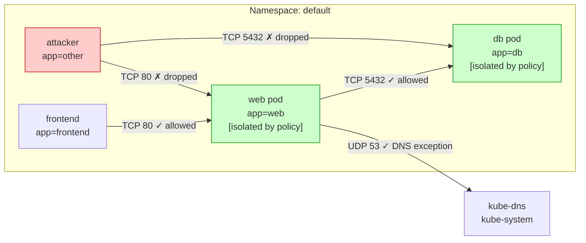
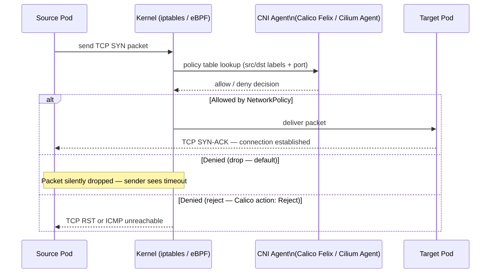

# Lesson 16 — Network Policies: Microsegmentation

> **Track:** Network Foundation — Bare Metal & Cloud  
> **Prerequisites:** [Lesson 13 — Kubernetes Services](13-kubernetes-services-kube-proxy.md)  
> **Duration:** ~2.5 hours

> **Goal:** Configure NetworkPolicy resources to implement microsegmentation, enforce default-deny namespaces, test connectivity enforcement with Cilium and Calico tooling, and avoid common selector and DNS egress pitfalls.

---

## Practice Setup

```bash
# Terminal 1 — Mac (kubectl)
kubectl get netpol -A
kubectl get pods -A -o wide | head -15

# Terminal 2 — minikube Linux node
minikube ssh
# Inspect CNI-enforced iptables rules (Calico)
sudo iptables -L | grep -i cali | head -20
# Or for Cilium: sudo bpftool map dump name cilium_policy 2>/dev/null | head -20
```

Observation commands — run after deploying test pods to see enforcement live:

```bash
# Deploy test pods with labels
kubectl run web --image=nginx --labels="app=web" --expose --port=80
kubectl run frontend --image=nicolaka/netshoot --labels="app=frontend" -- sleep 3600
kubectl run attacker --image=nicolaka/netshoot --labels="app=other" -- sleep 3600

# Confirm connectivity BEFORE any policy (all pods reachable — flat network)
kubectl exec frontend -- curl -s --max-time 2 http://web   # expect: nginx HTML
kubectl exec attacker -- curl -s --max-time 2 http://web   # expect: nginx HTML

# Apply default-deny + selective allow (Section 4), then verify isolation
kubectl exec frontend -- curl -s --max-time 2 http://web   # expect: nginx HTML (allowed)
kubectl exec attacker -- curl -s --max-time 2 http://web   # expect: silence / timeout (blocked)
echo "Enforcement confirmed if attacker timed out"

# Watch live events as policies are applied
kubectl get events --watch --field-selector reason=NetworkPolicyUpdated 2>/dev/null &
```

> **See also:** [Lesson 05 — iptables and packet filtering](05-iptables-nftables.md) for CNI enforcement mechanics.

---

## 1. The Default Model

Without any NetworkPolicy, all ingress and all egress between pods is **allowed** (flat network model). Applying a NetworkPolicy to a pod's selector activates enforcement and **denies all traffic not explicitly permitted**.

```
No policy applied → pod is non-isolated → all traffic allowed
Policy applied    → pod is isolated → only specified traffic allowed
```

The CNI plugin (Calico, Cilium, etc.) — not the Kubernetes API server — performs the actual enforcement. The API server stores and validates policy objects; the CNI agent on each node translates them into iptables rules or eBPF programs.



---

## 2. NetworkPolicy Anatomy

```yaml
apiVersion: networking.k8s.io/v1
kind: NetworkPolicy
metadata:
  name: web-policy
  namespace: default         # policies are namespace-scoped
spec:
  podSelector:               # pods this policy applies TO
    matchLabels:
      app: web

  policyTypes:               # which directions this policy governs
    - Ingress
    - Egress

  ingress:                   # whitelist of allowed inbound connections
    - from:
        - podSelector:       # from pods with these labels (same namespace)
            matchLabels:
              app: frontend
        - namespaceSelector: # from pods in namespaces with this label
            matchLabels:
              env: production
      ports:
        - protocol: TCP
          port: 80

  egress:                    # whitelist of allowed outbound connections
    - to:
        - podSelector:
            matchLabels:
              app: db
      ports:
        - protocol: TCP
          port: 5432
    - to: []                 # DNS egress (required or DNS breaks)
      ports:
        - protocol: UDP
          port: 53
        - protocol: TCP
          port: 53
```

### Key Parameters

| Parameter | Default | Effect | When to change |
|-----------|---------|--------|----------------|
| `podSelector: {}` | (none) | Selects ALL pods in namespace | Use for namespace-wide default-deny baseline |
| `policyTypes: [Ingress]` | Ingress-only | Egress remains open | Add `Egress` whenever restricting outbound traffic |
| `policyTypes: [Ingress, Egress]` | — | Both directions enforced | Full microsegmentation |
| `from: []` / `to: []` empty list | — | Denies ALL traffic in that direction | Default-deny pattern alongside podSelector: {} |
| `namespaceSelector` alone | — | Allows all pods from matching namespaces | Cross-namespace access; pair with podSelector for AND logic |
| `ipBlock: cidr` | — | Allows/blocks CIDR ranges | External traffic, on-prem resources, monitoring agents |
| `ipBlock: except` | — | Excludes sub-ranges from the CIDR block | Carve out sensitive sub-networks within an allowed CIDR |
| `port: 53 protocol: UDP/TCP` | — | DNS exception | Required whenever an egress policy is applied |

The packet journey through CNI enforcement:



---

## 3. Selector Combinations

```yaml
# AND condition: pod must have BOTH labels
from:
  - podSelector:
      matchLabels:
        app: frontend
        env: production

# OR condition: separate from entries
from:
  - podSelector:
      matchLabels:
        app: frontend
  - podSelector:
      matchLabels:
        app: api

# AND between podSelector AND namespaceSelector
# (pod must match AND be in a matching namespace)
from:
  - podSelector:
      matchLabels:
        role: db-client
    namespaceSelector:
      matchLabels:
        project: billing

# Note: if podSelector and namespaceSelector are SEPARATE from entries,
# they are ORed. If they are in the SAME from entry, they are ANDed.
```

---

## 4. Common Policy Patterns

### Default Deny All (namespace baseline)
```yaml
# Apply first — sets default deny for the namespace
apiVersion: networking.k8s.io/v1
kind: NetworkPolicy
metadata:
  name: default-deny-all
  namespace: default
spec:
  podSelector: {}      # matches all pods
  policyTypes:
    - Ingress
    - Egress
```

### Allow DNS (almost always needed with egress policies)
```yaml
apiVersion: networking.k8s.io/v1
kind: NetworkPolicy
metadata:
  name: allow-dns
  namespace: default
spec:
  podSelector: {}
  policyTypes:
    - Egress
  egress:
    - to:
        - namespaceSelector:
            matchLabels:
              kubernetes.io/metadata.name: kube-system
          podSelector:
            matchLabels:
              k8s-app: kube-dns
      ports:
        - port: 53
          protocol: UDP
        - port: 53
          protocol: TCP
```

### Allow Prometheus Scraping
```yaml
apiVersion: networking.k8s.io/v1
kind: NetworkPolicy
metadata:
  name: allow-prometheus
  namespace: default
spec:
  podSelector:
    matchLabels:
      app: web
  policyTypes:
    - Ingress
  ingress:
    - from:
        - namespaceSelector:
            matchLabels:
              kubernetes.io/metadata.name: monitoring
          podSelector:
            matchLabels:
              app: prometheus
      ports:
        - port: 9090
```

### Allow from Specific CIDR (bare metal or on-prem)
```yaml
egress:
  - to:
      - ipBlock:
          cidr: 10.100.0.0/16    # corporate internal
          except:
            - 10.100.1.0/24      # exclude sensitive subnet
```

---

## 5. CNI Plugin Support

NetworkPolicy enforcement is **the CNI plugin's responsibility** — the Kubernetes API accepts any policy, but only plugins that implement it will enforce it.

| CNI Plugin | NetworkPolicy Support |
|------------|----------------------|
| Calico | Full (Kubernetes + its own CRDs) |
| Cilium | Full (Kubernetes + its own CRDs + L7) |
| Weave Net | Full |
| Flannel | None (use with Calico or Calico policy-only mode) |
| AWS VPC CNI | Partial (use Calico or Cilium on top) |
| GKE Dataplane v2 | Full (Cilium under the hood) |

---

## 6. Testing Network Policies

```bash
# Method 1: netcat connectivity test from inside a pod
kubectl run -it --rm tester --image=nicolaka/netshoot -- \
  nc -vz web.default.svc.cluster.local 80

# Method 2: Policy trace with Calico
calicoctl policy trace \
  --src-pod default/frontend \
  --dst-pod default/backend \
  --dst-port 8080

# Method 3: Cilium policy trace
cilium policy trace \
  --src-identity <id> \
  --dst-identity <id> \
  --dport 80

# Method 4: Use network-policy-api conformance tests
# https://github.com/kubernetes-sigs/network-policy-api
```

---

## 7. Calico NetworkPolicy Extras

```yaml
# Calico GlobalNetworkPolicy — cluster-wide, pre-namespace policies
apiVersion: projectcalico.org/v3
kind: GlobalNetworkPolicy
metadata:
  name: allow-node-ports
spec:
  selector: all()
  ingress:
    - action: Allow
      protocol: TCP
      destination:
        ports: [30000-32767]   # NodePort range
  order: 100   # lower = higher priority

# Calico HostEndpoint — apply policy to node interfaces
apiVersion: projectcalico.org/v3
kind: HostEndpoint
metadata:
  name: node1-eth0
spec:
  interfaceName: eth0
  node: node1
  profiles:
    - node-profile
```

---

## 8. Cilium L7 Network Policy

Cilium can enforce policy at Layer 7 (HTTP, gRPC, Kafka).

```yaml
apiVersion: cilium.io/v2
kind: CiliumNetworkPolicy
metadata:
  name: http-policy
  namespace: default
spec:
  endpointSelector:
    matchLabels:
      app: api
  ingress:
    - fromEndpoints:
        - matchLabels:
            app: frontend
      toPorts:
        - ports:
            - port: "8080"
              protocol: TCP
          rules:
            http:
              - method: "GET"
                path: "/api/v1/.*"
              - method: "POST"
                path: "/api/v1/data"
                headers:
                  - "X-API-Key: .*"
```

---

## 9. Network Policy on Cloud Providers

### AWS EKS
```bash
# Option 1: Calico NetworkPolicy on EKS (without replacing VPC CNI)
kubectl apply -f calico-operator.yaml

# Option 2: Security Groups for Pods (AWS native)
# Apply SGs at pod level via SecurityGroupPolicy CRD
```

### GKE
```bash
# Enable NetworkPolicy at cluster creation (or update)
gcloud container clusters update my-cluster \
  --update-addons=NetworkPolicy=ENABLED
gcloud container clusters update my-cluster \
  --enable-network-policy
```

### AKS
```bash
# Enable Calico NetworkPolicy on AKS
az aks create --network-policy calico

# Or use Azure NPM (Azure Network Policy Manager)
az aks create --network-policy azure
```

---

## Troubleshooting

| Symptom | Likely Cause | Diagnostic Command | Fix |
|---------|-------------|-------------------|-----|
| DNS lookups fail after adding egress policy | Missing DNS egress exception | `kubectl exec <pod> -- nslookup kubernetes` | Add `allow-dns` NetworkPolicy to allow port 53 to kube-system/kube-dns |
| Traffic blocked even though policy looks correct | CNI plugin does not enforce NetworkPolicy (e.g., Flannel) | `kubectl get pods -n kube-system | grep -E 'calico\|cilium\|weave'` | Switch to or layer Calico/Cilium on top of Flannel |
| Policy applies to unintended pods | Broad podSelector: {} catches all pods | `kubectl describe netpol <name>` and check Affecting Pods | Narrow podSelector with specific matchLabels |
| Traffic still blocked after deleting the policy | A second policy also selects the pod | `kubectl get netpol -n default -o yaml | grep -A5 podSelector` | Delete all policies selecting that pod or add an explicit allow rule |
| AND logic not working (namespaceSelector + podSelector) | Both selectors placed as separate `from` entries (OR logic) | `kubectl get netpol -o yaml` and inspect `from` list structure | Nest both selectors in the same `from` list item for AND behavior |
| Cloud LB health checks fail after egress restriction | Health probe IPs blocked by egress policy | `kubectl describe svc <lb-svc>` → check health probe CIDR | Add egress allow for cloud health check IP ranges |
| Calico shows deny but no Kubernetes NetworkPolicy present | Calico GlobalNetworkPolicy (cluster-scoped) is blocking | `calicoctl get globalnetworkpolicy` | Review GNP `order` and `action`; adjust or add an explicit Allow with lower order number |

---

## Production Checklist

- [ ] Default-deny-all policy applied to every application namespace before any workloads are deployed
- [ ] Explicit `allow-dns` NetworkPolicy deployed alongside every egress restriction
- [ ] CNI plugin verified as NetworkPolicy-capable (`kubectl describe pod -n kube-system <cni-pod>`) before relying on enforcement
- [ ] Every policy tested with both allowed and blocked traffic paths before promoting to production
- [ ] Cloud LB health check IP ranges added to egress allowlist when using `externalTrafficPolicy: Local`
- [ ] Calico GlobalNetworkPolicy or Cilium ClusterwideNetworkPolicy audited for cluster-wide rules that could silently override namespace policies
- [ ] NetworkPolicy YAML reviewed with `editor.networkpolicy.io` or validated via `kubectl apply --dry-run=server` before applying in production

---

## Common Anti-Patterns

| What people do | Why it breaks | Correct approach |
|----------------|--------------|-----------------|
| Apply egress policy without a DNS exception | All DNS lookups time out; every service call that uses a hostname fails with "name not resolved" | Always deploy `allow-dns` as a companion policy whenever you restrict egress |
| Place `podSelector` and `namespaceSelector` as separate `from` entries expecting AND logic | Separate entries create OR conditions — either selector alone is sufficient to allow access, defeating the intent | Nest both selectors inside the same `from` list item to enforce AND (pod must match AND be in the matching namespace) |
| Use Flannel without an overlay policy engine and expect NetworkPolicy to work | Flannel has no policy enforcement engine; the API accepts the resource silently but nothing is blocked | Install Calico in policy-only mode on top of Flannel, or switch to Cilium or Weave |
| Omit the `policyTypes` field | Kubernetes infers policyTypes from the presence of `ingress`/`egress` rules, but explicit declaration prevents subtle bugs when rules are empty | Always declare both `Ingress` and `Egress` in `policyTypes` when you intend to restrict both directions |
| Write a temporary "allow-all" to unblock an incident and forget to remove it | Leaves a permanent open hole; the next policy added assumes the allow-all is gone but it is still there, silently granting access | Use labels + GitOps tracking to give every temporary policy an expiry annotation; automate cleanup |

---

## Quick Reference

| Use Case | Command |
|----------|---------|
| List all NetworkPolicies in a namespace | `kubectl get netpol -n <ns>` |
| Describe a policy (selector, rules, affected pods) | `kubectl describe netpol <name> -n <ns>` |
| Test TCP connectivity from a pod | `kubectl exec <pod> -- nc -vz <host> <port>` |
| Launch netshoot debug pod | `kubectl run -it --rm tester --image=nicolaka/netshoot -- bash` |
| Watch Cilium dropped flows | `hubble observe --verdict DROPPED --namespace default` |
| Trace a Calico policy decision | `calicoctl policy trace --src-pod ns/pod --dst-pod ns/pod --dst-port 80` |
| Get Cilium endpoint identity for a pod | `cilium endpoint list | grep <pod-name>` |
| Watch deny events in Calico Felix | `kubectl logs -n calico-system -l app=calico-node -c calico-node | grep Deny` |
| Check workload endpoint policies (Calico) | `calicoctl get workloadendpoint -n default <pod> -o yaml` |
| Check if a pod is isolated by any policy | `kubectl get netpol -n <ns> -o yaml | grep -B2 -A5 podSelector` |
| Validate NetworkPolicy YAML without applying | `kubectl apply --dry-run=server -f policy.yaml` |
| List all pods selected by a policy | `kubectl get pods -n <ns> -l <selector-from-policy>` |

---

## Summary

| Concept | Detail |
|---------|--------|
| Default behavior | All pod-to-pod traffic allowed (no policies present) |
| Policy activation | ANY policy selecting a pod isolates it in that direction |
| Selector logic | Same `from` entry = AND; separate `from` entries = OR |
| DNS egress | Must be explicitly allowed when any egress policy is applied |
| L7 policy | Cilium only via CiliumNetworkPolicy (Kubernetes NetworkPolicy is L4 only) |
| Testing | `nc`, Cilium Hubble observe, Calico `calicoctl policy trace` |
| Cloud providers | AWS: Calico on VPC CNI; GKE: enable at cluster level; AKS: Calico or Azure NPM |

---

## Online Resources

| Resource | Cost | What you practice |
|----------|------|-------------------|
| [Isovalent: Cilium Host Firewall](https://isovalent.com/labs/cilium-host-firewall/) | Free | Enforce network policies at the host level with Cilium — extends standard NetworkPolicy to node traffic |
| [Killercoda Playground](https://killercoda.com/) | Free | Apply and test NetworkPolicy YAML, verify traffic is blocked with `kubectl exec` + `curl` |
| [Kubernetes Network Policy Recipes](https://github.com/ahmetb/kubernetes-network-policy-recipes) | Free (GitHub) | 20+ ready-to-use NetworkPolicy examples covering default-deny, namespace isolation, CIDR rules — copy-paste into your cluster |
| [NetworkPolicy Editor (Cilium)](https://editor.networkpolicy.io/) | Free browser tool | Visual drag-and-drop NetworkPolicy editor — build policies graphically, export YAML, see the selector logic |

---

**Next:** [Lesson 17 — Ingress Controllers and L7 Load Balancing](17-ingress-controllers.md)
