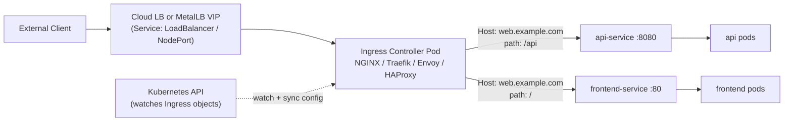
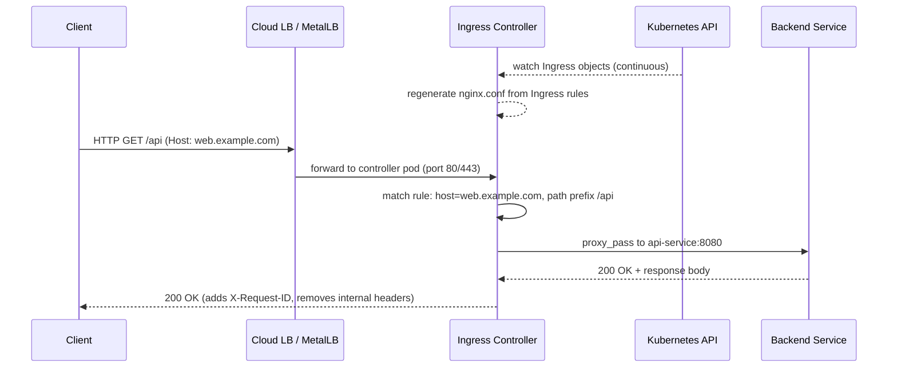

# Lesson 17 — Ingress Controllers and L7 Load Balancing

> **Track:** Network Foundation — Bare Metal & Cloud  
> **Prerequisites:** [Lesson 13 — Kubernetes Services](13-kubernetes-services-kube-proxy.md)  
> **Duration:** ~2.5 hours

> **Goal:** Deploy an NGINX or Traefik ingress controller, configure host-based and path-based routing with TLS termination via cert-manager, and diagnose 502/503/504 errors in the routing chain.

---

## Practice Setup

```bash
# Terminal 1 — Mac (kubectl + minikube tunnel)
kubectl get ingress -A
kubectl get pods -n ingress-nginx 2>/dev/null || kubectl get pods -n kube-system | grep ingress

# To expose an Ingress locally (bare metal simulation):
minikube tunnel   # run in a dedicated terminal, requires sudo

# Terminal 2 — Mac
kubectl get svc -n ingress-nginx -o wide 2>/dev/null
curl -H "Host: myapp.local" http://$(minikube ip)/
```

Observation commands — run after deploying NGINX Ingress to see routing live:

```bash
# Watch the NGINX controller pod as Ingress objects are applied
kubectl logs -n ingress-nginx -l app.kubernetes.io/component=controller -f &

# Deploy sample backends
kubectl create deployment web --image=nginx --port=80
kubectl expose deployment web --port=80
kubectl create deployment api --image=hashicorp/http-echo --port=5678 \
  -- /http-echo -text="api response"
kubectl expose deployment api --port=5678

# Apply and inspect routing
kubectl apply -f - <<EOF
apiVersion: networking.k8s.io/v1
kind: Ingress
metadata:
  name: demo
  annotations:
    nginx.ingress.kubernetes.io/rewrite-target: /
spec:
  ingressClassName: nginx
  rules:
  - host: demo.local
    http:
      paths:
      - path: /api
        pathType: Prefix
        backend:
          service:
            name: api
            port:
              number: 5678
      - path: /
        pathType: Prefix
        backend:
          service:
            name: web
            port:
              number: 80
EOF

kubectl describe ingress demo                       # check rules and backend status
kubectl get endpoints web api                       # confirm pods are ready
curl -H "Host: demo.local" http://$(minikube ip)/  # expect: nginx HTML
curl -H "Host: demo.local" http://$(minikube ip)/api  # expect: "api response"
```

> **See also:** [Lesson 19 — MetalLB and kube-vip](19-metallb-kube-vip.md) for assigning the Ingress controller a real EXTERNAL-IP on bare metal.

---

## 1. The Ingress Architecture

NodePort and LoadBalancer services give you L4 load balancing — they know TCP/UDP but nothing about HTTP. An Ingress controller adds L7 awareness: routing by hostname, URL path, TLS termination, authentication, rate limiting, and more.



The Ingress controller is itself a Kubernetes application (Deployment + Service). It watches Ingress resources and programs its proxy configuration dynamically.

---

## 2. Ingress Resource

```yaml
apiVersion: networking.k8s.io/v1
kind: Ingress
metadata:
  name: web-ingress
  namespace: default
  annotations:
    nginx.ingress.kubernetes.io/rewrite-target: /
spec:
  ingressClassName: nginx        # which controller handles this
  tls:
    - hosts:
        - web.example.com
      secretName: web-tls-cert   # TLS certificate
  rules:
    - host: web.example.com
      http:
        paths:
          - path: /api
            pathType: Prefix
            backend:
              service:
                name: api-service
                port:
                  number: 8080
          - path: /
            pathType: Prefix
            backend:
              service:
                name: frontend-service
                port:
                  number: 80
    - host: admin.example.com
      http:
        paths:
          - path: /
            pathType: Prefix
            backend:
              service:
                name: admin-service
                port:
                  number: 80
```

### Key Parameters

| Parameter | Default | Effect | When to change |
|-----------|---------|--------|----------------|
| `ingressClassName` | (cluster default IngressClass) | Selects which controller processes this Ingress | Multiple controllers installed; set explicitly to avoid ambiguity |
| `pathType: Prefix` | — | Matches path and all sub-paths | Use `Exact` for precise path matching with no sub-path bleed |
| `pathType: Exact` | — | Matches only the exact path string | Strict API endpoints where sub-paths should 404 |
| `tls.secretName` | — | Secret containing `tls.crt` and `tls.key` | Required for HTTPS; pair with cert-manager for auto-renewal |
| `nginx.ingress.kubernetes.io/rewrite-target` | (no rewrite) | Rewrites URL before forwarding to backend | Strip path prefix before sending to backend service |
| `nginx.ingress.kubernetes.io/ssl-redirect` | `"true"` | Redirects HTTP to HTTPS | Set to `"false"` for plain HTTP environments |
| `nginx.ingress.kubernetes.io/proxy-body-size` | `"1m"` | Maximum request body size | Increase for file uploads (`"100m"`) |
| `nginx.ingress.kubernetes.io/affinity` | (none) | Enables sticky sessions via cookie | Use when backend has session state |

The request flow through the Ingress controller:



---

## 3. NGINX Ingress Controller

The most widely used. Can run on bare metal or cloud.

```bash
# Install via Helm
helm repo add ingress-nginx https://kubernetes.github.io/ingress-nginx
helm install ingress-nginx ingress-nginx/ingress-nginx \
  --namespace ingress-nginx \
  --create-namespace \
  --set controller.service.type=LoadBalancer

# Verify
kubectl get pods -n ingress-nginx
kubectl get svc -n ingress-nginx ingress-nginx-controller
# Check EXTERNAL-IP — this is the IP your DNS should point to

# IngressClass resource
kubectl get ingressclass
```

```bash
# Bare metal: use NodePort or HostPort
helm install ingress-nginx ingress-nginx/ingress-nginx \
  --set controller.service.type=NodePort \
  --set controller.hostPort.enabled=true  # bind port 80/443 on each node
```

### NGINX Annotations

```yaml
annotations:
  # Rate limiting
  nginx.ingress.kubernetes.io/limit-rps: "10"
  nginx.ingress.kubernetes.io/limit-connections: "5"

  # Timeouts
  nginx.ingress.kubernetes.io/proxy-connect-timeout: "30"
  nginx.ingress.kubernetes.io/proxy-read-timeout: "60"

  # Auth
  nginx.ingress.kubernetes.io/auth-type: basic
  nginx.ingress.kubernetes.io/auth-secret: basic-auth-secret

  # Redirect HTTP to HTTPS
  nginx.ingress.kubernetes.io/ssl-redirect: "true"
  nginx.ingress.kubernetes.io/force-ssl-redirect: "true"

  # Backend protocol
  nginx.ingress.kubernetes.io/backend-protocol: "HTTPS"   # for HTTPS backends
  nginx.ingress.kubernetes.io/backend-protocol: "GRPC"    # for gRPC backends

  # Upload size
  nginx.ingress.kubernetes.io/proxy-body-size: "100m"

  # Sticky sessions
  nginx.ingress.kubernetes.io/affinity: "cookie"
  nginx.ingress.kubernetes.io/session-cookie-name: "INGRESSCOOKIE"
```

---

## 4. Traefik Ingress Controller

Popular in bare-metal and edge environments. Supports both Ingress and its own IngressRoute CRD.

```bash
# Install via Helm
helm repo add traefik https://helm.traefik.io/traefik
helm install traefik traefik/traefik \
  --namespace traefik \
  --create-namespace
```

```yaml
# Traefik IngressRoute (more expressive than standard Ingress)
apiVersion: traefik.io/v1alpha1
kind: IngressRoute
metadata:
  name: web-route
spec:
  entryPoints:
    - web
    - websecure
  routes:
    - match: "Host(`web.example.com`) && PathPrefix(`/api`)"
      kind: Rule
      services:
        - name: api-service
          port: 8080
      middlewares:
        - name: rate-limit
  tls:
    certResolver: letsencrypt
```

---

## 5. TLS Termination and cert-manager

```bash
# Install cert-manager
helm repo add jetstack https://charts.jetstack.io
helm install cert-manager jetstack/cert-manager \
  --namespace cert-manager \
  --create-namespace \
  --set installCRDs=true
```

```yaml
# ClusterIssuer for Let's Encrypt
apiVersion: cert-manager.io/v1
kind: ClusterIssuer
metadata:
  name: letsencrypt-prod
spec:
  acme:
    server: https://acme-v02.api.letsencrypt.org/directory
    email: admin@example.com
    privateKeySecretRef:
      name: letsencrypt-prod
    solvers:
      - http01:
          ingress:
            class: nginx
---
# Ingress with automatic TLS certificate
apiVersion: networking.k8s.io/v1
kind: Ingress
metadata:
  annotations:
    cert-manager.io/cluster-issuer: letsencrypt-prod
spec:
  tls:
    - hosts:
        - web.example.com
      secretName: web-tls    # cert-manager will create this Secret
```

```bash
# Check certificate status
kubectl get certificate
kubectl describe certificate web-tls
kubectl get certificaterequest
```

---

## 6. Ingress on Bare Metal

The main challenge: no cloud LB to assign an EXTERNAL-IP.

### Option A: NodePort + DNS round-robin
```bash
# Service type NodePort — expose on every node
helm install ingress-nginx ingress-nginx/ingress-nginx \
  --set controller.service.type=NodePort \
  --set controller.service.nodePorts.http=30080 \
  --set controller.service.nodePorts.https=30443

# DNS round-robin to all node IPs
# web.example.com → 192.168.1.10, 192.168.1.11, 192.168.1.12
```

### Option B: MetalLB + LoadBalancer
```bash
# Install MetalLB (see Lesson 19)
# Then service type=LoadBalancer works

helm install ingress-nginx ingress-nginx/ingress-nginx \
  --set controller.service.type=LoadBalancer
# MetalLB assigns EXTERNAL-IP from pool
```

### Option C: HostPort (DaemonSet mode)
```yaml
# Runs NGINX on every node, bound to ports 80/443
controller:
  kind: DaemonSet
  hostPort:
    enabled: true
  service:
    type: ClusterIP   # no LB needed — traffic goes direct to node
```

---

## 7. Cloud Ingress Integration

### AWS — AWS Load Balancer Controller (ALB)
```yaml
# ALB Ingress (creates an Application Load Balancer)
metadata:
  annotations:
    kubernetes.io/ingress.class: alb
    alb.ingress.kubernetes.io/scheme: internet-facing
    alb.ingress.kubernetes.io/target-type: ip
    alb.ingress.kubernetes.io/certificate-arn: arn:aws:acm:...
    alb.ingress.kubernetes.io/listen-ports: '[{"HTTP":80},{"HTTPS":443}]'
    alb.ingress.kubernetes.io/ssl-redirect: "443"
```

### GKE — GCE Ingress Controller
```yaml
metadata:
  annotations:
    kubernetes.io/ingress.class: "gce"
    kubernetes.io/ingress.global-static-ip-name: "my-static-ip"
```

### AKS — Application Gateway Ingress Controller (AGIC)
```yaml
metadata:
  annotations:
    kubernetes.io/ingress.class: azure/application-gateway
    appgw.ingress.kubernetes.io/ssl-redirect: "true"
```

---

## Troubleshooting

| Symptom | Likely Cause | Diagnostic Command | Fix |
|---------|-------------|-------------------|-----|
| `EXTERNAL-IP: <pending>` on NGINX service | No cloud LB or MetalLB configured | `kubectl describe svc -n ingress-nginx ingress-nginx-controller` | On bare metal: install MetalLB (L19) or switch to NodePort |
| 502 Bad Gateway from NGINX | Backend pod not ready or port mismatch | `kubectl get endpoints <service>` and `kubectl logs -n ingress-nginx <controller>` | Check pod readiness, correct targetPort in Service spec |
| 503 Service Unavailable | No healthy backend endpoints | `kubectl get endpoints <service>` — look for empty `<none>` | Fix pod labels to match Service selector; check readinessProbe |
| 504 Gateway Timeout | Backend too slow or proxy-read-timeout too short | `kubectl exec -n ingress-nginx <pod> -- curl -v <backend>:port` | Increase `proxy-read-timeout` annotation; tune app performance |
| TLS certificate shows "Kubernetes Ingress Controller Fake Certificate" | cert-manager not running or ClusterIssuer not ready | `kubectl get clusterissuer; kubectl describe certificate <name>` | Fix ClusterIssuer ACME credentials; check cert-manager pod logs |
| `404 Not Found` from NGINX | Path or host does not match any Ingress rule | `kubectl describe ingress <name>` and check Rules section | Add correct host/path rule; verify `ingressClassName` |
| Admission webhook error on `kubectl apply` | NGINX admission webhook pod not ready | `kubectl get pods -n ingress-nginx` and check webhook pod status | Delete and recreate the ValidatingWebhookConfiguration if pod is healthy |

---

## Production Checklist

- [ ] `ingressClassName` explicitly set on every Ingress resource (do not rely on cluster default in multi-controller clusters)
- [ ] TLS configured for all public-facing Ingress resources; HTTP redirected to HTTPS via `ssl-redirect: "true"`
- [ ] cert-manager ClusterIssuer tested with a staging Let's Encrypt endpoint before switching to production
- [ ] Readiness probes on all backend pods so NGINX removes unhealthy endpoints automatically
- [ ] Rate limiting annotations (`limit-rps`, `limit-connections`) applied to public endpoints
- [ ] NGINX ConfigMap tuned for `worker-processes`, `keep-alive`, and `upstream-keepalive-connections` based on expected traffic
- [ ] Ingress controller Deployment or DaemonSet tested for rolling updates without dropping connections (minReadySeconds, PodDisruptionBudget)

---

## Common Anti-Patterns

| What people do | Why it breaks | Correct approach |
|----------------|--------------|-----------------|
| Use `ingressClassName: nginx` without verifying which IngressClass is installed | Multiple controllers (nginx + traefik) may both pick up or both ignore the resource depending on installed classes | Run `kubectl get ingressclass` to confirm the class name and controller before deploying Ingress objects |
| Skip TLS and rely on HTTP in production | Traffic between client and cluster is unencrypted; modern browsers block mixed content | Always terminate TLS at the ingress controller; use cert-manager for automatic certificate lifecycle |
| Reuse a single Ingress resource across many teams by adding annotation overrides | Annotations apply to the whole Ingress object; one team's rate-limit annotation affects all hosts in that object | Give each team or service its own Ingress resource; use `ingressClassName` to share one controller |
| Set `proxy-body-size: "0"` (unlimited) globally in the ConfigMap | Exposes the cluster to memory exhaustion from large request bodies | Set a reasonable default globally; override per-Ingress only for specific upload endpoints |
| Deploy NGINX in Deployment mode (not DaemonSet) on bare metal with HostPort | Only the nodes running NGINX pods receive traffic; other nodes are dead ends | Use DaemonSet + HostPort on bare metal so every node can accept traffic, or use MetalLB to route to only ready nodes |

---

## Quick Reference

| Use Case | Command |
|----------|---------|
| List all Ingress objects cluster-wide | `kubectl get ingress -A` |
| Describe an Ingress (rules, backends, TLS) | `kubectl describe ingress <name> -n <ns>` |
| Check NGINX controller external IP | `kubectl get svc -n ingress-nginx ingress-nginx-controller` |
| View generated nginx.conf | `kubectl exec -n ingress-nginx <pod> -- nginx -T` |
| Tail NGINX access and error logs | `kubectl logs -n ingress-nginx <pod> --tail=100 -f` |
| Test routing with a Host header | `curl -H "Host: web.example.com" http://<controller-ip>` |
| Check certificate status | `kubectl get certificate -A` |
| Describe a cert-manager Certificate | `kubectl describe certificate <name>` |
| Verify TLS certificate from CLI | `openssl s_client -connect web.example.com:443 -servername web.example.com < /dev/null` |
| Check backend endpoints | `kubectl get endpoints <service-name>` |
| Reload NGINX manually (graceful) | `kubectl exec -n ingress-nginx <pod> -- nginx -s reload` |
| List IngressClass resources | `kubectl get ingressclass` |

---

## Summary

| Feature | Bare Metal | Cloud |
|---------|-----------|-------|
| External IP | MetalLB or NodePort | Cloud LB (auto) |
| TLS | cert-manager (LE or internal CA) | ACM/Cloud certificates |
| L7 LB | NGINX/Traefik/Envoy | ALB (AWS), GCE LB, App Gateway |
| Ingress class | Configure manually | Provided by cloud controller |
| Path routing | Standard across all | Standard across all |

---

## Online Resources

| Resource | Cost | What you practice |
|----------|------|-------------------|
| [Killercoda Playground](https://killercoda.com/) | Free | Deploy NGINX ingress controller, create Ingress resources, test path routing — full setup in a browser cluster |
| [Play with Kubernetes](https://labs.play-with-k8s.com/) | Free (Docker account) | Multi-node cluster in browser; deploy an ingress controller and expose services |
| [cert-manager: Getting Started](https://cert-manager.io/docs/getting-started/) | Free | Official tutorial deploying cert-manager on minikube with a self-signed issuer — matches the TLS section of this lesson |

---

**Next:** [Lesson 18 — Gateway API: Next-Generation Ingress](18-gateway-api.md)
