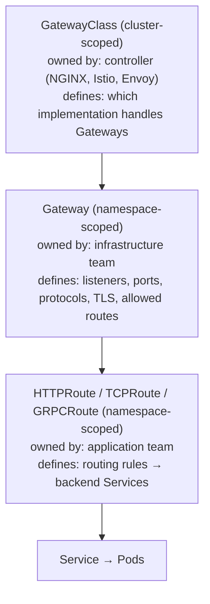
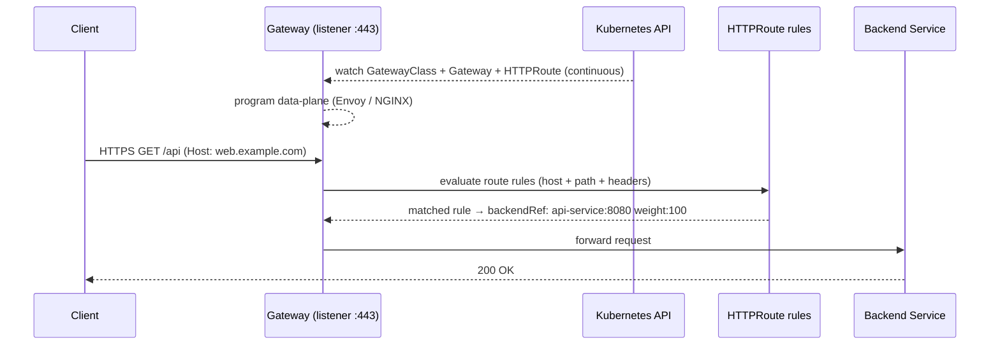

# Lesson 18 — Gateway API: Next-Generation Ingress

> **Track:** Network Foundation — Bare Metal & Cloud  
> **Prerequisites:** [Lesson 17 — Ingress Controllers](17-ingress-controllers.md)  
> **Duration:** ~2 hours

> **Goal:** Build a multi-role traffic management system using GatewayClass, Gateway, and HTTPRoute resources, implement canary deployments with weighted traffic splitting, and migrate workloads from Ingress to Gateway API.

---

## Practice Setup

```bash
# Terminal 1 — Mac (kubectl)
# Check if Gateway API CRDs are installed
kubectl api-resources | grep -E "gateway|httproute|grpcroute|tcproute"
kubectl get gatewayclass 2>/dev/null || echo "Gateway API not installed — run: kubectl apply -f https://github.com/kubernetes-sigs/gateway-api/releases/download/v1.1.0/standard-install.yaml"

# Terminal 2 — Mac
kubectl get gateway,httproute -A 2>/dev/null
```

Observation commands — run after creating a Gateway and HTTPRoute:

```bash
# Install Gateway API CRDs if not present
kubectl apply -f https://github.com/kubernetes-sigs/gateway-api/releases/download/v1.2.0/standard-install.yaml

# Watch Gateway and HTTPRoute status conditions as they are applied
kubectl get gateway -A -w &
kubectl get httproute -A -w &

# After creating resources (Sections 3-5), check status:
kubectl describe gateway prod-gateway -n infra
# Look for: "Programmed: True" and "ResolvedRefs: True" conditions

kubectl describe httproute web-route -n default
# Look for: "Accepted: True" and "ResolvedRefs: True" conditions

# Test weighted traffic split (Section 5)
for i in $(seq 1 20); do curl -s -H "Host: web.example.com" http://<gateway-ip>/ | grep -o 'v[12]'; done
# Expect roughly 18 × v1 and 2 × v2 (90/10 split)
```

> **See also:** [Lesson 17 — Ingress Controllers](17-ingress-controllers.md) for the Ingress API that Gateway API supersedes.

---

## 1. Why Gateway API Replaces Ingress

| Limitation | Ingress API | Gateway API |
|-----------|-------------|-------------|
| Roles | No separation of concerns | Infrastructure, cluster, app teams separated |
| Cross-namespace routing | Not supported | Supported via ReferenceGrant |
| TCP/UDP routing | Not supported | TCPRoute, UDPRoute |
| gRPC routing | Not supported | GRPCRoute |
| Traffic splitting | Annotation hacks | Weight-based, natively in spec |
| Header modification | Annotation hacks | RequestHeaderModifier filter |
| Extensibility | Annotations (string blobs) | Extension points + custom filters |

---

## 2. Resource Hierarchy

The Gateway API uses a three-layer role model — infrastructure teams own the top, application teams own the bottom:



The request path at runtime:



---

## 3. GatewayClass

```yaml
apiVersion: gateway.networking.k8s.io/v1
kind: GatewayClass
metadata:
  name: nginx
spec:
  controllerName: k8s.io/ingress-nginx   # controller that manages this class
```

```bash
# Install NGINX Gateway Fabric (Gateway API implementation)
helm install nginx-gateway oci://ghcr.io/nginxinc/charts/nginx-gateway-fabric \
  --namespace nginx-gateway \
  --create-namespace

kubectl get gatewayclass
# NAME    CONTROLLER                    ACCEPTED
# nginx   k8s.io/ingress-nginx          True
```

### GatewayClass Parameters

| Field | Default | Effect | When to change |
|-------|---------|--------|----------------|
| `controllerName` | — | Binds this class to a running controller | Match exactly the controller's advertised name (see controller docs) |
| `spec.parametersRef` | (none) | Points to a controller-specific config CRD | Use for controller-specific defaults (timeouts, logging) |
| `.status.conditions[Accepted]` | — | Controller acknowledged the class | If `False`, check controller logs for name mismatch |

---

## 4. Gateway

```yaml
apiVersion: gateway.networking.k8s.io/v1
kind: Gateway
metadata:
  name: prod-gateway
  namespace: infra
spec:
  gatewayClassName: nginx
  listeners:
    - name: http
      port: 80
      protocol: HTTP
      allowedRoutes:
        namespaces:
          from: All      # or: Same | Selector
    - name: https
      port: 443
      protocol: HTTPS
      tls:
        mode: Terminate
        certificateRefs:
          - name: web-tls-cert
            namespace: infra
      allowedRoutes:
        namespaces:
          from: Selector
          selector:
            matchLabels:
              gateway-access: allowed
```

### Gateway Listener Parameters

| Parameter | Default | Effect | When to change |
|-----------|---------|--------|----------------|
| `allowedRoutes.namespaces.from: All` | — | Any namespace can attach HTTPRoutes | Development clusters; restrict to `Selector` in production |
| `allowedRoutes.namespaces.from: Same` | — | Only routes in the Gateway's namespace attach | Single-team gateways |
| `allowedRoutes.namespaces.from: Selector` | — | Only namespaces with matching labels attach | Multi-tenant: label namespaces with `gateway-access: allowed` |
| `tls.mode: Terminate` | — | TLS terminated at the gateway; plain HTTP forwarded to backends | Standard web apps |
| `tls.mode: Passthrough` | — | TLS forwarded unchanged to backend (requires TLSRoute) | mTLS all the way to pods; backend owns the certificate |

---

## 5. HTTPRoute

```yaml
apiVersion: gateway.networking.k8s.io/v1
kind: HTTPRoute
metadata:
  name: web-route
  namespace: default
spec:
  parentRefs:
    - name: prod-gateway
      namespace: infra
      sectionName: https     # bind to the https listener
  hostnames:
    - "web.example.com"
  rules:
    # Path-based routing
    - matches:
        - path:
            type: PathPrefix
            value: /api
      backendRefs:
        - name: api-service
          port: 8080
          weight: 100

    # Header-based routing (canary)
    - matches:
        - headers:
            - name: X-Canary
              value: "true"
      backendRefs:
        - name: api-service-canary
          port: 8080

    # Traffic splitting (weighted)
    - matches:
        - path:
            type: PathPrefix
            value: /
      backendRefs:
        - name: frontend-v1
          port: 80
          weight: 90
        - name: frontend-v2
          port: 80
          weight: 10    # 10% canary traffic
```

---

## 6. HTTPRoute Filters

```yaml
rules:
  - filters:
      # Add/remove request headers
      - type: RequestHeaderModifier
        requestHeaderModifier:
          add:
            - name: X-Gateway-Version
              value: "v2"
          remove:
            - X-Internal-Token

      # Redirect HTTP to HTTPS
      - type: RequestRedirect
        requestRedirect:
          scheme: https
          statusCode: 301

      # URL rewrite
      - type: URLRewrite
        urlRewrite:
          path:
            type: ReplacePrefixMatch
            replacePrefixMatch: /v2

      # Mirror traffic to another service (for testing)
      - type: RequestMirror
        requestMirror:
          backendRef:
            name: shadow-service
            port: 8080
```

---

## 7. TCPRoute and GRPCRoute

```yaml
# TCPRoute — route raw TCP (databases, message queues)
apiVersion: gateway.networking.k8s.io/v1alpha2
kind: TCPRoute
metadata:
  name: postgres-route
spec:
  parentRefs:
    - name: prod-gateway
      sectionName: postgres   # listener on port 5432
  rules:
    - backendRefs:
        - name: postgres-service
          port: 5432
---
# GRPCRoute — route gRPC by service and method
apiVersion: gateway.networking.k8s.io/v1
kind: GRPCRoute
metadata:
  name: grpc-route
spec:
  parentRefs:
    - name: prod-gateway
      sectionName: grpc
  rules:
    - matches:
        - method:
            service: "myapp.UserService"
            method: "GetUser"
      backendRefs:
        - name: user-service
          port: 50051
```

---

## 8. Cross-Namespace Routing with ReferenceGrant

```yaml
# HTTPRoute in namespace "app" references Service in namespace "shared"
# → requires ReferenceGrant in "shared" namespace

apiVersion: gateway.networking.k8s.io/v1beta1
kind: ReferenceGrant
metadata:
  name: allow-from-app
  namespace: shared          # in the target namespace
spec:
  from:
    - group: gateway.networking.k8s.io
      kind: HTTPRoute
      namespace: app         # the source namespace
  to:
    - group: ""
      kind: Service
```

---

## 9. Gateway API on Cloud Providers

### AWS
The AWS Gateway API Controller maps Gateways to ALBs and VPC Lattice.
```bash
helm install aws-gateway-controller aws-gateway-api-controller \
  --namespace gateway-system
```

### GKE
GKE supports Gateway API natively with Cloud Load Balancers.
```yaml
# GKE GatewayClass
kubectl get gatewayclass
# gke-l7-global-external-managed    — global HTTPS LB
# gke-l7-regional-external-managed  — regional HTTPS LB
# gke-l7-rilb                       — internal LB
```

### AKS
```bash
# Enable Gateway API on AKS
az aks update --name my-aks --resource-group rg \
  --enable-azure-keyvault-secrets-provider
# App Gateway for Containers is AKS's Gateway API backend
```

---

## 10. Migrating from Ingress to Gateway API

```bash
# Step 1: Install CRDs
kubectl apply -f https://github.com/kubernetes-sigs/gateway-api/releases/download/v1.2.0/standard-install.yaml

# Step 2: Install a Gateway API-compatible controller
# (most modern ingress controllers support both)

# Step 3: Create GatewayClass and Gateway

# Step 4: Translate Ingress to HTTPRoute
# Ingress:
#   host: web.example.com
#   path: /api → service: api:8080
# HTTPRoute:
#   parentRef: gateway
#   hostname: web.example.com
#   path: /api → backendRef: api:8080

# Step 5: Validate both coexist (Ingress and HTTPRoute can run in parallel)
kubectl get ingress,httproute
```

---

## Troubleshooting

| Symptom | Likely Cause | Diagnostic Command | Fix |
|---------|-------------|-------------------|-----|
| Gateway stuck with `Programmed: False` | GatewayClass controller not running or name mismatch | `kubectl describe gatewayclass <name>` → check `Accepted` condition | Verify controller pod is running and `controllerName` matches exactly |
| HTTPRoute `Accepted: False` | `parentRefs` namespace/name wrong, or listener `allowedRoutes` does not permit this namespace | `kubectl describe httproute <name>` → check status conditions | Fix `parentRefs.namespace`, or add namespace label for `Selector`-mode allowedRoutes |
| Cross-namespace backend `ResolvedRefs: False` | Missing ReferenceGrant in the target Service's namespace | `kubectl get referencegrant -n <target-ns>` | Create ReferenceGrant granting access from route's namespace to target Service |
| Traffic not splitting at expected weights | Old connections stick to one backend (keep-alive) | Use short-lived connections: `curl --no-keepalive` | Test with fresh connections; configure session affinity intentionally if needed |
| TLS: certificate not served (fake cert) | Gateway TLS `certificateRefs` Secret does not exist or is in wrong namespace | `kubectl get secret <name> -n infra` | Create or copy the TLS Secret into the Gateway's namespace; use cert-manager BackendTLSPolicy |
| 404 on valid route | HTTPRoute `hostnames` does not match request Host header exactly | `curl -v -H "Host: web.example.com" http://<gw-ip>/` | Ensure `hostnames` in HTTPRoute matches the Host header sent by client |
| GRPCRoute not accepted | Using standard CRDs — GRPCRoute requires experimental channel | `kubectl api-resources | grep grpcroute` | Apply experimental CRDs: `experimental-install.yaml` from the Gateway API release |

---

## Production Checklist

- [ ] GatewayClass `Accepted` status confirmed before creating Gateway resources that reference it
- [ ] Gateway listener `allowedRoutes` set to `Selector` in production (not `All`) to prevent unauthorized namespace attachment
- [ ] ReferenceGrant created in every target namespace before cross-namespace routes are deployed
- [ ] HTTPRoute and Gateway status conditions checked (`Accepted`, `Programmed`, `ResolvedRefs`) after each change
- [ ] Canary traffic splits validated with real request sampling before increasing canary weight
- [ ] TLS certificates managed via cert-manager BackendTLSPolicy or external secret sync; not manually created
- [ ] Ingress and HTTPRoute objects not duplicated for the same hostname during migration (can cause split-brain routing)

---

## Common Anti-Patterns

| What people do | Why it breaks | Correct approach |
|----------------|--------------|-----------------|
| Give app teams permission to create Gateway objects | App teams can open arbitrary ports and protocols on the shared infrastructure; this defeats role separation | Only the infrastructure team creates Gateway objects; app teams create HTTPRoutes that attach to pre-approved Gateways |
| Reference a Service in another namespace without a ReferenceGrant | The route silently fails with `ResolvedRefs: False`; traffic does not flow but no error is surfaced to the caller | Always create ReferenceGrant in the target namespace before deploying a cross-namespace backendRef |
| Use Ingress annotation workarounds on HTTPRoute objects | HTTPRoute does not support annotations for behavior tuning; they are ignored silently | Use HTTPRoute filters (`RequestHeaderModifier`, `URLRewrite`, `RequestMirror`) for all routing behavior |
| Set `allowedRoutes.from: All` on the production Gateway | Any namespace in the cluster (including compromised ones) can attach routes and receive production traffic | Label trusted namespaces and use `from: Selector` with explicit label matching |
| Skip checking status conditions after applying resources | Resources may appear created but be non-functional if the controller rejects them | Always run `kubectl describe gateway/httproute` and verify `Accepted: True` and `Programmed: True` before testing |

---

## Quick Reference

| Use Case | Command |
|----------|---------|
| List all GatewayClasses | `kubectl get gatewayclass` |
| List all Gateways cluster-wide | `kubectl get gateway -A` |
| List all HTTPRoutes cluster-wide | `kubectl get httproute -A` |
| Describe Gateway (check status conditions) | `kubectl describe gateway <name> -n <ns>` |
| Describe HTTPRoute (check Accepted/ResolvedRefs) | `kubectl describe httproute <name> -n <ns>` |
| List ReferenceGrants | `kubectl get referencegrant -A` |
| Install standard Gateway API CRDs | `kubectl apply -f https://github.com/kubernetes-sigs/gateway-api/releases/download/v1.2.0/standard-install.yaml` |
| Install experimental CRDs (TCPRoute, UDPRoute, GRPCRoute) | `kubectl apply -f https://github.com/kubernetes-sigs/gateway-api/releases/download/v1.2.0/experimental-install.yaml` |
| Test weighted traffic split (20 requests) | `for i in $(seq 1 20); do curl -s -H "Host: web.example.com" http://<gw-ip>/; done` |
| Test header-based canary routing | `curl -H "X-Canary: true" -H "Host: web.example.com" http://<gw-ip>/` |
| Get Gateway API conformance test results | `kubectl get gatewayclass <name> -o jsonpath='{.status.conditions}'` |

---

## Summary

| Resource | Scope | Purpose |
|---------|-------|---------|
| GatewayClass | Cluster | Defines the controller implementation |
| Gateway | Namespace | Defines listeners (ports, protocols, TLS) |
| HTTPRoute | Namespace | HTTP/S routing rules → backends |
| TCPRoute | Namespace | TCP routing rules |
| GRPCRoute | Namespace | gRPC routing rules |
| ReferenceGrant | Namespace | Grants cross-namespace routing permission |

---

## Check Your Understanding

1. **[Concept question]** Why does the Gateway API use three separate resource types (GatewayClass, Gateway, HTTPRoute) instead of a single Ingress-like object?

   <details><summary>Answer</summary>

   The three-layer hierarchy maps to real organizational boundaries: infrastructure teams own GatewayClass (which controller handles traffic) and Gateway (listener ports, TLS, allowed namespaces), while application teams own HTTPRoute (routing rules to their backends). This separation means an app team cannot change TLS settings or open new ports on shared infrastructure. The old Ingress API collapsed all roles into one object, forcing teams to use annotation hacks for features like traffic splitting.

   </details>

2. **[Scenario question]** An HTTPRoute you just applied shows `ResolvedRefs: False` in its status conditions and traffic is not flowing. What is the most likely cause, and how do you fix it?

   <details><summary>Answer</summary>

   The most common cause is a missing ReferenceGrant when the HTTPRoute references a backend Service in a different namespace. Without a ReferenceGrant in the target namespace explicitly allowing the route's namespace to reference its Services, the controller rejects the cross-namespace backendRef. Create a `ReferenceGrant` in the Service's namespace with `from.namespace` set to the HTTPRoute's namespace. Verify with `kubectl get referencegrant -n <target-ns>` and re-check `kubectl describe httproute <name>`.

   </details>

3. **[Practical question]** What command would you run to verify that a weighted 90/10 traffic split between `frontend-v1` and `frontend-v2` is actually working as configured?

   <details><summary>Answer</summary>

   ```bash
   for i in $(seq 1 20); do curl -s -H "Host: web.example.com" http://<gateway-ip>/ | grep -o 'v[12]'; done | sort | uniq -c
   ```
   Look for approximately 18 responses tagged `v1` and 2 responses tagged `v2`; if all 20 return `v1`, the HTTPRoute weights are not being applied by the controller (check `kubectl describe httproute` for status conditions).

   </details>

---

## Online Resources

| Resource | Cost | What you practice |
|----------|------|-------------------|
| [Isovalent: Cilium Gateway API + cert-manager](https://isovalent.com/labs/cilium-gateway-api-cert-manager/) | Free | HTTPS configuration and certificate management with Gateway API — interactive browser lab |
| [Isovalent: Advanced Gateway API Use Cases](https://isovalent.com/labs/advanced-gateway-api-use-cases/) | Free | Header rewriting, redirects, gRPC routing, and canary deployments with HTTPRoute |
| [Isovalent: Cilium Gateway API — External Authentication](https://isovalent.com/labs/cilium-gateway-api-external-authentication/) | Free | Implement auth at the gateway layer without modifying apps |
| [Gateway API — Getting Started](https://gateway-api.sigs.k8s.io/guides/) | Free | Official docs with hands-on examples — use with `kubectl apply` on minikube |

---

**Next:** [Lesson 19 — Load Balancing on Bare Metal: MetalLB and kube-vip](19-metallb-kube-vip.md)
