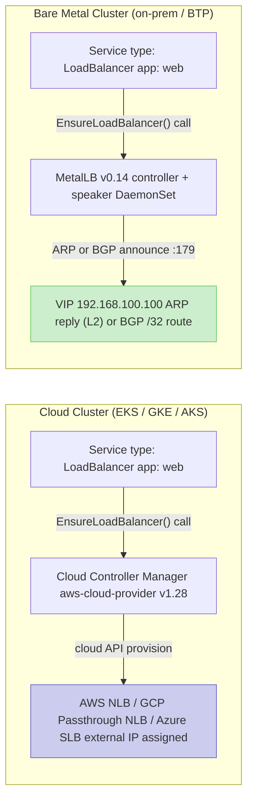
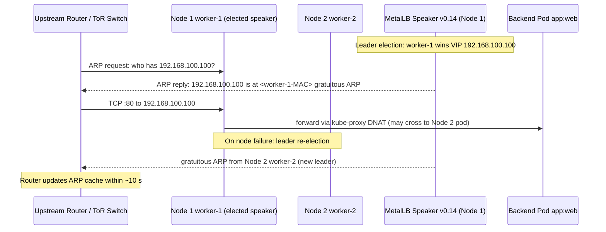

# Lesson 19 — Load Balancing on Bare Metal: MetalLB and kube-vip

> **Track:** Network Foundation — Bare Metal  
> **Prerequisites:** [Lesson 06 — BGP Fundamentals](06-bgp-fundamentals.md), [Lesson 13 — Kubernetes Services](13-kubernetes-services-kube-proxy.md)  
> **Duration:** ~2.5 hours

> **Goal:** Configure MetalLB in L2 and BGP modes to provide LoadBalancer services on bare-metal clusters, compare with kube-vip for control-plane HA, and diagnose ARP and BGP announcement failures.


**Jump to:** [Theory](#theory) · [Practice](#practice) · [Troubleshooting](#troubleshooting) · [Production Checklist](#production-checklist) · [Quick Reference](#quick-reference) · [Check Your Understanding](#check-your-understanding)

---

## Theory

## 1. The Bare Metal LB Problem

```bash
# Without a LB controller, LoadBalancer services hang:
kubectl get svc web
# NAME   TYPE           CLUSTER-IP    EXTERNAL-IP   PORT(S)        AGE
# web    LoadBalancer   10.96.42.10   <pending>     80:30080/TCP   10m
```

The Cloud Controller Manager (CCM) provisions cloud LBs. On bare metal, you need to run your own LB controller.



---

## 2. MetalLB Overview

MetalLB implements LoadBalancer by either:
- **L2 mode**: answers ARP/NDP for the VIP on the local subnet
- **BGP mode**: advertises VIP routes to upstream routers

```bash
# Install MetalLB
helm repo add metallb https://metallb.github.io/metallb
helm install metallb metallb/metallb \
  --namespace metallb-system \
  --create-namespace

kubectl get pods -n metallb-system
# metallb-controller-xxx  (allocates IPs)
# metallb-speaker-xxx     (announces IPs — DaemonSet)
```

---

## 3. MetalLB L2 Mode

The speaker pod on the node holding the VIP responds to ARP requests for that IP.



```yaml
# Configure an IP address pool
apiVersion: metallb.io/v1beta1
kind: IPAddressPool
metadata:
  name: production-pool
  namespace: metallb-system
spec:
  addresses:
    - 192.168.100.100-192.168.100.200
    - 192.168.200.0/24
---
# Enable L2 advertisement
apiVersion: metallb.io/v1beta1
kind: L2Advertisement
metadata:
  name: l2-advert
  namespace: metallb-system
spec:
  ipAddressPools:
    - production-pool
  nodeSelectors:               # optional: which nodes can announce
    - matchLabels:
        node-role.kubernetes.io/worker: ""
```

**L2 mode limitations:**
- Single node holds the VIP at a time (failover on node failure, ~10s)
- All traffic enters through one node (no true load balancing at the LB layer)
- Works only within the same L2 broadcast domain

---

## 4. MetalLB BGP Mode

Announces VIPs via BGP to upstream routers. Multiple nodes can announce the same VIP via ECMP.

```yaml
# BGP Peer (ToR switch)
apiVersion: metallb.io/v1beta2
kind: BGPPeer
metadata:
  name: tor-switch
  namespace: metallb-system
spec:
  myASN: 64512
  peerASN: 65000
  peerAddress: 192.168.1.1
  holdTime: 30s
  keepaliveTime: 10s
---
# Advertise pool via BGP
apiVersion: metallb.io/v1beta1
kind: BGPAdvertisement
metadata:
  name: bgp-advert
  namespace: metallb-system
spec:
  ipAddressPools:
    - production-pool
  communities:
    - 64512:100       # tag with community for upstream policy
  aggregationLength: 32   # advertise host routes (/32)
```

**BGP mode advantages:**
- ECMP: multiple nodes announce same VIP → load balancing at router level
- Fast failover (BFD sub-second)
- Works across L3 boundaries (across routers, not just L2)

### Key BGP/Pool Parameters

| Parameter | Default | Effect | When to change |
|-----------|---------|--------|----------------|
| `myASN` | — | Local AS number for the BGP session | Use private ASN (64512-65535); must match router config |
| `peerASN` | — | Upstream router's AS number | Match the ToR switch configuration |
| `holdTime` | `90s` | BGP session dead timer | Reduce to `30s` for faster failover detection |
| `aggregationLength` | `32` (IPv4) | Prefix length for advertised routes | Use `32` for per-VIP /32 host routes; aggregate with /24 to reduce BGP table size |
| `communities` | (none) | BGP community strings appended to routes | Signal upstream policy (e.g., no-export, local-pref) |
| `bfdProfile` | (none) | Enables BFD for sub-second failure detection | Production BGP — combine with fast BFD for <1s failover |
| `IPAddressPool.addresses` | — | CIDR or range of allocatable IPs | Must not overlap with node or pod subnets |

---

## 5. Using the LoadBalancer Service

```yaml
# Assign from a specific pool
apiVersion: v1
kind: Service
metadata:
  name: web
  annotations:
    metallb.io/address-pool: production-pool
    metallb.io/loadBalancerIPs: 192.168.100.105  # request specific IP
spec:
  type: LoadBalancer
  selector:
    app: web
  ports:
    - port: 80
      targetPort: 8080
```

```bash
kubectl get svc web
# NAME   TYPE           CLUSTER-IP    EXTERNAL-IP       PORT(S)   AGE
# web    LoadBalancer   10.96.42.10   192.168.100.105   80/TCP    30s
```

---

## 6. kube-vip

kube-vip provides VIP management using VRRP (ARP-based HA) or BGP. Also handles HA for the Kubernetes control plane API server.

```bash
# Install kube-vip as a DaemonSet for LoadBalancer services
kubectl apply -f https://kube-vip.io/manifests/rbac.yaml

# Generate kube-vip DaemonSet manifest
docker run --network host --rm \
  ghcr.io/kube-vip/kube-vip:latest \
  manifest daemonset \
  --services \
  --arp \
  --leaderElection \
  | kubectl apply -f -
```

```yaml
# kube-vip ConfigMap
apiVersion: v1
kind: ConfigMap
metadata:
  name: kube-vip
  namespace: kube-system
data:
  range-global: "192.168.100.100-192.168.100.200"
```

**kube-vip vs MetalLB:**

| Feature | kube-vip | MetalLB |
|---------|----------|---------|
| Control-plane VIP (HA API server) | Yes | No |
| L2 / ARP mode | Yes (VRRP) | Yes |
| BGP mode | Yes | Yes (more mature) |
| IP pool management CRDs | Basic (ConfigMap range) | Full (IPAddressPool, L2Advertisement, BGPAdvertisement) |
| Recommended for | Control-plane HA + simple LB | Production LoadBalancer services |

---

## 7. Shared IPs Across Services

Both tools support multiple services sharing one IP (different ports).

```yaml
# MetalLB shared IP
metadata:
  annotations:
    metallb.io/allow-shared-ip: "web-group"   # same key = shared IP
---
# Service 1: port 80
# Service 2: port 443
# Both get the same EXTERNAL-IP
```

---

## 8. Production Considerations

```bash
# Separate the LB VIP range from node IPs to avoid conflicts
# Node subnet:  192.168.1.0/24
# VIP pool:     192.168.100.0/24  (different subnet, routed via ToR)

# Use BGP mode for production — no single point of failure
# Use L2 mode for dev/lab — simpler, no BGP required

# MetalLB BGP with BFD for fast failover
apiVersion: metallb.io/v1beta2
kind: BGPPeer
spec:
  bfdProfile: fast-bfd
---
apiVersion: metallb.io/v1beta1
kind: BFDProfile
metadata:
  name: fast-bfd
spec:
  receiveInterval: 300    # 300ms
  transmitInterval: 300
  detectMultiplier: 3     # 3 × 300ms = 900ms failure detection
```

---

### Industry Applications

| Company / Project | Context | Technology from this lesson | Outcome |
|---|---|---|---|
| SAP BTP bare-metal nodes | On-premise BTP infrastructure nodes need LoadBalancer IPs without cloud CCM | MetalLB L2 mode on bare-metal nodes; BGP mode on data-center racks with ToR switch peering | LoadBalancer services get real IPs from a managed pool without cloud provider dependency |
| Equinix Metal customers | Bare-metal cloud workloads require anycast VIPs for high-availability services | MetalLB BGP mode peering with Equinix Metal's BGP infrastructure; ECMP across all nodes | Traffic distributed across all announcing nodes; sub-second failover via BFD on BGP sessions |
| Talos Linux clusters | Immutable bare-metal OS requiring HA control-plane API server without external LB | kube-vip VRRP mode providing a floating VIP for the kube-apiserver before the cluster is bootstrapped | Multi-master control plane works without any external load balancer hardware or cloud CCM |
| Home Assistant OS | Home automation clusters on Raspberry Pi / NUC hardware needing local service exposure | MetalLB L2 mode on a home LAN; services get local IPs from a 192.168.x.x pool | Kubernetes services accessible on the home network at stable IPs without router configuration |

---

## Practice

### Environment Setup

```bash
# Terminal 1 — Mac (kubectl)
kubectl get pods -n metallb-system 2>/dev/null || echo "MetalLB not installed"
kubectl get ipaddresspools,l2advertisements -n metallb-system 2>/dev/null
kubectl get svc -A --field-selector spec.type=LoadBalancer

# Terminal 2 — minikube Linux node (inspect ARP for L2 mode)
minikube ssh
arp -n | head -20
ip neigh show
```

Observation commands — run after installing MetalLB and creating a LoadBalancer service:

```bash
# Watch MetalLB speaker announcements in real time
kubectl logs -n metallb-system -l app.kubernetes.io/component=speaker -f &

# Create a test LoadBalancer service
kubectl create deployment web --image=nginx --replicas=2
kubectl expose deployment web --type=LoadBalancer --port=80

# Watch the service get an EXTERNAL-IP assigned from the pool
kubectl get svc web -w
# Expect: EXTERNAL-IP changes from <pending> to 192.168.100.xxx

# From outside the cluster, verify ARP resolution (L2 mode)
# arping -I eth0 192.168.100.100   # should respond from the elected speaker node

# Check which node is currently serving the VIP
kubectl get events -n metallb-system | grep -i announcing
```

> **See also:** [Lesson 06 — BGP Fundamentals](06-bgp-fundamentals.md) for BGP session setup and ECMP concepts used by MetalLB BGP mode.

### Hands-On Lab

Work through the Theory sections to build a fully functional bare-metal LoadBalancer setup:

1. Install MetalLB via Helm (Section 2) and verify controller + speaker pods are `Running`
2. Create an `IPAddressPool` and `L2Advertisement` (Section 3); expose a deployment and watch `EXTERNAL-IP` assigned
3. Test ARP announcement: run `arping -I eth0 <VIP>` from outside the cluster and confirm speaker node responds
4. Switch to BGP mode (Section 4): configure `BGPPeer` to point at your router (or a mock with `gobgp`) and verify session
5. Add a `BFDProfile` (Section 8) and check sub-second failover by cordoning the elected speaker node
6. Install kube-vip (Section 6) and compare VIP failover behavior to MetalLB L2 mode

### Configuration Reference

Key parameter tables are embedded in the Theory sections above:

| Section | Table |
|---------|-------|
| Section 4 — BGP Mode | Key BGP/Pool Parameters: `myASN`, `peerASN`, `holdTime`, `aggregationLength`, `bfdProfile` |
| Section 6 — kube-vip | kube-vip vs MetalLB feature comparison table |

---

## Troubleshooting

| Symptom | Likely Cause | Diagnostic Command | Fix |
|---------|-------------|-------------------|-----|
| `EXTERNAL-IP: <pending>` after MetalLB install | No IPAddressPool or L2Advertisement/BGPAdvertisement created | `kubectl get ipaddresspools,l2advertisements -n metallb-system` | Create IPAddressPool and the appropriate Advertisement CRD |
| VIP assigned but unreachable from outside cluster | VIP is in a different subnet than clients (L2 mode) or BGP session is not established | `arping -I eth0 <VIP>` from outside; `kubectl logs -n metallb-system -l component=speaker | grep bgp` | For L2: ensure VIP is in same broadcast domain; for BGP: check session with router |
| ARP not responding for VIP | Speaker not elected or port security on switch blocking gratuitous ARP | `kubectl get events -n metallb-system | grep announcing` | Check speaker pod logs; disable port-security / ARP inspection on the connected switch port |
| BGP session not established | Firewall blocking TCP 179 between node and router | `telnet <router-ip> 179` from node | Open TCP 179 on host firewall and network ACLs |
| IP pool exhausted — service stays pending | All IPs in pool are allocated | `kubectl describe ipaddresspool production-pool -n metallb-system` | Expand pool address range or add a second IPAddressPool |
| Traffic only reaches one pod (L2 mode) | L2 mode is single-node ingress; kube-proxy distributes after the node | `kubectl get pods -o wide -l app=web` — all traffic enters one node | Accept this limitation for L2; switch to BGP mode with ECMP for true per-node distribution |
| kube-vip leader not switching after node failure | Leader lease stuck or ARP cache not refreshed on upstream router | `kubectl logs -n kube-system -l app=kube-vip | grep -E 'leader|VIP'` | Increase ARP probe frequency in kube-vip config; check upstream router ARP cache timeout |

---

## Production Checklist

- [ ] VIP address pool configured in a separate subnet from node and pod CIDRs to prevent IP conflicts
- [ ] BGP mode used for production workloads (L2 mode is for dev/lab only — single ingress node is a bottleneck)
- [ ] BGP peer `holdTime` and `keepaliveTime` tuned; BFDProfile configured for sub-second failover
- [ ] Switch port security and gratuitous ARP inspection disabled (or explicitly permitted) for nodes running MetalLB speakers
- [ ] IP address pool size planned with headroom — allocating 100% causes new services to stay pending
- [ ] kube-vip deployed for control-plane HA if running a multi-master bare-metal cluster
- [ ] MetalLB speaker resource limits set (DaemonSet pods run on every node — size accordingly)

---

## Common Anti-Patterns

| What people do | Why it breaks | Correct approach |
|----------------|--------------|-----------------|
| Use L2 mode in production expecting high availability | L2 mode is single-node: only one node holds the VIP at a time; failover takes ~10 s and traffic is not distributed across nodes | Use BGP mode with ECMP in production for true multi-node load distribution and sub-second failover with BFD |
| Put VIP pool in the same /24 as the node IPs | The LB may assign an IP already used by a node or another static device on the subnet | Always allocate the VIP pool from a dedicated subnet or range that is not shared with node addresses |
| Forget to open TCP 179 (BGP) on node firewalls | BGP sessions never establish; MetalLB speaker logs show repeated connection refused; VIPs stay unannounced | Pre-open TCP 179 between all nodes and each BGP peer (ToR switch) in the host firewall before installing MetalLB |
| Use MetalLB and kube-vip for LoadBalancer services simultaneously | Both tools race to handle the same Service resources; one or both fail to announce correctly | Pick one tool per cluster for LoadBalancer services; kube-vip for control-plane HA can coexist if LoadBalancer mode is disabled in one of them |
| Request a specific IP with `metallb.io/loadBalancerIPs` without first checking pool availability | Service stays pending with an event saying the requested IP is not in any pool | Verify the IP is within a configured IPAddressPool range before annotating the Service |

---

## Quick Reference

| Use Case | Command |
|----------|---------|
| List MetalLB pods | `kubectl get pods -n metallb-system` |
| List IP address pools | `kubectl get ipaddresspools -n metallb-system` |
| List all LoadBalancer services | `kubectl get svc -A --field-selector spec.type=LoadBalancer` |
| Watch speaker announcement logs | `kubectl logs -n metallb-system -l app.kubernetes.io/component=speaker -f` |
| Check events in metallb-system | `kubectl get events -n metallb-system --sort-by='.lastTimestamp'` |
| Check which node is speaker for a VIP | `kubectl get events -n metallb-system | grep announcing` |
| Test ARP response for VIP (from outside cluster) | `arping -I <iface> <VIP>` |
| Describe IP pool allocation | `kubectl describe ipaddresspool <name> -n metallb-system` |
| Check kube-vip leader election | `kubectl logs -n kube-system -l app=kube-vip | grep -E 'leader\|VIP'` |
| Request specific IP for a service | Add annotation `metallb.io/loadBalancerIPs: <IP>` to Service |
| Share IP across two services | Add same `metallb.io/allow-shared-ip: "<key>"` to both Services |
| Describe MetalLB controller | `kubectl describe pod -n metallb-system -l app.kubernetes.io/component=controller` |

---

## Summary

| Tool | Mode | Failover | Load Distribution |
|------|------|---------|-----------------|
| MetalLB L2 | ARP/NDP | ~10s (leader election) | Single node (ingress point) |
| MetalLB BGP | BGP routes | <1s (with BFD) | ECMP across nodes |
| kube-vip | ARP/BGP | VRRP ~1s | Single or ECMP |

---

## Check Your Understanding

1. **[Concept question]** Why does MetalLB L2 mode result in a single ingress node rather than true load balancing, and how does BGP mode solve this?

   <details><summary>Answer</summary>

   In L2 mode, MetalLB uses leader election so that exactly one node's speaker answers ARP requests for the VIP. All external traffic therefore enters through that one node, which then uses kube-proxy to forward to pods — the LB layer itself is a single point of ingress. BGP mode solves this by having each speaker on multiple nodes advertise the same /32 host route via BGP; the upstream router installs ECMP routes for the VIP and distributes flows across all announcing nodes, giving true per-node load balancing.

   </details>

2. **[Scenario question]** A LoadBalancer service stays in `EXTERNAL-IP: <pending>` even after MetalLB pods are running. What two CRDs should you check first?

   <details><summary>Answer</summary>

   Check that an `IPAddressPool` exists with a valid address range and that an `L2Advertisement` (or `BGPAdvertisement` for BGP mode) references that pool. Without both CRDs, MetalLB's controller will not allocate an IP or advertise it. Run `kubectl get ipaddresspools,l2advertisements -n metallb-system` to confirm both are present. A missing advertisement CRD is the most common oversight after install.

   </details>

3. **[Practical question]** What command would you run to find which node is currently announcing a specific VIP in L2 mode?

   <details><summary>Answer</summary>

   ```bash
   kubectl get events -n metallb-system | grep announcing
   ```
   Look for event messages of the form `announcing from node worker-X` — the node named in that event is the current elected speaker for the VIP. You can also watch speaker logs with `kubectl logs -n metallb-system -l app.kubernetes.io/component=speaker -f` for real-time announcement events.

   </details>

---

## Online Resources

| Resource | Cost | What you practice |
|----------|------|-------------------|
| [Killercoda Playground](https://killercoda.com/) | Free | Deploy MetalLB in L2 mode, create a LoadBalancer service, watch ARP announcements with `arping` |
| [MetalLB Official Tutorial](https://metallb.universe.tf/installation/) | Free | Step-by-step MetalLB install on minikube with L2 and BGP mode examples |

---

**← Previous:** [Lesson 18 — Gateway API: Next-Generation Ingress](18-gateway-api.md)   |   **Next:** [Lesson 20 — Cloud Provider Load Balancers](20-cloud-load-balancers.md)
