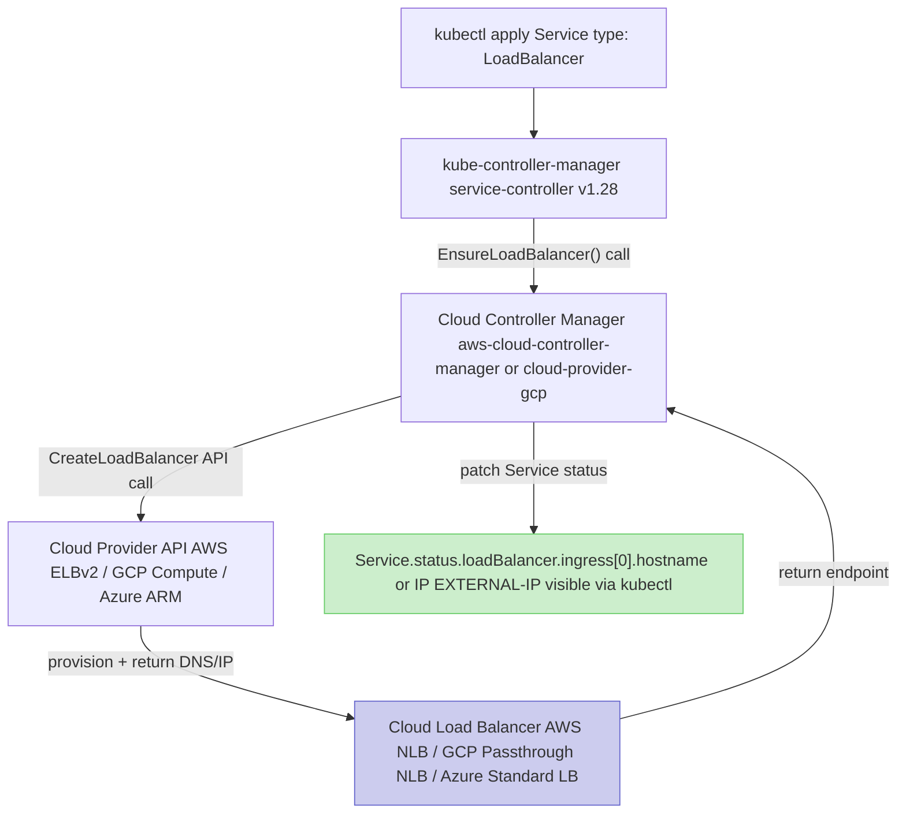
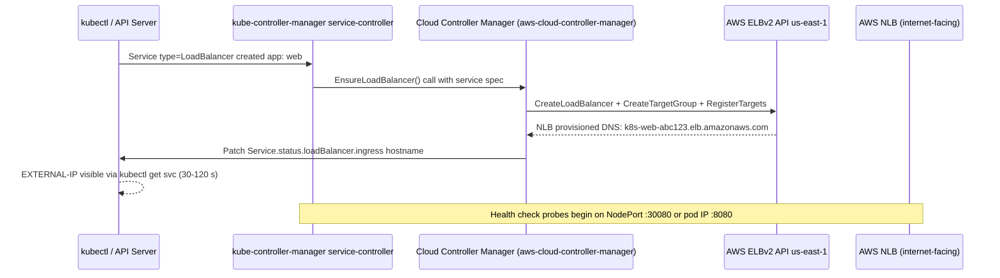

# Lesson 20 — Cloud Provider Load Balancers

> **Track:** Network Foundation — Cloud Provider  
> **Prerequisites:** [Lesson 08 — Cloud Provider Networking](08-cloud-provider-networking.md), [Lesson 13 — Kubernetes Services](13-kubernetes-services-kube-proxy.md)  
> **Duration:** ~2.5 hours

> **Goal:** Provision and configure cloud load balancers on AWS, GCP, and Azure, choose between NLB and ALB target types, set externalTrafficPolicy correctly, and diagnose CCM provisioning failures.


**Jump to:** [Theory](#theory) · [Practice](#practice) · [Troubleshooting](#troubleshooting) · [Production Checklist](#production-checklist) · [Quick Reference](#quick-reference) · [Check Your Understanding](#check-your-understanding)

---

## Theory

## 1. How Cloud LBs Are Provisioned



The CCM provisioning lifecycle:



```bash
# Track provisioning
kubectl get svc web -w
# EXTERNAL-IP: <pending> → 203.0.113.100

# CCM logs
kubectl logs -n kube-system -l app=cloud-controller-manager
```

---

## 2. AWS Load Balancers

### Classic Load Balancer (CLB) — legacy
Created by default before the AWS Load Balancer Controller.

### Network Load Balancer (NLB) — L4
Recommended for TCP/UDP. Very high throughput, static IPs.

```yaml
service:
  type: LoadBalancer
  annotations:
    service.beta.kubernetes.io/aws-load-balancer-type: "external"
    service.beta.kubernetes.io/aws-load-balancer-nlb-target-type: "ip"   # pod IP targets
    service.beta.kubernetes.io/aws-load-balancer-scheme: "internet-facing"
    service.beta.kubernetes.io/aws-load-balancer-healthcheck-protocol: "TCP"
    service.beta.kubernetes.io/aws-load-balancer-healthcheck-port: "traffic-port"
    # Cross-zone load balancing
    service.beta.kubernetes.io/aws-load-balancer-cross-zone-load-balancing-enabled: "true"
    # Preserve client IP
    service.beta.kubernetes.io/aws-load-balancer-target-group-attributes: "preserve_client_ip.enabled=true"
```

### Application Load Balancer (ALB) — L7
Created via the AWS Load Balancer Controller (Ingress resource).

```yaml
# Install AWS LBC
helm repo add eks https://aws.github.io/eks-charts
helm install aws-load-balancer-controller eks/aws-load-balancer-controller \
  --namespace kube-system \
  --set clusterName=my-cluster \
  --set serviceAccount.create=true \
  --set serviceAccount.annotations."eks\.amazonaws\.com/role-arn"=arn:aws:iam::123:role/alb-role
```

```yaml
# ALB Ingress
metadata:
  annotations:
    kubernetes.io/ingress.class: alb
    alb.ingress.kubernetes.io/scheme: internet-facing
    alb.ingress.kubernetes.io/target-type: ip      # pod-level targets
    alb.ingress.kubernetes.io/certificate-arn: arn:aws:acm:us-east-1:123:certificate/xxx
    alb.ingress.kubernetes.io/listen-ports: '[{"HTTP": 80}, {"HTTPS": 443}]'
    alb.ingress.kubernetes.io/ssl-redirect: "443"
    alb.ingress.kubernetes.io/healthcheck-path: /healthz
    alb.ingress.kubernetes.io/group.name: "shared-alb"  # share one ALB across Ingresses
```

### AWS NLB Target Types

| Target Type | Traffic Path | Use Case |
|-------------|-------------|---------|
| `instance` | LB → NodePort → pod | Default; simpler, no VPC CNI requirement |
| `ip` | LB → pod IP directly | Lower latency; requires AWS VPC CNI; preserves client IP natively |

### Key AWS Annotations

| Annotation | Default | Effect | When to change |
|-----------|---------|--------|----------------|
| `aws-load-balancer-type: "external"` | `""` (CLB) | Creates an NLB via AWS LBC | Use for all new NLB deployments |
| `aws-load-balancer-nlb-target-type: "ip"` | `"instance"` | Routes directly to pod IPs | Preferred for latency-sensitive workloads with VPC CNI |
| `aws-load-balancer-scheme: "internet-facing"` | `"internal"` | Creates internet-accessible LB | Public-facing services |
| `aws-load-balancer-cross-zone-load-balancing-enabled: "true"` | `"false"` | Distributes traffic across all AZs | Multi-AZ clusters with uneven pod distribution |
| `aws-load-balancer-target-group-attributes: "preserve_client_ip.enabled=true"` | disabled | Preserves real client IP in target group | Needed for ip target type to pass client IP to pods |

---

## 3. GCP Load Balancers

### External Passthrough NLB (default)
```yaml
# Default LoadBalancer service
spec:
  type: LoadBalancer

# Restrict access to specific CIDRs
spec:
  loadBalancerSourceRanges:
    - 10.0.0.0/8
    - 203.0.113.0/24
```

### Internal L4 (ILB)
```yaml
metadata:
  annotations:
    networking.gke.io/load-balancer-type: "Internal"
    # Optional: specify subnet
    networking.gke.io/internal-load-balancer-subnet: "my-subnet"
```

### External Global L7 (GCE Ingress)
```yaml
metadata:
  annotations:
    kubernetes.io/ingress.class: "gce"
    kubernetes.io/ingress.global-static-ip-name: "my-static-ip"
    networking.gke.io/managed-certificates: "my-ssl-cert"
```

```bash
# Create a managed SSL certificate
kubectl apply -f - <<EOF
apiVersion: networking.gke.io/v1
kind: ManagedCertificate
metadata:
  name: my-ssl-cert
spec:
  domains:
    - web.example.com
EOF
```

### GKE BackendConfig — Health Checks and CDN
```yaml
apiVersion: cloud.google.com/v1
kind: BackendConfig
metadata:
  name: web-backend-config
spec:
  healthCheck:
    requestPath: /healthz
    port: 8080
    type: HTTP
  cdn:
    enabled: true
    cachePolicy:
      includeHost: true
      includeProtocol: true
      includeQueryString: false
  connectionDraining:
    drainingTimeoutSec: 60
```

GKE uses Network Endpoint Groups (NEGs) to route traffic directly to pod IPs, bypassing NodePort entirely when `cloud.google.com/neg: '{"ingress": true}'` is annotated on the Service.

---

## 4. Azure Load Balancers

### Standard External LB
```yaml
# Default
spec:
  type: LoadBalancer
```

### Internal LB
```yaml
metadata:
  annotations:
    service.beta.kubernetes.io/azure-load-balancer-internal: "true"
    service.beta.kubernetes.io/azure-load-balancer-internal-subnet: "my-internal-subnet"
```

### Standard LB annotations
```yaml
annotations:
  # Static IP from public IP resource
  service.beta.kubernetes.io/azure-pip-name: "my-public-ip"

  # DNS label
  service.beta.kubernetes.io/azure-dns-label-name: "my-service"

  # Health probe
  service.beta.kubernetes.io/azure-load-balancer-health-probe-request-path: "/healthz"
  service.beta.kubernetes.io/azure-load-balancer-health-probe-protocol: "https"

  # Idle timeout
  service.beta.kubernetes.io/azure-idle-timeout-in-minutes: "30"

  # Share LB across services
  service.beta.kubernetes.io/azure-shared-securityrule: "true"
```

### App Gateway for Containers (AKS Gateway API)
```bash
az aks create --name my-aks \
  --enable-oidc-issuer \
  --enable-workload-identity

# Install ALB controller
helm install alb-controller oci://mcr.microsoft.com/application-lb/charts/alb-controller \
  --namespace azure-alb-system
```

---

## 5. Cross-Provider Comparison

| Feature | AWS NLB | GCP NLB | Azure SLB |
|---------|---------|---------|-----------|
| Protocol | TCP/UDP | TCP/UDP/ICMP | TCP/UDP |
| Static IP | Elastic IP | Static IP resource | Public IP resource |
| Cross-zone | Configurable | Auto | Auto |
| Client IP preserve | Yes (ip target) | Yes (ExternalTrafficPolicy:Local) | Yes (ExternalTrafficPolicy:Local) |
| Proxy protocol | Yes | No | No |
| DDoS protection | AWS Shield (Basic free) | Cloud Armor (paid) | Azure DDoS (paid) |
| Internal LB | Yes | Yes | Yes |

---

## 6. ExternalTrafficPolicy and Source IP

```yaml
spec:
  externalTrafficPolicy: Local   # preserve source IP, only pods on receiving node
  # vs:
  externalTrafficPolicy: Cluster # any pod reachable, source IP SNATed to node IP
```

```bash
# With Local: check if traffic will be unbalanced (nodes without pods get no traffic)
kubectl get pods -o wide -l app=web   # see which nodes have pods

# Cloud LB health check must work correctly with Local policy
# The LB health-checks the NodePort; nodes without ready pods return unhealthy
```

| Policy | Client IP preserved | Traffic balance | Health check port |
|--------|--------------------|-----------------|--------------------|
| `Cluster` | No (SNATed to node IP) | Even — any pod across all nodes | kube-proxy NodePort |
| `Local` | Yes (real client IP) | Uneven — only pods on node that received traffic | 10256 (kube-proxy healthz) |

---

### Industry Applications

| Company / Project | Context | Technology from this lesson | Outcome |
|---|---|---|---|
| AWS / large EKS workloads | Production SaaS platforms requiring TCP load balancing at 1 M+ connections/second | AWS NLB with `target-type: ip` and `preserve_client_ip.enabled=true`; cross-zone enabled | Direct pod-IP routing eliminates NodePort hop; real client IPs reach pods for auth and logging |
| Shopify (GKE) | Black Friday traffic peaks 10x normal load across global GKE clusters | GCP Passthrough NLB with NEGs (Network Endpoint Groups) routing directly to pod IPs | Zero-hop load balancing; autoscaling adds pods and NEGs update within seconds without LB reconfiguration |
| Zalando (AWS EKS) | Blue-green and canary deployments for microservices across EU regions | AWS ALB with weighted target groups (10%/90% split) managed by ALB Controller + Ingress `alb.ingress.kubernetes.io/actions` | Traffic shifts without DNS changes; LB health checks gate rollout automatically |
| Booking.com (Azure AKS) | Internal microservice traffic between AKS clusters in the same VNET | Azure Standard SLB with `azure-load-balancer-internal: true` and subnet routing | Services reachable on private IPs without exposing to internet; Azure VNet routes handle cross-AZ traffic |

---

## Practice

### Environment Setup

```bash
# Terminal 1 — Mac (kubectl)
kubectl get svc -A --field-selector spec.type=LoadBalancer
kubectl describe svc <your-lb-svc> | grep -E "LoadBalancer|Ingress|Annotations"

# Terminal 2 — cloud CLI (optional)
aws elb describe-load-balancers 2>/dev/null | jq '.LoadBalancerDescriptions[].LoadBalancerName' || \
  echo "Configure AWS CLI or use GCP/Azure equivalent"
```

Observation commands — run after creating a LoadBalancer service to watch the provisioning lifecycle:

```bash
# Watch service until EXTERNAL-IP is assigned
kubectl get svc web -w
# Expect: EXTERNAL-IP: <pending> → 203.0.113.100 (takes 30-120 seconds)

# Watch CCM events on the Service object
kubectl describe svc web
# Look for Events:
#   Normal  EnsuredLoadBalancer  Successfully ensured load balancer
#   Warning FailedToEnsure       ...  ← examine this on failure

# Stream CCM logs (shows cloud API calls)
kubectl logs -n kube-system -l k8s-app=cloud-controller-manager -f

# AWS: watch NLB target group registration in real time
aws elbv2 describe-target-health \
  --target-group-arn $(aws elbv2 describe-target-groups \
    --query 'TargetGroups[0].TargetGroupArn' --output text) \
  --query 'TargetHealthDescriptions[*].{Target:Target.Id,Health:TargetHealth.State}'
```

> **See also:** [Lesson 19 — MetalLB and kube-vip](19-metallb-kube-vip.md) for the bare-metal equivalent of cloud LoadBalancer provisioning.

### Hands-On Lab

Work through each provider section to understand annotation-driven provisioning:

1. Create a basic `type: LoadBalancer` Service and watch `EXTERNAL-IP` assigned (Section 1 provisioning flow)
2. Add AWS NLB annotations (Section 2): switch from `instance` to `ip` target type and verify client IP preservation
3. Create an internal LB for a backend service (Section 2/3/4) and confirm it gets a private IP
4. Enable cross-zone load balancing and check that traffic distributes across AZs with uneven pod counts
5. Set `externalTrafficPolicy: Local` (Section 6) and confirm pod-less nodes are removed from LB targets
6. Test `externalTrafficPolicy: Cluster` to see SNAT behavior in pod access logs

### Configuration Reference

Key parameter tables are embedded in the Theory sections above:

| Section | Table |
|---------|-------|
| Section 2 — AWS | Key AWS Annotations: `aws-load-balancer-type`, `nlb-target-type`, `scheme`, `cross-zone`, `preserve_client_ip` |
| Section 5 — Comparison | Cross-Provider Comparison: AWS NLB vs GCP NLB vs Azure SLB features |
| Section 6 — ExternalTrafficPolicy | Policy behavior: client IP preservation vs traffic balance |

---

## Troubleshooting

| Symptom | Likely Cause | Diagnostic Command | Fix |
|---------|-------------|-------------------|-----|
| `EXTERNAL-IP: <pending>` indefinitely | CCM cannot call cloud API (IAM/RBAC permission missing) | `kubectl logs -n kube-system -l k8s-app=cloud-controller-manager | grep -i error` | Attach the required IAM role/policy to the node instance profile or workload identity |
| LB provisioned but traffic does not reach pods | Security Group / Firewall rule not allowing health check probe IPs | `kubectl describe svc <name>` → check Events for health check failures | Add ingress rule for cloud health check IPs (AWS: 100.64.0.0/10; GCP: 35.191.0.0/16 + 130.211.0.0/22) |
| `ExternalTrafficPolicy: Local` — some nodes receive no traffic | Cloud LB correctly removes nodes where no ready pods exist; uneven pod distribution | `kubectl get pods -o wide -l <selector>` | Distribute pods across all nodes (remove nodeSelector/affinity constraints) or switch to `Cluster` policy |
| AWS NLB: client IP is the node IP, not the real client | `target-type: instance` mode SNATs traffic at the node | Check annotation `aws-load-balancer-nlb-target-type` | Switch to `ip` target type; ensure pods have VPC-routable IPs (AWS VPC CNI) |
| AKS internal LB stuck pending | Missing subnet annotation for internal LB | `kubectl describe svc <name>` → look for subnet error | Add `azure-load-balancer-internal-subnet` annotation with correct subnet name |
| GKE: LB health checks fail | Backend pod readiness probe path differs from health check path | `kubectl describe backendconfig <name>` | Add BackendConfig with correct `healthCheck.requestPath` matching pod readiness probe |
| Cloud LB account limit reached | Cloud provider quota on number of LBs (e.g., AWS default 20 CLBs per region) | AWS: `aws service-quotas list-service-quotas --service-code elasticloadbalancing` | Request quota increase or consolidate services behind a single Ingress/ALB using `group.name` |

---

## Production Checklist

- [ ] NLB target type set to `ip` for VPC CNI clusters to avoid double-hop through NodePort
- [ ] `externalTrafficPolicy: Local` used only when client IP preservation is required AND pods are evenly distributed across nodes
- [ ] Cross-zone load balancing enabled for multi-AZ clusters to prevent traffic imbalance during pod scheduling
- [ ] Cloud LB health check path and port configured to match pod readiness probes (use BackendConfig on GKE)
- [ ] Security Groups / Firewall rules explicitly allow cloud health check probe IP ranges to reach all node ports
- [ ] Internal LB used for services that do not need internet exposure (avoid default internet-facing scheme)
- [ ] IAM permissions for the CCM or AWS LBC service account tested in a staging environment before production deployment

---

## Common Anti-Patterns

| What people do | Why it breaks | Correct approach |
|----------------|--------------|-----------------|
| Create a separate LoadBalancer Service for every microservice | Each service creates a new cloud LB — costs multiply quickly; AWS default NLB quota is 50/region | Expose multiple services through a single Ingress (ALB/NGINX) using path or host routing; use `group.name` on AWS ALB |
| Use `externalTrafficPolicy: Local` without ensuring pods on every node | Nodes without pods fail LB health checks and receive zero traffic; app appears down on those nodes | Only use `Local` when pods are deployed as DaemonSets or when node pinning is intentional; otherwise use `Cluster` |
| Leave the default CLB on AWS EKS (no annotations) | CLBs are legacy, more expensive, have no cross-zone load balancing by default, and do not support modern target types | Always annotate with `aws-load-balancer-type: external` to get NLB, and specify `nlb-target-type: ip` |
| Use `instance` target type on NLB with many pods per node | Traffic is DNAT'd to NodePort then kube-proxy picks a random pod — extra hop, SNAT loses client IP, uneven distribution | Use `ip` target type to route directly to pod IPs and preserve client IP |
| Skip the AKS SKU selection (use Basic LB) | Azure Basic LB does not support multiple availability zones or outbound rules for large clusters | Always create AKS clusters with `--load-balancer-sku standard`; Basic LB is deprecated |

---

## Quick Reference

| Use Case | Command |
|----------|---------|
| List all LoadBalancer services | `kubectl get svc -A --field-selector spec.type=LoadBalancer` |
| Watch LB provisioning | `kubectl get svc <name> -w` |
| Check CCM events on a service | `kubectl describe svc <name>` |
| Stream CCM logs | `kubectl logs -n kube-system -l k8s-app=cloud-controller-manager -f` |
| AWS: list all NLBs | `aws elbv2 describe-load-balancers --query 'LoadBalancers[*].{Name:LoadBalancerName,DNS:DNSName}'` |
| AWS: check NLB target health | `aws elbv2 describe-target-health --target-group-arn <arn>` |
| GCP: list forwarding rules | `gcloud compute forwarding-rules list` |
| GKE: check NEG status | `kubectl describe svc <name> | grep neg` |
| Azure: list load balancers | `az network lb list --resource-group <node-rg> -o table` |
| Check externalTrafficPolicy | `kubectl get svc <name> -o jsonpath='{.spec.externalTrafficPolicy}'` |
| Get LB ingress IP/hostname | `kubectl get svc <name> -o jsonpath='{.status.loadBalancer.ingress[0]}'` |
| Patch externalTrafficPolicy | `kubectl patch svc <name> -p '{"spec":{"externalTrafficPolicy":"Local"}}'` |

---

## Summary

| Provider | L4 LB | L7 LB | Internal |
|----------|--------|--------|---------|
| AWS EKS | NLB | ALB (LBC controller) | NLB internal |
| GCP GKE | Passthrough NLB | Cloud LB (GCE Ingress) | ILB |
| Azure AKS | Standard LB | App Gateway / AGIC | Internal SLB |
| Bare metal | MetalLB / kube-vip | NGINX/Traefik | Same (private pool) |

---

## Check Your Understanding

1. **[Concept question]** Why does `externalTrafficPolicy: Local` preserve the real client IP while `externalTrafficPolicy: Cluster` does not?

   <details><summary>Answer</summary>

   With `Cluster` policy, any node can receive the traffic and kube-proxy SNATs the source IP to the node's own IP before forwarding to a pod on a different node — the original client IP is lost at that SNAT step. With `Local` policy, the cloud LB's health check only marks nodes with ready pods as healthy, so traffic is only sent to nodes that already have a pod; kube-proxy does not SNAT because no cross-node hop is needed. The trade-off is that `Local` can cause uneven distribution if pods are not spread across all nodes.

   </details>

2. **[Scenario question]** An AWS NLB is working but pod logs show the source IP as the EC2 node IP, not the original client IP. Which annotation is most likely misconfigured?

   <details><summary>Answer</summary>

   The NLB is using `target-type: instance` mode, which routes through NodePort and kube-proxy, causing SNAT. Switch to `service.beta.kubernetes.io/aws-load-balancer-nlb-target-type: "ip"` so the NLB routes directly to pod IPs (bypassing NodePort). You may also need `service.beta.kubernetes.io/aws-load-balancer-target-group-attributes: "preserve_client_ip.enabled=true"` to ensure the NLB passes the client IP through to the pod.

   </details>

3. **[Practical question]** What command would you run to watch the progression of an EXTERNAL-IP being assigned to a LoadBalancer service?

   <details><summary>Answer</summary>

   ```bash
   kubectl get svc web -w
   ```
   Watch for the `EXTERNAL-IP` column to change from `<pending>` to an actual IP or DNS hostname; this transition typically takes 30–120 seconds and is driven by the Cloud Controller Manager calling the cloud provider API to provision the load balancer.

   </details>

---

## Online Resources

| Resource | Cost | What you practice |
|----------|------|-------------------|
| [AWS EKS Workshop](https://www.eksworkshop.com/) | Free workshop (~$3 AWS cost) | Deploy NLB and ALB via AWS Load Balancer Controller, configure annotations, test instance vs ip target mode |
| [AWS Skill Builder — Amazon EKS](https://skillbuilder.aws/) | Free (account required) | Official AWS simulated labs for EKS load balancing with no live AWS cost |
| [GKE Quickstart](https://cloud.google.com/kubernetes-engine/docs/quickstart) | Free tier (GCP free credits) | Deploy a GKE cluster with a LoadBalancer service and inspect the cloud LB created |

---

**← Previous:** [Lesson 19 — Load Balancing on Bare Metal: MetalLB and kube-vip](19-metallb-kube-vip.md)   |   **Next:** [Lesson 21 — Service Mesh with Istio](21-service-mesh-istio.md)
