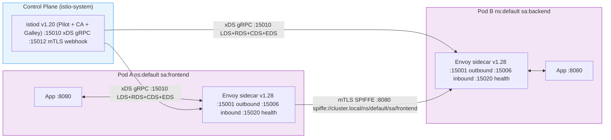
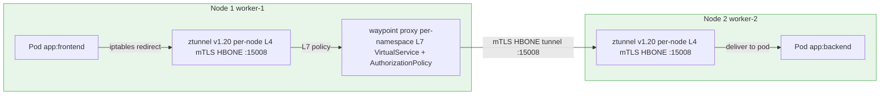
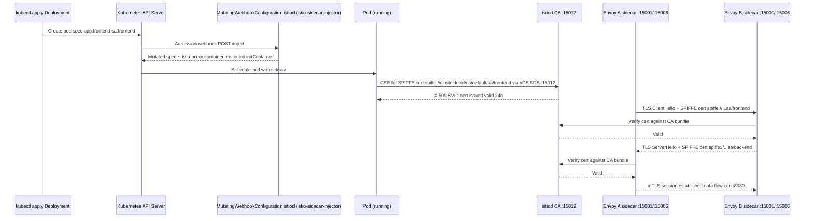

# Lesson 21 — Service Mesh with Istio

> **Track:** Service Mesh | **Prerequisites:** [Lesson 13 — Services](13-kubernetes-services-kube-proxy.md), [Lesson 16 — Network Policies](16-network-policies.md) | **Duration:** ~3 hours

> **Goal:** Configure Istio sidecar injection, enforce mTLS between services, and control traffic with VirtualService and DestinationRule policies.


**Jump to:** [Theory](#theory) · [Practice](#practice) · [Troubleshooting](#troubleshooting) · [Production Checklist](#production-checklist) · [Quick Reference](#quick-reference) · [Check Your Understanding](#check-your-understanding)

---

## Theory

## 1. Architecture

### Sidecar Mode (classic Istio)



### Ambient Mode (sidecar-less, Istio 1.18+)



Ambient mode eliminates sidecar overhead; ztunnel handles mTLS transparently.

### Sidecar Injection + mTLS Handshake Flow



---

## 2. Installation

```bash
# Install Istio using istioctl
curl -L https://istio.io/downloadIstio | sh -
export PATH=$PWD/istio-*/bin:$PATH

# Install with default profile
istioctl install --set profile=default -y

# Verify
istioctl verify-install
kubectl get pods -n istio-system
# expect: istiod Running, istio-ingressgateway Running

# Enable sidecar injection for a namespace
kubectl label namespace default istio-injection=enabled

# Check injection is working
kubectl get namespace default --show-labels
# expect: istio-injection=enabled
```

```bash
# Ambient mode installation
istioctl install --set profile=ambient -y
# No sidecar injection needed — ztunnel handles it per-node
kubectl label namespace default istio.io/dataplane-mode=ambient
```

### Istio Profile Reference

| Parameter | Default | Effect | When to change |
|-----------|---------|--------|----------------|
| `profile` | `default` | Control plane + ingressgateway | Use `minimal` for custom ingress |
| `values.pilot.traceSampling` | `1.0` | % of requests traced | Lower in high-traffic prod |
| `values.global.proxy.resources.requests.cpu` | `10m` | Envoy sidecar CPU request | Increase for high-RPS services |
| `values.global.proxy.resources.requests.memory` | `128Mi` | Envoy sidecar memory | Increase for large XDS configs |
| `meshConfig.accessLogFile` | `""` (disabled) | Envoy access log destination | Set `/dev/stdout` for debugging |
| `meshConfig.defaultConfig.concurrency` | `2` | Envoy worker threads | Match vCPU count on large nodes |

---

## 3. mTLS with PeerAuthentication

```yaml
# Require mTLS for all services in a namespace
apiVersion: security.istio.io/v1
kind: PeerAuthentication
metadata:
  name: default
  namespace: default
spec:
  mtls:
    mode: STRICT     # PERMISSIVE allows plain text too (migration period)
```

```bash
# Verify mTLS is active
istioctl authn tls-check <pod-name>.default
# HOST:PORT                                     STATUS     SERVER     CLIENT
# web.default.svc.cluster.local:80             OK         STRICT     STRICT

# Check certificate used
istioctl proxy-config secret <pod-name>.default
# expect: cert validity, SPIFFE URI in SAN

# See all mTLS CONFLICT states cluster-wide
istioctl authn tls-check --all-namespaces 2>/dev/null | grep CONFLICT
# empty = no conflicts
```

### PeerAuthentication Mode Reference

| Mode | Behavior | When to use |
|------|----------|-------------|
| `STRICT` | mTLS only; plain text rejected | Full mesh — all sidecars injected |
| `PERMISSIVE` | Accept both mTLS and plain text | Migration: external clients still plain |
| `DISABLE` | Plain text only | Debug only — never in production |

---

## 4. AuthorizationPolicy

```yaml
# Allow only specific services to call the web service
apiVersion: security.istio.io/v1
kind: AuthorizationPolicy
metadata:
  name: web-allow
  namespace: default
spec:
  selector:
    matchLabels:
      app: web
  action: ALLOW
  rules:
    - from:
        - source:
            principals:               # service account identity
              - "cluster.local/ns/default/sa/frontend"
      to:
        - operation:
            methods: ["GET", "POST"]
            paths: ["/api/*"]
---
# Default deny everything not explicitly allowed
apiVersion: security.istio.io/v1
kind: AuthorizationPolicy
metadata:
  name: deny-all
  namespace: default
spec:
  {}  # empty = deny all
```

---

## 5. Traffic Management

### VirtualService
```yaml
apiVersion: networking.istio.io/v1
kind: VirtualService
metadata:
  name: web
spec:
  hosts:
    - web
  http:
    # Canary: route 10% to v2
    - route:
        - destination:
            host: web
            subset: v1
          weight: 90
        - destination:
            host: web
            subset: v2
          weight: 10

    # Fault injection (testing resilience)
    - fault:
        delay:
          percentage:
            value: 10.0
          fixedDelay: 5s
        abort:
          percentage:
            value: 5.0
          httpStatus: 503
      route:
        - destination:
            host: web

    # Retry policy
    - retries:
        attempts: 3
        perTryTimeout: 2s
        retryOn: 5xx,reset,connect-failure
      timeout: 10s
      route:
        - destination:
            host: web
```

### DestinationRule
```yaml
apiVersion: networking.istio.io/v1
kind: DestinationRule
metadata:
  name: web
spec:
  host: web
  trafficPolicy:
    connectionPool:
      tcp:
        maxConnections: 100
      http:
        h2UpgradePolicy: UPGRADE
        http2MaxRequests: 1000
    outlierDetection:        # circuit breaker
      consecutiveGatewayErrors: 5
      interval: 30s
      baseEjectionTime: 30s
      maxEjectionPercent: 50
  subsets:
    - name: v1
      labels:
        version: v1
    - name: v2
      labels:
        version: v2
```

### VirtualService / DestinationRule Key Parameters

| Parameter | Default | Effect | When to change |
|-----------|---------|--------|----------------|
| `retries.attempts` | 2 | Max retry count | Increase for idempotent reads |
| `retries.perTryTimeout` | 25s | Timeout per attempt | Match upstream SLA |
| `outlierDetection.consecutiveGatewayErrors` | 5 | Errors before ejection | Lower for fast failover |
| `outlierDetection.baseEjectionTime` | 30s | How long host stays ejected | Increase for slow recovery |
| `connectionPool.tcp.maxConnections` | 2^32-1 | Max TCP connections | Set for connection limiting |
| `connectionPool.http.http1MaxPendingRequests` | 2^32-1 | Max queued HTTP/1 requests | Tune to prevent queue buildup |

---

## 6. Ingress with Istio Gateway

```yaml
apiVersion: networking.istio.io/v1
kind: Gateway
metadata:
  name: web-gateway
spec:
  selector:
    istio: ingressgateway
  servers:
    - port:
        number: 443
        name: https
        protocol: HTTPS
      tls:
        mode: SIMPLE
        credentialName: web-tls-cert
      hosts:
        - web.example.com
---
apiVersion: networking.istio.io/v1
kind: VirtualService
metadata:
  name: web-vs
spec:
  hosts:
    - web.example.com
  gateways:
    - web-gateway
  http:
    - match:
        - uri:
            prefix: /
      route:
        - destination:
            host: web
            port:
              number: 80
```

---

## 7. Observability

```bash
# Install Kiali (topology dashboard), Prometheus, Grafana, Jaeger
kubectl apply -f samples/addons/prometheus.yaml
kubectl apply -f samples/addons/grafana.yaml
kubectl apply -f samples/addons/jaeger.yaml
kubectl apply -f samples/addons/kiali.yaml

# Access Kiali (service mesh topology)
istioctl dashboard kiali
# expect: topology graph with traffic flows and mTLS lock icons

# Access Jaeger (distributed tracing)
istioctl dashboard jaeger

# Access Grafana (metrics)
istioctl dashboard grafana
```

```bash
# CLI observability
# Envoy access logs (per sidecar)
kubectl logs <pod> -c istio-proxy | head -20
# expect: JSON log lines with method, path, response_code, upstream_cluster

# Proxy config dump
istioctl proxy-config cluster <pod>.default
# expect: table with FQDN, PORT, SUBSET, DIRECTION, TYPE

istioctl proxy-config listener <pod>.default
# expect: virtual listeners 0.0.0.0:15001 (outbound) and per-port entries

istioctl proxy-config route <pod>.default
# expect: virtual host routing rules

# Check for traffic issues
istioctl analyze   # validates Istio config — reports errors and warnings
# expect: "No validation issues found" or list of issues
```

---

## 8. Bare Metal vs Cloud Considerations

### Bare Metal
```bash
# Istio ingressgateway needs an external IP
# Use MetalLB or NodePort:
kubectl patch svc istio-ingressgateway -n istio-system \
  --type='json' \
  -p='[{"op":"replace","path":"/spec/type","value":"LoadBalancer"}]'
# MetalLB assigns the IP
```

### Cloud
```bash
# Cloud provisioner auto-assigns EXTERNAL-IP to ingressgateway Service
# AWS: becomes an NLB
# GKE: becomes a Passthrough NLB
kubectl get svc istio-ingressgateway -n istio-system
# expect: EXTERNAL-IP populated within ~60 seconds
```

---

### Industry Applications

| Company / Project | Context | Technology from this lesson | Outcome |
|---|---|---|---|
| Airbnb | Securing service-to-service communication across 1000+ microservices without code changes | PeerAuthentication STRICT mesh-wide; AuthorizationPolicy per-service; Istio sidecar injection | Zero-trust mTLS between all services; identity-based access control replaces network-level firewall rules |
| SAP BTP | Service-to-service mTLS within BTP Kyma runtime across shared Kubernetes clusters | Istio mesh with SPIFFE X.509 certs; PeerAuthentication STRICT per namespace; VirtualService for A/B testing | Tenant workloads cryptographically isolated; routing policies expressed in YAML without application changes |
| eBay | A/B testing and canary releases across payment services processing millions of transactions/day | VirtualService with weighted routes (95/5 split) + DestinationRule subsets (v1/v2 label selectors) | Traffic gradually shifted to new payment logic; instant rollback by updating weights without redeployment |
| Microsoft (Azure Service Fabric + Istio) | Migrating legacy on-prem microservices to AKS with gradual mTLS adoption | PeerAuthentication PERMISSIVE during migration; switched to STRICT per namespace after sidecar coverage reached 100% | Zero downtime migration; services coexisted with and without mTLS during the transition period |

---

## Practice

### Environment Setup

```bash
# Terminal 1 — Mac (istioctl + kubectl)
istioctl version 2>/dev/null || echo "Install: curl -L https://istio.io/downloadIstio | sh -"
kubectl get pods -n istio-system 2>/dev/null
istioctl proxy-status 2>/dev/null | head -10   # expect: SYNCED for each pod

# Terminal 2 — Mac
kubectl get peerauthentication -A 2>/dev/null           # check mTLS mode
kubectl get authorizationpolicy -A 2>/dev/null          # check access rules
kubectl get virtualservice,destinationrule -A 2>/dev/null  # check traffic config

# Verify sidecar injection label
kubectl get namespace default --show-labels | grep istio-injection
# expect: istio-injection=enabled
```

### Hands-On Lab

Work through the Theory sections to build a fully configured Istio service mesh:

1. Install Istio with the default profile (Section 2) and verify istiod + ingressgateway are `Running`
2. Label the `default` namespace for sidecar injection, deploy two services, and confirm sidecars are injected
3. Apply `PeerAuthentication PERMISSIVE`, then `STRICT` (Section 3); use `istioctl authn tls-check` to confirm
4. Create an `AuthorizationPolicy` default-deny + explicit ALLOW (Section 4) and test that blocked paths return 403
5. Apply a `VirtualService` with 90/10 weighted routing + a `DestinationRule` (Section 5) and verify traffic split
6. Configure the Istio Gateway + VirtualService for HTTPS ingress (Section 6) with a TLS certificate
7. Deploy observability stack (Section 7) and inspect traffic topology in Kiali

### Configuration Reference

Key parameter tables are embedded in the Theory sections above:

| Section | Table |
|---------|-------|
| Section 2 — Installation | Istio Profile Reference: `profile`, `traceSampling`, `proxy.resources`, `accessLogFile` |
| Section 3 — mTLS | PeerAuthentication Mode Reference: STRICT vs PERMISSIVE vs DISABLE |
| Section 5 — Traffic Management | VirtualService / DestinationRule Key Parameters: `retries`, `outlierDetection`, `connectionPool` |

---

## Troubleshooting

| Symptom | Likely Cause | Diagnostic Command | Fix |
|---------|-------------|-------------------|-----|
| Sidecar not injected | Namespace missing label | `kubectl get ns <ns> --show-labels` | `kubectl label ns <ns> istio-injection=enabled` |
| 503 Service Unavailable | mTLS conflict (one side STRICT, other plain) | `istioctl authn tls-check <pod>.default` | Add PeerAuthentication PERMISSIVE or inject sidecar in caller |
| `upstream connect error` | DestinationRule subset has no matching pods | `istioctl proxy-config cluster <pod>.default \| grep <service>` | Verify label selector in subset matches pod labels |
| Envoy not synced to istiod | istiod unavailable or network partition | `istioctl proxy-status` — look for `NOT SENT` | Check `kubectl logs -n istio-system -l app=istiod` |
| AuthorizationPolicy blocking | DENY rule or missing ALLOW rule | `kubectl logs <pod> -c istio-proxy \| grep RBAC` | Add explicit ALLOW or check principal format |
| High latency after mesh enable | Envoy sidecar CPU/memory starved | `kubectl top pod <pod> --containers` | Increase `values.global.proxy.resources` limits |
| Certificate expired | SVID cert not rotated | `istioctl proxy-config secret <pod>.default` | Restart istiod to force rotation |

```bash
# 1. Is sidecar injected?
kubectl describe pod <pod> | grep istio-proxy

# 2. Is Istiod healthy?
kubectl get pods -n istio-system
kubectl logs -n istio-system -l app=istiod | grep -E "WARN|ERROR"

# 3. Is mTLS the problem?
# Temporarily set PERMISSIVE mode
kubectl apply -f - <<EOF
apiVersion: security.istio.io/v1
kind: PeerAuthentication
metadata:
  name: default
  namespace: default
spec:
  mtls:
    mode: PERMISSIVE
EOF
# If traffic flows now → certificate or policy issue

# 4. Check Envoy configuration
istioctl proxy-config cluster <pod>.default | grep <service-name>

# 5. Enable Envoy access logging
kubectl apply -f - <<EOF
apiVersion: telemetry.istio.io/v1alpha1
kind: Telemetry
metadata:
  name: access-logging
spec:
  accessLogging:
    - providers:
        - name: envoy
EOF

# 6. Run connectivity test
istioctl experimental envoy-stats <pod>
```

> **See also:** [Lesson 16 — Network Policies](16-network-policies.md) for base NetworkPolicy before layering Istio AuthorizationPolicy.


---

## Production Checklist

- [ ] PeerAuthentication set to `STRICT` in all application namespaces (not PERMISSIVE)
- [ ] AuthorizationPolicy default-deny applied per namespace before deploying workloads
- [ ] `istioctl analyze` runs clean in CI — zero errors or warnings
- [ ] Envoy sidecar CPU/memory requests and limits set to prevent noisy-neighbor starvation
- [ ] Distributed tracing (Jaeger/Zipkin) sampling rate tuned — not 100% in high-RPS production
- [ ] Istio ingress gateway has a PodDisruptionBudget with `minAvailable: 1`
- [ ] Certificate rotation tested — SVID expiry handled without service interruption

---

## Common Anti-Patterns

| What people do | Why it breaks | Correct approach |
|----------------|--------------|-----------------|
| Apply PeerAuthentication STRICT before all pods have sidecars | Non-injected pods cannot complete mTLS handshake — 503 errors | Enable PERMISSIVE first, verify all pods have sidecar, then switch to STRICT |
| Use namespace-wide `deny-all` AuthorizationPolicy without allow rules | Blocks health checks and monitoring, causing cascading failures | Add explicit ALLOW for health check paths and monitoring principals first |
| Deploy VirtualService subsets before DestinationRule is applied | Envoy has no subset configuration — 503 on subset routing | Apply DestinationRule before or simultaneously with VirtualService |
| Run Istio control plane (istiod) with a single replica | istiod failure causes cert rotation and config push to stop | Set `replicaCount: 2` or more and add PodAntiAffinity |
| Forget to annotate sidecar resource limits | Envoy sidecar consumes unbounded CPU — evicts application containers | Always set `sidecar.istio.io/proxyCPU` and `proxyCPULimit` annotations |

---

## Quick Reference

| Use Case | Command |
|----------|---------|
| Check sidecar injection status for all pods | `istioctl proxy-status` |
| Inspect Envoy cluster config for a pod | `istioctl proxy-config cluster <pod>.default` |
| Check mTLS status for a service | `istioctl authn tls-check <pod>.default` |
| Validate all Istio configs | `istioctl analyze` |
| View Envoy access logs | `kubectl logs <pod> -c istio-proxy` |
| Open Kiali topology dashboard | `istioctl dashboard kiali` |
| Check secret/cert for a sidecar | `istioctl proxy-config secret <pod>.default` |
| Enable sidecar injection on namespace | `kubectl label ns <ns> istio-injection=enabled` |
| Temporarily disable mTLS for debugging | Apply PeerAuthentication `mode: PERMISSIVE` |
| Force Envoy config re-push from istiod | `kubectl rollout restart deployment -n istio-system istiod` |
| Get Envoy listener table | `istioctl proxy-config listener <pod>.default` |
| Install observability stack | `kubectl apply -f samples/addons/` |

---

## Summary

| Feature | Istio Mechanism |
|---------|----------------|
| mTLS | Envoy sidecar intercepts all traffic, presents SPIFFE cert |
| AuthorizationPolicy | Envoy enforces at request time per-service |
| Traffic splitting | VirtualService weights |
| Circuit breaker | DestinationRule outlierDetection |
| Tracing | Envoy propagates B3/W3C trace headers |
| Ambient mode | ztunnel (L4) + waypoint (L7), no sidecar |

---

## Check Your Understanding

1. **[Concept question]** What is the difference between `PeerAuthentication` modes `PERMISSIVE` and `STRICT`, and when should each be used?

   <details><summary>Answer</summary>

   `PERMISSIVE` mode accepts both mTLS-encrypted connections and plain-text connections, which allows non-injected clients (such as external services or pods without sidecars) to still communicate during a migration. `STRICT` mode rejects all plain-text — only connections with valid SPIFFE X.509 certificates are accepted. Use `PERMISSIVE` during the rollout period while injecting sidecars into all workloads, then switch to `STRICT` once every pod in the namespace has an injected Envoy sidecar to guarantee end-to-end mTLS.

   </details>

2. **[Scenario question]** After applying `PeerAuthentication` with `mode: STRICT` to a namespace, several services start returning 503 errors. What is the most likely cause?

   <details><summary>Answer</summary>

   Some caller pods are missing the Istio sidecar — either their namespace does not have the `istio-injection=enabled` label or they were created before the label was applied. Without a sidecar, those pods send plain-text requests that STRICT mode rejects. Run `istioctl authn tls-check <pod>.default` to identify CONFLICT rows and `kubectl describe pod <pod> | grep istio-proxy` to confirm whether the sidecar was injected. The fix is to label the namespace and restart affected pods to trigger injection.

   </details>

3. **[Practical question]** What command would you run to verify that mTLS is active and in STRICT mode between a specific pod and the `web` service?

   <details><summary>Answer</summary>

   ```bash
   istioctl authn tls-check <pod-name>.default
   ```
   Look for the row `web.default.svc.cluster.local:80` and confirm the `STATUS` column shows `OK` with both `SERVER` and `CLIENT` columns showing `STRICT`; a `CONFLICT` status means one side is not enforcing mTLS.

   </details>

---

## Online Resources

| Resource | Cost | What you practice |
|----------|------|-------------------|
| [Istio — Get Started](https://istio.io/latest/docs/setup/getting-started/) | Free | Official Istio tutorial on minikube: deploy Bookinfo app, enable mTLS, configure VirtualService traffic splitting — covers this entire lesson |
| [Tetrate Academy: Istio Fundamentals](https://academy.tetrate.io/courses/istio-fundamentals) | Free (account required) | Official free Istio training with browser-based labs; covers PeerAuthentication, AuthorizationPolicy, DestinationRule |
| [Isovalent: TLS Visibility](https://isovalent.com/labs/tls-visibility/) | Free | Inspect TLS traffic and cipher identification using Cilium + Hubble — complements mTLS concepts |
| [Killercoda Playground](https://killercoda.com/) | Free | Run `istioctl proxy-status`, inspect sidecar config, test traffic routing |

---

**← Previous:** [Lesson 20 — Cloud Provider Load Balancers](20-cloud-load-balancers.md)   |   **Next:** [Lesson 22 — Multi-Cluster Networking](22-multi-cluster-networking.md)
