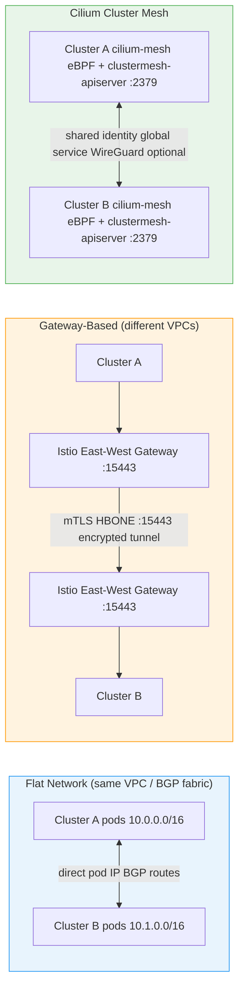
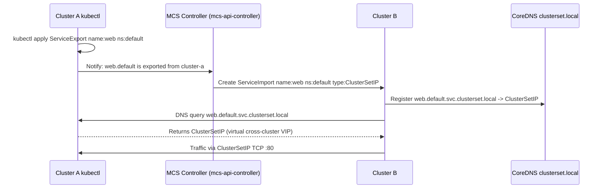
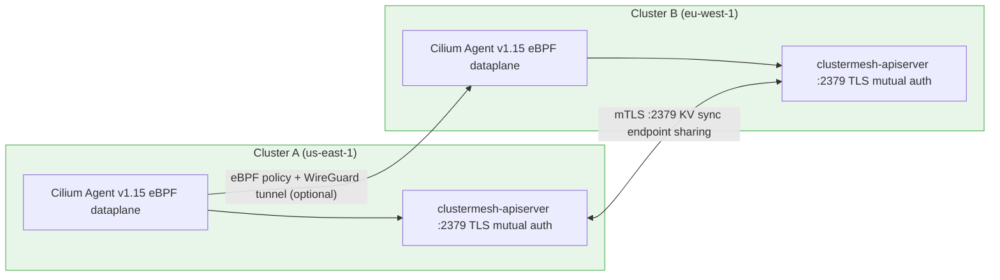
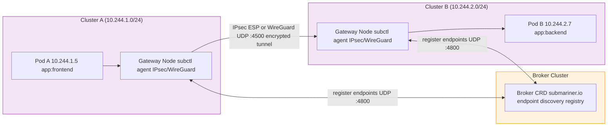

# Lesson 22 — Multi-Cluster Networking

> **Track:** Network Foundation — Bare Metal & Cloud | **Prerequisites:** [Lesson 12 — Cilium](12-cilium-cni-ebpf.md), [Lesson 06 — BGP](06-bgp-fundamentals.md) | **Duration:** ~2.5 hours

> **Goal:** Connect two Kubernetes clusters with Cilium Cluster Mesh or Submariner and reach services across cluster boundaries using the MCS API.


**Jump to:** [Theory](#theory) · [Practice](#practice) · [Troubleshooting](#troubleshooting) · [Production Checklist](#production-checklist) · [Quick Reference](#quick-reference) · [Check Your Understanding](#check-your-understanding)

---

## Theory

## 1. Multi-Cluster Patterns



| Pattern | Description | Use Case |
|---------|-------------|---------|
| Flat network | Pod IPs routable across clusters | Same VPC, low latency |
| Gateway-based | Traffic goes through ingress/egress gateways | Different VPCs, encrypted |
| Service mirroring | Service objects mirrored across clusters | East-west service discovery |
| Cluster Mesh | Full interconnect with shared identity | Cilium native |
| DNS-based federation | DNS routes to nearest healthy cluster | Geo-distributed apps |

---

## 2. Multi-Cluster Services API (MCS)

The Kubernetes Multi-Cluster Services API (SIG-Multicluster KEP-1645) provides a standard for cross-cluster service export/import.



```yaml
# In cluster A — export a service
apiVersion: multicluster.x-k8s.io/v1alpha1
kind: ServiceExport
metadata:
  name: web
  namespace: default
---
# In cluster B — import it
apiVersion: multicluster.x-k8s.io/v1alpha1
kind: ServiceImport
metadata:
  name: web
  namespace: default
spec:
  type: ClusterSetIP
  ports:
    - port: 80
      protocol: TCP
```

```bash
# DNS name for imported service:
# web.default.svc.clusterset.local
kubectl exec -it pod -- nslookup web.default.svc.clusterset.local
# expect: returns a ClusterSetIP address (virtual IP)
```

### MCS API Parameter Reference

| Parameter | Default | Effect | When to change |
|-----------|---------|--------|----------------|
| `ServiceImport.spec.type` | `ClusterSetIP` | Virtual IP for cross-cluster LB | Use `Headless` for direct pod routing |
| `ServiceExport` annotation `multicluster.kubernetes.io/derived-service` | auto | Maps to derived ClusterIP service | Do not modify manually |
| DNS domain | `clusterset.local` | Search domain for cross-cluster names | Configured in DNS operator |

---

## 3. Cilium Cluster Mesh

Cilium's Cluster Mesh connects clusters so pods can communicate using their cluster-internal pod IPs and DNS names.



```bash
# Enable Cluster Mesh on cluster A
cilium clustermesh enable \
  --service-type LoadBalancer
cilium clustermesh status --wait
# expect: "Cluster Mesh: OK"

# Connect cluster B to cluster A
# (run with context pointing to cluster A)
cilium clustermesh connect \
  --destination-context cluster-b \
  --source-context cluster-a

# Verify mesh is connected
cilium clustermesh status
# Cluster A ←→ Cluster B  CONNECTED
# expect: "Global services: N" showing shared services count
```

```yaml
# Share a service globally (available in all mesh clusters)
apiVersion: v1
kind: Service
metadata:
  name: web
  annotations:
    service.cilium.io/global: "true"
    service.cilium.io/shared: "true"   # include this cluster's endpoints
spec:
  selector:
    app: web
  ports:
    - port: 80
```

```bash
# Global service load balances across all clusters
# Affinity to local cluster:
annotations:
  service.cilium.io/global: "true"
  service.cilium.io/affinity: "local"   # prefer local cluster, fall back cross-cluster
```

### Cilium Cluster Mesh Parameter Reference

| Annotation / Parameter | Default | Effect | When to change |
|------------------------|---------|--------|----------------|
| `service.cilium.io/global` | `"false"` | Make service visible across all mesh clusters | Set `"true"` for HA global services |
| `service.cilium.io/shared` | `"false"` | Include this cluster's endpoints in global LB | Set `"true"` to contribute backends |
| `service.cilium.io/affinity` | `"none"` | Prefer local (`"local"`) or remote (`"remote"`) endpoints | Use `"local"` to reduce cross-region latency |
| `clustermesh.cilium.io/global-service` | — | Alternative annotation form | Same as `service.cilium.io/global` |

---

## 4. Istio Multi-Cluster

### Primary-Remote Model
One cluster has the control plane; remote clusters use it.

```bash
# Install Istio on primary cluster
istioctl install --set profile=default \
  --set values.pilot.env.EXTERNAL_ISTIOD=true

# Install remote cluster config
istioctl install --set profile=remote \
  --set values.global.remotePilotAddress=<primary-pilot-ip>
```

### Multi-Primary (Recommended for HA)
Each cluster runs its own Istiod.

```bash
# Step 1: Create a shared root CA
# (both clusters must trust the same root)

# Step 2: Install Istio on cluster 1
istioctl install -f cluster1.yaml

# Step 3: Install Istio on cluster 2
istioctl install -f cluster2.yaml

# Step 4: Cross-cluster east-west gateway
kubectl apply -n istio-system -f eastwest-gateway.yaml

# Step 5: Expose services for cross-cluster discovery
istioctl x create-remote-secret \
  --context=cluster1 \
  --name=cluster1 | kubectl apply --context=cluster2 -f -

# Services become reachable via their FQDN across clusters
# Verify remote clusters registered:
istioctl remote-clusters
# expect: cluster1 and cluster2 listed as CONNECTED
```

---

## 5. Submariner

Submariner provides direct pod-to-pod connectivity between clusters using encrypted tunnels.



```bash
# Install subctl CLI
curl -Ls https://get.submariner.io | bash

# Deploy broker (coordinates cluster registration)
subctl deploy-broker --kubeconfig broker-cluster.kubeconfig

# Join cluster A
subctl join broker-info.subm --kubeconfig cluster-a.kubeconfig \
  --clusterid cluster-a \
  --natt-discovery-port 4900 \
  --globalnet   # if pod CIDRs overlap

# Join cluster B
subctl join broker-info.subm --kubeconfig cluster-b.kubeconfig \
  --clusterid cluster-b \
  --globalnet
```

```bash
# Verify connectivity
subctl verify --kubeconfig cluster-a.kubeconfig --toconfig cluster-b.kubeconfig
# expect: all connectivity checks PASS

# Export service for cross-cluster access
subctl export service --namespace default web
# Creates ServiceExport → Lighthouse DNS resolves across clusters
# DNS: web.default.svc.clusterset.local
```

---

## 6. AWS Multi-Cluster (EKS)

```bash
# Option 1: VPC Peering — flat network, pod IPs routable
aws ec2 create-vpc-peering-connection \
  --vpc-id vpc-cluster-a \
  --peer-vpc-id vpc-cluster-b

# Update route tables in both VPCs
aws ec2 create-route \
  --route-table-id rtb-xxxxxx \
  --destination-cidr-block 10.1.0.0/16 \
  --vpc-peering-connection-id pcx-xxxxxx

# Option 2: AWS Transit Gateway — hub-and-spoke for many VPCs
aws ec2 attach-vpc-to-transit-gateway \
  --transit-gateway-id tgw-xxxxx \
  --vpc-id vpc-cluster-a

# Option 3: AWS VPC Lattice (new, service-level)
# Service-to-service connectivity without VPC peering
```

---

## 7. GCP Multi-Cluster (GKE)

```bash
# GKE Hub — register clusters to a fleet
gcloud container hub memberships register cluster-a \
  --gke-cluster us-central1/cluster-a

gcloud container hub memberships register cluster-b \
  --gke-cluster us-east1/cluster-b

# Enable Multi-Cluster Services
gcloud container hub multi-cluster-services enable

# Enable Multi-Cluster Ingress
gcloud container hub ingress enable \
  --config-membership=cluster-a

# MultiClusterIngress resource (deployed to config cluster)
apiVersion: networking.gke.io/v1
kind: MultiClusterIngress
metadata:
  name: web-ingress
spec:
  template:
    spec:
      backend:
        serviceName: web
        servicePort: 80
```

---

## 8. Overlapping Pod CIDRs Problem

When clusters have overlapping pod CIDRs (common in independent deployments), you need NAT or Globalnet.

```
Cluster A: pods 10.244.0.0/16
Cluster B: pods 10.244.0.0/16  ← SAME CIDR

Solution 1: Globalnet (Submariner)
  — Each cluster gets a unique global CIDR
  — Pods are SNATed to the global CIDR for cross-cluster traffic

Solution 2: Service-based communication only
  — Expose services, not pods — services have cluster-unique IPs

Solution 3: Re-IP pods (if possible)
  — Reinitialize clusters with non-overlapping CIDRs
```

---

### Industry Applications

| Company / Project | Context | Technology from this lesson | Outcome |
|---|---|---|---|
| Spotify | Multi-cluster pod scheduling to balance GPU/CPU workloads across AWS regions | Admiralty virtual-node scheduler + MCS API ServiceExport/ServiceImport for cross-cluster DNS | Pods transparently scheduled to clusters with available capacity; services resolve cross-cluster via clusterset.local |
| Google (Anthos) | 100+ GKE clusters across on-prem and cloud managed as a single fleet | Anthos Service Mesh (Istio multi-primary) + GKE Hub multi-cluster ingress + MCS controller | Single-pane control plane; mTLS between clusters with shared root CA; MultiClusterIngress routes to nearest healthy backend |
| Netflix | Multi-region active-active deployments across AWS us-east-1, eu-west-1, ap-southeast-1 | Spinnaker for orchestration + Istio federation + VPC Lattice for service-level routing (replacing VPC Peering) | Zero-downtime regional failover; traffic shifts within seconds via VirtualService weight updates during incidents |
| Red Hat OpenShift Submariner | On-prem + cloud hybrid clusters with overlapping pod CIDRs from independent team deployments | Submariner with `--globalnet` mode; IPsec tunnels between gateway nodes; Lighthouse DNS for clusterset.local | Clusters with identical 10.244.0.0/16 pod CIDRs coexist; cross-cluster traffic uses Globalnet SNATed global IPs |

---

## Practice

### Environment Setup

```bash
# Terminal 1 — Mac (kubectl with multiple contexts)
kubectl config get-contexts
# expect: list with cluster-1 and cluster-2 entries

kubectl config use-context <cluster-1>
kubectl get pods -A | head -10

# Terminal 2 — Mac (second cluster context)
kubectl config use-context <cluster-2>
cilium clustermesh status 2>/dev/null || echo "Cluster Mesh not enabled on this cluster"
kubectl get serviceimports -A 2>/dev/null || echo "MCS API not installed"

# Verify cross-cluster DNS (MCS)
kubectl exec -it pod -- nslookup web.default.svc.clusterset.local 2>/dev/null || echo "MCS DNS not configured"
```

### Hands-On Lab

Work through the Theory sections to build a multi-cluster connectivity setup:

1. Set up two kubeconfig contexts (two separate clusters or two minikube instances) — verify `kubectl config get-contexts`
2. Create a `ServiceExport` on cluster A and verify the MCS controller creates a `ServiceImport` on cluster B (Section 2)
3. Enable Cilium Cluster Mesh on both clusters (Section 3): run `cilium clustermesh enable` and `cilium clustermesh connect`
4. Annotate a Service with `service.cilium.io/global: "true"` and verify DNS resolves cross-cluster
5. Set `service.cilium.io/affinity: "local"` and test that traffic prefers the local cluster's endpoints
6. Install Submariner (Section 5): deploy broker, join two clusters, run `subctl verify` to confirm connectivity
7. Test overlapping CIDR scenario (Section 8): join with `--globalnet` and verify cross-cluster pod routing works

### Configuration Reference

Key parameter tables are embedded in the Theory sections above:

| Section | Table |
|---------|-------|
| Section 2 — MCS API | MCS API Parameter Reference: `ServiceImport.spec.type`, `clusterset.local` DNS domain |
| Section 3 — Cilium Cluster Mesh | Cilium Cluster Mesh Parameter Reference: `service.cilium.io/global`, `shared`, `affinity` annotations |

---

## Troubleshooting

| Symptom | Likely Cause | Diagnostic Command | Fix |
|---------|-------------|-------------------|-----|
| `cilium clustermesh status` shows DISCONNECTED | TLS cert mismatch or network block on port 2379 | `cilium clustermesh status --wait; kubectl logs -n kube-system ds/clustermesh-apiserver` | Regenerate clustermesh secrets: `cilium clustermesh enable --service-type LoadBalancer` |
| Cross-cluster pod unreachable but service works | Pod CIDR overlaps, Globalnet needed | `subctl diagnose all` | Re-join with `--globalnet` flag |
| Hubble shows no cross-cluster flows | Hubble relay not reaching remote cluster | `hubble observe --from-cluster cluster-b` | Verify clustermesh status and Hubble relay ports |
| Istio remote cluster shows ERROR | Shared root CA mismatch or remote secret expired | `istioctl remote-clusters` | Rotate remote secret: `istioctl x create-remote-secret` |
| MCS DNS (`clusterset.local`) not resolving | MCS controller not installed or ServiceExport missing | `kubectl get serviceexport -A; kubectl get serviceimport -A` | Install MCS controller, verify ServiceExport exists in source cluster |
| Submariner tunnel flapping | UDP 4500/4490 (IPsec) blocked between gateway nodes | `subctl show connections; subctl diagnose firewall inter-cluster` | Open UDP 4490, 4500, 4800 between gateway node IPs |

```bash
# Cilium Cluster Mesh
cilium clustermesh status
# Check "Clusters" section for CONNECTED status

hubble observe --from-cluster cluster-b   # cross-cluster flows

# Istio
istioctl remote-clusters   # check registered remote clusters
istioctl proxy-config cluster <pod> | grep cluster-b

# Submariner
subctl show connections
subctl show endpoints
subctl diagnose all   # comprehensive health check

# DNS cross-cluster
# MCS: nslookup web.default.svc.clusterset.local
# Cilium: nslookup web.default.svc.cluster.local (global service)
# Submarine: nslookup web.default.svc.clusterset.local (Lighthouse)
```

> **See also:** [Lesson 21 — Istio](21-service-mesh-istio.md) for Istio multi-cluster east-west gateway configuration. [Lesson 23 — Network Security Hardening](23-network-security-hardening.md) for encrypting cross-cluster tunnels.


---

## Production Checklist

- [ ] Pod CIDRs are non-overlapping across all clusters — or Globalnet is enabled
- [ ] Cross-cluster traffic is encrypted (WireGuard in Cilium, IPsec in Submariner, mTLS in Istio)
- [ ] Cluster identity verification in place — certificates from shared CA or per-cluster identity
- [ ] Global services have `service.cilium.io/affinity: local` to avoid unnecessary cross-region traffic
- [ ] MCS `ServiceExport` resources are version-controlled and reviewed before deployment
- [ ] Failover behavior tested: shut down one cluster's endpoints and verify traffic shifts
- [ ] Cross-cluster DNS TTL is low enough for fast failover (≤30s)

---

## Common Anti-Patterns

| What people do | Why it breaks | Correct approach |
|----------------|--------------|-----------------|
| Expose all services as global without affinity | Every request potentially crosses regions — high latency and cost | Only export services that genuinely need cross-cluster HA; set `affinity: local` |
| Use overlapping pod CIDRs without Globalnet | Pod IP collisions make routing ambiguous — traffic goes to wrong cluster | Plan non-overlapping CIDRs at day zero or enable Globalnet in Submariner |
| Share a single root CA between clusters without rotation plan | Compromised CA affects all clusters simultaneously | Use intermediate CAs per cluster, rotate quarterly |
| Deploy MCS controller without RBAC review | ServiceExport allows any namespace to expose services to other clusters | Restrict ServiceExport creation to cluster-admins or dedicated operators |
| Rely only on DNS for cross-cluster health detection | Stale DNS cache serves dead endpoints during outage | Combine DNS failover with health-check-based endpoint removal |

---

## Quick Reference

| Use Case | Command |
|----------|---------|
| View all kubectl contexts | `kubectl config get-contexts` |
| Switch to cluster context | `kubectl config use-context <name>` |
| Check Cilium mesh status | `cilium clustermesh status` |
| Connect two Cilium clusters | `cilium clustermesh connect --destination-context <ctx>` |
| Check Submariner connections | `subctl show connections` |
| Run Submariner diagnostics | `subctl diagnose all` |
| Export service via Submariner | `subctl export service --namespace <ns> <svc>` |
| Watch cross-cluster flows in Hubble | `hubble observe --from-cluster <cluster-name>` |
| Check Istio remote clusters | `istioctl remote-clusters` |
| Create Istio remote secret | `istioctl x create-remote-secret --context=<ctx> --name=<name>` |
| Look up cross-cluster DNS | `kubectl exec -it pod -- nslookup web.default.svc.clusterset.local` |
| Check ServiceExport/Import status | `kubectl get serviceexport,serviceimport -A` |

---

## Summary

| Solution | Mechanism | Pod-Level | Service-Level | Encryption |
|----------|-----------|-----------|--------------|------------|
| Cilium Cluster Mesh | eBPF + tunnels | Yes | Yes | WireGuard |
| Istio multi-cluster | Envoy gateways | Via mesh | Yes | mTLS |
| Submariner | IPsec/WireGuard tunnels | Yes | Via Lighthouse | IPsec/WG |
| MCS API | Standard API | No | Yes | Depends |
| VPC Peering (AWS/GCP) | Cloud routing | Yes | Yes | Optional |

---

## Check Your Understanding

1. **[Concept question]** What DNS suffix does the Multi-Cluster Services (MCS) API use for cross-cluster service discovery, and what two objects must exist before the DNS name resolves?

   <details><summary>Answer</summary>

   Cross-cluster services resolve under the `clusterset.local` domain — for example, `web.default.svc.clusterset.local`. Two objects must exist: a `ServiceExport` in the source cluster (which signals that the service should be shared) and a corresponding `ServiceImport` in the destination cluster (which the MCS controller creates automatically). Without the ServiceExport in the originating cluster, the MCS controller never notifies other clusters, so the ServiceImport and DNS record are never created.

   </details>

2. **[Scenario question]** A Cilium Cluster Mesh shows `DISCONNECTED` between cluster-a and cluster-b even though both clusters are running. What port and protocol should you verify is open between nodes?

   <details><summary>Answer</summary>

   The Cluster Mesh API server uses TCP port 2379 (etcd) for the clustermesh-apiserver mutual TLS connection between clusters. If a firewall or security group blocks TCP 2379 between the node IPs of the two clusters, the mesh will show DISCONNECTED. Run `kubectl logs -n kube-system ds/clustermesh-apiserver` to see TLS or connection refused errors, and open TCP 2379 bidirectionally between the clusters' node CIDR ranges.

   </details>

3. **[Practical question]** What command would you run to check whether two Cilium Cluster Mesh-connected clusters are CONNECTED and how many global services are shared?

   <details><summary>Answer</summary>

   ```bash
   cilium clustermesh status
   ```
   Look for lines showing each connected cluster with status `CONNECTED` and a count of `Global services: N`; a `DISCONNECTED` or `PENDING` state indicates an API server reachability or certificate issue that needs further investigation.

   </details>

---

## Online Resources

| Resource | Cost | What you practice |
|----------|------|-------------------|
| [Isovalent: Cilium Cluster Mesh](https://isovalent.com/labs/cilium-cluster-mesh/) | Free | Connect two Kubernetes clusters with Cilium Cluster Mesh, enable shared services, test cross-cluster pod connectivity |
| [Killercoda Playground](https://killercoda.com/) | Free | Multi-context kubectl setup; simulate multi-cluster with two separate namespaces |
| [Submariner Quickstart](https://submariner.io/getting-started/quickstart/) | Free | Official Submariner tutorial connecting two kind clusters — works locally without cloud |

---

**← Previous:** [Lesson 21 — Service Mesh with Istio](21-service-mesh-istio.md)   |   **Next:** [Lesson 23 — Network Security Hardening](23-network-security-hardening.md)
