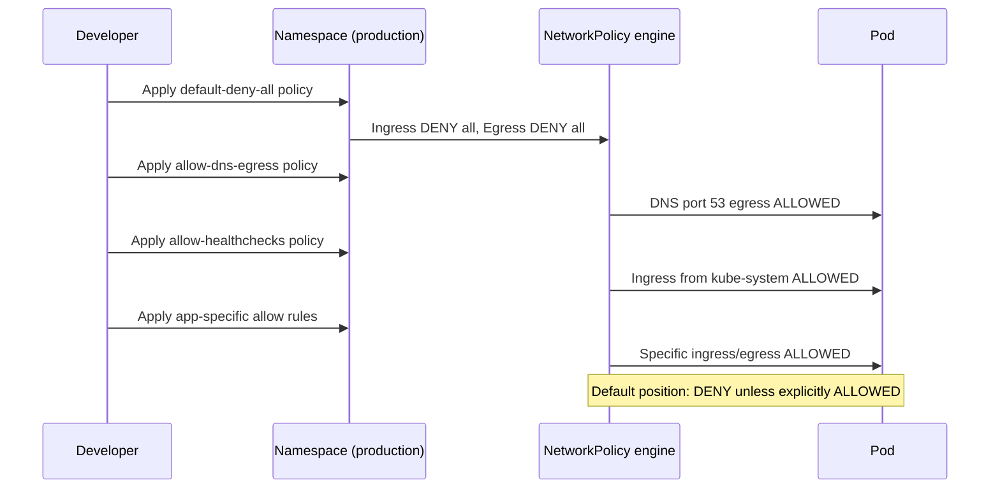

# Lesson 23 — Network Security Hardening

> **Track:** Network Foundation — Bare Metal & Cloud | **Prerequisites:** [Lesson 16 — Network Policies](16-network-policies.md), [Lesson 21 — Istio](21-service-mesh-istio.md) | **Duration:** ~2.5 hours

> **Goal:** Apply layered network security controls — default-deny policies, metadata API blocks, encrypted transit, and runtime enforcement — that satisfy PCI-DSS, HIPAA, and CIS Kubernetes Benchmark requirements.

---

## Practice Setup

```bash
# Terminal 1 — Mac (kubectl — audit current posture)
kubectl get netpol -A
# expect: list of policies; empty namespace means no policies = all pods open

kubectl get peerauthentication -A 2>/dev/null || echo "Istio not installed"
kubectl get pods -A -o jsonpath='{range .items[*]}{.metadata.name}{"\t"}{.spec.hostNetwork}{"\n"}{end}' | grep true
# expect: only system components (node-exporter, CNI) should use hostNetwork

# Terminal 2 — Mac
# Check for pods with no NetworkPolicy coverage
kubectl get pods -n default -o wide
kubectl get netpol -n default
# A production namespace with pods but no netpol = security gap
```

---

## 1. The Threat Model

```mermaid
flowchart TD
    attacker["Compromised Pod"]

    attacker -- "1 Lateral movement" --> other_pods["Other Pods\n(same cluster)"]
    attacker -- "2 Exfiltration" --> internet["Attacker C2\n(internet)"]
    attacker -- "3 Credential theft" --> metadata["Cloud Metadata API\n169.254.169.254"]
    attacker -- "4 Eavesdropping" --> wire["Unencrypted\nPod Traffic"]
    attacker -- "5 Privilege escalation" --> host["Host Network\n(bypass pod controls)"]
    attacker -- "6 Supply chain" --> supply["Malicious image\ncalls home"]

    control1["Default-Deny NetworkPolicy"] -. mitigates .-> other_pods
    control2["FQDN Egress Policy"] -. mitigates .-> internet
    control3["ipBlock except 169.254.169.254"] -. mitigates .-> metadata
    control4["WireGuard / mTLS"] -. mitigates .-> wire
    control5["PodSecurity restricted"] -. mitigates .-> host
    control6["FQDN allowlist"] -. mitigates .-> supply

    style attacker fill:#ffebee,stroke:#f44336
    style control1 fill:#e8f5e9,stroke:#4CAF50
    style control2 fill:#e8f5e9,stroke:#4CAF50
    style control3 fill:#e8f5e9,stroke:#4CAF50
    style control4 fill:#e8f5e9,stroke:#4CAF50
    style control5 fill:#e8f5e9,stroke:#4CAF50
    style control6 fill:#e8f5e9,stroke:#4CAF50
```



---

## 2. Default Deny Network Policies

Start with deny-all and explicitly allow required traffic.



```yaml
# Namespace-level default deny
apiVersion: networking.k8s.io/v1
kind: NetworkPolicy
metadata:
  name: default-deny-all
  namespace: production
spec:
  podSelector: {}
  policyTypes:
    - Ingress
    - Egress
---
# Allow only DNS egress
apiVersion: networking.k8s.io/v1
kind: NetworkPolicy
metadata:
  name: allow-dns-egress
  namespace: production
spec:
  podSelector: {}
  policyTypes:
    - Egress
  egress:
    - ports:
        - port: 53
          protocol: UDP
        - port: 53
          protocol: TCP
---
# Allow health check probes from kube-system
apiVersion: networking.k8s.io/v1
kind: NetworkPolicy
metadata:
  name: allow-healthchecks
  namespace: production
spec:
  podSelector: {}
  policyTypes:
    - Ingress
  ingress:
    - from:
        - namespaceSelector:
            matchLabels:
              kubernetes.io/metadata.name: kube-system
```

### NetworkPolicy Parameter Reference

| Parameter | Default | Effect | When to change |
|-----------|---------|--------|----------------|
| `podSelector: {}` | Selects ALL pods | Policy applies namespace-wide | Use label selector for per-app granularity |
| `policyTypes: [Ingress]` | Only ingress controlled | Egress remains open | Always add `Egress` to `policyTypes` for full control |
| `namespaceSelector` | Not set (any namespace) | Restricts by namespace labels | Required for cross-namespace allow rules |
| `ipBlock.except` | Not set | Allow all IPs in CIDR | Use to carve out cloud metadata API |
| `port: 53, protocol: UDP` | UDP DNS | Allow DNS resolution | Add TCP 53 for large DNS responses |

---

## 3. Block Cloud Metadata API

The cloud metadata API (169.254.169.254) exposes credentials and configuration. Block it from pods.

```yaml
# Block access to cloud metadata service
apiVersion: networking.k8s.io/v1
kind: NetworkPolicy
metadata:
  name: deny-metadata-api
  namespace: production
spec:
  podSelector: {}
  policyTypes:
    - Egress
  egress:
    - to:
        - ipBlock:
            cidr: 0.0.0.0/0
            except:
              - 169.254.169.254/32   # AWS/GCP/Azure metadata
              - 169.254.170.2/32     # AWS ECS metadata
```

```bash
# Verify block works
kubectl run -it --rm test --image=nicolaka/netshoot -- \
  curl -m 3 http://169.254.169.254/latest/meta-data/
# expect: connection timed out (or refused) — NOT a valid metadata response

# Verify DNS still works after block
kubectl run -it --rm dns-test --image=nicolaka/netshoot -- \
  nslookup kubernetes.default.svc.cluster.local
# expect: resolves successfully (DNS egress port 53 is still open)
```

---

## 4. Encryption in Transit

### Cilium WireGuard
```bash
helm upgrade cilium cilium/cilium --reuse-values \
  --set encryption.enabled=true \
  --set encryption.type=wireguard \
  --set encryption.nodeEncryption=true   # encrypt node-to-node too

# Verify encryption
cilium encrypt status
# Encryption: Wireguard
# Keys in use: 1
# expect: all nodes show WireGuard active
```

### Calico WireGuard
```bash
kubectl patch felixconfiguration default \
  --type='merge' \
  -p '{"spec":{"wireguardEnabled":true}}'

# Verify
kubectl get node <node> -o yaml | grep wireguard
calicoctl node status | grep WireGuard
# expect: "WireGuard: Active" per node
```

### Istio mTLS
```yaml
# Enforce strict mTLS cluster-wide
apiVersion: security.istio.io/v1
kind: PeerAuthentication
metadata:
  name: default
  namespace: istio-system   # applies to all namespaces
spec:
  mtls:
    mode: STRICT
```

### Encryption Method Comparison

| Method | Layer | Scope | Key Management | Performance Cost |
|--------|-------|-------|---------------|-----------------|
| WireGuard (Cilium/Calico) | L3 | Node-to-node | Automatic per-node keys | ~3-5% CPU overhead |
| IPsec (Cilium/Submariner) | L3 | Node-to-node | Manual or operator-managed | ~5-8% CPU overhead |
| Istio mTLS | L7 | Pod-to-pod | istiod CA (SPIFFE) | Envoy sidecar overhead |
| TLS (application) | L7 | Service-to-service | App-managed certs | Minimal if hardware offloaded |

---

## 5. Egress Control with FQDN Policies

Cilium allows restricting outbound traffic to specific domain names.

```yaml
apiVersion: cilium.io/v2
kind: CiliumNetworkPolicy
metadata:
  name: allow-external-apis
  namespace: production
spec:
  endpointSelector:
    matchLabels:
      app: worker
  egress:
    - toFQDNs:
        - matchName: "api.github.com"
        - matchPattern: "*.amazonaws.com"
      toPorts:
        - ports:
            - port: "443"
              protocol: TCP
```

```bash
# Verify FQDN policy is active
kubectl exec -it -n production worker-pod -- curl -v https://api.github.com
# expect: HTTP 200 — allowed by FQDN policy

kubectl exec -it -n production worker-pod -- curl -v https://evil.example.com
# expect: connection refused or timeout — not in FQDN allowlist
```

Calico also supports DNS-based policy in Enterprise edition.

---

## 6. Pod Security and Network Interaction

Kubernetes PodSecurity Admission enforces security at the pod level, which complements network controls.

```yaml
# Apply baseline security to a namespace
kubectl label namespace production \
  pod-security.kubernetes.io/enforce=baseline \
  pod-security.kubernetes.io/enforce-version=latest

# Restricted: prevents hostNetwork, hostPID, privileged
kubectl label namespace production \
  pod-security.kubernetes.io/enforce=restricted
```

**Network-relevant pod spec hardening:**
```yaml
spec:
  hostNetwork: false       # don't share host network namespace
  hostPID: false           # don't share host PID namespace
  securityContext:
    runAsNonRoot: true
  containers:
    - name: app
      securityContext:
        allowPrivilegeEscalation: false
        capabilities:
          drop: ["ALL"]
          add: ["NET_BIND_SERVICE"]  # only if binding ports < 1024
```

### PodSecurity Level vs Network Risk

| Level | hostNetwork | hostPID | Privileged | Net Risk |
|-------|-------------|---------|------------|---------|
| `privileged` | Allowed | Allowed | Allowed | Critical — bypasses all pod-level controls |
| `baseline` | Blocked | Blocked | Blocked | Moderate — container escape still possible |
| `restricted` | Blocked | Blocked | Blocked | Low — combined with NetworkPolicy = strong |

---

## 7. Audit Logging for Network Events

```bash
# Cilium flow audit (all denied flows)
hubble observe --verdict DROPPED --all-namespaces -o json | \
  jq '{src: .flow.source.pod_name, dst: .flow.destination.pod_name,
       dport: .flow.l4.TCP.destination_port, verdict: .flow.verdict}'
# expect: JSON lines showing blocked flows — use to build allow rules

# Tetragon network audit
kubectl exec -n kube-system ds/tetragon -- \
  tetra getevents --event-types PROCESS_ACCEPT,PROCESS_CONNECT -o json
# expect: process-level network events including binary path and args

# kube-apiserver audit log — network policy changes
kubectl get events --all-namespaces | grep NetworkPolicy
```

---

## 8. Network Security Checklist Automation

```bash
# 1. Default deny policies in all namespaces
for ns in $(kubectl get ns -o jsonpath='{.items[*].metadata.name}'); do
  count=$(kubectl get networkpolicy -n $ns 2>/dev/null | grep deny | wc -l)
  echo "$ns: $count deny policies"
done
# expect: each namespace shows ≥1 deny policy

# 2. Pod → metadata API is blocked
kubectl run -it --rm meta-test --image=curlimages/curl -- \
  curl -m 3 http://169.254.169.254/
# expect: timeout

# 3. Encryption is active
cilium encrypt status   # for Cilium/WireGuard
# expect: "Encryption: Wireguard" and "Keys in use: 1"

# 4. mTLS is enforced (Istio)
istioctl authn tls-check --all-namespaces 2>/dev/null | grep CONFLICT
# expect: empty — no CONFLICT rows

# 5. No hostNetwork pods (except system components)
kubectl get pods --all-namespaces \
  -o json | jq '.items[] | select(.spec.hostNetwork == true) |
    .metadata.namespace + "/" + .metadata.name'
# expect: only kube-system / openshift-* components

# 6. No pods with excessive capabilities
kubectl get pods --all-namespaces \
  -o json | jq '.items[].spec.containers[].securityContext.capabilities.add // empty'
# expect: empty or only NET_BIND_SERVICE

# 7. Egress to internet is controlled
kubectl run -it --rm egress-test --image=nicolaka/netshoot -- \
  curl -m 5 https://ifconfig.me
# expect: timeout (if egress blocked) or only expected exit IPs
```

---

## 9. Compliance Reference

| Requirement | Kubernetes Control |
|-------------|-------------------|
| PCI-DSS 1.2 | NetworkPolicy: segment cardholder data environment |
| PCI-DSS 4.1 | Istio/Calico mTLS: encrypt cardholder data in transit |
| HIPAA | NetworkPolicy + mTLS: isolate PHI workloads |
| SOC 2 | Audit logs: Hubble + Tetragon for network events |
| CIS Benchmark | Default deny policies, no hostNetwork for user pods |

```bash
# CIS Kubernetes Benchmark network checks
# 5.3.1 Ensure network policies are set (default deny)
# 5.3.2 Ensure all namespaces have network policies

# Automated scan with kube-bench
kubectl apply -f https://raw.githubusercontent.com/aquasecurity/kube-bench/main/job.yaml
kubectl logs -f job.kube-bench | grep -A3 "5.3"
# expect: PASS for 5.3.1 and 5.3.2
```

---

## Troubleshooting

| Symptom | Likely Cause | Diagnostic Command | Fix |
|---------|-------------|-------------------|-----|
| Pods can't do DNS after default-deny | Missing `allow-dns-egress` NetworkPolicy | `kubectl exec pod -- nslookup kubernetes` | Apply `allow-dns-egress` policy (port 53 UDP+TCP) |
| Health checks failing after deny-all | Kubelet probe traffic blocked from kube-system | `kubectl describe pod <pod> \| grep Events` | Add ingress from `namespaceSelector: kube-system` |
| WireGuard not encrypting between nodes | Kernel < 5.6 (no built-in WireGuard) or module missing | `cilium encrypt status` | Upgrade kernel or use IPsec fallback |
| Tetragon not capturing events | eBPF program not loaded or kernel too old | `kubectl logs -n kube-system ds/tetragon` | Check kernel version ≥ 4.19 for eBPF support |
| FQDN egress policy allows wrong IPs | DNS cache poisoning or stale entry | `kubectl exec pod -- nslookup api.github.com` and compare to Cilium's cached IPs | Add `fromEndpoints` restriction and flush Cilium DNS cache |
| `PodSecurity restricted` blocks all pods | Pods not compliant (privileged, hostNetwork, etc.) | `kubectl describe pod <pod> \| grep "violates PodSecurity"` | Add `runAsNonRoot`, drop ALL capabilities, remove hostNetwork |
| Hubble shows flows but no drop verdicts | PeerAuthentication in PERMISSIVE — policy not enforced | `kubectl get peerauthentication -A` | Switch to STRICT after confirming all sidecars injected |

> **See also:** [Lesson 16 — Network Policies](16-network-policies.md) for base NetworkPolicy syntax. [Lesson 21 — Istio](21-service-mesh-istio.md) for mTLS STRICT enforcement.

---

## Production Checklist

- [ ] Default-deny NetworkPolicy applied in every application namespace before workloads deploy
- [ ] Metadata API (169.254.169.254) blocked via `ipBlock.except` in egress policy
- [ ] Node-to-node encryption enabled (WireGuard in Cilium/Calico or IPsec in Submariner)
- [ ] Istio PeerAuthentication set to STRICT cluster-wide (not per-namespace permissive)
- [ ] `pod-security.kubernetes.io/enforce=restricted` on all application namespaces
- [ ] Hubble or Tetragon audit log exported to SIEM for network event retention
- [ ] kube-bench run on all nodes — CIS checks 5.3.1 and 5.3.2 pass

---

## Common Anti-Patterns

| What people do | Why it breaks | Correct approach |
|----------------|--------------|-----------------|
| Apply default-deny without testing first | Breaks DNS, monitoring, and health checks immediately | Use `hubble observe --verdict DROPPED` to discover required flows before enforcing |
| Encrypt only pod-to-pod traffic, not node-to-node | Host-level processes (kubelet, CNI) still send plain traffic on the wire | Enable `nodeEncryption: true` in Cilium WireGuard config |
| Use PERMISSIVE mTLS permanently | No actual encryption guarantee — legacy clients silently bypass mTLS | Set a migration deadline; switch to STRICT within sprint |
| Block metadata API only in `default` namespace | Pods in other namespaces still reach metadata API | Apply `deny-metadata-api` NetworkPolicy in every namespace or use Calico GlobalNetworkPolicy |
| Run Tetragon/Hubble but never export to SIEM | Audit data only lives in ephemeral pod logs — lost on restart | Configure Hubble to export to Kafka/Elasticsearch; Tetragon to Falco/Splunk |

---

## Quick Reference

| Use Case | Command |
|----------|---------|
| List all NetworkPolicies cluster-wide | `kubectl get netpol -A` |
| Watch denied flows in real time | `hubble observe --verdict DROPPED --all-namespaces` |
| Check WireGuard encryption status | `cilium encrypt status` |
| Enable Calico WireGuard | `kubectl patch felixconfiguration default --type merge -p '{"spec":{"wireguardEnabled":true}}'` |
| Check Istio mTLS conflicts | `istioctl authn tls-check --all-namespaces \| grep CONFLICT` |
| List pods with hostNetwork=true | `kubectl get pods -A -o json \| jq '.items[]\|select(.spec.hostNetwork==true)\|.metadata.name'` |
| Run kube-bench CIS check | `kubectl apply -f https://raw.githubusercontent.com/aquasecurity/kube-bench/main/job.yaml` |
| Test metadata API block | `kubectl run -it --rm t --image=curlimages/curl -- curl -m3 http://169.254.169.254/` |
| Check pod capabilities | `kubectl get pods -A -o json \| jq '.items[].spec.containers[].securityContext.capabilities'` |
| Trace Cilium policy decision | `cilium policy trace --src-pod ns/pod-a --dst-pod ns/pod-b --dport 80` |
| Enable Tetragon network event capture | `kubectl exec -n kube-system ds/tetragon -- tetra getevents --event-types PROCESS_CONNECT` |
| Apply PodSecurity restricted to namespace | `kubectl label ns <ns> pod-security.kubernetes.io/enforce=restricted` |

---

## Summary

| Control | Tool | What It Prevents |
|---------|------|----------------|
| Default deny | NetworkPolicy | Lateral movement |
| Metadata block | NetworkPolicy (ipBlock except) | Credential theft |
| FQDN egress | Cilium CiliumNetworkPolicy | Exfiltration |
| Encryption | WireGuard / mTLS | Eavesdropping |
| Pod security | PodSecurity Admission | hostNetwork bypass |
| Audit | Hubble / Tetragon | Detecting incidents |

---

## Online Resources

| Resource | Cost | What you practice |
|----------|------|-------------------|
| [Isovalent: Zero Trust Visibility](https://isovalent.com/labs/zero-trust-visibility/) | Free | Use metrics and Hubble dashboards to identify all required application flows before enforcing zero-trust network policies |
| [Kubernetes Network Policy Recipes](https://github.com/ahmetb/kubernetes-network-policy-recipes) | Free (GitHub) | 20+ policy templates covering default-deny, namespace isolation, metadata API block |
| [NetworkPolicy Editor](https://editor.networkpolicy.io/) | Free browser tool | Visually build and validate NetworkPolicy YAML before applying it |
| [Killercoda Playground](https://killercoda.com/) | Free | Apply hardening policies, verify blocks, test WireGuard encryption toggle in Cilium |

---

**Next:** [Lesson 24 — Network Observability and Troubleshooting](24-network-observability-troubleshooting.md)
