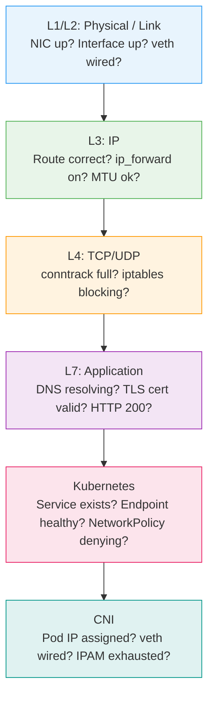
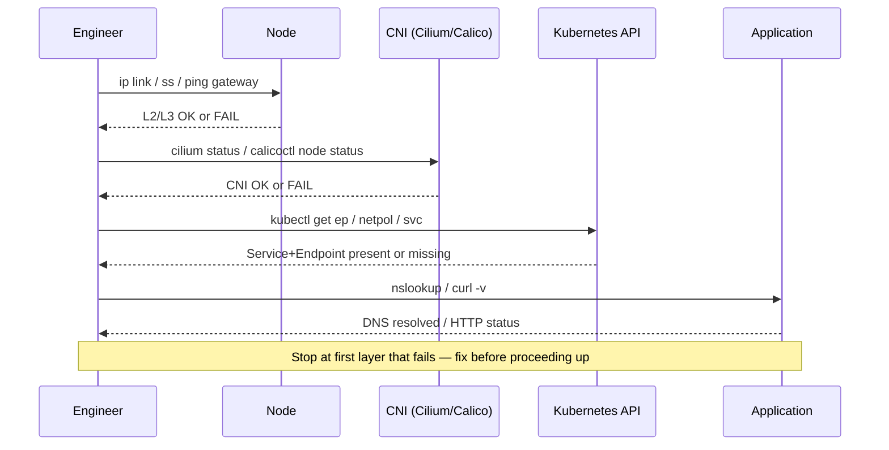

# Lesson 24 — Network Observability and Troubleshooting

> **Track:** Network Foundation — Bare Metal & Cloud | **Prerequisites:** All previous lessons — this is the capstone | **Duration:** ~3 hours

> **Goal:** Diagnose any Kubernetes network failure — from pod unreachability to DNS timeouts — using a structured L1-to-L7 methodology and tools including Hubble, netshoot, tcpdump, and Prometheus metrics.

---

## Practice Setup

```bash
# Terminal 1 — minikube Linux node
minikube ssh
ss -s           # socket summary — total established/closed counts
ss -tlnp        # listening TCP sockets with process names
conntrack -L 2>/dev/null | head -10  # conntrack table — expect: NAT entries

# Terminal 2 — Mac (kubectl + hubble)
hubble observe --last 20 2>/dev/null || echo "hubble not running — try: cilium hubble enable"
kubectl run netshoot --image=nicolaka/netshoot --rm -it --restart=Never -- bash
# expect: bash prompt inside netshoot — all network debug tools available
```

---

## 1. Systematic Troubleshooting Methodology

Work from the bottom of the stack up:



**The golden rule:** confirm each layer before moving up. Don't start at Kubernetes if you haven't confirmed the node NIC is up.



---

## 2. The Diagnostic Pod

Keep a debug pod manifest ready:

```yaml
apiVersion: v1
kind: Pod
metadata:
  name: netshoot
  namespace: default
spec:
  containers:
    - name: netshoot
      image: nicolaka/netshoot
      command: ["sleep", "infinity"]
  nodeSelector:
    kubernetes.io/hostname: "node-to-debug"  # pin to specific node
```

```bash
# Or one-liner:
kubectl run -it --rm netshoot --image=nicolaka/netshoot -- bash
# expect: bash prompt with curl, nslookup, tcpdump, ss, traceroute, iperf3

# In the same network namespace as a running pod:
kubectl debug -it <pod-name> --image=nicolaka/netshoot --target=<container-name>
# expect: shares network namespace of target — same IP, same routes

# nsenter trick (from node — sees pod network namespace):
NODE_PID=$(kubectl get pod <pod> -o jsonpath='{.status.podIP}')
# SSH to node, find PID:
crictl inspect $(crictl ps | grep <pod-name> | awk '{print $1}') | jq '.info.pid'
nsenter -n -t <PID> -- ss -tlnp
# expect: socket table from inside the pod
```

---

## 3. Pod Connectivity Checklist

```bash
# SYMPTOM: Pod A cannot reach Pod B

# Step 1: Can Pod A reach its own gateway?
kubectl exec -it pod-a -- ping -c3 $(ip route | grep default | awk '{print $3}')
# expect: 0% packet loss

# Step 2: Can Pod A reach Pod B's IP directly?
POD_B_IP=$(kubectl get pod pod-b -o jsonpath='{.status.podIP}')
kubectl exec -it pod-a -- ping -c3 $POD_B_IP
# If fail → routing or NetworkPolicy issue

# Step 3: Is there a NetworkPolicy blocking traffic?
# Check policies selecting pod-a (egress) and pod-b (ingress)
kubectl get networkpolicy -n default -o yaml | grep -A10 "podSelector"
# Use Cilium policy trace:
cilium policy trace --src-pod default/pod-a --dst-pod default/pod-b --dport 80
# expect: "Final verdict: allowed" or "Final verdict: denied — reason: ..."

# Step 4: Is the route present?
NODE=$(kubectl get pod pod-b -o jsonpath='{.spec.nodeName}')
# SSH to node
ssh $NODE
ip route get $POD_B_IP
# expect: a valid route showing the veth or tunnel interface

# Step 5: Cross-node — is VXLAN/BGP working?
# Check CNI status
calicoctl node status   # or: cilium status
# expect: BGP peer state Established, VXLAN/WireGuard active

# Step 6: Packet capture
# On pod-b's node:
tcpdump -i any -n host $POD_B_IP
# expect: ICMP packets arriving from Pod A's IP
```

---

## 4. Service Connectivity Checklist

```bash
# SYMPTOM: Pod cannot reach Service

# Step 1: Does the service exist?
kubectl get svc web -n default
# expect: ClusterIP shows an IP address (not <none>)

# Step 2: Does it have endpoints?
kubectl get endpoints web -n default
# expect: IP:port entries — if empty: selector doesn't match pods or pods not Ready
kubectl describe endpoints web -n default
# shows notReadyAddresses if pods are failing health checks

# Step 3: Is the DNS name resolving?
kubectl exec -it pod-a -- nslookup web.default.svc.cluster.local
# expect: returns ClusterIP address
kubectl exec -it pod-a -- nslookup web   # short name
# expect: same result via search domain

# Step 4: Is the ClusterIP reachable?
CLUSTER_IP=$(kubectl get svc web -o jsonpath='{.spec.clusterIP}')
kubectl exec -it pod-a -- curl -v http://$CLUSTER_IP:80
# expect: HTTP response — if fails: iptables DNAT rule missing

# Step 5: Are iptables DNAT rules present?
iptables -t nat -L KUBE-SERVICES -n | grep $CLUSTER_IP
# expect: rule with "/* web/default:http cluster IP */"

# Step 6: Is kube-proxy running and healthy?
kubectl get pods -n kube-system -l k8s-app=kube-proxy
kubectl logs -n kube-system -l k8s-app=kube-proxy | tail -20
# expect: "Syncing iptables rules" messages without ERROR
```

---

## 5. DNS Troubleshooting

```bash
# SYMPTOM: DNS lookups failing or slow

# Step 1: Can pod reach CoreDNS?
kubectl exec -it pod-a -- nc -vzu 10.96.0.10 53
# expect: "open" (UDP) — if fails: NetworkPolicy blocking CoreDNS

# Step 2: Does a simple lookup work?
kubectl exec -it pod-a -- nslookup kubernetes.default.svc.cluster.local
# expect: returns 10.96.0.1 (or configured API server ClusterIP)

# Step 3: Enable CoreDNS query logging
kubectl edit cm -n kube-system coredns
# Add: log  (inside the .:53 { block)
kubectl rollout restart deployment -n kube-system coredns

# Watch queries
kubectl logs -n kube-system -l k8s-app=kube-dns -f | grep -v "NOERROR"
# expect: each query logged — look for NXDOMAIN or SERVFAIL

# Step 4: Check ndots behavior
kubectl exec -it pod-a -- cat /etc/resolv.conf
# expect: "ndots:5" — means short names trigger 5 search domain tries before bare lookup
# high ndots:5 → many fallback queries for external names

# Step 5: Check CoreDNS metrics
kubectl port-forward -n kube-system svc/kube-dns 9153:9153 &
curl -s http://localhost:9153/metrics | grep coredns_dns_request_duration
# expect: histogram buckets with 95th percentile < 5ms for healthy DNS

# Step 6: Check for conntrack UDP race condition
# (symptom: 5-second DNS timeouts)
dmesg | grep "nf_conntrack: table full"
# if present: conntrack exhaustion is causing DNS drops
sysctl net.netfilter.nf_conntrack_count
sysctl net.netfilter.nf_conntrack_max
# expect: count < 80% of max
```

---

## 6. Latency Investigation

```bash
# SYMPTOM: High latency between pods

# Step 1: Baseline measurement
kubectl exec -it pod-a -- \
  for i in $(seq 10); do curl -w "%{time_total}\n" -o /dev/null -s http://web; done
# expect: p99 < 5ms for in-cluster pod-to-pod on modern hardware

# Step 2: Check for packet loss
kubectl exec -it pod-a -- ping -c100 -f $POD_B_IP
# "%" column shows packet loss
# expect: 0% loss for healthy cluster

# Step 3: MTU mismatch (causes fragmentation → latency)
kubectl exec -it pod-a -- ping -M do -s 1422 $POD_B_IP  # VXLAN
# If "Message too long" → MTU mismatch
# Check effective MTU
kubectl exec -it pod-a -- ip link show eth0 | grep mtu
# expect: 1450 (VXLAN) or 1360 (WireGuard over VXLAN) or 1500 (native)

# Step 4: CPU throttling on pods (affects packet processing)
kubectl top pod pod-a
kubectl describe pod pod-a | grep -A5 "Limits\|Requests"
# expect: CPU usage well below limits — high throttling causes tail latency

# Step 5: conntrack contention
# High conntrack lookup latency on busy nodes:
cat /proc/net/stat/nf_conntrack
# expect: low "searched" vs "found" ratio

# Step 6: Node CPU for network interrupts
# On node:
watch -n1 'cat /proc/interrupts | grep -E "eth0|mlx5"'
# expect: interrupts spread evenly across CPUs (RSS/multi-queue working)
```

---

## 7. Packet Capture Techniques

```bash
# Capture on a specific pod's veth (from the host)
# First, find the veth
POD_ID=$(kubectl get pod pod-a -o jsonpath='{.metadata.uid}')
# Find matching veth on node:
ip link show | grep -i cali
# Then capture:
tcpdump -i cali1234abcd -n -w /tmp/pod-a.pcap
# expect: raw packets — open in Wireshark to decode

# Capture inside pod
kubectl exec -it pod-a -- tcpdump -i eth0 -n -w /tmp/capture.pcap
# Copy out:
kubectl cp pod-a:/tmp/capture.pcap ./pod-a.pcap
# expect: pcap file on local disk

# ksniff — kubectl plugin for pod packet capture
kubectl sniff pod-a -n default -o ./pod-a.pcap
# expect: live capture piped to Wireshark (requires krew install sniff)

# Capture VXLAN encapsulated traffic (between nodes)
tcpdump -i eth0 -n udp port 4789 -w /tmp/vxlan.pcap
# expect: UDP frames with inner IP headers visible in Wireshark

# View in Wireshark
# wireshark ./pod-a.pcap
# or analyze with tshark:
tshark -r pod-a.pcap -T fields -e frame.number -e ip.src -e ip.dst -e tcp.dstport
# expect: columns showing inner IP flow src/dst/port
```

---

## 8. Hubble — Flow-Level Observability

```bash
# Install Hubble CLI
curl -L --fail --remote-name-all \
  https://github.com/cilium/hubble/releases/download/v0.13.0/hubble-linux-amd64.tar.gz
tar xzvf hubble-linux-amd64.tar.gz
mv hubble /usr/local/bin/

# Forward Hubble relay
cilium hubble port-forward &

# Watch all flows
hubble observe
# expect: stream of src → dst flows with verdict (FORWARDED/DROPPED)

# Watch denied flows (policy violations)
hubble observe --verdict DROPPED --all-namespaces
# expect: flows that NetworkPolicy or Istio AuthorizationPolicy blocked

# Flow for specific pod
hubble observe --from-pod default/frontend --to-pod default/backend
# expect: flows between those two pods with HTTP method and status

# Count flows per destination
hubble observe --all-namespaces -o json | \
  jq -r '.flow | .destination.namespace + "/" + .destination.pod_name' | \
  sort | uniq -c | sort -rn | head -20
# expect: top-N pods by received flow count

# HTTP flows
hubble observe --protocol http --all-namespaces | head -20
# expect: HTTP method, path, response code for each flow

# Service connectivity map (Hubble UI)
cilium hubble ui
# expect: browser opens at localhost:12000 with service topology graph
```

### Hubble Key Metrics

| Metric | PromQL | What it shows |
|--------|--------|---------------|
| Total drop rate | `rate(cilium_drop_count_total[5m])` | Policy drops per second |
| Drop by reason | `sum by (reason) (rate(cilium_drop_count_total[5m]))` | Why traffic is dropped |
| iptables rule count | `felix_iptables_rules_total` | Calico iptables rule count |
| conntrack entries | `node_nf_conntrack_entries` | Current conntrack table usage |
| DNS error rate | `rate(coredns_dns_responses_total{rcode!="NOERROR"}[5m])` | CoreDNS failures |

---

## 9. Key Metrics to Monitor

```bash
# Kubernetes network metrics (from kube-state-metrics + node-exporter)
# In Prometheus/Grafana:

# Node network throughput
rate(node_network_receive_bytes_total{device="eth0"}[5m])
rate(node_network_transmit_bytes_total{device="eth0"}[5m])
# expect: matches expected app traffic patterns

# Network errors
rate(node_network_receive_errs_total[5m])
rate(node_network_transmit_errs_total[5m])
# expect: near-zero; spikes indicate hardware/driver issues

# conntrack usage
node_nf_conntrack_entries / node_nf_conntrack_entries_limit
# expect: < 0.8 (80%) — above this DNS and new connections start dropping

# DNS query rate
rate(coredns_dns_requests_total[5m])
# baseline this per-pod for capacity planning

# DNS error rate
rate(coredns_dns_responses_total{rcode!="NOERROR"}[5m])
# expect: near-zero; NXDOMAIN spike = broken service names

# kube-proxy sync latency
rate(kubeproxy_sync_proxy_rules_duration_seconds_bucket[5m])
# expect: < 100ms p99; spikes correlate with iptables rule churn
```

---

## Troubleshooting

| Symptom | Likely Cause | Diagnostic Command | Fix |
|---------|-------------|-------------------|-----|
| Pod can't ping pod | NetworkPolicy block or missing route | `cilium policy trace --src-pod ns/a --dst-pod ns/b --dport 80` | Add NetworkPolicy allow rule or fix CNI route |
| Pod can't reach service | No endpoints or kube-proxy not synced | `kubectl get endpoints <svc>; iptables -t nat -L KUBE-SERVICES -n \| grep <clusterIP>` | Fix pod readiness probe or restart kube-proxy |
| DNS timeout (5s) | conntrack UDP race or CoreDNS crash | `dmesg \| grep conntrack; kubectl logs -n kube-system -l k8s-app=kube-dns` | Increase conntrack table size or scale CoreDNS replicas |
| Intermittent connections | conntrack table exhausted | `cat /proc/sys/net/netfilter/nf_conntrack_count` vs max | `sysctl -w net.netfilter.nf_conntrack_max=524288` |
| High latency | MTU fragmentation (VXLAN overhead ignored) | `ping -M do -s 1422 <pod-ip>` | Lower pod MTU to 1450 for VXLAN or 1360 for WireGuard |
| LoadBalancer pending | CCM not installed or cloud IAM insufficient | `kubectl describe svc <svc> \| grep Events` | Install cloud CCM or grant IAM role for LB provisioning |
| BGP not established | TCP/179 blocked or ASN mismatch | `calicoctl node status \| grep BGP; telnet <peer> 179` | Open TCP 179 and verify peer ASN config |
| VXLAN drops | UDP/4789 blocked on firewall or MTU exceeded | `tcpdump -i eth0 -n udp port 4789` | Open UDP 4789 and set CNI MTU to 1450 |

---

## Production Checklist

- [ ] Hubble or equivalent flow exporter deployed and exporting to centralized log store
- [ ] Prometheus alerts configured for `cilium_drop_count_total` and `node_nf_conntrack_entries`
- [ ] netshoot (or equivalent debug image) added to cluster image pull policy allowlist
- [ ] `ss -tlnp` and `conntrack -L` available on nodes — `conntrack-tools` package installed
- [ ] MTU set correctly for CNI overlay (1450 VXLAN, 1360 WireGuard+VXLAN) — not default 1500
- [ ] CoreDNS scaled to minimum 2 replicas with PodAntiAffinity across nodes
- [ ] Network troubleshooting runbook stored in team wiki with this lesson's methodology

---

## Common Anti-Patterns

| What people do | Why it breaks | Correct approach |
|----------------|--------------|-----------------|
| Start troubleshooting at Kubernetes layer (services, policies) | Lower layers (MTU, routing, CNI) may be broken — Kubernetes can't fix a missing route | Always start at L1/L2 and work up: NIC → route → conntrack → K8s |
| Use `kubectl exec curl` as the only test | Passes through kube-proxy DNAT — hides raw routing issues | Also test pod-IP directly and use tcpdump on the node |
| Run `tcpdump` without specifying interface | Captures loopback and all interfaces — overwhelming noise | Always specify `-i cali1234` (veth) or `-i eth0 udp port 4789` |
| Ignore MTU for overlay networks | 1500-byte packets are fragmented in VXLAN tunnels — silent performance loss | Calculate: physical MTU (1500) − VXLAN header (50) = 1450 max pod MTU |
| Assume DNS failure = CoreDNS issue | conntrack table exhaustion or NetworkPolicy blocking DNS are more common | Check `dmesg \| grep conntrack` and `netpol` before touching CoreDNS config |

---

## Quick Reference

| Use Case | Command |
|----------|---------|
| Watch denied flows real-time | `hubble observe --verdict DROPPED --all-namespaces` |
| Trace Cilium policy decision | `cilium policy trace --src-pod ns/pod-a --dst-pod ns/pod-b --dport 80` |
| Check service endpoints | `kubectl get endpoints <svc> -n <ns>` |
| Verify ClusterIP DNAT rule | `iptables -t nat -L KUBE-SERVICES -n \| grep <clusterIP>` |
| Capture pod traffic from node | `tcpdump -i cali<veth> -n -w /tmp/out.pcap` |
| Check conntrack table usage | `cat /proc/sys/net/netfilter/nf_conntrack_count` |
| Test DNS resolution from pod | `kubectl exec -it pod -- nslookup <svc>.default.svc.cluster.local` |
| Inspect socket table inside pod | `kubectl exec -it pod -- ss -tlnp` |
| Run netshoot debug pod | `kubectl run -it --rm netshoot --image=nicolaka/netshoot -- bash` |
| Debug in target pod network ns | `kubectl debug -it <pod> --image=nicolaka/netshoot --target=<container>` |
| Check MTU fragmentation | `kubectl exec -it pod -- ping -M do -s 1422 <dest-ip>` |
| View Hubble service topology | `cilium hubble ui` |

---

## Summary and Graduation

You have covered the full Kubernetes networking stack:

```
Lessons 01-04: Linux primitives — namespaces, veth, routing, iptables
Lessons 05-06: Overlay networks and BGP
Lessons 07-08: Bare metal infrastructure and cloud provider networking
Lesson  09:    CNI specification
Lessons 10-11: Calico and Cilium — the two dominant CNIs
Lessons 12-13: Services and DNS — the discovery layer
Lesson  14:    Network Policies — microsegmentation
Lessons 15-16: Ingress and Gateway API — L7 traffic
Lessons 17-18: Load balancers — bare metal and cloud
Lesson  19:    Istio service mesh
Lesson  20:    eBPF/XDP — the kernel layer
Lesson  21:    IPv6 and dual-stack
Lesson  22:    Multi-cluster networking
Lesson  23:    Security hardening
Lesson  24:    Observability and troubleshooting ← you are here
```

You can now trace a packet from a pod's application socket all the way to its destination across any infrastructure — and diagnose where it breaks.

> **See also:** [Lesson 23 — Network Security Hardening](23-network-security-hardening.md) for Hubble verdict filtering to build security policies. [Lesson 21 — Istio](21-service-mesh-istio.md) for `istioctl proxy-config` and Envoy access log troubleshooting.

---

## Check Your Understanding

1. **[Concept question]** Why does the L1-to-L7 troubleshooting methodology require confirming each layer before moving up, rather than starting at the Kubernetes service layer where the symptom is visible?

   <details><summary>Answer</summary>

   Higher-layer Kubernetes components (Services, NetworkPolicies, kube-proxy) depend on lower-layer correctness — if a route is missing or a veth pair is not wired to the OVS bridge, no amount of Kubernetes-level fixes will restore connectivity. Starting at L1/L2 (interface up, veth connected) and L3 (route present, ip_forward enabled) rules out the most fundamental issues before you spend time debugging iptables rules or Kubernetes endpoints that are actually fine. The golden rule is: confirm each layer is working before moving up, so you stop at the first layer that fails.

   </details>

2. **[Scenario question]** DNS lookups from a pod occasionally time out with exactly a 5-second delay. CoreDNS pods are running and healthy. What two root causes should you check first?

   <details><summary>Answer</summary>

   The two most common causes of 5-second DNS timeouts in Kubernetes are: (1) conntrack table exhaustion — when the nf_conntrack table is full, new UDP connections (including DNS queries) are dropped silently and the client waits for the timeout; check with `dmesg | grep "nf_conntrack: table full"` and compare `nf_conntrack_count` to `nf_conntrack_max`. (2) The conntrack UDP race condition with parallel DNS queries on the same socket — the kernel can SNAT both A and AAAA queries to the same 5-tuple and drop one; check CoreDNS logs for `NXDOMAIN` or timeout patterns, and consider setting `ndots:3` or enabling NodeLocal DNSCache.

   </details>

3. **[Practical question]** What command would you run to watch all denied network flows across the entire cluster in real time?

   <details><summary>Answer</summary>

   ```bash
   hubble observe --verdict DROPPED --all-namespaces
   ```
   Each line shows the source and destination pod names, namespace, destination port, and drop reason (such as `POLICY_DENIED` or `UNSUPPORTED_L3_PROTOCOL`); use this output to identify which flows are being blocked and by what policy, then work down the stack with `cilium policy trace` or `tcpdump` if the reason is not a Kubernetes NetworkPolicy.

   </details>

---

## Online Resources

| Resource | Cost | What you practice |
|----------|------|-------------------|
| [Isovalent: Getting Started with Cilium](https://isovalent.com/labs/getting-started-with-cilium/) | Free | Use Hubble CLI and UI to inspect live traffic flows, identify drops, build service dependency maps |
| [Isovalent: Zero Trust Visibility](https://isovalent.com/labs/zero-trust-visibility/) | Free | Investigate connectivity issues and build service maps using Hubble Timescape |
| [Killercoda Playground](https://killercoda.com/) | Free | Run `ss -s`, `conntrack -L`, `tcpdump`, deploy netshoot pod for live packet capture |
| [iximiuz: Networking Challenges](https://labs.iximiuz.com/challenges) | Free | Real troubleshooting scenarios — broken network configs with automated pass/fail checking |

---

*End of Kubernetes Network Engineering — Network Foundations Course*
