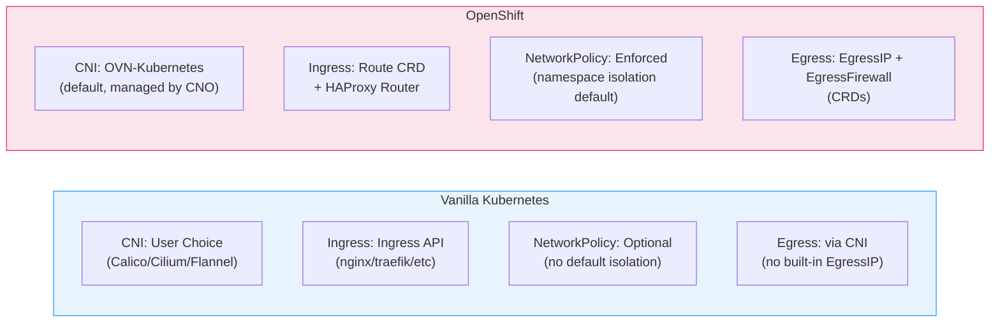
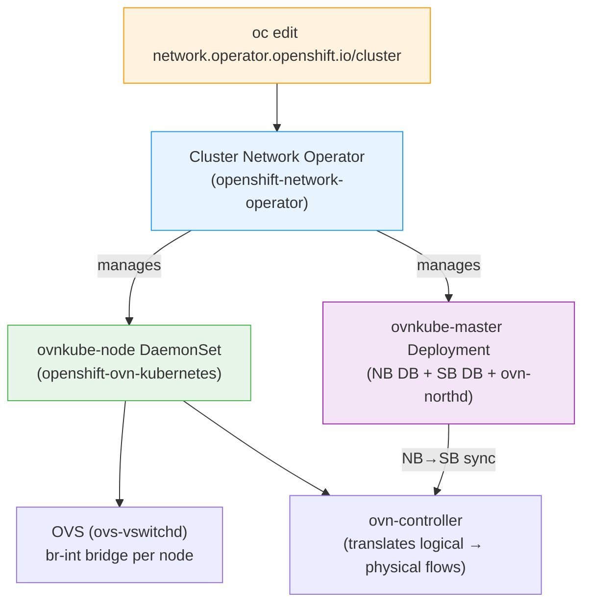
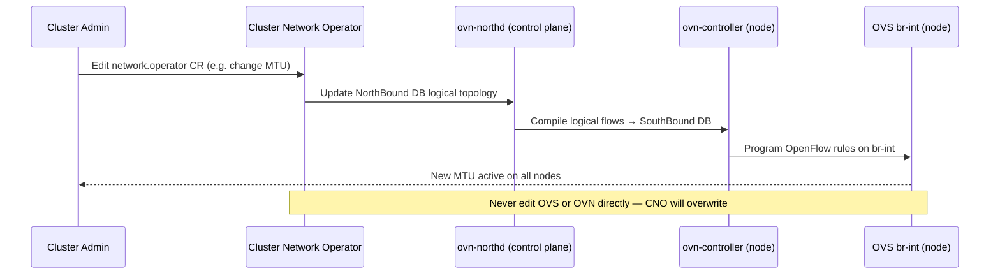

# Lesson 25 — OpenShift Networking Overview

> **Track:** OpenShift Networking | **Prerequisites:** [Lesson 09 — CNI Specification](09-cni-specification.md), [Lesson 12 — Services](13-kubernetes-services-kube-proxy.md) | **Duration:** ~2.5 hours

> **Goal:** Understand how OpenShift's Cluster Network Operator manages OVN-Kubernetes, explain how OpenShift namespace isolation differs from vanilla Kubernetes, and use `oc` commands to inspect and troubleshoot network configuration.

---

## Practice Setup

```bash
# Terminal 1 — OpenShift CLI (oc)
oc get network.operator cluster -o yaml | grep -A10 defaultNetwork
# expect: type: OVNKubernetes, clusterNetwork, serviceNetwork fields

oc get pods -n openshift-network-operator
# expect: network-operator pod Running

oc get clusternetwork 2>/dev/null
# only present in legacy OpenShiftSDN clusters

# Terminal 2 — oc
oc get pods -n openshift-ovn-kubernetes | head -10
# expect: ovnkube-node DaemonSet pods per node, ovnkube-master pods

oc get hostsubnet 2>/dev/null || echo "OVN-Kubernetes mode (no hostsubnet)"
# hostsubnet only exists in OpenShiftSDN legacy mode
```

---

## 1. OpenShift vs Vanilla Kubernetes Networking



| Feature | Vanilla Kubernetes | OpenShift |
|---------|-------------------|-----------|
| Default CNI | None (you choose) | OVN-Kubernetes |
| Ingress | Ingress API | Route CRD + HAProxy Router |
| NetworkPolicy | Optional | Enforced by default (namespace isolation) |
| Egress control | Via CNI | EgressIP, EgressFirewall CRDs |
| DNS | CoreDNS | CoreDNS (same) |
| Load Balancer | Cloud CCM / MetalLB | Same + MetalLB on bare metal |
| Security | PodSecurity Admission | Security Context Constraints (SCCs) |
| SDN history | N/A | OpenShift SDN (deprecated) → OVN-Kubernetes |
| Network config entry point | Edit CNI configs directly | Edit `network.operator.openshift.io` CR only |
| Pod CIDR default | 10.244.0.0/16 (kubeadm) | 10.128.0.0/14 |
| Service CIDR default | 10.96.0.0/12 (kubeadm) | 172.30.0.0/16 |

---

## 2. OpenShift Network Operator (CNO)

OpenShift manages its network configuration through the **Cluster Network Operator (CNO)**. You never edit CNI configs directly — you edit the `Network.operator.openshift.io` custom resource.





```bash
# View current network configuration
oc get network.operator.openshift.io cluster -o yaml
# Key fields:
# spec.defaultNetwork.type: OVNKubernetes
# spec.clusterNetwork: pod CIDR
# spec.serviceNetwork: service CIDR
# spec.networkType: OVNKubernetes
```

```bash
# View the cluster-level network config (read-only summary)
oc get network.config.openshift.io cluster -o yaml
# status.clusterNetwork:
#   - cidr: 10.128.0.0/14
#     hostPrefix: 23          ← /23 per node = 512 pods max per node
# status.serviceNetwork:
#   - 172.30.0.0/16
# status.networkType: OVNKubernetes
# expect: matches install-config.yaml values set at cluster creation
```

### CNO / OVN-Kubernetes Key Parameters

| Parameter | Default | Effect | When to change |
|-----------|---------|--------|----------------|
| `spec.defaultNetwork.type` | `OVNKubernetes` | Active CNI plugin | Set at install time only — migration requires maintenance window |
| `spec.clusterNetwork[].cidr` | `10.128.0.0/14` | Pod IP CIDR | Set at install time — cannot change post-install |
| `spec.clusterNetwork[].hostPrefix` | `23` | Subnet size per node | Smaller = more nodes; larger = more pods per node |
| `spec.serviceNetwork` | `172.30.0.0/16` | ClusterIP range | Set at install time only |
| `spec.defaultNetwork.ovnKubernetesConfig.mtu` | `1400` (Geneve) | Pod network MTU | Lower if physical MTU < 1450 (e.g. VPN overhead) |
| `spec.defaultNetwork.ovnKubernetesConfig.genevePort` | `6081` | UDP tunnel port | Change if 6081 is blocked |

---

## 3. Default Pod and Service CIDRs

OpenShift uses different default CIDRs from vanilla Kubernetes:

```
Pod CIDR:      10.128.0.0/14   (4 × /16 blocks)
Service CIDR:  172.30.0.0/16
Node prefix:   /23             (512 IPs per node)
```

Each node gets a `/23` from the pod CIDR:
```
Node 1: 10.128.0.0/23   (pods 10.128.0.1 – 10.128.1.254)
Node 2: 10.128.2.0/23
Node 3: 10.128.4.0/23
...
```

```bash
# See per-node pod CIDR allocations
oc get nodes -o jsonpath='{range .items[*]}{.metadata.name}{"\t"}{.spec.podCIDRs}{"\n"}{end}'
# expect: each node shows its /23 subnet

# Verify service CIDR
oc get svc kubernetes -n default -o jsonpath='{.spec.clusterIP}'
# expect: 172.30.0.1 (or first IP in service CIDR)
```

---

## 4. Namespace Network Isolation

OpenShift enforces **namespace isolation by default** using NetworkPolicy. When you create a namespace, OpenShift automatically creates policies that:
- Allow traffic within the same namespace
- Deny traffic from other namespaces
- Allow ingress from the router namespace
- Allow ingress from the monitoring namespace

```bash
# View auto-created NetworkPolicies
oc get networkpolicy -n my-namespace
# NAME                                    POD-SELECTOR   AGE
# allow-from-openshift-ingress            <none>         5m
# allow-from-openshift-monitoring         <none>         5m
# allow-same-namespace                    <none>         5m
# expect: these three policies in every new namespace

# Verify traffic between namespaces is blocked by default
# (without an explicit allow policy)
oc exec -it -n namespace-a pod-a -- curl -m5 http://<pod-b-ip>
# expect: timeout (blocked by auto-created isolation policy)
```

To allow traffic between namespaces:
```yaml
# Allow namespace B to receive from namespace A
apiVersion: networking.k8s.io/v1
kind: NetworkPolicy
metadata:
  name: allow-from-namespace-a
  namespace: namespace-b
spec:
  podSelector: {}
  ingress:
    - from:
        - namespaceSelector:
            matchLabels:
              kubernetes.io/metadata.name: namespace-a
```

---

## 5. OpenShift DNS

CoreDNS is used but configured via the DNS operator:

```bash
# View DNS operator config
oc get dns.operator.openshift.io default -o yaml
# expect: spec.servers empty (no custom upstream) by default

# Custom upstream DNS servers
oc edit dns.operator.openshift.io default
# spec:
#   servers:
#     - name: corporate-dns
#       zones:
#         - corp.example.com
#       forwardPlugin:
#         upstreams:
#           - 10.100.0.53
# expect: CoreDNS CoreFile updated automatically by DNS operator
```

```bash
# DNS service (runs on each node via NodeLocal DNSCache)
oc get svc -n openshift-dns
# dns-default   ClusterIP   172.30.0.10   53/UDP,53/TCP

# NodeLocal cache address: 10.0.0.10 (or the node's local DNS cache)
# Verify pods use the local cache:
oc exec -it pod -- cat /etc/resolv.conf
# expect: nameserver 172.30.0.10 (or NodeLocal DNSCache IP)
```

---

## 6. OpenShift Monitoring Network

OpenShift's built-in monitoring stack (Prometheus, Alertmanager, Grafana) lives in `openshift-monitoring` and needs network access to scrape all pods.

```bash
# Check monitoring pods
oc get pods -n openshift-monitoring
# expect: prometheus-k8s, alertmanager-main, grafana pods Running

# NetworkPolicy allows monitoring ingress automatically
oc get networkpolicy -A | grep monitoring
# expect: "allow-from-openshift-monitoring" in every namespace

# Check monitoring scrape targets
oc port-forward -n openshift-monitoring svc/prometheus-k8s 9090
# Browse to localhost:9090 → Status → Targets
# expect: all namespace/pod targets UP
```

---

## 7. OpenShift SDN (Legacy — Deprecated)

Before OVN-Kubernetes, OpenShift used its own SDN plugin with three modes:

| Mode | Description |
|------|-------------|
| `subnet` | Flat network, no isolation between namespaces |
| `multitenant` | Per-namespace VXLAN VNI — full isolation |
| `networkpolicy` | NetworkPolicy API — selective isolation |

```bash
# Check if a cluster still uses OpenShift SDN (older clusters)
oc get network.operator.openshift.io cluster \
  -o jsonpath='{.spec.defaultNetwork.type}'
# OpenShiftSDN  ← legacy
# OVNKubernetes ← current

# expect: OVNKubernetes on any cluster >= 4.12
```

Migration from OpenShift SDN to OVN-Kubernetes is supported but requires a maintenance window.

---

## 8. Key OpenShift Networking CLI Commands

```bash
# Overall network status
oc get network.config.openshift.io cluster
# expect: networkType, clusterNetwork, serviceNetwork fields

oc get clusteroperator network
# expect: Available=True, Progressing=False, Degraded=False

# CNO health
oc get pods -n openshift-network-operator
oc logs -n openshift-network-operator deploy/network-operator
# expect: "reconciliation successful" messages; no ERROR lines

# OVN-Kubernetes pods
oc get pods -n openshift-ovn-kubernetes
# expect: ovnkube-node Running on every worker/master node

# Node network status
oc get pods -n openshift-network-diagnostics
# expect: network-check-source and network-check-target pods Running

# Run network connectivity checks
oc get podnetworkconnectivitycheck -n openshift-network-diagnostics | head -20
# expect: "NetworkCheckSuccess" conditions; failures indicate routing problems

# Collect full diagnostic bundle
oc adm must-gather --image=registry.redhat.io/openshift4/ose-must-gather -- \
  /usr/bin/gather_network_logs
# produces /must-gather/network/ with OVN NB/SB DB dumps and flow tables
```

---

## Troubleshooting

| Symptom | Likely Cause | Diagnostic Command | Fix |
|---------|-------------|-------------------|-----|
| `oc get clusteroperator network` shows Degraded | CNO cannot reconcile — missing CRD or config error | `oc logs -n openshift-network-operator deploy/network-operator` | Check CR spec for syntax errors; restore from backup |
| Pod cannot reach another namespace | Missing NetworkPolicy (OpenShift default isolation) | `oc get netpol -n <dest-ns>` | Add `namespaceSelector` allow rule in destination namespace |
| `EgressIP` not assigning to node | Node not labeled or EgressIP CIDR not on node's subnet | `oc get egressip; oc describe node <node> \| grep egressIP` | Label node: `oc label node <node> k8s.ovn.org/egress-assignable=""` |
| OVN-Kubernetes pods crashlooping | OVSDB schema mismatch after upgrade | `oc logs -n openshift-ovn-kubernetes ds/ovnkube-node` | Force pod recreation: `oc delete pods -n openshift-ovn-kubernetes --all` |
| DNS resolution fails for pods | CoreDNS unreachable — NetworkPolicy blocking port 53 | `oc exec pod -- nc -vzu 172.30.0.10 53` | Add egress allow for port 53 to CoreDNS ClusterIP |
| `PodNetworkConnectivityCheck` failing | Node-to-node routing broken (Geneve port 6081 blocked) | `oc get podnetworkconnectivitycheck -n openshift-network-diagnostics` | Open UDP 6081 between nodes; verify firewall rules |
| Route not serving traffic | HAProxy router pod not running in `openshift-ingress` | `oc get pods -n openshift-ingress` | Check IngressController CR and router pod logs |

```bash
# Quick health check sequence
oc get clusteroperator network                        # operator healthy?
oc get pods -n openshift-ovn-kubernetes              # OVN pods running?
oc get podnetworkconnectivitycheck -n openshift-network-diagnostics  # node connectivity?
oc adm top nodes                                     # node resource pressure?
```

> **See also:** [Lesson 24 — Network Observability](24-network-observability-troubleshooting.md) for general packet-level debugging methodology. [Lesson 23 — Security Hardening](23-network-security-hardening.md) for NetworkPolicy hardening on top of OpenShift's defaults.

---

## Production Checklist

- [ ] `oc get clusteroperator network` shows `Available=True, Degraded=False` after every upgrade
- [ ] `PodNetworkConnectivityCheck` conditions are all `NetworkCheckSuccess` on all nodes
- [ ] Custom upstream DNS configured for internal zones via DNS Operator (not CoreDNS ConfigMap directly)
- [ ] EgressIP configured and tested for namespaces that need a stable external IP (compliance)
- [ ] `oc adm must-gather` procedure documented and tested — ensure network logs are captured
- [ ] Pod/service CIDR capacity reviewed: `/14` pod CIDR supports ~1024 nodes at `/23` host prefix
- [ ] Namespace-level NetworkPolicy customizations version-controlled — OpenShift auto-policies must not be deleted

---

## Common Anti-Patterns

| What people do | Why it breaks | Correct approach |
|----------------|--------------|-----------------|
| Edit OVN or OVS config files directly on nodes | CNO overwrites all changes on next reconcile | Always edit `network.operator.openshift.io/cluster` CR only |
| Delete auto-created NetworkPolicies in namespace | Breaks monitoring scraping and router ingress | Never delete `allow-from-openshift-monitoring` or `allow-from-openshift-ingress` |
| Set pod CIDR to /16 at install and add nodes beyond /23 capacity | Pod IP exhaustion on individual nodes — new pods stuck Pending | Plan: `clusterNetwork` size ≥ `max_nodes × 2^(32-hostPrefix)` |
| Mix OpenShift SDN and OVN-Kubernetes concepts | SDN used `netnamespace` and VNIs; OVN uses OVN logical switches — confusion leads to wrong troubleshooting | Know which CNI is active: `oc get network.operator cluster -o jsonpath='{.spec.defaultNetwork.type}'` |
| Use `kubectl` for OpenShift-specific resources | `kubectl` lacks `oc` shorthand for Routes, SCCs, and Projects — silent failures on some resources | Always use `oc` on OpenShift — it is a superset of `kubectl` |

---

## Quick Reference

| Use Case | Command |
|----------|---------|
| View CNO network config | `oc get network.operator.openshift.io cluster -o yaml` |
| View read-only network summary | `oc get network.config.openshift.io cluster -o yaml` |
| Check OVN-Kubernetes pod health | `oc get pods -n openshift-ovn-kubernetes` |
| Check CNO operator health | `oc get clusteroperator network` |
| View CNO logs | `oc logs -n openshift-network-operator deploy/network-operator` |
| Run connectivity checks | `oc get podnetworkconnectivitycheck -n openshift-network-diagnostics` |
| View auto-created NetworkPolicies | `oc get netpol -n <namespace>` |
| Check per-node pod CIDR | `oc get nodes -o jsonpath='{range .items[*]}{.metadata.name}{"\t"}{.spec.podCIDRs}{"\n"}{end}'` |
| Check if cluster uses OVN or SDN | `oc get network.operator cluster -o jsonpath='{.spec.defaultNetwork.type}'` |
| Collect network diagnostics bundle | `oc adm must-gather --image=registry.redhat.io/openshift4/ose-must-gather -- /usr/bin/gather_network_logs` |
| View DNS operator config | `oc get dns.operator.openshift.io default -o yaml` |
| Check EgressIP assignments | `oc get egressip -A` |

---

## Summary

| Concept | OpenShift Detail |
|---------|-----------------|
| CNI | OVN-Kubernetes (default) |
| Config | Cluster Network Operator — never edit directly |
| Pod CIDR | 10.128.0.0/14, /23 per node |
| Service CIDR | 172.30.0.0/16 |
| Namespace isolation | Enforced by default via auto-created NetworkPolicy |
| Ingress | Route CRD + HAProxy (see Lesson 27) |
| Egress | EgressIP, EgressFirewall CRDs (see Lesson 28) |

---

## Check Your Understanding

1. **[Concept question]** Why does OpenShift manage OVN-Kubernetes through the Cluster Network Operator (CNO) rather than allowing administrators to edit CNI configuration files directly on nodes?

   <details><summary>Answer</summary>

   The CNO acts as the single source of truth for network configuration: it continuously reconciles the `network.operator.openshift.io/cluster` custom resource against the actual state of OVN pods, ConfigMaps, and node settings. If you edit OVS or OVN files directly on a node, the CNO's next reconciliation loop will overwrite your changes. This design ensures consistency across all nodes, makes upgrades safe (the CNO knows how to roll out new OVN versions), and prevents configuration drift that would be impossible to audit through GitOps.

   </details>

2. **[Scenario question]** A pod in `namespace-a` cannot reach a pod in `namespace-b` even though both pods are running. No custom NetworkPolicies have been created. What three auto-created NetworkPolicies does OpenShift place in every new namespace, and which one is preventing this traffic?

   <details><summary>Answer</summary>

   OpenShift automatically creates `allow-same-namespace` (allows traffic within the same namespace), `allow-from-openshift-ingress` (allows the HAProxy router to reach pods), and `allow-from-openshift-monitoring` (allows Prometheus scraping). The policy preventing cross-namespace traffic is the absence of any explicit allow between namespaces — `allow-same-namespace` only permits intra-namespace traffic, and there is no auto-created policy that allows arbitrary cross-namespace traffic. Add a NetworkPolicy in `namespace-b` with a `namespaceSelector` allowing ingress from `namespace-a`.

   </details>

3. **[Practical question]** What command would you run to check the current CNI type, pod CIDR, and service CIDR of an OpenShift cluster?

   <details><summary>Answer</summary>

   ```bash
   oc get network.config.openshift.io cluster -o yaml
   ```
   Look for `status.networkType` (should be `OVNKubernetes`), `status.clusterNetwork[].cidr` (default `10.128.0.0/14` with `/23` host prefix), and `status.serviceNetwork` (default `172.30.0.0/16`); these values are set at install time and cannot be changed post-install.

   </details>

---

## Online Resources

| Resource | Cost | What you practice |
|----------|------|-------------------|
| [Red Hat Interactive Learning Portal](https://www.redhat.com/en/interactive-labs/openshift) | Free (Red Hat account) | Browser-based OpenShift cluster with labs for CNO, network operator config, and namespace isolation |
| [Red Hat Developer Sandbox](https://developers.redhat.com/developer-sandbox) | Free 30-day cluster | Real OpenShift cluster: run `oc get network.operator cluster`, inspect CNO config, test pod networking |
| [OpenShift Interactive Learning Portal](https://learn.openshift.com/) | Free | Scenario-based OpenShift labs including networking basics |

---

**Next:** [Lesson 26 — OVN-Kubernetes: OpenShift's Default CNI](26-ovn-kubernetes.md)
