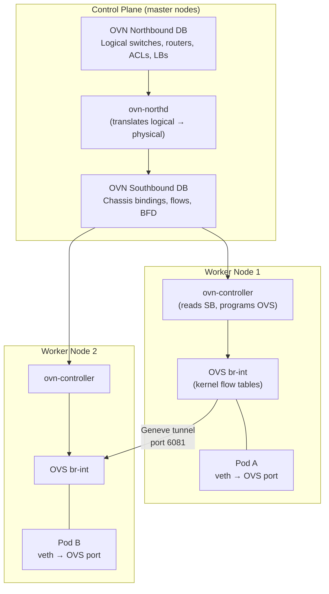
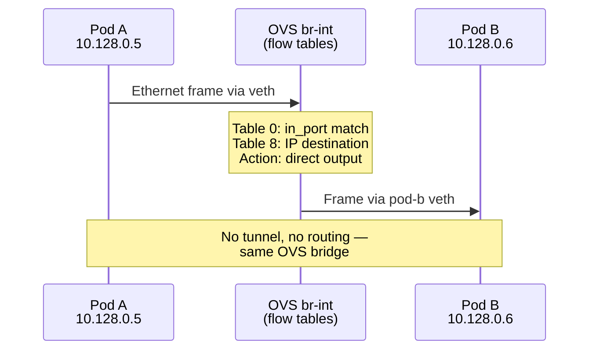
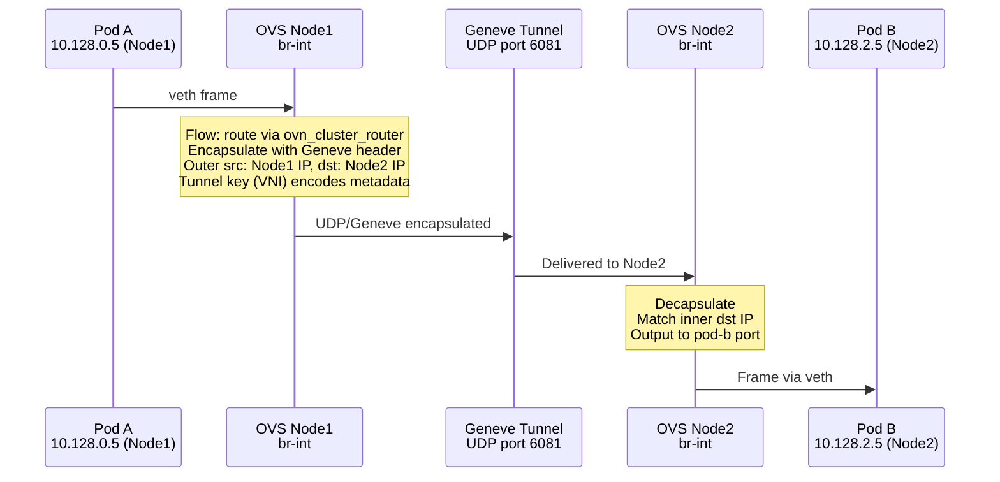

# Lesson 26 — OVN-Kubernetes: OpenShift's Default CNI

> **Track:** OpenShift Networking
> **Prerequisites:** [Lesson 25 — OpenShift Networking Overview](25-openshift-networking-overview.md), [Lesson 03 — iptables](03-iptables-and-netfilter.md)
> **Duration:** ~3 hours

> **Goal:** Inspect the OVN/OVS control and data planes on a live OpenShift cluster, trace a packet from source pod to destination pod, and explain how NetworkPolicy is enforced without iptables.

---

## Practice Setup

```bash
# Terminal 1 — verify OVN-Kubernetes is running
oc get pods -n openshift-ovn-kubernetes -o wide
# Expect: ovnkube-node on every node, ovnkube-master on control-plane nodes

# Terminal 2 — open a node debug shell (keep open throughout)
oc debug node/<worker-node-name>
# Inside: chroot /host

# Terminal 3 — exec into ovnkube-master for northbound commands
MASTER=$(oc get pods -n openshift-ovn-kubernetes -l app=ovnkube-master \
  -o jsonpath='{.items[0].metadata.name}')
echo "Master pod: $MASTER"
```

> **See also:** [Lesson 03 — iptables and Netfilter](03-iptables-and-netfilter.md) for why OVN replaces iptables entirely.

---

## 1. Architecture



**Components per worker node:**
- `ovn-controller` — reads Southbound DB, programs OVS flows
- `ovs-vswitchd` — OVS daemon implementing the dataplane
- `ovsdb-server` — OVS local database

**Components on control-plane nodes only:**
- `ovn-northd` — translates logical network to physical bindings
- `nbdb` — OVN Northbound database (logical topology)
- `sbdb` — OVN Southbound database (physical topology)

---

## 2. OVN-Kubernetes Pods in OpenShift

```bash
# View OVN-Kubernetes pods — confirm all Running
oc get pods -n openshift-ovn-kubernetes -o wide
# NAME                          NODE           STATUS
# ovnkube-node-aaaaa            worker-1       Running   <- per worker node
# ovnkube-node-bbbbb            worker-2       Running
# ovnkube-master-ccccc          master-1       Running   <- control-plane only

# Check health (any non-Running pods are a problem)
oc get pods -n openshift-ovn-kubernetes | grep -v Running

# Inspect individual containers in ovnkube-node
oc get pod -n openshift-ovn-kubernetes $OVNNODE \
  -o jsonpath='{.spec.containers[*].name}'
# ovn-controller ovs-vswitchd ovsdb-server ovnkube-node
```

---

## 3. The OVS Bridge (br-int)

Each node has an OVS integration bridge (`br-int`) that connects all pods and handles all forwarding:

```bash
# From the node debug shell (chroot /host):
ovs-vsctl show
# Bridge "br-int"
#   Port eeb73ac0d1e3789      <- pod veth port (hex = iface ID)
#       Interface eeb73ac0d1e3789
#   Port k8s-worker-1
#       Interface k8s-worker-1  <- node's own port
#   Port patch-br-int-to-breth0_worker-1
#       Interface patch-br-int-to-breth0_worker-1
#           type: patch          <- connects to external bridge

# List ports with their OF port numbers
ovs-vsctl list-ports br-int

# Show OpenFlow tables (actual forwarding rules — 1000s of entries)
ovs-ofctl dump-flows br-int | wc -l       # count
ovs-ofctl dump-flows br-int | head -30    # first few rules

# Show all OVS interfaces with metadata
ovs-vsctl list Interface | grep -E "^name|external_ids|ofport" | head -40
```

---

## 4. Logical Network Topology

OVN creates a virtual topology mirroring Kubernetes objects — changes to pods/services trigger updates here:

```bash
# View entire logical network (run against master pod)
oc exec -n openshift-ovn-kubernetes $MASTER -- ovn-nbctl show | head -60
# switch <uuid> (egressip-no-reroute-node-subnets)
# switch <uuid> (node-local-switch)
#     port node-local-switch-to-join ...
# router <uuid> (ovn_cluster_router)
#     port rtoj-ovn_cluster_router ...

# List logical switches (one per node + cluster-wide switches)
oc exec -n openshift-ovn-kubernetes $MASTER -- ovn-nbctl ls-list

# List logical routers
oc exec -n openshift-ovn-kubernetes $MASTER -- ovn-nbctl lr-list
# <uuid> (ovn_cluster_router)   <- routes between all nodes/pods
# <uuid> (GR_worker-1)          <- gateway router per node

# List load balancers (each Service = one LB entry)
oc exec -n openshift-ovn-kubernetes $MASTER -- ovn-nbctl lb-list | head -20
# <uuid>  None   tcp    10.96.0.1:443 = 192.168.0.5:6443,...

# View Southbound DB — physical chassis bindings
oc exec -n openshift-ovn-kubernetes $MASTER -- ovn-sbctl show | head -40
```

---

## 5. Pod Traffic Flow — Same Node



---

## 6. Pod Traffic Flow — Cross-Node (Geneve Tunnel)



```bash
# Verify Geneve tunnels exist on a node
ip link show type geneve     # Geneve tunnel interfaces
ovs-vsctl list-ports br-int | grep -i tun

# Confirm Geneve port (6081) is open between nodes
ss -ulnp | grep 6081

# View tunnel endpoints in OVN Southbound DB
oc exec -n openshift-ovn-kubernetes $MASTER -- \
  ovn-sbctl list Encap | grep -E "ip|type"
```

---

## 7. NetworkPolicy Implementation — OVN ACLs

OVN implements NetworkPolicy using **ACLs** in the Northbound DB — not iptables. `ovn-northd` compiles ACLs → Southbound logical flows → `ovn-controller` programs OVS.

```bash
# Find the logical switch for a namespace
oc exec -n openshift-ovn-kubernetes $MASTER -- \
  ovn-nbctl ls-list | grep production

# View ACLs on that switch (derived from NetworkPolicy objects)
oc exec -n openshift-ovn-kubernetes $MASTER -- \
  ovn-nbctl acl-list <ls-name> | head -20
# to-lport  1000 (ip4 && ip4.dst == 10.128.1.5 && tcp.dst == 80) allow-related
# to-lport  0    (ip4 && ip4.dst == {10.128.1.5}) drop   <- default deny

# Count total ACLs in the cluster
oc exec -n openshift-ovn-kubernetes $MASTER -- \
  ovn-nbctl find ACL | grep -c "^_uuid"

# Trace what happens to a specific packet (ovn-trace — no actual traffic)
oc exec -n openshift-ovn-kubernetes $MASTER -- \
  ovn-trace <ls-name> \
  'inport == "pod-a-port"; ip4; ip4.src=10.128.0.5; ip4.dst=10.128.1.5; tcp; tcp.dst=80'
# output: "Policy drop" or "output to pod-b-port"
```

**ACL to NetworkPolicy mapping:**
| NetworkPolicy field | OVN ACL field |
|---------------------|--------------|
| `podSelector` | `ip4.src` / `ip4.dst` match on port |
| `namespaceSelector` | address set for namespace pod IPs |
| `ports` | `tcp.dst == X` or `udp.dst == X` |
| `policyType: Ingress` | `to-lport` direction |
| `policyType: Egress` | `from-lport` direction |

---

## 8. OVN-Kubernetes Modes

### Local Gateway Mode (default OpenShift 4.10+)
Egress traffic leaves via each node's own interface. Preserves pod source IPs for external traffic. Recommended.

### Shared Gateway Mode (legacy)
All external traffic routes through master nodes. Single bottleneck. Not recommended for production.

```bash
# Check current gateway mode
oc get network.operator.openshift.io cluster \
  -o jsonpath='{.spec.defaultNetwork.ovnKubernetesConfig.gatewayConfig}'
# {"routingViaHost": true}   <- local gateway (recommended)
# {"routingViaHost": false}  <- shared gateway (legacy)

# Change to local gateway (rolling restart of ovnkube-node pods)
oc patch network.operator.openshift.io cluster \
  --type=merge \
  -p '{"spec":{"defaultNetwork":{"ovnKubernetesConfig":{"gatewayConfig":{"routingViaHost":true}}}}}'
```

---

## 9. IPsec Encryption

OVN-Kubernetes supports transparent IPsec encryption for all Geneve tunnel traffic between nodes. No application changes required.

```bash
# Enable IPsec (takes 10-15 min — rolls out per node)
oc patch network.operator.openshift.io cluster \
  --type=merge \
  -p '{"spec":{"defaultNetwork":{"ovnKubernetesConfig":{"ipsecConfig":{"mode":"Full"}}}}}'

# Check IPsec pod status
oc get pods -n openshift-ovn-kubernetes | grep ipsec

# Verify IPsec is active on a node
oc debug node/<node> -- chroot /host \
  ip xfrm state | head -20
# src 192.168.0.1 dst 192.168.0.2
#     proto esp ... <- IPsec ESP state

# Check OVS certificate used for IPsec
oc exec -n openshift-ovn-kubernetes ovnkube-node-xxxxx -- \
  ovs-vsctl get Open_vSwitch . other_config:certificate
```

---

## 10. Configuration Reference

| Parameter | Default | Effect | When to change |
|-----------|---------|--------|---------------|
| `gatewayConfig.routingViaHost` | `false` (shared) | Routes egress via node NIC vs master | Set `true` for local gateway in production |
| `ipsecConfig.mode` | `Disabled` | Encrypts Geneve tunnels with IPsec ESP | Enable for compliance (PCI, HIPAA) |
| `mtu` | auto-detected | Overlay MTU (subtract Geneve overhead ~50B) | Lower if jumbo frames unavailable |
| `hybridOverlayConfig.enabled` | `false` | Allows Windows nodes using VXLAN hybrid | Enable for mixed Linux/Windows clusters |
| `v4InternalSubnet` | `100.64.0.0/16` | Transit subnet for OVN join switch | Change only if 100.64.x conflicts |
| `egressIPConfig.reachabilityTotalTimeoutSeconds` | `1` | Time to detect EgressIP node failure | Lower for faster HA failover |

---

## 11. OVN-Kubernetes vs Other CNIs

| Feature | OVN-Kubernetes | Calico | Cilium |
|---------|---------------|--------|--------|
| Dataplane | OVS flow tables | iptables / eBPF | eBPF |
| Policy engine | OVN ACLs | Felix (iptables/eBPF) | eBPF |
| Encapsulation | Geneve (port 6081) | VXLAN / IPIP / None | VXLAN / Geneve / None |
| Load balancing | OVN logical LB | kube-proxy / eBPF | eBPF |
| Observability | ovn-trace, OVS flows | Calico flow logs | Hubble |
| OpenShift default | Yes | Optional | Optional |
| Kernel dependency | OVS module | iptables / kmod | eBPF verifier |

---

## Troubleshooting

| Symptom | Likely Cause | Diagnostic Command | Fix |
|---------|-------------|-------------------|-----|
| Pods can't reach each other cross-node | Geneve tunnel down | `ip link show type geneve; ovs-vsctl show` | Check node firewall — UDP 6081 must be open |
| NetworkPolicy not enforced | ovn-controller out of sync | `ovn-appctl -t ovn-controller connection-status` | Restart ovnkube-node pod on affected node |
| Pod IP missing from OVN NB | Stale logical switch port | `ovn-nbctl lsp-list <switch>` | Delete and recreate the pod |
| Services unreachable from pod | OVN load balancer missing | `ovn-nbctl lb-list \| grep <clusterIP>` | Restart ovnkube-master pod |
| Node shows as not in sync in SB DB | ovn-controller can't reach SBDB | `oc logs ovnkube-node-<x> -c ovn-controller \| grep ERROR` | Check TLS certs; check SBDB pod health |
| ACL not blocking traffic | Wrong logical switch targeted | `ovn-nbctl acl-list <ls> \| grep drop` | Verify namespace label selectors |
| IPsec failing | Certificate mismatch between nodes | `ip xfrm state; ovs-vsctl get Open_vSwitch . other_config` | Rotate IPsec certs via operator |

```bash
# Full OVN diagnostic sequence
# Step 1 — controller sync status
oc exec -n openshift-ovn-kubernetes ovnkube-node-xxxxx -- \
  ovn-appctl -t ovn-controller connection-status

# Step 2 — trace a specific packet (no traffic generated)
oc exec -n openshift-ovn-kubernetes $MASTER -- \
  ovn-trace <ls-name> \
  'inport=="pod-a-port"; ip4; ip4.src=10.128.0.5; ip4.dst=10.128.1.5; tcp; tcp.dst=8080'

# Step 3 — OVS packet trace (live dataplane)
oc debug node/<node> -- chroot /host \
  ovs-appctl ofproto/trace br-int \
  "in_port=1,ip,ip_src=10.128.0.5,ip_dst=10.128.1.5,tcp,tcp_dst=8080"

# Step 4 — check for stale ports
oc exec -n openshift-ovn-kubernetes $MASTER -- \
  ovn-nbctl lsp-list <switch> | grep -v "pod\|node\|stor"

# Step 5 — network diagnostics operator
oc get podnetworkconnectivitycheck -n openshift-network-diagnostics \
  -o jsonpath='{range .items[?(@.status.failures)]}{.metadata.name}{"\n"}{end}'

# Step 6 — collect logs
oc logs -n openshift-ovn-kubernetes ovnkube-node-xxxxx -c ovn-controller | tail -50
oc logs -n openshift-ovn-kubernetes $MASTER -c northd | tail -50
```

---

## Production Checklist

- [ ] All `ovnkube-node` pods Running on every worker node — zero CrashLoopBackOff
- [ ] All `ovnkube-master` pods Running on control-plane nodes with no restarts in 24 h
- [ ] Geneve UDP port 6081 allowed between all node security groups / firewall rules
- [ ] Gateway mode set to `routingViaHost: true` (local gateway) for production traffic
- [ ] IPsec enabled if workloads are subject to data-in-transit compliance requirements
- [ ] `podnetworkconnectivitycheck` resources all show no failures
- [ ] OVN NBDB and SBDB Raft quorum healthy — at least 3 control-plane nodes

---

## Common Anti-Patterns

| What people do | Why it breaks | Correct approach |
|----------------|--------------|-----------------|
| Edit OVS flows directly with `ovs-ofctl mod-flows` | ovn-controller overwrites manual flows on next reconcile | All changes go through OVN NB via operator (`network.operator.openshift.io`) |
| Delete OVN pods to "restart networking" | NBDB or SBDB pod restart triggers full re-sync — brief outage on all nodes | Restart only the specific container (`ovn-controller`) when needed |
| Mix shared and local gateway mode expectations | Shared gateway NATs egress through masters; local gateway does not — source IPs differ | Pick one mode at cluster install time; migration requires rolling restart |
| Allow only TCP 6081 for Geneve | Geneve uses UDP — TCP 6081 does nothing | Allow UDP 6081 between all node IPs |
| Expect `iptables -L` to show NetworkPolicy rules | OVN uses ACLs + OVS flows, not iptables — iptables is empty | Use `ovn-nbctl acl-list` and `ovs-ofctl dump-flows` |

---

## Quick Reference

| Use Case | Command |
|----------|---------|
| List all OVN-K pods | `oc get pods -n openshift-ovn-kubernetes -o wide` |
| Show OVS bridge on node | `ovs-vsctl show` (from `oc debug node` → `chroot /host`) |
| Dump OVS flows for a pod IP | `ovs-ofctl dump-flows br-int \| grep <pod-ip>` |
| List logical switches | `ovn-nbctl ls-list` |
| List logical routers | `ovn-nbctl lr-list` |
| List ACLs on a switch | `ovn-nbctl acl-list <switch-name>` |
| Simulate a packet (no traffic) | `ovn-trace <ls> 'inport=="<port>"; ip4; ...'` |
| Check controller sync | `ovn-appctl -t ovn-controller connection-status` |
| View Geneve tunnels | `ip link show type geneve` |
| Check gateway mode | `oc get network.operator.openshift.io cluster -o jsonpath='{.spec.defaultNetwork.ovnKubernetesConfig.gatewayConfig}'` |
| Enable IPsec | `oc patch network.operator... -p '{"spec":{"defaultNetwork":{"ovnKubernetesConfig":{"ipsecConfig":{"mode":"Full"}}}}}'` |
| Network connectivity check | `oc get podnetworkconnectivitycheck -n openshift-network-diagnostics` |

---

## Summary

| Concept | Detail |
|---------|--------|
| Data plane | Open vSwitch (OVS) flow tables — kernel module |
| Control plane | OVN: Northbound DB → `ovn-northd` → Southbound DB → `ovn-controller` |
| Encapsulation | Geneve tunnels between nodes (UDP port 6081) |
| NetworkPolicy | Compiled to OVN ACLs — no iptables involved |
| Services | OVN Logical Load Balancers (DNAT in flow tables) |
| Encryption | IPsec transparent mode over Geneve tunnels |
| Configuration | Via Cluster Network Operator — never edit OVS/OVN directly |
| Packet tracing | `ovn-trace` for logical simulation; `ovs-appctl ofproto/trace` for dataplane |

---

## Check Your Understanding

1. **[Concept question]** How does OVN-Kubernetes enforce NetworkPolicy without using iptables, and what is the control-plane path from a NetworkPolicy object to an enforced flow rule?

   <details><summary>Answer</summary>

   OVN-Kubernetes compiles NetworkPolicy objects into OVN ACLs stored in the Northbound database. `ovn-northd` reads those ACLs and translates them into logical flows in the Southbound database. Each node's `ovn-controller` reads the Southbound DB and programs OpenFlow rules into the OVS `br-int` bridge. The result is that packet filtering happens in the OVS kernel dataplane flow tables — `iptables -L` shows no NetworkPolicy rules because they are enforced entirely within OVS, not netfilter.

   </details>

2. **[Scenario question]** Cross-node pod-to-pod traffic fails but pods on the same node can communicate. What port and protocol must be open between all nodes, and how would you verify it is the issue?

   <details><summary>Answer</summary>

   OVN-Kubernetes uses Geneve tunnels on **UDP port 6081** for cross-node encapsulation. If a firewall or security group blocks UDP 6081 between nodes, intra-node traffic (which stays on the OVS bridge without tunneling) works fine while cross-node traffic silently drops. Verify by running `ss -ulnp | grep 6081` on a node to confirm the port is listening, and use `tcpdump -i eth0 -n udp port 6081` on both nodes to check whether tunnel packets are arriving. The fix is to open UDP 6081 bidirectionally between all node IPs.

   </details>

3. **[Practical question]** What command would you run to simulate a packet from pod-a to pod-b on port 8080 without sending real traffic, to see whether OVN ACLs would allow or drop it?

   <details><summary>Answer</summary>

   ```bash
   oc exec -n openshift-ovn-kubernetes $MASTER -- \
     ovn-trace <ls-name> \
     'inport=="pod-a-port"; ip4; ip4.src=10.128.0.5; ip4.dst=10.128.1.5; tcp; tcp.dst=8080'
   ```
   The output shows each logical flow table that the simulated packet passes through; look for `output to pod-b-port` for an allow result or `Policy drop` / `drop` for a deny result, which tells you which ACL matched.

   </details>

---

## Online Resources

| Resource | Cost | What you practice |
|----------|------|-------------------|
| [Red Hat Developer Sandbox](https://developers.redhat.com/developer-sandbox) | Free 30-day cluster | The only free way to run `ovs-vsctl show`, inspect OVN NB/SB databases, and view Geneve tunnels in a real OpenShift cluster |
| [Red Hat Interactive Learning Portal](https://www.redhat.com/en/interactive-labs/openshift) | Free (Red Hat account) | Guided labs for OVN-Kubernetes network troubleshooting |

---

**Next:** [Lesson 27 — OpenShift Routes and HAProxy Router](27-openshift-routes-haproxy.md)
