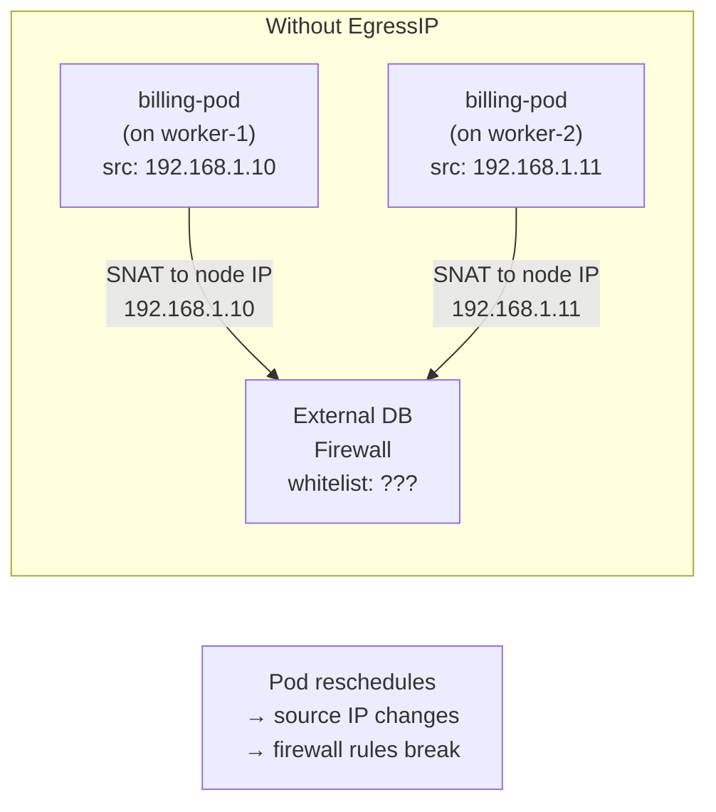
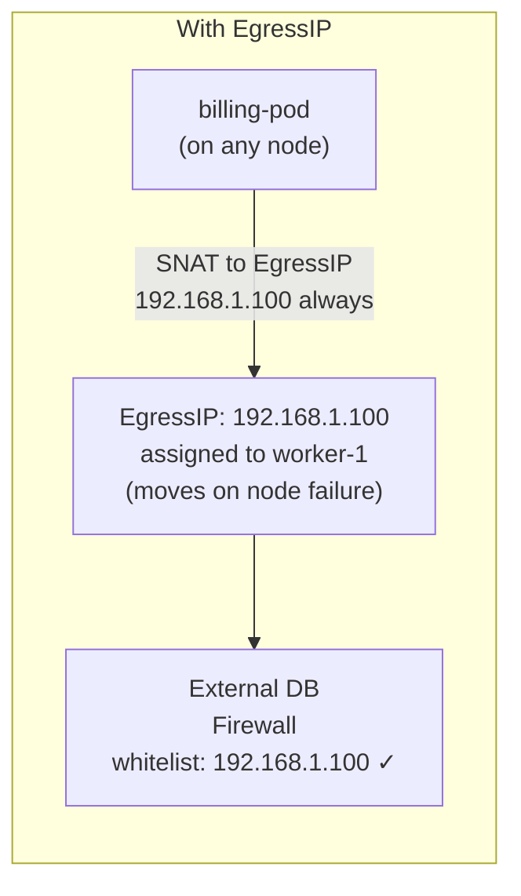
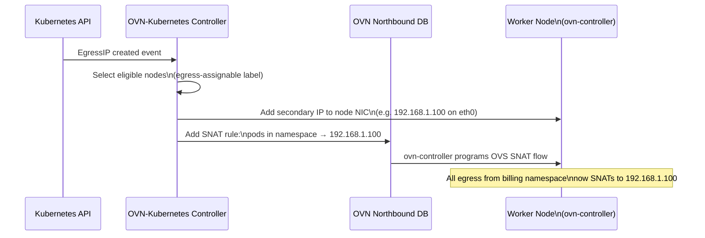

# Lesson 28 — OpenShift EgressIP and EgressFirewall

> **Track:** OpenShift Networking
> **Prerequisites:** [Lesson 16 — Network Policies](16-network-policies.md), [Lesson 25 — OpenShift Overview](25-openshift-networking-overview.md)
> **Duration:** ~2 hours

> **Goal:** Assign a stable egress IP to a namespace so external firewall rules remain valid across pod rescheduling, and restrict outbound destinations per namespace using EgressFirewall with CIDR and DNS-based rules.

---

## Practice Setup

```bash
# Terminal 1 — check existing egress resources
oc get egressip -o wide 2>/dev/null
oc get egressfirewall -A 2>/dev/null

# Terminal 2 — check which nodes are egress-assignable
oc get nodes -o custom-columns=\
'NAME:.metadata.name,EGRESS:.metadata.labels.k8s\.ovn\.org/egress-assignable'
# NAME        EGRESS
# worker-1    <present>   <- assignable
# worker-2    <none>      <- not assignable yet

# Terminal 3 — confirm OVN-Kubernetes is the network type
oc get network.config.openshift.io cluster \
  -o jsonpath='{.status.networkType}'
# OVNKubernetes
```

> **See also:** [Lesson 26 — OVN-Kubernetes](26-ovn-kubernetes.md) for how OVN ACLs underpin both EgressIP and EgressFirewall.
> **See also:** [Lesson 16 — Network Policies](16-network-policies.md) for controlling ingress traffic.

---

## 1. The Egress Problem





**Core principle:** EgressIP decouples outbound source IP from the node the pod runs on. The IP floats between eligible nodes using OVN SNAT rules.

---

## 2. EgressIP Configuration

```bash
# Step 1 — mark worker nodes as EgressIP candidates
oc label node worker-1 k8s.ovn.org/egress-assignable=""
oc label node worker-2 k8s.ovn.org/egress-assignable=""

# Step 2 — verify nodes appear as assignable
oc get nodes -l k8s.ovn.org/egress-assignable
```

```yaml
# Step 3 — create the EgressIP resource
apiVersion: k8s.ovn.org/v1
kind: EgressIP
metadata:
  name: billing-egress
spec:
  egressIPs:
    - 192.168.1.100     # must be in the same subnet as the egress node
    - 192.168.1.101     # second IP → HA: each IP lands on a different node
  namespaceSelector:
    matchLabels:
      egress: billing   # namespaces with this label use these IPs
  podSelector:          # optional: restrict to specific pods within the namespace
    matchLabels:
      app: billing-processor
```

```bash
# Step 4 — label the target namespace
oc label namespace billing egress=billing

# Step 5 — apply and verify
oc apply -f egress-ip.yaml
oc get egressip billing-egress -o yaml
# status:
#   items:
#     - egressIP: 192.168.1.100
#       node: worker-1          <- which node holds this IP now
#     - egressIP: 192.168.1.101
#       node: worker-2          <- second IP on a different node

# Step 6 — confirm source IP from inside the pod
oc exec -n billing billing-pod -- curl -s ifconfig.me
# 192.168.1.100   <- EgressIP, not the node IP
```

---

## 3. EgressIP Assignment Flow



---

## 4. EgressIP High Availability

EgressIP is automatically HA when multiple nodes are assignable and multiple IPs are configured. Failover uses BFD (Bidirectional Forwarding Detection) for sub-second node failure detection.

```bash
# View current IP-to-node assignment
oc get egressip -o wide
# NAME             EGRESSIPS                     ASSIGNED NODE    ASSIGNED EGRESSIPS
# billing-egress   192.168.1.100,192.168.1.101   worker-1         192.168.1.100
#                                                worker-2         192.168.1.101

# Simulate node failure — cordon worker-1 to trigger reassignment
oc adm cordon worker-1
# OVN detects node failure via BFD (~1 second)
# 192.168.1.100 moves to another egress-assignable node

# Confirm reassignment
oc get egressip billing-egress -o jsonpath='{.status.items}' | jq .

# Verify continuous egress (from a pod, while cordon is active)
for i in $(seq 1 10); do
  oc exec -n billing billing-pod -- curl -s --connect-timeout 2 ifconfig.me
  sleep 0.5
done
# Should return 192.168.1.100 on all requests (brief gap < 2s during failover)

# Restore
oc adm uncordon worker-1
```

---

## 5. EgressFirewall

EgressFirewall restricts which external destinations a namespace's pods can reach. It is enforced via OVN ACLs — no iptables involved.

```yaml
apiVersion: k8s.ovn.org/v1
kind: EgressFirewall
metadata:
  name: default
  namespace: production
spec:
  egress:
    # Rule order matters — first match wins
    - type: Allow
      to:
        cidrSelector: 10.100.0.0/16    # corporate internal network

    - type: Allow
      to:
        dnsName: api.example.com       # DNS-based rule (wildcard supported)
      ports:
        - protocol: TCP
          port: 443

    # Always allow DNS resolution — without this, DNS lookups fail
    - type: Allow
      to:
        cidrSelector: 0.0.0.0/0
      ports:
        - protocol: UDP
          port: 53
        - protocol: TCP
          port: 53

    # Implicit deny-all for everything else
    - type: Deny
      to:
        cidrSelector: 0.0.0.0/0
```

```bash
# Apply and verify
oc apply -f egress-firewall.yaml
oc get egressfirewall -n production
# NAME      EGRESSFIREWALL STATUS
# default   EgressFirewall Rules applied

# Test: allowed traffic
oc exec -n production app-pod -- curl -m5 https://api.example.com    # allowed
oc exec -n production app-pod -- curl -m5 https://10.100.0.5         # allowed

# Test: blocked traffic (times out — Deny rule drops silently)
oc exec -n production app-pod -- curl -m5 https://google.com
# curl: (28) Connection timed out after 5001 milliseconds

# View OVN ACLs generated from EgressFirewall
oc exec -n openshift-ovn-kubernetes $MASTER -- \
  ovn-nbctl find ACL external_ids:egressFirewall=production | head -30
```

---

## 6. EgressFirewall Configuration Reference

| Parameter | Values | Effect | When to change |
|-----------|--------|--------|---------------|
| `spec.egress[].type` | `Allow` / `Deny` | Permit or block matching traffic | First match wins — order rules carefully |
| `spec.egress[].to.cidrSelector` | CIDR string | Match by destination IP range | Use for RFC1918 or known IP blocks |
| `spec.egress[].to.dnsName` | FQDN or `*.example.com` | Match by DNS name (OVN resolves it) | Use for SaaS APIs with dynamic IPs |
| `spec.egress[].ports[].protocol` | `TCP` / `UDP` / `SCTP` | Protocol filter per rule | Omit to match all protocols |
| `spec.egress[].ports[].port` | 1–65535 | Port filter per rule | Combine with CIDR for precise control |

---

## 7. DNS-Based EgressFirewall Rules

DNS-based rules are resolved by the OVN-Kubernetes DNS interceptor — it polls DNS and updates ACLs when IPs change:

```yaml
egress:
  - type: Allow
    to:
      dnsName: "*.amazonaws.com"   # wildcard DNS names supported
    ports:
      - protocol: TCP
        port: 443
```

```bash
# Check how OVN resolves DNS names for the firewall
oc logs -n openshift-ovn-kubernetes $MASTER -c northd | grep -i dns | tail -20

# Check DNS cache TTL used by OVN
oc exec -n openshift-ovn-kubernetes $MASTER -- \
  ovn-nbctl find DNS | grep -E "records|external_ids"

# Important: DNS rules are eventually consistent (up to TTL seconds)
# For highly dynamic IPs, use CIDR rules instead
```

---

## 8. EgressFirewall on Legacy OpenShift SDN

On older clusters using OpenShift SDN, EgressFirewall is a different resource:

```bash
# Check which network type you have
oc get network.config.openshift.io cluster \
  -o jsonpath='{.status.networkType}'
# OVNKubernetes → use EgressFirewall (k8s.ovn.org/v1)
# OpenShiftSDN  → use EgressNetworkPolicy (network.openshift.io/v1)
```

```yaml
# Legacy — OpenShift SDN only
apiVersion: network.openshift.io/v1
kind: EgressNetworkPolicy
metadata:
  name: default
  namespace: production
spec:
  egress:
    - type: Allow
      to:
        cidrSelector: 10.100.0.0/16
    - type: Deny
      to:
        cidrSelector: 0.0.0.0/0
```

---

## 9. EgressRouter (Legacy — Redirect Mode)

EgressRouter is an older mechanism that deploys a dedicated pod acting as a fixed-destination traffic redirector. Largely superseded by EgressIP + EgressFirewall.

```bash
# Check if any EgressRouter resources exist
oc get egressrouter -A 2>/dev/null

# EgressRouter use case: redirect all traffic from a namespace to a fixed IP
# Rarely needed in OVN-Kubernetes deployments
# Prefer EgressIP for stable source IP + EgressFirewall for destination control
```

---

## Troubleshooting

| Symptom | Likely Cause | Diagnostic Command | Fix |
|---------|-------------|-------------------|-----|
| EgressIP not assigned to any node | No nodes labeled `k8s.ovn.org/egress-assignable` | `oc get nodes -l k8s.ovn.org/egress-assignable` | Label at least 2 worker nodes with the egress-assignable label |
| EgressIP assigned but pod still uses node IP | Namespace not labeled / label mismatch | `oc get ns <ns> --show-labels` | Match namespace label to `egressIPs.spec.namespaceSelector.matchLabels` |
| EgressIP not in node subnet | IP not routable on node's NIC — OVN can't add it | `oc get egressip <name> -o yaml \| grep conditions` | Use an IP from the same subnet as the egress node |
| EgressFirewall blocking DNS | Missing UDP/TCP port 53 Allow rule at top | `oc exec -n <ns> pod -- nslookup google.com` — SERVFAIL | Add explicit Allow rule for 0.0.0.0/0 port 53 before the Deny-all |
| DNS-based rule not matching dynamic IP | OVN DNS cache hasn't refreshed yet | `oc logs -n openshift-ovn-kubernetes $MASTER -c northd \| grep dns` | Wait for TTL expiry; for critical rules use CIDR instead of DNS name |
| EgressFirewall not found | Running OpenShift SDN not OVN-Kubernetes | `oc get network.config.openshift.io cluster -o jsonpath='{.status.networkType}'` | Use `EgressNetworkPolicy` for OpenShift SDN |
| EgressIP failover not working | Only one egress-assignable node configured | `oc get egressip -o wide` — only one node listed | Label a second node; configure a second EgressIP address |

```bash
# Full egress diagnostic sequence

# 1. Verify EgressIP assignment
oc get egressip -o wide

# 2. Verify namespace selector matches
oc get ns -l egress=billing

# 3. Test actual source IP from pod
oc exec -n billing billing-pod -- curl -s ifconfig.me

# 4. Check OVN SNAT rules
oc exec -n openshift-ovn-kubernetes $MASTER -- \
  ovn-nbctl find NAT external_ip=192.168.1.100 | head -20

# 5. Test EgressFirewall allow/deny
oc exec -n production app-pod -- curl -m5 https://allowed-host.com
oc exec -n production app-pod -- curl -m5 https://blocked-host.com

# 6. View EgressFirewall OVN ACLs
oc exec -n openshift-ovn-kubernetes $MASTER -- \
  ovn-nbctl find ACL "external_ids:egressFirewall=production" | grep -E "action|match"

# 7. Check OVN logs for ACL activity
oc logs -n openshift-ovn-kubernetes ovnkube-node-xxxxx -c ovn-controller \
  | grep -i "acl\|drop\|reject" | tail -30
```

---

## Production Checklist

- [ ] At least 2 nodes labeled `k8s.ovn.org/egress-assignable` for EgressIP HA
- [ ] EgressIPs are within the subnet CIDR of their assigned nodes and not used by other hosts
- [ ] Each critical namespace has an EgressFirewall with explicit Deny-all as the final rule
- [ ] All EgressFirewall rules include an explicit Allow for DNS (UDP/TCP port 53) before the Deny-all
- [ ] EgressIP failover tested by cordoning the primary egress node and verifying the IP moves
- [ ] DNS-based EgressFirewall rules reviewed — high-TTL domains only; use CIDR for dynamic IPs
- [ ] `oc get egressip` and `oc get egressfirewall -A` included in cluster health monitoring

---

## Common Anti-Patterns

| What people do | Why it breaks | Correct approach |
|----------------|--------------|-----------------|
| Use a single egress-assignable node | No HA — node failure removes the EgressIP entirely | Label at least 2 nodes; configure 2 EgressIPs (one per node) |
| Put EgressIP in a different subnet than the node | OVN cannot attach the IP as a secondary NIC address | Coordinate with network team — EgressIP must be from the node's subnet |
| Write DNS-based EgressFirewall rules for fast-TTL hostnames | ACL misses traffic until OVN's DNS cache refreshes | Use CIDR-based rules for rapidly changing IP sets; DNS rules for stable SaaS endpoints |
| Forget the DNS Allow rule before the Deny-all | All DNS lookups fail — application breaks on first name resolution | Always put UDP/TCP port 53 Allow to 0.0.0.0/0 before any broad Deny |
| Use EgressRouter for new deployments | EgressRouter is a legacy single-pod redirect — no HA, no policy | Use EgressIP (stable source) + EgressFirewall (destination policy) together |

---

## Quick Reference

| Use Case | Command |
|----------|---------|
| List EgressIP resources | `oc get egressip -o wide` |
| List EgressFirewall resources | `oc get egressfirewall -A` |
| Label node as egress-assignable | `oc label node <name> k8s.ovn.org/egress-assignable=""` |
| Label namespace for EgressIP | `oc label namespace <ns> <key>=<value>` |
| Check which node holds an EgressIP | `oc get egressip <name> -o jsonpath='{.status.items}'` |
| Test pod source IP | `oc exec -n <ns> <pod> -- curl -s ifconfig.me` |
| Test EgressFirewall allow/deny | `oc exec -n <ns> <pod> -- curl -m5 https://<host>` |
| View OVN ACLs for a namespace firewall | `oc exec -n openshift-ovn-kubernetes $MASTER -- ovn-nbctl find ACL "external_ids:egressFirewall=<ns>"` |
| Check OVN SNAT rules for EgressIP | `oc exec -n openshift-ovn-kubernetes $MASTER -- ovn-nbctl find NAT external_ip=<ip>` |
| Determine CNI type | `oc get network.config.openshift.io cluster -o jsonpath='{.status.networkType}'` |
| View EgressIP failover conditions | `oc get egressip <name> -o yaml \| grep -A5 conditions` |

---

## Summary

| Resource | Purpose | Scope | HA model |
|----------|---------|-------|----------|
| EgressIP | Stable outbound source IP — survives pod rescheduling | Namespace or pod selector | Multiple IPs spread across egress-assignable nodes |
| EgressFirewall | Restrict external destinations by CIDR or DNS name | Per namespace (one per namespace) | N/A — OVN ACLs are replicated |
| EgressNetworkPolicy | Legacy EgressFirewall for OpenShift SDN | Per namespace | N/A |
| EgressRouter | Fixed-destination traffic redirect (legacy) | Per namespace | None — single-pod |

---

## Online Resources

| Resource | Cost | What you practice |
|----------|------|-------------------|
| [Red Hat Developer Sandbox](https://developers.redhat.com/developer-sandbox) | Free 30-day cluster | Apply EgressIP and EgressFirewall resources; test DNS-based egress rules; observe HA failover behavior |
| [Red Hat: EgressIP Documentation](https://docs.openshift.com/container-platform/latest/networking/ovn_kubernetes_network_provider/assigning-egress-ips-ovn.html) | Free | Official walkthrough with YAML examples — follow along in the Developer Sandbox |

---

**Next:** [Lesson 29 — AWS EKS Networking Deep Dive](29-aws-eks-networking.md)
