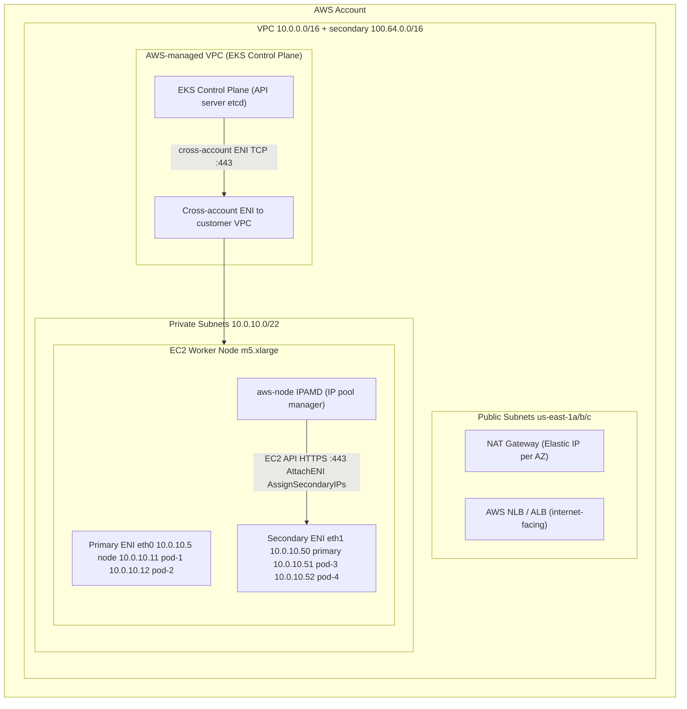
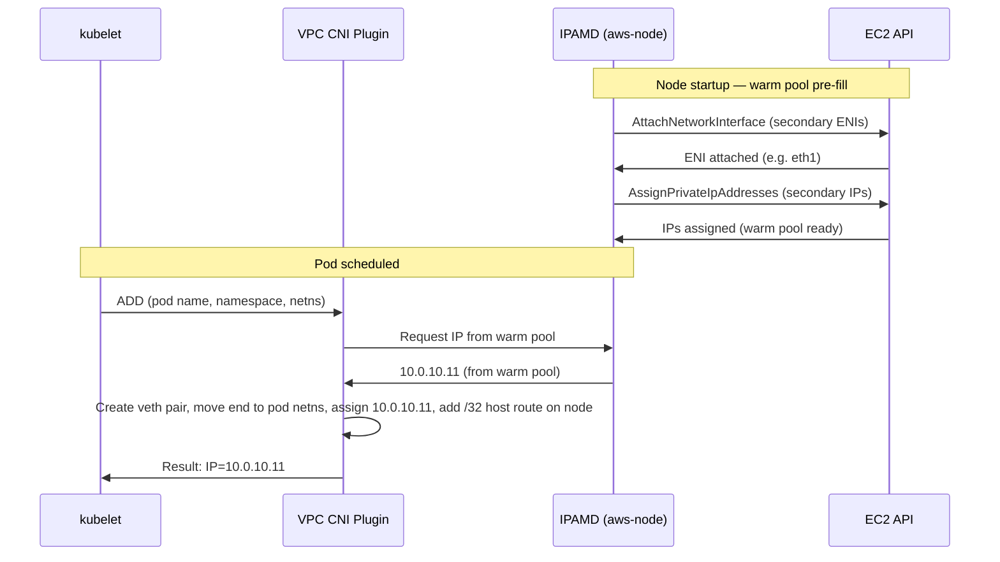
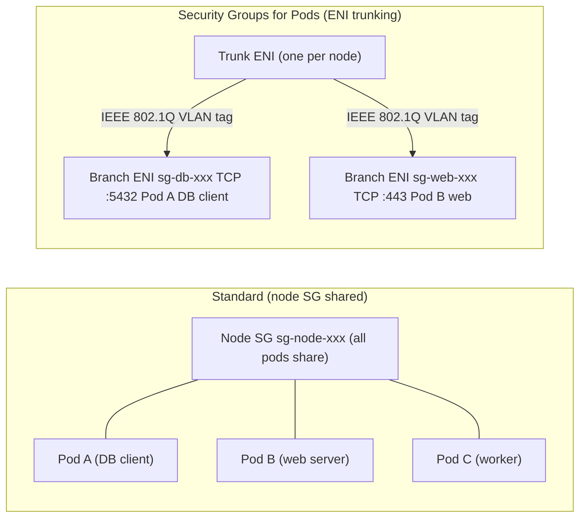

# Lesson 29 — AWS EKS Networking Deep Dive

> **Track:** AWS Networking
> **Prerequisites:** [Lesson 08 — Cloud Provider Networking](08-cloud-provider-networking.md), [Lesson 09 — CNI](09-cni-specification.md)
> **Duration:** ~3 hours

> **Goal:** Explain how the AWS VPC CNI assigns real VPC IPs to pods via ENI secondary IPs, calculate the pod density limit for a given instance type, enable prefix delegation to increase that limit, and assign per-pod Security Groups using SecurityGroupPolicy.

> **Version note:** Current stable as of November 2026 — **AWS VPC CNI v1.23.3**, **EKS supports K8s 1.32–1.37**. eBPF network policy controller was introduced in VPC CNI v1.14 (minimum version for that feature); the reference to `v1.14+` throughout this lesson means that feature boundary, not the current version.


**Jump to:** [Theory](#theory) · [Practice](#practice) · [Troubleshooting](#troubleshooting) · [Production Checklist](#production-checklist) · [Quick Reference](#quick-reference) · [Check Your Understanding](#check-your-understanding)

---

## Theory

## 1. EKS Architecture



**Control Plane:** Managed by AWS — lives in an AWS-owned VPC, connected to your VPC via a cross-account ENI per subnet. You do not manage control plane nodes.

---

## 2. AWS VPC CNI — How Pod IPs Are Assigned

Pods receive **real VPC IP addresses** from EC2 ENI secondary IPs. No overlay network, no NAT for pod-to-pod traffic within the VPC.



```bash
# Check IPAMD logs (IP assignment events)
kubectl logs -n kube-system -l k8s-app=aws-node -c aws-node | \
  grep -E "AssignPrivateIp|warm|allocated" | tail -20

# View current warm pool status
kubectl exec -n kube-system -l k8s-app=aws-node -c aws-node -- \
  curl -s http://localhost:61678/v1/nodeIPStats 2>/dev/null | jq .
# totalIPAddresses: N
# assignedIPAddresses: M
# coolDownIPs: 0
```

---

## 3. ENI Secondary IP — Node Layout

```
EC2 Node (m5.large: max 3 ENIs × 10 IPs per ENI)

Primary ENI (eth0)          Secondary ENI (eth1)
┌─────────────────┐         ┌─────────────────┐
│ 10.0.10.5 (node)│         │ 10.0.10.50       │
│ 10.0.10.11 → Pod│         │ 10.0.10.51 → Pod│
│ 10.0.10.12 → Pod│         │ 10.0.10.52 → Pod│
│ ...             │         │ ...             │
└─────────────────┘         └─────────────────┘
  -1 IP per ENI for node's own use

Max pods = (ENIs × IPs_per_ENI) − ENIs
m5.large = (3 × 10) − 3 = 27 pods
```

```bash
# Check this node's pod capacity
kubectl describe node $NODE | grep -E "pods:" | head -3
# pods: 29   (aws-node uses formula + 2 for host-network pods)

# Check actual formula values for this instance type
kubectl get node $NODE -o json | \
  jq '.metadata.annotations["vpc.amazonaws.com/eniIPv4Limit"]'
```

---

## 4. Pod Density Limits by Instance Type

| Instance | ENIs | IPs/ENI | Standard Max Pods | With Prefix Delegation |
|----------|------|---------|-------------------|----------------------|
| t3.small | 3 | 4 | 11 | 48 |
| t3.medium | 3 | 6 | 15 | 48 |
| m5.large | 3 | 10 | 27 | 48 |
| m5.xlarge | 4 | 15 | 58 | 64 |
| m5.4xlarge | 8 | 30 | 234 | 234+ |
| c5.2xlarge | 4 | 15 | 58 | 64 |
| r5.2xlarge | 4 | 15 | 58 | 64 |

Formula (standard): `(ENIs × IPs_per_ENI) − ENIs`

Formula (prefix delegation): `(ENIs × prefixes_per_ENI × 16) − ENIs`

---

## 5. Prefix Delegation

Assign /28 CIDR blocks (16 IPs) per ENI slot instead of individual secondary IPs. Dramatically increases pod density.

```bash
# Enable prefix delegation
kubectl set env ds aws-node -n kube-system \
  ENABLE_PREFIX_DELEGATION=true \
  WARM_PREFIX_TARGET=1

# After enabling, check node capacity change
kubectl describe node $NODE | grep "pods:"
# Before: pods: 27  (m5.large standard)
# After:  pods: 48  (m5.large with prefix delegation)

# View /28 prefixes attached to ENIs on the node
NODE_IP=$(kubectl get node $NODE -o jsonpath='{.status.addresses[?(@.type=="InternalIP")].address}')
aws ec2 describe-instances \
  --filters "Name=private-ip-address,Values=$NODE_IP" \
  --query 'Reservations[0].Instances[0].NetworkInterfaces[*].Ipv4Prefixes'

# IPAMD logs showing prefix assignment
kubectl logs -n kube-system -l k8s-app=aws-node -c aws-node | \
  grep -i prefix | tail -20
```

**Industry example:** Capital One adopted prefix delegation on EKS clusters running cloud-native banking workloads. By assigning /28 CIDR blocks per ENI slot on `m5.xlarge` nodes, they achieved a 3x pod density increase without changing instance type.

---

## 6. Security Groups for Pods

By default all pods on a node share the **node's Security Group**. With Security Groups for Pods, individual pods get their own SG via ENI trunking.



```bash
# Step 1 — enable trunk ENI mode
kubectl set env ds aws-node -n kube-system ENABLE_POD_ENI=true
# Restart node group to activate trunk ENI (rolling replacement)
```

```yaml
# Step 2 — SecurityGroupPolicy: assign SG to specific pods
apiVersion: vpcresources.k8s.aws/v1beta1
kind: SecurityGroupPolicy
metadata:
  name: db-sg-policy
  namespace: production
spec:
  podSelector:
    matchLabels:
      app: database-client
  securityGroups:
    groupIds:
      - sg-0123456789abcdef0   # SG with RDS port 5432 ingress rule
```

```bash
# Step 3 — verify pod has the right SG
POD_IP=$(kubectl get pod <pod> -n production -o jsonpath='{.status.podIP}')
aws ec2 describe-network-interfaces \
  --filters "Name=private-ip-address,Values=$POD_IP" \
  --query 'NetworkInterfaces[0].Groups'
# [{"GroupId": "sg-0123456789abcdef0", "GroupName": "db-access"}]
```

**Industry example:** Shopify uses `SecurityGroupPolicy` on their EKS-based e-commerce platform to satisfy PCI-DSS isolation requirements. Per-pod Security Groups restrict database access to only payment-processing pods, preventing lateral movement from other workloads on the same node.

---

## 7. EKS Node Networking

```bash
# View all ENIs attached to a node
NODE_IP=$(kubectl get node $NODE -o jsonpath='{.status.addresses[?(@.type=="InternalIP")].address}')
aws ec2 describe-instances \
  --filters "Name=private-ip-address,Values=$NODE_IP" \
  --query 'Reservations[0].Instances[0].NetworkInterfaces[*].{ENI:NetworkInterfaceId,IPs:PrivateIpAddresses[*].PrivateIpAddress}'

# View routes on the node — /32 host routes per pod IP
# (SSH to node via SSM or bastion)
aws ssm start-session --target <instance-id>
ip route show | grep -v docker | grep scope
# 10.0.10.11 dev eth0 scope link  <- pod IP host route
# 10.0.10.51 dev eth1 scope link
# 10.0.10.52 dev eth1 scope link

# Source/destination check must be DISABLED on EKS nodes
aws ec2 describe-instance-attribute \
  --instance-id <instance-id> \
  --attribute sourceDestCheck
# "Value": false   <- correct; true breaks pod routing
```

---

## 8. VPC CNI Network Policies (eBPF)

Since VPC CNI v1.14, AWS includes a built-in eBPF network policy controller:

```bash
# Enable network policy controller
kubectl set env ds aws-node -n kube-system \
  ENABLE_NETWORK_POLICY_CONTROLLER=true

# Standard Kubernetes NetworkPolicy resources are enforced
kubectl apply -f - <<EOF
apiVersion: networking.k8s.io/v1
kind: NetworkPolicy
metadata:
  name: db-only
  namespace: production
spec:
  podSelector:
    matchLabels:
      app: database
  ingress:
    - from:
        - podSelector:
            matchLabels:
              app: api
      ports:
        - port: 5432
EOF

# Verify eBPF programs are loaded
kubectl exec -n kube-system -l k8s-app=aws-node -- \
  bpftool prog list | grep aws 2>/dev/null | head -10
```

---

## 9. IRSA — IAM Roles for Service Accounts

Pods need AWS API access without storing static credentials. IRSA uses OIDC federation to map Kubernetes service accounts to IAM roles.

```bash
# Associate OIDC provider with cluster
eksctl utils associate-iam-oidc-provider \
  --cluster my-cluster --approve

# Create IAM role for a service account
eksctl create iamserviceaccount \
  --name s3-reader \
  --namespace production \
  --cluster my-cluster \
  --attach-policy-arn arn:aws:iam::aws:policy/AmazonS3ReadOnlyAccess \
  --approve

# Verify the annotation on the service account
kubectl get sa s3-reader -n production -o yaml | grep eks.amazonaws.com
# eks.amazonaws.com/role-arn: arn:aws:iam::123456789:role/my-cluster-s3-reader

# Pod uses the service account — AWS_WEB_IDENTITY_TOKEN_FILE is auto-injected
kubectl run test-irsa --rm -it --image=amazon/aws-cli \
  --serviceaccount=s3-reader -n production \
  -- s3 ls
```

---

## 10. EKS with Alternative CNI Plugins

```bash
# Option 1: Keep VPC CNI for pod IPs; add Calico for NetworkPolicy only
kubectl apply -f https://raw.githubusercontent.com/aws/amazon-vpc-cni-k8s/master/config/master/calico-operator.yaml

# Option 2: Cilium replacing VPC CNI entirely (overlay mode)
kubectl -n kube-system delete daemonset aws-node
helm install cilium cilium/cilium \
  --namespace kube-system \
  --set eni.enabled=true \
  --set ipam.mode=eni \
  --set egressMasqueradeInterfaces=eth0 \
  --set tunnel=disabled
```

### Industry Applications

| Company / Project | Context | Technology from this lesson | Outcome |
|---|---|---|---|
| Robinhood | Financial trading platform on EKS | VPC CNI real VPC IPs for low-latency order routing | Direct pod IPs eliminate NAT for sub-millisecond trade execution |
| Amazon.com | Thousands of EKS clusters for Prime Day traffic | IRSA (IAM Roles for Service Accounts) per microservice | Zero static credentials; each pod scope-limited to its own IAM role |

---

## Practice

### Environment Setup

```bash
# Terminal 1 — verify aws-node DaemonSet is running
kubectl get ds -n kube-system aws-node -o wide
kubectl get pods -n kube-system -l k8s-app=aws-node -o wide
# One pod per node — all should be Running

# Terminal 2 — check cluster identity
aws sts get-caller-identity
kubectl config current-context

# Terminal 3 — view ENIs attached to a node
NODE=$(kubectl get nodes -o jsonpath='{.items[0].metadata.name}')
INSTANCE_TYPE=$(kubectl get node $NODE \
  -o jsonpath='{.metadata.labels.node\.kubernetes\.io/instance-type}')
echo "Node: $NODE  Instance type: $INSTANCE_TYPE"

aws ec2 describe-network-interfaces \
  --filters "Name=description,Values=aws-K8s-*" \
  --query 'NetworkInterfaces[*].[NetworkInterfaceId,PrivateIpAddresses[*].PrivateIpAddress]' \
  --output table 2>/dev/null || echo "Configure AWS CLI with EKS cluster credentials first"
```

> **See also:** [Lesson 09 — CNI Specification](09-cni-specification.md) for how CNI plugins attach to the kubelet.
> **See also:** [Lesson 30 — AWS VPC Design](30-aws-vpc-design.md) for subnet sizing and secondary CIDR configuration.

### Hands-On Lab

```bash
# 1. Check IPAMD warm pool health on the first aws-node pod
kubectl exec -n kube-system $(kubectl get pod -n kube-system -l k8s-app=aws-node \
  -o jsonpath='{.items[0].metadata.name}') -c aws-node -- \
  curl -s http://localhost:61678/v1/nodeIPStats | jq .
# Key fields: totalIPAddresses, assignedIPAddresses, coolDownIPs

# 2. Enable prefix delegation (increases pod density 16x per ENI slot)
kubectl set env ds aws-node -n kube-system \
  ENABLE_PREFIX_DELEGATION=true \
  WARM_PREFIX_TARGET=1
kubectl describe node $NODE | grep "pods:"
# Before: pods: 27  (m5.large standard)
# After:  pods: 48  (m5.large with prefix delegation)

# 3. Enable Security Groups for Pods
kubectl set env ds aws-node -n kube-system ENABLE_POD_ENI=true
# Then apply a SecurityGroupPolicy (see Section 6)

# 4. Enable eBPF network policy enforcement (VPC CNI v1.14+)
kubectl set env ds aws-node -n kube-system ENABLE_NETWORK_POLICY_CONTROLLER=true

# 5. Associate IRSA OIDC provider with cluster
eksctl utils associate-iam-oidc-provider \
  --cluster my-cluster --approve
kubectl get sa s3-reader -n production -o yaml | grep eks.amazonaws.com
```

### Configuration Reference

| Variable | Default | Effect | When to change |
|----------|---------|--------|---------------|
| `WARM_IP_TARGET` | `1` | Min unused IPs to keep in warm pool | Increase (e.g. 5) for bursty workloads to reduce IP attach latency |
| `MINIMUM_IP_TARGET` | `0` | Absolute minimum IPs to maintain | Set to expected pod count for stable baseline |
| `WARM_ENI_TARGET` | `1` | Min unused ENIs to keep attached | Set to `0` on small instances to avoid wasting IPs |
| `WARM_PREFIX_TARGET` | `1` | Min unused /28 prefixes (prefix delegation only) | Set to `2` for burst tolerance |
| `ENABLE_PREFIX_DELEGATION` | `false` | Assign /28 CIDR blocks instead of individual IPs | Set `true` for large clusters — 16x more IPs per ENI slot |
| `ENABLE_POD_ENI` | `false` | Enable trunk ENI for Security Groups for Pods | Set `true` to use SecurityGroupPolicy CRD |
| `AWS_VPC_K8S_CNI_CUSTOM_NETWORK_CFG` | `false` | Use ENIConfig CRD for pod subnet selection | Set `true` for custom networking / secondary CIDR |
| `ENI_CONFIG_LABEL_DEF` | `k8s.amazonaws.com/eniConfig` | Node label to match ENIConfig | Set to `topology.kubernetes.io/zone` for per-AZ config |
| `ENABLE_NETWORK_POLICY_CONTROLLER` | `false` | Enable eBPF-based network policy enforcement | Set `true` to replace kube-proxy NetworkPolicy (v1.14+) |

---

## Troubleshooting

| Symptom | Likely Cause | Diagnostic Command | Fix |
|---------|-------------|-------------------|-----|
| Pods stuck Pending — "0/N nodes are available: N Too many pods" | Node at ENI/IP capacity | `kubectl describe node $NODE \| grep "pods:"` and compare to running count | Use larger instance type or enable prefix delegation |
| Pod gets no IP — CNI timeout in kubelet | IPAMD warm pool empty / EC2 API throttling | `kubectl logs -n kube-system -l k8s-app=aws-node -c aws-node \| grep ERROR` | Increase `MINIMUM_IP_TARGET`; check EC2 API rate limits |
| Pod IP unreachable from another pod | Source/destination check enabled on node | `aws ec2 describe-instance-attribute --instance-id <id> --attribute sourceDestCheck` | Disable source/destination check on all node ENIs |
| Security Groups for Pods not working | Trunk ENI not provisioned | `kubectl get node $NODE -o yaml \| grep vpc.amazonaws.com/trunk` | Restart node (rolling) after setting `ENABLE_POD_ENI=true` |
| Pods can't reach ECR on private cluster | Missing VPC endpoint for ECR | `aws ec2 describe-vpc-endpoints \| grep ecr` | Create interface endpoints for `ecr.api`, `ecr.dkr`, and S3 gateway |
| Node shows Ready but pod IPs exhaust quickly | WARM_ENI_TARGET too high — IPs reserved but unused | `curl localhost:61678/v1/nodeIPStats` on node | Lower `WARM_ENI_TARGET` to 0; tune `WARM_IP_TARGET` |
| NetworkPolicy not enforced | Network policy controller not enabled | `kubectl get ds aws-node -n kube-system -o yaml \| grep ENABLE_NETWORK_POLICY` | Set `ENABLE_NETWORK_POLICY_CONTROLLER=true` and restart aws-node |

```bash
# Full VPC CNI diagnostic sequence

# 1. Check IPAMD health
kubectl exec -n kube-system $(kubectl get pod -n kube-system -l k8s-app=aws-node \
  -o jsonpath='{.items[0].metadata.name}') -c aws-node -- \
  curl -s http://localhost:61678/v1/nodeIPStats | jq .

# 2. Check for IPAMD errors
kubectl logs -n kube-system -l k8s-app=aws-node -c aws-node | \
  grep -E "ERROR|WARN" | tail -30

# 3. Check ENI attachment status
aws ec2 describe-network-interfaces \
  --filters "Name=description,Values=aws-K8s-*" \
  --query 'NetworkInterfaces[*].{ID:NetworkInterfaceId,Status:Status,Description:Description}' \
  --output table

# 4. Check pod IP assignment from VPC side
POD_IP=$(kubectl get pod <pod> -o jsonpath='{.status.podIP}')
aws ec2 describe-network-interfaces \
  --filters "Name=private-ip-address,Values=$POD_IP" \
  --query 'NetworkInterfaces[0].{ID:NetworkInterfaceId,Node:Attachment.InstanceId}'

# 5. Connectivity test
kubectl run -it --rm debug --image=nicolaka/netshoot -- \
  curl -v http://<service-clusterip>:<port>
```

---

## Production Checklist

- [ ] Instance types sized for expected pod density — verify `max pods` with prefix delegation enabled
- [ ] `MINIMUM_IP_TARGET` set to expected average pod count per node to reduce cold-start IP attach latency
- [ ] Prefix delegation enabled (`ENABLE_PREFIX_DELEGATION=true`) for clusters with >30 pods/node
- [ ] Source/destination check disabled on all node ENIs (managed automatically by EKS Managed Node Groups)
- [ ] IRSA configured for all pods accessing AWS APIs — no static credentials in environment variables or Secrets
- [ ] VPC endpoints created for ECR (api + dkr), S3 (gateway), STS, and EC2 to avoid NAT Gateway costs
- [ ] Network policy controller enabled and baseline NetworkPolicies applied to all production namespaces

---

## Common Anti-Patterns

| What people do | Why it breaks | Correct approach |
|----------------|--------------|-----------------|
| Use t3.small for production nodes | Only 11 max pods standard, 48 with prefix delegation — quickly exhausts for real workloads | Use m5.large or larger; always enable prefix delegation |
| Leave `WARM_IP_TARGET=1` on bursty workloads | Pod scheduling stalls waiting for IPAMD to attach IPs (5-10s delay) | Set `WARM_IP_TARGET=5` and `MINIMUM_IP_TARGET` to expected average |
| Share one SG for all pods on a node | Cannot scope DB access to specific pods — entire node has DB access | Use SecurityGroupPolicy with `ENABLE_POD_ENI=true` for sensitive workloads |
| Store AWS credentials in K8s Secrets | Credentials rotate; Secrets can be read by other pods | Use IRSA — service account token exchanged for temporary IAM credentials |
| Run all pods in public subnets | Pods have public IPs — dramatically increases attack surface | Nodes and pods in private subnets; only NLBs/ALBs in public subnets |

---

## Quick Reference

| Use Case | Command |
|----------|---------|
| Check aws-node DaemonSet | `kubectl get ds -n kube-system aws-node` |
| View IPAMD warm pool stats | `kubectl exec -n kube-system <aws-node-pod> -c aws-node -- curl -s localhost:61678/v1/nodeIPStats` |
| Enable prefix delegation | `kubectl set env ds aws-node -n kube-system ENABLE_PREFIX_DELEGATION=true` |
| Enable SGs for Pods | `kubectl set env ds aws-node -n kube-system ENABLE_POD_ENI=true` |
| Check pod SG assignment | `aws ec2 describe-network-interfaces --filters "Name=private-ip-address,Values=<pod-ip>" --query 'NetworkInterfaces[0].Groups'` |
| View ENIs on a node | `aws ec2 describe-instances --filters "Name=private-ip-address,Values=<node-ip>" --query '...NetworkInterfaces'` |
| Enable eBPF network policy | `kubectl set env ds aws-node -n kube-system ENABLE_NETWORK_POLICY_CONTROLLER=true` |
| Create IRSA service account | `eksctl create iamserviceaccount --name <sa> --namespace <ns> --cluster <cluster> --attach-policy-arn <arn> --approve` |
| Check IPAMD errors | `kubectl logs -n kube-system -l k8s-app=aws-node -c aws-node \| grep ERROR` |
| Node max pods | `kubectl describe node <name> \| grep pods:` |
| VPC CNI version | `kubectl get ds -n kube-system aws-node -o jsonpath='{.spec.template.spec.containers[0].image}'` |

---

## Summary

| Concept | Detail |
|---------|--------|
| Pod IP model | Real VPC IPs from ENI secondary IPs — no overlay, no NAT for pod-to-pod |
| IP assignment | IPAMD (aws-node) maintains a warm pool; CNI plugin draws from it on pod create |
| Pod density | Limited by instance ENI/IP limits — use prefix delegation (16x IPs per ENI slot) |
| Security Groups for Pods | `SecurityGroupPolicy` CRD + trunk ENI — per-pod SG without overlay |
| Network Policy | VPC CNI eBPF controller (v1.14+) or Calico overlay |
| IAM | IRSA: service account → IAM role (OIDC — no stored credentials) |
| Encryption | In transit via TLS; pod-to-pod: add Calico/Cilium WireGuard |

---

## Check Your Understanding

1. **[Concept question]** Why does the AWS VPC CNI assign real VPC IP addresses to pods instead of using an overlay network, and what is the main pod density constraint this introduces?

   <details><summary>Answer</summary>

   Real VPC IPs eliminate NAT and tunneling overhead: pod-to-pod traffic stays native L3 routing within the VPC, reducing latency and simplifying security group rules (SGs apply directly to pod IPs). The main constraint is that each IP must come from an ENI secondary IP slot, and each EC2 instance type has hard limits on the number of ENIs and IPs per ENI. For example, an `m5.large` supports 3 ENIs × 10 IPs − 3 (one per ENI for the node) = 27 pods maximum, far less than the default Kubernetes limit of 110. Prefix delegation (`ENABLE_PREFIX_DELEGATION=true`) assigns /28 blocks instead of individual IPs, raising the `m5.large` limit to 48.

   </details>

2. **[Scenario question]** Pods are stuck in Pending with the reason "0/3 nodes are available: 3 Too many pods." The cluster uses `m5.large` nodes without prefix delegation. What is the current maximum pod count per node, and what is the simplest way to raise it?

   <details><summary>Answer</summary>

   An `m5.large` supports 3 ENIs × 10 secondary IPs per ENI, minus 3 (one primary IP per ENI reserved for the node) = 27 pods. Enable prefix delegation by setting `ENABLE_PREFIX_DELEGATION=true` and `WARM_PREFIX_TARGET=1` on the `aws-node` DaemonSet with `kubectl set env ds aws-node -n kube-system ENABLE_PREFIX_DELEGATION=true`; this assigns /28 CIDR blocks (16 IPs each) per ENI slot, raising the `m5.large` limit to 48 pods without changing instance type.

   </details>

3. **[Practical question]** What command would you run to check the current IP warm pool status — how many IPs are assigned versus available — on a specific node?

   <details><summary>Answer</summary>

   ```bash
   kubectl exec -n kube-system $(kubectl get pod -n kube-system -l k8s-app=aws-node \
     -o jsonpath='{.items[0].metadata.name}') -c aws-node -- \
     curl -s http://localhost:61678/v1/nodeIPStats | jq .
   ```
   Look for `totalIPAddresses`, `assignedIPAddresses`, and `coolDownIPs` fields; if `totalIPAddresses` minus `assignedIPAddresses` is at or near zero, the warm pool is exhausted and new pods will stall while IPAMD attaches more IPs from the EC2 API.

   </details>

---

## Online Resources

| Resource | Cost | What you practice |
|----------|------|-------------------|
| [AWS EKS Workshop](https://www.eksworkshop.com/) | Free workshop (~$3 AWS cost, clean up after) | ENI secondary IPs, VPC CNI configuration, prefix delegation, Security Groups for Pods — mirrors this lesson end-to-end |
| [AWS Skill Builder — Amazon EKS](https://skillbuilder.aws/) | Free (AWS account required) | Official AWS simulated labs for EKS networking with no live infrastructure cost |
| [Amazon EKS Best Practices Guide — Networking](https://aws.github.io/aws-eks-best-practices/networking/index/) | Free | Deep reference on VPC CNI design, pod density, custom networking — read alongside this lesson |

---

**← Previous:** [Lesson 28 — OpenShift EgressIP and EgressFirewall](28-openshift-egress.md)   |   **Next:** [Lesson 30 — AWS VPC Design for Kubernetes](30-aws-vpc-design.md)
