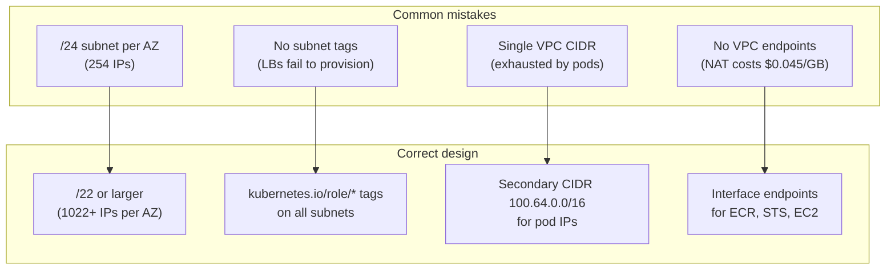
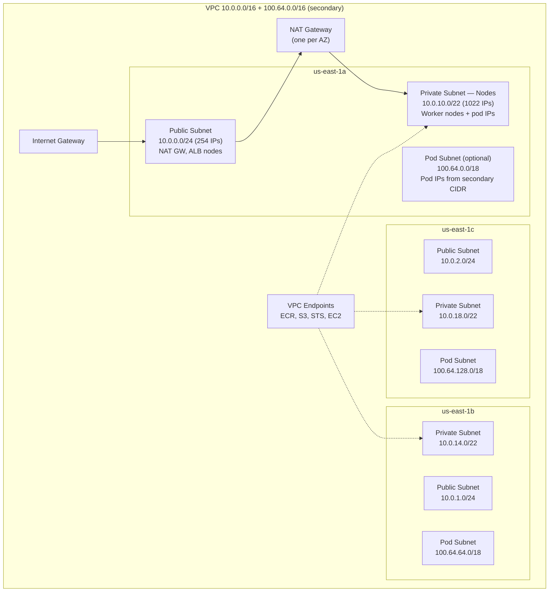
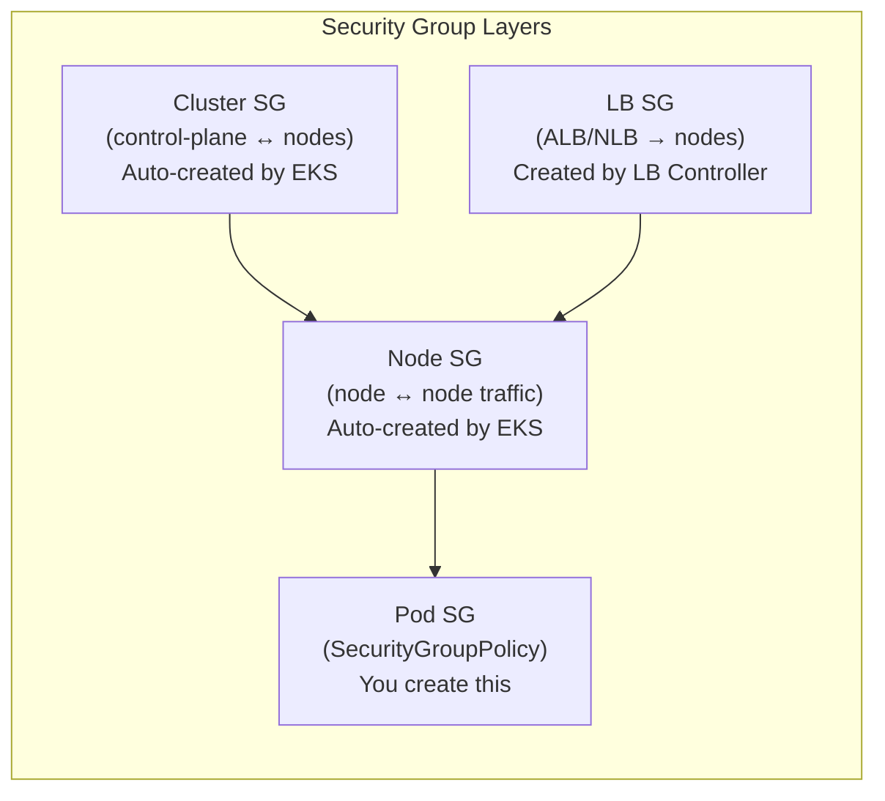
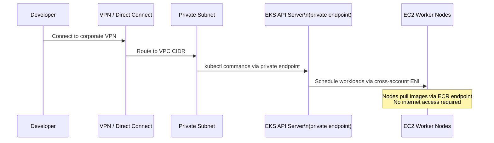

# Lesson 30 — AWS VPC Design for Kubernetes

> **Track:** AWS Networking
> **Prerequisites:** [Lesson 29 — EKS Networking Deep Dive](29-aws-eks-networking.md)
> **Duration:** ~2.5 hours

> **Goal:** Design a production VPC for EKS — size subnets correctly for pod density, apply the required EKS subnet tags, attach a secondary CIDR to avoid RFC1918 exhaustion, and configure VPC endpoints so pods never traverse a NAT Gateway to reach ECR or S3.

---

## Practice Setup

```bash
# Terminal 1 — verify AWS CLI and EKS access
aws sts get-caller-identity
aws ec2 describe-vpcs \
  --query 'Vpcs[*].{ID:VpcId,CIDR:CidrBlock,Secondary:CidrBlockAssociationSet[*].CidrBlock}' \
  --output table

# Terminal 2 — check EKS-tagged subnets
aws ec2 describe-subnets \
  --query 'Subnets[?Tags[?Key==`kubernetes.io/role/elb`]].[SubnetId,CidrBlock,AvailabilityZone]' \
  --output table 2>/dev/null || echo "Configure AWS CLI first"

# Terminal 3 — check VPC endpoints
aws ec2 describe-vpc-endpoints \
  --query 'VpcEndpoints[*].{Type:VpcEndpointType,Service:ServiceName,State:State}' \
  --output table 2>/dev/null
```

> **See also:** [Lesson 29 — AWS EKS Networking](29-aws-eks-networking.md) for ENI/IP limits that drive subnet sizing.

---

## 1. Why VPC Design Matters for EKS



**Root cause of most EKS network failures:** subnets exhausted, missing tags, or missing VPC endpoints.

---

## 2. IP Planning Formula

```
Required IPs per subnet =
  (nodes_per_AZ × 1)              <- node primary IPs
  + (pods_per_node × nodes_per_AZ)  <- pod secondary IPs (VPC CNI)
  + (LBs × 1)                     <- one IP per NLB/ALB per AZ
  + 20% buffer

Example: 20 nodes/AZ, 29 pods/node (m5.large), 5 LBs
  = 20 + (29 × 20) + 5 + 20% buffer
  = 20 + 580 + 5 = 605 × 1.2 = ~726 IPs
  → need /22 (1022 IPs) minimum per AZ
```

```bash
# Calculate IPs available in a subnet
python3 -c "
import ipaddress
n = ipaddress.IPv4Network('10.0.10.0/22')
print(f'Network: {n}')
print(f'Usable hosts: {n.num_addresses - 2}')
# AWS reserves 5 addresses per subnet (first 4 + last 1)
print(f'AWS usable: {n.num_addresses - 5}')
"
```

---

## 3. Recommended VPC Architecture



---

## 4. Subnet Tagging — Required for EKS

**Missing tags are the #1 reason LoadBalancer services fail to provision.**

```bash
# Tag private subnets — internal NLBs and ALBs (EKS-managed LBs)
aws ec2 create-tags \
  --resources subnet-private-1a subnet-private-1b subnet-private-1c \
  --tags \
    Key=kubernetes.io/cluster/my-cluster,Value=shared \
    Key=kubernetes.io/role/internal-elb,Value=1

# Tag public subnets — internet-facing NLBs and ALBs
aws ec2 create-tags \
  --resources subnet-public-1a subnet-public-1b subnet-public-1c \
  --tags \
    Key=kubernetes.io/cluster/my-cluster,Value=shared \
    Key=kubernetes.io/role/elb,Value=1

# Verify tags
aws ec2 describe-subnets \
  --filters "Name=tag:kubernetes.io/cluster/my-cluster,Values=shared" \
  --query 'Subnets[*].{ID:SubnetId,CIDR:CidrBlock,Tags:Tags[?Key==`kubernetes.io/role/internal-elb`||Key==`kubernetes.io/role/elb`]}' \
  --output table
```

| Tag | Value | Required for |
|-----|-------|-------------|
| `kubernetes.io/cluster/<cluster-name>` | `shared` or `owned` | EKS to discover subnets |
| `kubernetes.io/role/internal-elb` | `1` | Internal NLBs and ALBs |
| `kubernetes.io/role/elb` | `1` | Internet-facing NLBs and ALBs |

**`shared` vs `owned`:** Use `shared` when multiple EKS clusters share the same subnets. Use `owned` when only one cluster uses the subnet (allows the cluster to delete it on cluster deletion).

---

## 5. Secondary CIDR — Avoiding RFC1918 Exhaustion

Large clusters consume VPC IPs at scale (1 IP per pod). A secondary CIDR from RFC 6598 (`100.64.0.0/10` — "shared address space") adds non-RFC1918 IPs that don't conflict with on-premises ranges.

```bash
# Attach secondary CIDR to VPC
aws ec2 associate-vpc-cidr-block \
  --vpc-id vpc-xxxxx \
  --cidr-block 100.64.0.0/16

# Verify
aws ec2 describe-vpcs --vpc-ids vpc-xxxxx \
  --query 'Vpcs[0].CidrBlockAssociationSet'
# [{"CidrBlock": "10.0.0.0/16", ...}, {"CidrBlock": "100.64.0.0/16", ...}]

# Create pod subnets in the secondary CIDR (one per AZ)
aws ec2 create-subnet \
  --vpc-id vpc-xxxxx \
  --cidr-block 100.64.0.0/18 \
  --availability-zone us-east-1a

# Configure VPC CNI to use secondary CIDR for pod IPs
kubectl set env ds aws-node -n kube-system \
  AWS_VPC_K8S_CNI_CUSTOM_NETWORK_CFG=true \
  ENI_CONFIG_LABEL_DEF=topology.kubernetes.io/zone
```

---

## 6. ENIConfig — Custom Networking per AZ

When pods must use a different subnet than nodes (secondary CIDR scenario or separated pod/node subnets):

```yaml
# One ENIConfig per AZ — name must match the AZ name exactly
apiVersion: crd.k8s.amazonaws.com/v1alpha1
kind: ENIConfig
metadata:
  name: us-east-1a       # must match topology.kubernetes.io/zone label
spec:
  subnet: subnet-pod-1a   # subnet for pod ENIs in this AZ (100.64.0.0/18)
  securityGroups:
    - sg-pod-xxxxx         # SG to attach to pod ENIs
---
apiVersion: crd.k8s.amazonaws.com/v1alpha1
kind: ENIConfig
metadata:
  name: us-east-1b
spec:
  subnet: subnet-pod-1b
  securityGroups:
    - sg-pod-xxxxx
---
apiVersion: crd.k8s.amazonaws.com/v1alpha1
kind: ENIConfig
metadata:
  name: us-east-1c
spec:
  subnet: subnet-pod-1c
  securityGroups:
    - sg-pod-xxxxx
```

```bash
# Apply ENIConfigs
kubectl apply -f eniconfig-us-east-1a.yaml
kubectl apply -f eniconfig-us-east-1b.yaml
kubectl apply -f eniconfig-us-east-1c.yaml

# Verify ENIConfigs exist
kubectl get eniconfig

# Nodes automatically pick the right ENIConfig based on their AZ label
kubectl get node $NODE -o jsonpath='{.metadata.labels.topology\.kubernetes\.io/zone}'
# us-east-1a  <- matches ENIConfig name "us-east-1a"
```

---

## 7. Security Groups for EKS



```bash
# List EKS-managed security groups
aws ec2 describe-security-groups \
  --filters "Name=tag:kubernetes.io/cluster/my-cluster,Values=owned,shared" \
  --query 'SecurityGroups[*].{Name:GroupName,ID:GroupId,Tags:Tags[?Key==`Name`].Value|[0]}'

# Allow DB access from node SG (for pods without per-pod SG)
aws ec2 authorize-security-group-ingress \
  --group-id sg-db-xxxxx \
  --protocol tcp \
  --port 5432 \
  --source-group sg-node-xxxxx  # node SG ID

# If using CNI overlay plugins (Cilium/Calico VXLAN)
aws ec2 authorize-security-group-ingress \
  --group-id sg-node-xxxxx \
  --protocol udp --port 4789 \
  --source-group sg-node-xxxxx

# Allow NodePort range from load balancers
aws ec2 authorize-security-group-ingress \
  --group-id sg-node-xxxxx \
  --protocol tcp --port 30000-32767 \
  --cidr 10.0.0.0/8
```

---

## 8. VPC Endpoints — Keep Traffic Off the NAT Gateway

Pods accessing AWS services go via NAT Gateway by default ($0.045/GB + NAT GW hourly cost). VPC Endpoints keep traffic private and free (gateway) or low-cost (interface).

```bash
# Create S3 Gateway endpoint (free — route-table based)
aws ec2 create-vpc-endpoint \
  --vpc-id vpc-xxxxx \
  --service-name com.amazonaws.us-east-1.s3 \
  --route-table-ids rtb-private-1a rtb-private-1b rtb-private-1c

# Create ECR API interface endpoint (required for image pulls on private clusters)
aws ec2 create-vpc-endpoint \
  --vpc-id vpc-xxxxx \
  --vpc-endpoint-type Interface \
  --service-name com.amazonaws.us-east-1.ecr.api \
  --subnet-ids subnet-private-1a subnet-private-1b subnet-private-1c \
  --security-group-ids sg-endpoint-xxxxx \
  --private-dns-enabled

# Create ECR DKR interface endpoint (actual image layer pulls)
aws ec2 create-vpc-endpoint \
  --vpc-id vpc-xxxxx \
  --vpc-endpoint-type Interface \
  --service-name com.amazonaws.us-east-1.ecr.dkr \
  --subnet-ids subnet-private-1a subnet-private-1b subnet-private-1c \
  --security-group-ids sg-endpoint-xxxxx \
  --private-dns-enabled

# Verify endpoints are available
aws ec2 describe-vpc-endpoints \
  --filters "Name=vpc-id,Values=vpc-xxxxx" \
  --query 'VpcEndpoints[*].{Type:VpcEndpointType,Service:ServiceName,State:State}' \
  --output table
```

**Required endpoints for a fully private EKS cluster:**

| Endpoint | Type | Why needed |
|----------|------|-----------|
| `com.amazonaws.<region>.ecr.api` | Interface | Authenticate ECR image pulls |
| `com.amazonaws.<region>.ecr.dkr` | Interface | Pull image layers from ECR |
| `com.amazonaws.<region>.s3` | Gateway (free) | Pull image layers (ECR uses S3 backend) |
| `com.amazonaws.<region>.sts` | Interface | IRSA token exchange |
| `com.amazonaws.<region>.ec2` | Interface | VPC CNI calls EC2 API |
| `com.amazonaws.<region>.elasticloadbalancing` | Interface | AWS Load Balancer Controller |

---

## 9. EKS Fully Private Cluster



```bash
# Create a cluster with only private API endpoint
aws eks create-cluster \
  --name private-cluster \
  --resources-vpc-config \
    "subnetIds=subnet-private-1a,subnet-private-1b,\
     securityGroupIds=sg-cluster-xxxxx,\
     endpointPrivateAccess=true,\
     endpointPublicAccess=false"

# Access requires VPN, Direct Connect, or bastion
# Use SSM Session Manager for node access (no SSH required)
aws ssm start-session --target i-xxxxx
```

---

## 10. Network ACLs vs Security Groups

| | Security Groups | Network ACLs |
|--|----------------|--------------|
| Scope | ENI level (per interface) | Subnet level (all traffic) |
| Stateful | Yes — return traffic auto-allowed | No — must allow both directions |
| Default behavior | Deny all inbound, allow all outbound | Allow all (default NACL) |
| Rules | Allow only | Allow + Deny |
| EKS use | Primary access control | Secondary; rarely needed |
| Order | All rules evaluated | Rule number order (lowest wins) |

```bash
# NACLs break EKS when stateless return traffic is blocked
# Allow ephemeral ports (1024-65535) for return traffic on outbound-restricted NACLs
aws ec2 authorize-network-acl-entry \
  --network-acl-id acl-xxxxx \
  --rule-number 900 \
  --protocol tcp \
  --port-range From=1024,To=65535 \
  --cidr-block 0.0.0.0/0 \
  --egress \
  --rule-action allow

# Same for inbound return traffic
aws ec2 authorize-network-acl-entry \
  --network-acl-id acl-xxxxx \
  --rule-number 900 \
  --protocol tcp \
  --port-range From=1024,To=65535 \
  --cidr-block 0.0.0.0/0 \
  --ingress \
  --rule-action allow
```

---

## 11. VPC Flow Logs for Kubernetes Debugging

```bash
# Enable VPC flow logs to CloudWatch
aws ec2 create-flow-logs \
  --resource-type VPC \
  --resource-ids vpc-xxxxx \
  --traffic-type ALL \
  --log-destination-type cloud-watch-logs \
  --log-group-name /aws/vpc/flowlogs/my-cluster

# Query: find REJECT traffic from a specific pod IP
aws logs filter-log-events \
  --log-group-name /aws/vpc/flowlogs/my-cluster \
  --filter-pattern "[version, account_id, interface_id, srcaddr=\"10.0.10.25\", ...]" | \
  jq '.events[].message' | grep REJECT

# CloudWatch Insights query for pod connectivity debugging:
# fields @timestamp, srcAddr, dstAddr, dstPort, action
# | filter action = "REJECT"
# | filter srcAddr like "10.0.10."
# | sort @timestamp desc
# | limit 50
```

---

## 12. Subnet Sizing Reference

| Cluster Size | Nodes per AZ | Pods per Node | Recommended Subnet | IPs Available |
|-------------|-------------|--------------|-------------------|--------------|
| Small (dev) | 3 | 29 (m5.large) | /24 | 251 |
| Medium | 10 | 29 | /23 | 507 |
| Large | 25 | 29 | /22 | 1019 |
| XL | 50 | 58 (m5.xlarge) | /21 | 2043 |
| Cluster with prefix delegation | 50 | 110+ | /20 | 4091 |

**Rule of thumb:** At least /22 per AZ for any production EKS cluster. Add secondary CIDR if you anticipate > 500 pods per AZ.

---

## Troubleshooting

| Symptom | Likely Cause | Diagnostic Command | Fix |
|---------|-------------|-------------------|-----|
| `LoadBalancer` service stuck Pending | Missing subnet tags | `aws ec2 describe-subnets --subnet-ids <id> --query 'Subnets[0].Tags'` | Add `kubernetes.io/role/elb` or `internal-elb` tag |
| Node group fails to launch | Subnet exhausted | `aws ec2 describe-subnets --subnet-ids <id> --query 'Subnets[0].AvailableIpAddressCount'` | Expand subnet or add new subnet |
| Image pull fails on private cluster | Missing ECR VPC endpoint | `aws ec2 describe-vpc-endpoints --filters "Name=service-name,Values=*ecr*"` | Create interface endpoints for `ecr.api` and `ecr.dkr` |
| Cross-AZ pod latency high | Pods and nodes in different AZs due to bad ENIConfig | `kubectl get pods -o wide` and compare AZ of pod IP vs node | Verify ENIConfig names match AZ labels exactly |
| IRSA token exchange fails on private cluster | Missing STS VPC endpoint | `kubectl logs <pod> | grep sts` | Create interface endpoint for `sts` |
| NLB health checks fail | NACL blocking return traffic | `aws ec2 describe-network-acls --filter "Name=vpc-id,Values=<vpc>"` | Allow ephemeral ports 1024-65535 inbound and outbound in NACL |
| Pod IP from wrong AZ subnet | ENIConfig name mismatch | `kubectl get node <name> -o jsonpath='{.metadata.labels.topology\.kubernetes\.io/zone}'` | Rename ENIConfig to match exact AZ string |

```bash
# Full VPC diagnostic sequence

# 1. Check subnet capacity
aws ec2 describe-subnets \
  --filters "Name=tag:kubernetes.io/cluster/my-cluster,Values=shared" \
  --query 'Subnets[*].{ID:SubnetId,AZ:AvailabilityZone,Free:AvailableIpAddressCount,CIDR:CidrBlock}' \
  --output table

# 2. Verify all required subnet tags
aws ec2 describe-subnets \
  --filters "Name=vpc-id,Values=<vpc-id>" \
  --query 'Subnets[*].{ID:SubnetId,Tags:Tags}' \
  --output json | jq '.[] | select(.Tags | map(.Key) | contains(["kubernetes.io/role/internal-elb"]) | not) | .ID'

# 3. Check VPC endpoints
aws ec2 describe-vpc-endpoints \
  --filters "Name=vpc-id,Values=<vpc-id>" \
  --query 'VpcEndpoints[*].{Service:ServiceName,State:State}' \
  --output table

# 4. Check flow logs for REJECT on pod IPs
aws logs filter-log-events \
  --log-group-name /aws/vpc/flowlogs/my-cluster \
  --filter-pattern "REJECT" \
  --start-time $(($(date +%s) - 300))000 | jq '.events[].message' | head -20
```

---

## Production Checklist

- [ ] Private subnets sized at /22 or larger per AZ — `AvailableIpAddressCount` > 20% of capacity at all times
- [ ] All private subnets tagged `kubernetes.io/role/internal-elb=1` and `kubernetes.io/cluster/<name>=shared`
- [ ] All public subnets tagged `kubernetes.io/role/elb=1` and `kubernetes.io/cluster/<name>=shared`
- [ ] Secondary CIDR (100.64.0.0/16) attached if primary CIDR is /16 and cluster has >500 pods
- [ ] VPC endpoints created for ECR (api + dkr), S3 (gateway), STS, EC2, and ELB
- [ ] NAT Gateway deployed one per AZ (not one shared — single NAT is a failure domain)
- [ ] VPC Flow Logs enabled and forwarded to CloudWatch for pod-level connectivity debugging

---

## Common Anti-Patterns

| What people do | Why it breaks | Correct approach |
|----------------|--------------|-----------------|
| Use /24 subnets for EKS nodes | 254 IPs minus 5 AWS reserved = 249 usable; large clusters exhaust this in one AZ | Use /22 (1019 IPs) minimum; /20 for XL clusters |
| Single NAT Gateway for all AZs | NAT Gateway AZ outage takes down cross-AZ egress for all nodes | Deploy one NAT Gateway per AZ — cost is worth the HA |
| Share VPC CIDR with on-prem without secondary CIDR | Pod IPs overlap with corporate RFC1918 — routing breaks via VPN/Direct Connect | Add 100.64.0.0/16 secondary CIDR; use ENIConfig to put pods there |
| Use `owned` tag on shared subnets | EKS assumes exclusive ownership and may delete/modify subnet resources on cluster deletion | Use `shared` for subnets used by multiple clusters or other workloads |
| Skip VPC endpoints assuming NAT Gateway is cheaper | ECR image pulls generate significant NAT data transfer charges; VPC endpoints eliminate this | Interface endpoints cost ~$0.01/hr each; pay for 3 endpoints, save on GB charges for image pulls |

---

## Quick Reference

| Use Case | Command |
|----------|---------|
| List VPCs and CIDRs | `aws ec2 describe-vpcs --query 'Vpcs[*].{ID:VpcId,CIDR:CidrBlock}'` |
| Add secondary CIDR | `aws ec2 associate-vpc-cidr-block --vpc-id <id> --cidr-block 100.64.0.0/16` |
| Tag subnet (internal LB) | `aws ec2 create-tags --resources <subnet-id> --tags Key=kubernetes.io/role/internal-elb,Value=1` |
| Tag subnet (public LB) | `aws ec2 create-tags --resources <subnet-id> --tags Key=kubernetes.io/role/elb,Value=1` |
| Check subnet free IPs | `aws ec2 describe-subnets --subnet-ids <id> --query 'Subnets[0].AvailableIpAddressCount'` |
| List VPC endpoints | `aws ec2 describe-vpc-endpoints --query 'VpcEndpoints[*].{Service:ServiceName,State:State}'` |
| Create S3 gateway endpoint | `aws ec2 create-vpc-endpoint --vpc-id <id> --service-name com.amazonaws.<region>.s3 --route-table-ids <rtb>` |
| Enable flow logs | `aws ec2 create-flow-logs --resource-type VPC --resource-ids <vpc> --traffic-type ALL --log-destination-type cloud-watch-logs --log-group-name /vpc/flows` |
| Check ENIConfig | `kubectl get eniconfig` |
| View NACL rules | `aws ec2 describe-network-acls --filter "Name=vpc-id,Values=<vpc>"` |
| Create private EKS cluster | `aws eks create-cluster ... --resources-vpc-config "endpointPrivateAccess=true,endpointPublicAccess=false"` |

---

## Summary

| Design Decision | Recommendation |
|----------------|---------------|
| VPC CIDR | /16 primary (65k IPs); add 100.64.0.0/16 secondary for pods at scale |
| Private subnet size | /22 per AZ (1019 usable IPs) minimum; /20 for large clusters |
| Public subnet size | /24 per AZ — NLBs and NAT Gateways only |
| Subnet tags | `kubernetes.io/role/elb=1` (public), `internal-elb=1` (private) — required for LB provisioning |
| NAT Gateway | One per AZ — never share across AZs |
| VPC endpoints | ECR (api+dkr), S3 (gateway), STS, EC2, ELB — required for private clusters |
| Security Groups | Cluster SG + Node SG (auto-created); Pod SG for sensitive workloads |
| Traffic visibility | VPC Flow Logs to CloudWatch — essential for pod-level debugging |

---

## Check Your Understanding

1. **[Concept question]** Why does the EKS documentation recommend at least /22 subnets per AZ for production clusters, and how does the IP planning formula account for pod IPs?

   <details><summary>Answer</summary>

   The VPC CNI assigns one real VPC IP per pod (not just per node), so a typical medium cluster with 10 nodes × 29 pods each in one AZ already needs 290 pod IPs plus 10 node IPs plus buffer. A /24 subnet provides only 251 usable IPs (259 minus 5 AWS-reserved), which is exhausted quickly. A /22 provides 1,019 usable IPs. The planning formula is: (nodes_per_AZ × 1) + (pods_per_node × nodes_per_AZ) + (LBs × 1) + 20% buffer — always round up to the next power-of-two subnet that accommodates the result.

   </details>

2. **[Scenario question]** A new LoadBalancer Service is stuck in `<pending>` on EKS even though the VPC and subnets exist. The AWS Load Balancer Controller logs show "No subnets found." What subnet tag is most likely missing?

   <details><summary>Answer</summary>

   The subnet is missing the EKS discovery tag. For internal NLBs the required tag is `kubernetes.io/role/internal-elb=1`; for internet-facing NLBs the tag is `kubernetes.io/role/elb=1`. Both internal and external subnets also need `kubernetes.io/cluster/<cluster-name>=shared` (or `owned`). Without these tags the AWS Load Balancer Controller cannot discover which subnets to place the load balancer in. Add the tags with `aws ec2 create-tags --resources <subnet-id> --tags Key=kubernetes.io/role/internal-elb,Value=1`.

   </details>

3. **[Practical question]** What command would you run to check how many IP addresses are still available in a specific EKS subnet?

   <details><summary>Answer</summary>

   ```bash
   aws ec2 describe-subnets --subnet-ids <subnet-id> \
     --query 'Subnets[0].AvailableIpAddressCount'
   ```
   If this number is below 20% of the subnet's total capacity (for example, below 200 for a /22), plan to expand the subnet or add a secondary CIDR (such as `100.64.0.0/16`) before the cluster runs out of IPs and node groups fail to launch.

   </details>

---

## Online Resources

| Resource | Cost | What you practice |
|----------|------|-------------------|
| [AWS EKS Workshop — VPC and Subnets](https://www.eksworkshop.com/) | Free workshop (~$3 AWS cost) | Create VPC with correct subnet tags, configure ENIConfig for custom networking, deploy to multi-AZ |
| [AWS Skill Builder — Amazon EKS](https://skillbuilder.aws/) | Free (AWS account required) | Subnet design labs for EKS without live infrastructure cost |
| [Amazon EKS Best Practices Guide — Networking](https://aws.github.io/aws-eks-best-practices/networking/index/) | Free | VPC CIDR planning, subnet sizing formulas, VPC endpoint design for EKS |
| [AWS VPC Subnet Calculator](https://network00.com/NetworkTools/IPv4SubnetCreator/) | Free browser tool | Plan your /22 subnets and pod CIDR ranges visually before applying |

---

**Next:** [Lesson 31 — AWS Load Balancer Controller Deep Dive](31-aws-load-balancer-controller.md)
