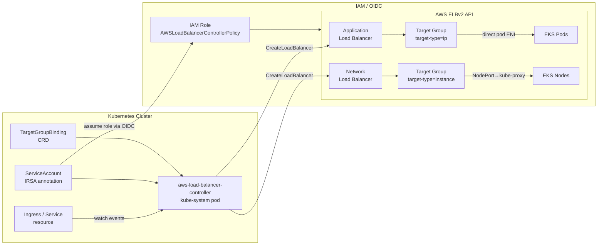
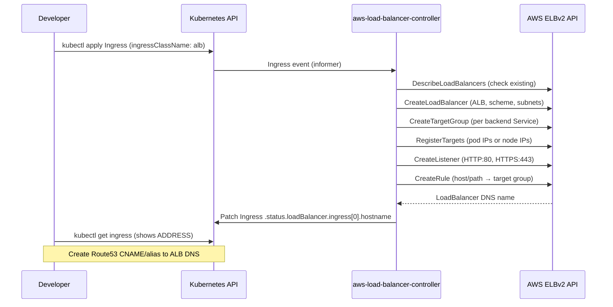

# Lesson 31 — AWS Load Balancer Controller Deep Dive

> **Track:** AWS Networking  
> **Prerequisites:** [Lesson 20 — Cloud Load Balancers](20-cloud-load-balancers.md), [Lesson 29 — EKS Networking](29-aws-eks-networking.md)  
> **Duration:** ~2.5 hours

> **Goal:** Configure AWS Load Balancer Controller to provision ALBs via Ingress and NLBs via Service, using IRSA, IngressGroups, weighted canary routing, and WAFv2 integration.

---

## Practice Setup

```bash
# Terminal 1 — Mac (kubectl)
kubectl get deployment -n kube-system aws-load-balancer-controller 2>/dev/null || \
  echo "AWS LBC not installed — see section 2 for installation"
kubectl get ingressclass
kubectl get targetgroupbindings -A 2>/dev/null

# Terminal 2 — Mac (aws CLI)
aws elbv2 describe-load-balancers \
  --query 'LoadBalancers[*].[LoadBalancerName,Type,State.Code]' \
  --output table 2>/dev/null || echo "Configure AWS CLI first"
```

---

## 1. AWS LBC vs In-Tree CCM

| Feature | In-tree CCM (legacy) | AWS Load Balancer Controller |
|---------|---------------------|------------------------------|
| NLB type | Classic LB or NLB | NLB (Network Load Balancer) |
| ALB | No | Yes (via Ingress) |
| Target type | Instance only | Instance or IP (pod-level) |
| Annotations | Limited | 50+ annotations |
| IngressGroup | No | Yes — share one ALB across Ingresses |
| WAFv2 integration | No | Yes |
| Weighted routing | No | Yes (canary via ALB listener rules) |
| Maintenance | Deprecated | Actively developed |

---

## 2. Controller Architecture

The LBC watches Ingress and Service resources, reconciles against the ELBv2 API, and creates or updates ALB or NLB resources. It authenticates to AWS via IRSA (IAM Role for Service Account) — no EC2 instance profile needed.



> **See also:** [Lesson 29 — EKS Networking](29-aws-eks-networking.md) for VPC CNI and ENI assignment that enable ip target type.

---

## 3. ALB Provisioning Flow



---

## 4. NLB via Service (type: LoadBalancer)

```yaml
apiVersion: v1
kind: Service
metadata:
  name: web
  annotations:
    # Required: use external controller, not CCM
    service.beta.kubernetes.io/aws-load-balancer-type: "external"
    service.beta.kubernetes.io/aws-load-balancer-nlb-target-type: "ip"

    # Scheme
    service.beta.kubernetes.io/aws-load-balancer-scheme: "internet-facing"
    # or: "internal" for private NLB

    # Health check
    service.beta.kubernetes.io/aws-load-balancer-healthcheck-protocol: "HTTP"
    service.beta.kubernetes.io/aws-load-balancer-healthcheck-path: "/healthz"
    service.beta.kubernetes.io/aws-load-balancer-healthcheck-interval: "10"
    service.beta.kubernetes.io/aws-load-balancer-healthcheck-healthy-threshold: "2"

    # Cross-zone LB (distributes traffic evenly across AZs)
    service.beta.kubernetes.io/aws-load-balancer-cross-zone-load-balancing-enabled: "true"

    # Preserve client IP
    service.beta.kubernetes.io/aws-load-balancer-target-group-attributes: "preserve_client_ip.enabled=true"

    # Static IP via Elastic IP
    service.beta.kubernetes.io/aws-load-balancer-eip-allocations: "eipalloc-xxxxx,eipalloc-yyyyy"

    # TLS
    service.beta.kubernetes.io/aws-load-balancer-ssl-cert: "arn:aws:acm:us-east-1:123:certificate/xxx"
    service.beta.kubernetes.io/aws-load-balancer-ssl-ports: "443"

    # Access logging
    service.beta.kubernetes.io/aws-load-balancer-access-log-enabled: "true"
    service.beta.kubernetes.io/aws-load-balancer-access-log-s3-bucket-name: "my-nlb-logs"
spec:
  type: LoadBalancer
  selector:
    app: web
  ports:
    - port: 80
      targetPort: 8080
```

### Instance vs IP Target Type

**Instance mode:** NLB → NodePort → kube-proxy → pod
```yaml
service.beta.kubernetes.io/aws-load-balancer-nlb-target-type: "instance"
```

**IP mode:** NLB → pod IP directly (requires VPC CNI)
```yaml
service.beta.kubernetes.io/aws-load-balancer-nlb-target-type: "ip"
# Lower latency — skips NodePort and kube-proxy
# Client IP preserved natively
```

---

## 5. ALB via Ingress

```yaml
apiVersion: networking.k8s.io/v1
kind: Ingress
metadata:
  name: web-ingress
  annotations:
    kubernetes.io/ingress.class: alb
    alb.ingress.kubernetes.io/scheme: internet-facing
    alb.ingress.kubernetes.io/target-type: ip

    # TLS
    alb.ingress.kubernetes.io/certificate-arn: arn:aws:acm:us-east-1:123:certificate/xxx
    alb.ingress.kubernetes.io/listen-ports: '[{"HTTP":80},{"HTTPS":443}]'
    alb.ingress.kubernetes.io/ssl-redirect: "443"

    # Health check
    alb.ingress.kubernetes.io/healthcheck-path: /healthz
    alb.ingress.kubernetes.io/healthcheck-interval-seconds: "15"
    alb.ingress.kubernetes.io/success-codes: "200-399"

    # Stickiness
    alb.ingress.kubernetes.io/target-group-attributes: stickiness.enabled=true,stickiness.lb_cookie.duration_seconds=86400

    # WAF
    alb.ingress.kubernetes.io/wafv2-acl-arn: arn:aws:wafv2:us-east-1:123:regional/webacl/xxx

    # Access logs
    alb.ingress.kubernetes.io/load-balancer-attributes: "access_logs.s3.enabled=true,access_logs.s3.bucket=my-alb-logs"

spec:
  ingressClassName: alb
  rules:
    - host: web.example.com
      http:
        paths:
          - path: /api
            pathType: Prefix
            backend:
              service:
                name: api-service
                port:
                  number: 8080
          - path: /
            pathType: Prefix
            backend:
              service:
                name: frontend
                port:
                  number: 80
```

---

## 6. IngressGroup — Share One ALB Across Ingresses

```yaml
# Multiple Ingress resources share one ALB (cost saving)
metadata:
  annotations:
    alb.ingress.kubernetes.io/group.name: "production"   # same group = same ALB
    alb.ingress.kubernetes.io/group.order: "10"          # rule priority order
```

```bash
# All Ingresses with group.name=production share one ALB
kubectl get ingress -A | grep production
# web-ingress     web.example.com
# api-ingress     api.example.com
# → both served by the same ALB DNS name
```

---

## 7. TargetGroupBinding — Attach External Target Groups

```yaml
# Register pods directly to an existing Target Group (useful for blue/green)
apiVersion: elbv2.k8s.aws/v1beta1
kind: TargetGroupBinding
metadata:
  name: web-tgb
spec:
  serviceRef:
    name: web
    port: 8080
  targetGroupARN: arn:aws:elasticloadbalancing:us-east-1:123:targetgroup/web/xxx
  targetType: ip
```

---

## 8. Weighted Routing for Canary Deployments

```yaml
# Two services, weighted via annotations
apiVersion: networking.k8s.io/v1
kind: Ingress
metadata:
  name: web-canary
  annotations:
    kubernetes.io/ingress.class: alb
    alb.ingress.kubernetes.io/actions.weighted-routing: |
      {"type":"forward","forwardConfig":{"targetGroups":[
        {"serviceName":"web-v1","servicePort":"80","weight":90},
        {"serviceName":"web-v2","servicePort":"80","weight":10}
      ]}}
spec:
  rules:
    - http:
        paths:
          - path: /
            pathType: Prefix
            backend:
              service:
                name: weighted-routing
                port:
                  name: use-annotation
```

> **See also:** [Lesson 33 — ArgoCD GitOps](33-argocd-gitops.md) for Argo Rollouts progressive delivery using ALB weighted target groups.

---

## 9. IAM Permissions (IRSA)

The LBC needs IAM permissions to manage ALBs and NLBs:

```bash
# Create IAM policy
curl -o iam-policy.json \
  https://raw.githubusercontent.com/kubernetes-sigs/aws-load-balancer-controller/main/docs/install/iam_policy.json

aws iam create-policy \
  --policy-name AWSLoadBalancerControllerIAMPolicy \
  --policy-document file://iam-policy.json

# Create IRSA service account
eksctl create iamserviceaccount \
  --cluster my-cluster \
  --namespace kube-system \
  --name aws-load-balancer-controller \
  --attach-policy-arn arn:aws:iam::ACCOUNT:policy/AWSLoadBalancerControllerIAMPolicy \
  --override-existing-serviceaccounts \
  --approve
```

---

## 10. Key Annotation Reference

### NLB Service Annotations

| Parameter | Default | Effect | When to change |
|-----------|---------|--------|----------------|
| `aws-load-balancer-type` | (CCM) | Set to `external` to force LBC ownership | Always set when using LBC for NLBs |
| `aws-load-balancer-nlb-target-type` | `instance` | `ip` sends directly to pod ENI | Use `ip` for lower latency + accurate client IP |
| `aws-load-balancer-scheme` | `internal` | `internet-facing` creates public NLB | External-facing services |
| `aws-load-balancer-cross-zone-load-balancing-enabled` | `false` | Evenly distributes across AZs | Multi-AZ clusters with uneven node counts |
| `aws-load-balancer-eip-allocations` | (dynamic IPs) | Assign static Elastic IPs per AZ | IP allowlisting by external partners |
| `aws-load-balancer-ssl-cert` | (none) | ACM cert ARN for TLS termination | HTTPS/TLS on NLB |
| `aws-load-balancer-healthcheck-interval` | `30` | Seconds between health checks | Tune for faster failover (10s) |

### ALB Ingress Annotations

| Parameter | Default | Effect | When to change |
|-----------|---------|--------|----------------|
| `alb.ingress.kubernetes.io/target-type` | `instance` | `ip` routes directly to pod | Lower latency; requires VPC CNI |
| `alb.ingress.kubernetes.io/scheme` | `internal` | `internet-facing` for public ALB | Public-facing applications |
| `alb.ingress.kubernetes.io/group.name` | (none) | Share one ALB across multiple Ingresses | Multiple services to save ALB cost |
| `alb.ingress.kubernetes.io/group.order` | `0` | Priority of rules within the shared ALB | Prevent rule conflicts in shared ALB |
| `alb.ingress.kubernetes.io/wafv2-acl-arn` | (none) | Attach WAFv2 Web ACL to ALB | DDoS and bot protection for public APIs |
| `alb.ingress.kubernetes.io/ssl-redirect` | (none) | `443` redirects all HTTP to HTTPS | Enforce TLS in production |
| `alb.ingress.kubernetes.io/healthcheck-interval-seconds` | `15` | Seconds between ALB health checks | Tune for fast pod failover vs noise |

---

## 11. Hands-On Practice

```bash
# 1. Verify LBC is running and has IRSA wired up
kubectl get sa aws-load-balancer-controller -n kube-system \
  -o jsonpath='{.metadata.annotations.eks\.amazonaws\.com/role-arn}'
# Expected: arn:aws:iam::123456789:role/AWSLoadBalancerControllerRole

# 2. Confirm IngressClass is registered
kubectl get ingressclass alb -o yaml | grep controller
# Expected: controller: ingress.k8s.aws/alb

# 3. Create a minimal ALB Ingress and watch reconciliation
kubectl apply -f web-ingress.yaml
kubectl describe ingress web-ingress | grep -A 20 Events
# Expected: Normal  SuccessfullyReconciled ... Reconciled

# 4. Get the provisioned ALB DNS name
kubectl get ingress web-ingress \
  -o jsonpath='{.status.loadBalancer.ingress[0].hostname}'
# Expected: k8s-default-webingress-XXXX.us-east-1.elb.amazonaws.com

# 5. Verify target group health (ip-mode shows pod IPs; instance-mode shows node IPs)
TG_ARN=$(aws elbv2 describe-target-groups \
  --query 'TargetGroups[?contains(TargetGroupName,`k8s`)].TargetGroupArn' \
  --output text | head -1)
aws elbv2 describe-target-health --target-group-arn "$TG_ARN" \
  --query 'TargetHealthDescriptions[*].[Target.Id,Target.Port,TargetHealth.State]' \
  --output table
# Expected: pod IPs with State=healthy (ip-mode) or node IPs (instance-mode)

# 6. Verify IngressGroup — services in same group share one ALB
kubectl get ingress -A \
  -o custom-columns='NS:.metadata.namespace,NAME:.metadata.name,GROUP:.metadata.annotations.alb\.ingress\.kubernetes\.io/group\.name,ADDR:.status.loadBalancer.ingress[0].hostname'
# Expected: same ADDR for all Ingresses in the same group

# 7. Test weighted canary routing — confirm traffic split
for i in $(seq 1 20); do curl -s https://web.example.com/ | grep -o "v[12]"; done | sort | uniq -c
# Expected: approximately 18x v1, 2x v2 (90/10 split)
```

---

## Troubleshooting

| Symptom | Likely Cause | Diagnostic Command | Fix |
|---------|-------------|-------------------|-----|
| Ingress has no ADDRESS after 2 min | LBC not running or wrong IngressClass | `kubectl logs -n kube-system deploy/aws-load-balancer-controller \| tail -30` | Verify `ingressClassName: alb` and LBC pod status |
| `AccessDenied` in LBC logs | Missing IRSA or wrong IAM policy | `kubectl logs -n kube-system deploy/aws-load-balancer-controller \| grep AccessDenied` | Recreate IRSA with `eksctl create iamserviceaccount` |
| `No subnets found` in LBC logs | Subnets missing ELB role tags | `aws ec2 describe-subnets --filters Name=tag-key,Values=kubernetes.io/role/elb` | Tag public subnets `kubernetes.io/role/elb=1`, private: `kubernetes.io/role/internal-elb=1` |
| Target group health check failing | Wrong health check path, port, or pods not ready | `aws elbv2 describe-target-health --target-group-arn <arn>` | Set `alb.ingress.kubernetes.io/healthcheck-path` and verify pod readiness |
| Two ALBs created for same IngressGroup | Different `group.name` spelling or case | `kubectl get ingress -A -o jsonpath='{..annotations}'` | Ensure exact same `group.name` value across all Ingresses |
| 502 Bad Gateway from ALB | Pod not ready or wrong `targetPort` | `kubectl get endpoints <service>` | Verify pod readiness and Service `targetPort` matches container port |
| Certificate error on HTTPS | ACM cert in wrong AWS region | `aws acm describe-certificate --certificate-arn <arn>` | Use cert ARN from same region as EKS cluster |
| WAF blocking legitimate traffic | Overly strict WAF rules | Check WAF sampled requests in AWS Console | Add IP set allow-rule or adjust managed rule group sensitivity |

---

## Production Checklist

- [ ] Subnet tags set: `kubernetes.io/role/elb=1` (public subnets) and `kubernetes.io/role/internal-elb=1` (private subnets)
- [ ] IRSA configured — LBC ServiceAccount has `eks.amazonaws.com/role-arn` annotation, no EC2 instance profile
- [ ] ALB access logs enabled, shipped to versioned S3 bucket with 90-day lifecycle policy
- [ ] WAFv2 ACL attached to all internet-facing ALBs via `wafv2-acl-arn` annotation
- [ ] `ssl-redirect: "443"` enforces HTTPS; HTTP listener only redirects, never serves content
- [ ] IngressGroup used to minimize ALB count across namespaces (ALB limit: 50 per region by default)
- [ ] `target-type: ip` used with VPC CNI for direct pod routing and accurate client IP logging

---

## Common Anti-Patterns

| What people do | Why it breaks | Correct approach |
|----------------|--------------|-----------------|
| Use legacy CCM annotation (`aws-load-balancer-type: nlb`) | Creates classic NLB via old in-tree controller, misses LBC features like IP mode and WAF | Add `external` value and use full LBC annotation set |
| One Ingress per service with no `group.name` | Each Ingress creates a separate ALB — costly and exhausts the 50 ALB regional limit quickly | Group with `alb.ingress.kubernetes.io/group.name` to share one ALB |
| `target-type: instance` for latency-sensitive workloads | Adds NodePort hop and kube-proxy latency; source IP is node IP, losing client identity | Use `target-type: ip` with VPC CNI for direct pod routing |
| Hard-code ALB DNS name in app config or external DNS | ALB DNS changes on delete and recreate, breaking connectivity | Create Route53 alias or CNAME record pointing to the ALB DNS name |
| No WAF on internet-facing ALBs | Exposes APIs to bots, scrapers, and common OWASP exploits without filtering | Attach WAFv2 ACL via `alb.ingress.kubernetes.io/wafv2-acl-arn` annotation |

---

## Quick Reference

| Use Case | Command |
|----------|---------|
| Check LBC is running | `kubectl get deploy -n kube-system aws-load-balancer-controller` |
| Get ALB DNS for Ingress | `kubectl get ingress <name> -o jsonpath='{.status.loadBalancer.ingress[0].hostname}'` |
| Watch LBC reconciliation logs | `kubectl logs -n kube-system deploy/aws-load-balancer-controller -f` |
| List all TargetGroupBindings | `kubectl get targetgroupbindings -A` |
| List ALBs in account | `aws elbv2 describe-load-balancers --query 'LoadBalancers[?Type==\`application\`].[LoadBalancerName,State.Code]' --output table` |
| Check target group health | `aws elbv2 describe-target-health --target-group-arn <arn>` |
| View IngressGroup members | `kubectl get ingress -A -l alb.ingress.kubernetes.io/group.name=<group>` |
| Check required subnet tags | `aws ec2 describe-subnets --filters Name=tag-key,Values=kubernetes.io/role/elb --query 'Subnets[*].[SubnetId,Tags]'` |
| Force LBC to re-reconcile Ingress | `kubectl annotate ingress <name> reconcile="$(date +%s)" --overwrite` |
| Get IRSA role on LBC ServiceAccount | `kubectl get sa aws-load-balancer-controller -n kube-system -o jsonpath='{.metadata.annotations.eks\.amazonaws\.com/role-arn}'` |
| Describe IngressClass | `kubectl describe ingressclass alb` |
| Watch Ingress events | `kubectl get events -n <ns> --field-selector involvedObject.name=<ingress-name> -w` |

---

## Summary

| Resource | AWS Component | Use Case |
|---------|--------------|---------|
| Service (ip target) | NLB → pods directly | TCP/UDP, low latency |
| Service (instance target) | NLB → NodePort | Simple setup |
| Ingress | ALB → pods | HTTP/S, path routing, WAF |
| IngressGroup | Shared ALB | Multiple services, one LB |
| TargetGroupBinding | Existing TG | Blue/green, external traffic |

---

## Check Your Understanding

1. **[Concept question]** What is the difference between `target-type: instance` and `target-type: ip` for the AWS Load Balancer Controller, and when would you choose each?

   <details><summary>Answer</summary>

   With `target-type: instance`, the ALB or NLB sends traffic to each node's NodePort; kube-proxy on that node then performs a second hop (DNAT) to route the packet to the actual pod, which may be on a different node. With `target-type: ip`, the load balancer registers pod ENI IPs directly as targets and routes traffic in a single hop to the pod without going through kube-proxy. Choose `instance` when pods are using host-network or when you have strict compatibility requirements with older kube-proxy; choose `ip` for lower latency, correct client IP preservation, and direct pod health checks.

   </details>

2. **[Scenario question]** Two teams each defined an `Ingress` with `ingressClassName: alb` for different paths on the same domain. The controller provisioned two separate ALBs, doubling cost. What annotation would consolidate them into one ALB?

   <details><summary>Answer</summary>

   Add the `alb.ingress.kubernetes.io/group.name` annotation with the same value on both Ingress resources, for example `alb.ingress.kubernetes.io/group.name: "shared-prod"`. The AWS Load Balancer Controller merges all Ingress resources that share a group name into a single ALB, combining their listener rules. Each Ingress still manages its own rules independently — deleting one Ingress removes only its rules, not the shared ALB.

   </details>

3. **[Practical question]** What AWS CLI command would you run to check the health of targets registered behind a specific ALB target group, to see which pods are healthy vs. draining vs. unhealthy?

   <details><summary>Answer</summary>

   ```bash
   aws elbv2 describe-target-health \
     --target-group-arn arn:aws:elasticloadbalancing:<region>:<account>:targetgroup/<name>/<id>
   ```
   The output lists each target (IP or instance ID) with its `TargetHealth.State` (`healthy`, `unhealthy`, `draining`, `unused`) and a `TargetHealth.Reason` explaining any failure. Unhealthy targets are typically caused by security group rules blocking the health-check port or the pod not yet passing its readiness probe.

   </details>

---

## Online Resources

| Resource | Cost | What you practice |
|----------|------|-------------------|
| [AWS EKS Workshop — Load Balancers](https://www.eksworkshop.com/) | Free workshop (~$3 AWS cost) | Deploy AWS Load Balancer Controller, create ALB via Ingress, NLB via Service — covers every annotation in this lesson |
| [AWS Skill Builder — Amazon EKS](https://skillbuilder.aws/) | Free (AWS account required) | Simulated ALB and NLB configuration labs |
| [AWS Load Balancer Controller Docs](https://kubernetes-sigs.github.io/aws-load-balancer-controller/) | Free | Official reference for every annotation, IngressGroup, and TargetGroupBinding — bookmark for the hands-on sections |

---

**Next:** [Lesson 32 — AWS Hybrid and Multi-Cluster Networking](32-aws-hybrid-multicluster.md)
