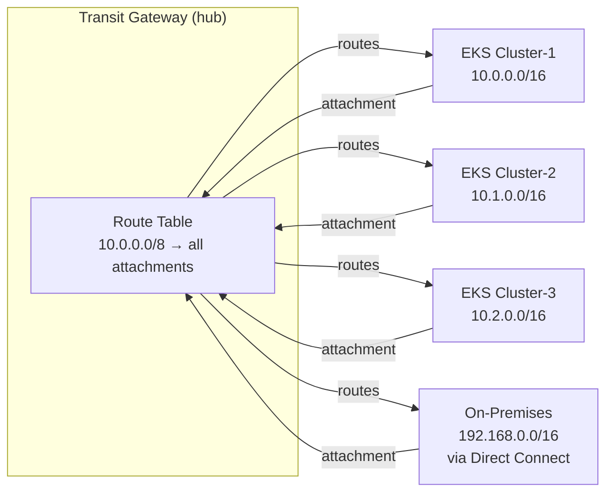
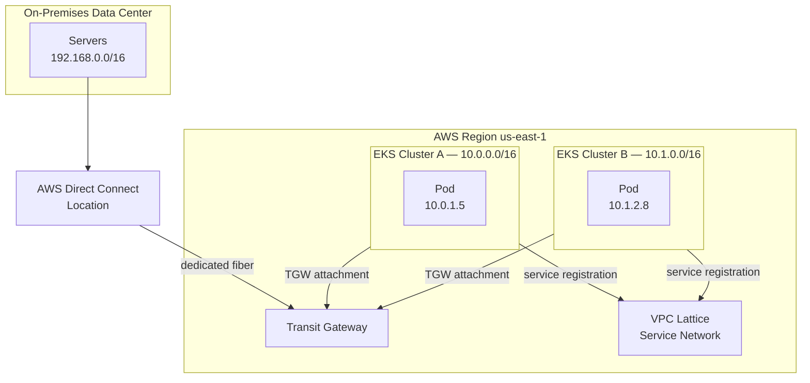
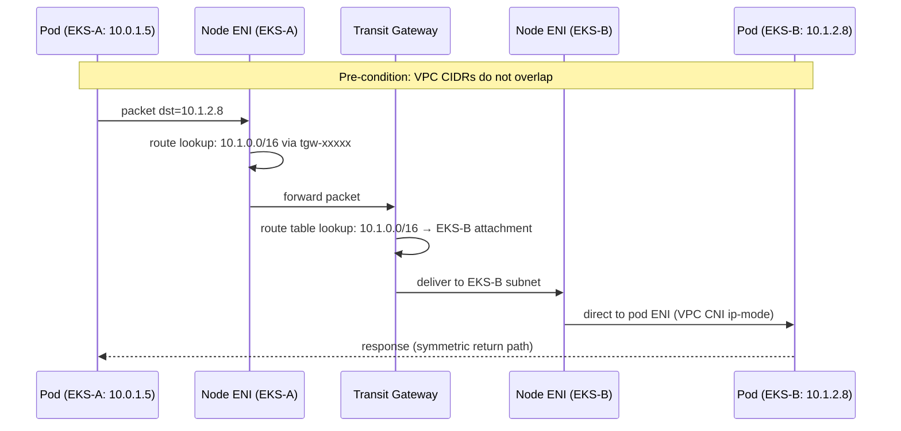
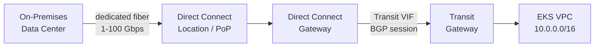

# Lesson 32 — AWS Hybrid and Multi-Cluster Networking

> **Track:** AWS Networking  
> **Prerequisites:** [Lesson 22 — Multi-Cluster Networking](22-multi-cluster-networking.md), [Lesson 30 — AWS VPC Design](30-aws-vpc-design.md)  
> **Duration:** ~2.5 hours

> **Goal:** Connect multiple EKS clusters and on-premises workloads using VPC Peering, Transit Gateway, Direct Connect, and VPC Lattice, with cross-cluster DNS discovery and GitOps delivery.

---

## Practice Setup

```bash
# Terminal 1 — Mac (kubectl multi-context)
kubectl config get-contexts
aws eks list-clusters --output table 2>/dev/null || echo "Configure AWS CLI first"

# Terminal 2 — Mac (aws CLI — inspect Transit Gateway if present)
aws ec2 describe-transit-gateways \
  --query 'TransitGateways[*].[TransitGatewayId,State,Description]' \
  --output table 2>/dev/null || echo "No Transit Gateways or AWS CLI not configured"
```

---

## 1. Connectivity Options at a Glance

| Solution | Routing | Transitive | Latency | Cost | Best for |
|----------|---------|-----------|---------|------|----------|
| VPC Peering | Direct VPC-to-VPC | No | Lowest | Very low | 2–3 clusters, no overlap |
| Transit Gateway | Hub-and-spoke | Yes | Low | Medium | 3+ clusters or on-prem hybrid |
| VPC Lattice | DNS/L7 service mesh | N/A | Low | Per-request | Service-to-service, no IP routing |
| Direct Connect | Dedicated fiber | Via TGW | Very low | High (port fee) | Production on-prem hybrid |
| Site-to-Site VPN | IPsec over internet | Via TGW | Medium | Low | Dev/backup on-prem |
| EKS Anywhere | On-prem EKS | N/A | Bare-metal | Infra cost | On-prem with EKS API |

---

## 2. VPC Peering (simplest, same region or cross-region)

```bash
# Create VPC peering between cluster A VPC and cluster B VPC
aws ec2 create-vpc-peering-connection \
  --vpc-id vpc-cluster-a \
  --peer-vpc-id vpc-cluster-b \
  --peer-region us-west-2   # omit for same region

# Accept the peering request
aws ec2 accept-vpc-peering-connection \
  --vpc-peering-connection-id pcx-xxxxx

# Update route tables in both VPCs
aws ec2 create-route \
  --route-table-id rtb-cluster-a \
  --destination-cidr-block 10.1.0.0/16 \     # cluster B VPC CIDR
  --vpc-peering-connection-id pcx-xxxxx

aws ec2 create-route \
  --route-table-id rtb-cluster-b \
  --destination-cidr-block 10.0.0.0/16 \     # cluster A VPC CIDR
  --vpc-peering-connection-id pcx-xxxxx
```

Pod CIDRs must not overlap. With VPC peering + VPC CNI, pods can reach each other directly by IP.

**Limitations:** no transitive routing (A↔B, B↔C, but not A↔C via B). N VPCs require N×(N-1)/2 peering connections (10 VPCs = 45 connections).

---

## 3. Transit Gateway (hub-and-spoke, recommended for 3+ VPCs)

```bash
# Create Transit Gateway
aws ec2 create-transit-gateway \
  --description "EKS multi-cluster TGW" \
  --options DefaultRouteTableAssociation=enable,DefaultRouteTablePropagation=enable

# Attach VPCs to TGW
aws ec2 create-transit-gateway-vpc-attachment \
  --transit-gateway-id tgw-xxxxx \
  --vpc-id vpc-cluster-a \
  --subnet-ids subnet-a1 subnet-a2

aws ec2 create-transit-gateway-vpc-attachment \
  --transit-gateway-id tgw-xxxxx \
  --vpc-id vpc-cluster-b \
  --subnet-ids subnet-b1 subnet-b2

# Add routes in each VPC pointing to TGW for other clusters
aws ec2 create-route \
  --route-table-id rtb-cluster-a-private \
  --destination-cidr-block 10.1.0.0/16 \
  --transit-gateway-id tgw-xxxxx
```

TGW supports transitive routing: A↔B, B↔C, A↔C all work. Scales to 5,000 attachments.



---

## 4. Multi-Cluster Connectivity Architecture



> **See also:** [Lesson 22 — Multi-Cluster Networking](22-multi-cluster-networking.md) for Cilium Cluster Mesh and Submariner details.

---

## 5. Cross-Cluster Pod Communication Flow



---

## 6. Cross-Cluster Service Discovery

After VPC peering or TGW, pods can reach each other by IP. But DNS discovery still needs work.

### Option A: Shared CoreDNS (stub zones)

```bash
# In cluster A's CoreDNS, forward cluster-b.local queries to cluster B's DNS
kubectl edit cm -n kube-system coredns
```

```
cluster-b.local:53 {
    forward . 172.30.0.10   # cluster B's kube-dns ClusterIP
    cache 30
}
```

```bash
# For this to work, cluster A nodes must be able to reach cluster B's kube-dns
# → ensure security groups allow UDP/TCP 53 between clusters
```

### Option B: ExternalDNS + Route53

```bash
# Install ExternalDNS in both clusters
# It creates Route53 records for Services and Ingresses

helm install external-dns bitnami/external-dns \
  --set provider=aws \
  --set aws.region=us-east-1 \
  --set domainFilters[0]=cluster-a.example.com \
  --set policy=sync

# Services with annotation get DNS records:
kubectl annotate svc web \
  external-dns.alpha.kubernetes.io/hostname=web.cluster-a.example.com
```

### Option C: AWS VPC Lattice (new, managed service mesh)

```bash
# VPC Lattice provides service-to-service connectivity without VPC peering
# Install AWS Gateway API Controller
helm install aws-gateway-controller \
  oci://public.ecr.aws/aws-samples/aws-gateway-api-controller \
  -n aws-application-networking-system

# Create a ServiceNetwork (spans VPCs/clusters)
kubectl apply -f - <<EOF
apiVersion: application-networking.k8s.aws/v1beta1
kind: VpcLatticeServiceNetwork
metadata:
  name: my-service-network
EOF

# Services registered in the network are reachable cross-cluster
```

---

## 7. On-Premises to EKS (Hybrid)

### AWS Direct Connect



```bash
# Create a Transit Virtual Interface
aws directconnect create-transit-virtual-interface \
  --connection-id dxcon-xxxxx \
  --new-transit-virtual-interface \
    virtualInterfaceName=to-tgw,\
    vlan=100,\
    asn=65000,\
    mtu=9001,\
    transitGatewayId=tgw-xxxxx

# BGP peers automatically for route exchange
# On-prem router advertises: 192.168.0.0/16 (on-prem CIDR)
# AWS TGW advertises: 10.0.0.0/8 (VPC CIDRs)
```

### Site-to-Site VPN (simpler, over internet)

```bash
# Create Customer Gateway (your on-prem router)
aws ec2 create-customer-gateway \
  --type ipsec.1 \
  --public-ip 203.0.113.1 \  # on-prem public IP
  --bgp-asn 65001

# Create VPN Gateway and attach to VPC
aws ec2 create-vpn-gateway --type ipsec.1
aws ec2 attach-vpn-gateway \
  --vpn-gateway-id vgw-xxxxx \
  --vpc-id vpc-eks

# Create VPN connection
aws ec2 create-vpn-connection \
  --type ipsec.1 \
  --customer-gateway-id cgw-xxxxx \
  --vpn-gateway-id vgw-xxxxx \
  --options StaticRoutesOnly=false   # use BGP

# Download VPN config for your on-prem router
aws ec2 describe-vpn-connections \
  --vpn-connection-ids vpn-xxxxx \
  --query 'VpnConnections[0].CustomerGatewayConfiguration'
```

---

## 8. EKS Anywhere (On-Premises EKS)

EKS Anywhere brings EKS to your data center with the same tooling.

```bash
# Install eksctl-anywhere plugin
brew install aws/tap/eks-anywhere

# Create a cluster spec
eksctl anywhere generate clusterconfig my-cluster \
  --provider vsphere > cluster.yaml  # or: baremetal, docker, nutanix

# Review and deploy
eksctl anywhere create cluster -f cluster.yaml

# Networking with EKS Anywhere:
# - Uses Cilium as default CNI
# - Full BGP support for bare-metal
# - Same kubectl/eksctl experience as cloud EKS
```

---

## 9. Cilium Cluster Mesh on EKS

```bash
# Enable Cluster Mesh on EKS clusters
# (after replacing VPC CNI with Cilium)
cilium clustermesh enable \
  --service-type LoadBalancer \
  --context eks-cluster-a

cilium clustermesh enable \
  --service-type LoadBalancer \
  --context eks-cluster-b

# Connect the clusters
cilium clustermesh connect \
  --source-context eks-cluster-a \
  --destination-context eks-cluster-b

# Verify
cilium clustermesh status --context eks-cluster-a
```

---

## 10. Cross-Account EKS Access

```bash
# Share Transit Gateway across accounts
aws ram create-resource-share \
  --name tgw-share \
  --resource-arns arn:aws:ec2:us-east-1:ACCOUNT-A:transit-gateway/tgw-xxxxx \
  --principals ACCOUNT-B-ID

# In account B, accept the share
aws ram accept-resource-share-invitation \
  --resource-share-invitation-arn arn:aws:ram:...

# Attach account B's VPC to the shared TGW
aws ec2 create-transit-gateway-vpc-attachment \
  --transit-gateway-id tgw-xxxxx \  # from account A
  --vpc-id vpc-cluster-b-accountB \
  --subnet-ids subnet-xxxxx
```

---

## 11. Key Configuration Reference

### VPC Peering vs Transit Gateway Parameters

| Parameter | VPC Peering | Transit Gateway |
|-----------|------------|----------------|
| Max connections | N×(N-1)/2 — unlimited but unmanageable | 5,000 attachments |
| Transitive routing | No | Yes (via TGW route tables) |
| Cross-account | Yes (requires accept in peer account) | Yes (via AWS RAM sharing) |
| Cross-region | Yes (inter-region peering) | Yes (TGW peering between regions) |
| Bandwidth limit | None (limited by NIC) | 50 Gbps per attachment burst |
| Cost | No hourly fee; data transfer charged | $0.05/hr per attachment + data transfer |

### Direct Connect Virtual Interface Types

| VIF Type | Connects To | Use Case | When to change |
|----------|------------|---------|----------------|
| Private VIF | VGW (single VPC) | Simple single-VPC connectivity | Upgrade to Transit VIF for multi-VPC |
| Public VIF | AWS public endpoints | Access S3, DynamoDB over DX | Avoid unless specifically needed |
| Transit VIF | Direct Connect Gateway → TGW | Multi-VPC, multi-account hybrid | Default choice for EKS hybrid |
| Hosted VIF | Partner-managed | Smaller bandwidth increments | When <1 Gbps is sufficient |

---

## 12. Hands-On Practice

```bash
# 1. Check existing VPC peering connections
aws ec2 describe-vpc-peering-connections \
  --query 'VpcPeeringConnections[*].[VpcPeeringConnectionId,Status.Code,RequesterVpcInfo.VpcId,AccepterVpcInfo.VpcId]' \
  --output table

# 2. Verify TGW attachments and their state
aws ec2 describe-transit-gateway-vpc-attachments \
  --query 'TransitGatewayVpcAttachments[*].[TransitGatewayAttachmentId,VpcId,State]' \
  --output table

# 3. Inspect TGW route tables
TGW_ID=$(aws ec2 describe-transit-gateways \
  --query 'TransitGateways[0].TransitGatewayId' --output text)
aws ec2 describe-transit-gateway-route-tables \
  --filters Name=transit-gateway-id,Values=$TGW_ID

# 4. Cross-cluster pod reachability test
kubectl run -it --rm test-connectivity \
  --image=nicolaka/netshoot --context eks-cluster-a -- \
  ping -c 3 10.1.2.8   # pod IP in cluster B
# Expected: 3 packets transmitted, 3 received

# 5. Verify CoreDNS stub zone resolves cross-cluster
kubectl run -it --rm dns-test \
  --image=nicolaka/netshoot --context eks-cluster-a -- \
  dig +short web.cluster-b.local
# Expected: ClusterIP of service in cluster B

# 6. Check BGP session status (Direct Connect)
aws directconnect describe-virtual-interfaces \
  --query 'virtualInterfaces[*].[virtualInterfaceName,virtualInterfaceState,bgpPeers[0].bgpStatus]' \
  --output table
# Expected: bgpStatus=up for healthy session

# 7. VPN tunnel status
aws ec2 describe-vpn-connections \
  --query 'VpnConnections[*].VgwTelemetry[*].[OutsideIpAddress,Status,StatusMessage]' \
  --output table
# Expected: Status=UP for both tunnels (redundant pair)
```

> **See also:** [Lesson 29 — EKS Networking](29-aws-eks-networking.md) for VPC CNI behavior and pod CIDR assignments that must not overlap across peered clusters.

---

## Troubleshooting

| Symptom | Likely Cause | Diagnostic Command | Fix |
|---------|-------------|-------------------|-----|
| Pods cannot ping across clusters | Missing routes in VPC route tables | `aws ec2 describe-route-tables --route-table-ids <rtb-id>` | Add route to peer VPC CIDR via pcx- or tgw- |
| TGW attachment in `failed` state | Subnet not in correct AZ or quota exceeded | `aws ec2 describe-transit-gateway-vpc-attachments --filters Name=state,Values=failed` | Check TGW subnet requirements; request quota increase |
| DNS not resolving cross-cluster | CoreDNS stub zone missing or wrong IP | `kubectl exec -n kube-system deploy/coredns -- nslookup web.cluster-b.local` | Add stub zone to CoreDNS ConfigMap pointing to cluster B kube-dns |
| VPC peering traffic rejected | CIDR overlap between VPCs | `aws logs filter-log-events --log-group-name /aws/vpc/flowlogs --filter-pattern "[...,action=REJECT]"` | CIDRs must be non-overlapping; delete peering and re-plan CIDRs |
| Direct Connect BGP not establishing | Wrong ASN or MTU mismatch | `aws directconnect describe-virtual-interfaces` | Verify ASN matches on-prem router; set MTU=9001 for jumbo frames |
| VPN tunnel DOWN | On-prem IP change or IKE mismatch | `aws ec2 describe-vpn-connections --query 'VpnConnections[0].VgwTelemetry'` | Re-download VPN config and reconfigure on-prem device |
| Cross-account TGW attachment pending | RAM share not accepted | `aws ram get-resource-share-invitations` | Accept invitation in account B with `aws ram accept-resource-share-invitation` |

---

## Production Checklist

- [ ] All VPC CIDRs (including pod CIDRs) are non-overlapping before any peering or TGW attachment
- [ ] Transit Gateway used for 3+ VPCs — VPC peering mesh avoided past 3 connections
- [ ] TGW route tables segment traffic (e.g., dev clusters cannot route to prod clusters)
- [ ] Direct Connect has two redundant connections at different PoPs for HA
- [ ] Security groups explicitly allow required ports between cluster security groups (not just route-level)
- [ ] VPC Flow Logs enabled on all cluster VPCs for connectivity audit
- [ ] EKS cluster kubeconfigs for all clusters stored in a secrets manager, not local files

---

## Common Anti-Patterns

| What people do | Why it breaks | Correct approach |
|----------------|--------------|-----------------|
| Full-mesh VPC peering for 5+ clusters | 10 clusters = 45 peering connections; no transitive routing, complex route management | Use Transit Gateway for hub-and-spoke at 3+ VPCs |
| Overlapping pod CIDRs across clusters | Peered VPCs with overlapping pod CIDRs cause routing ambiguity | Plan CIDR allocations before cluster creation; use IP Address Manager (IPAM) |
| Single Direct Connect connection | Physical fiber failure takes down all hybrid connectivity | Provision two DX connections at different PoPs + VPN as fallback |
| Security group "allow all" between clusters | Effectively no network isolation between clusters | Use specific port/protocol rules per service; use VPC Lattice for service-level access control |
| DNS discovery via /etc/hosts | Does not scale and breaks on pod restart | Use CoreDNS stub zones or ExternalDNS + Route53 for dynamic DNS |

---

## Quick Reference

| Use Case | Command |
|----------|---------|
| List EKS clusters | `aws eks list-clusters --output table` |
| Show kubectl contexts | `kubectl config get-contexts` |
| Switch cluster context | `kubectl config use-context <context-name>` |
| List TGW attachments | `aws ec2 describe-transit-gateway-vpc-attachments --output table` |
| Check TGW route tables | `aws ec2 describe-transit-gateway-route-tables` |
| View VPC peering connections | `aws ec2 describe-vpc-peering-connections --output table` |
| Check DX virtual interfaces | `aws directconnect describe-virtual-interfaces` |
| Check VPN tunnel status | `aws ec2 describe-vpn-connections --query 'VpnConnections[0].VgwTelemetry'` |
| Cross-cluster pod ping test | `kubectl run -it --rm t --image=nicolaka/netshoot -- ping -c3 <pod-ip>` |
| View VPC Flow Logs (rejected) | `aws logs filter-log-events --log-group-name /aws/vpc/flowlogs --filter-pattern "[...,action=REJECT]"` |
| Cilium cluster mesh status | `cilium clustermesh status --context <ctx>` |
| List RAM resource shares | `aws ram list-resources --resource-owner SELF --output table` |

---

## Summary

| Solution | Use Case | Routing |
|----------|---------|---------|
| VPC Peering | 2–3 clusters, same/cross region | Direct, no transit |
| Transit Gateway | 3+ clusters, hub-and-spoke | Transitive |
| VPC Lattice | Service mesh across VPCs/accounts | Managed, L7-aware |
| Direct Connect | On-prem to AWS, production | BGP, dedicated |
| VPN | On-prem to AWS, dev/backup | BGP or static, over internet |
| EKS Anywhere | On-prem EKS | Same as bare-metal (Lesson 07) |

---

## Online Resources

| Resource | Cost | What you practice |
|----------|------|-------------------|
| [AWS EKS Workshop](https://www.eksworkshop.com/) | Free workshop (~$3 AWS cost) | Transit Gateway connectivity, VPC peering between EKS clusters, Direct Connect simulation |
| [AWS Skill Builder — Networking](https://skillbuilder.aws/) | Free (AWS account required) | Transit Gateway, VPC peering, and hybrid networking simulated labs |
| [Submariner Quickstart](https://submariner.io/getting-started/quickstart/) | Free | Connect two local kind clusters — a free stand-in for practicing cross-cluster pod routing concepts without AWS cost |

---

**See also:** [Lesson 22 — Multi-Cluster Networking](22-multi-cluster-networking.md) for Cilium Cluster Mesh and Submariner details.

**Next:** [Lesson 33 — ArgoCD and GitOps for Network Configuration](33-argocd-gitops.md)
