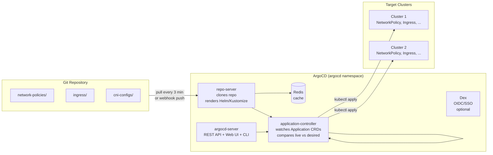
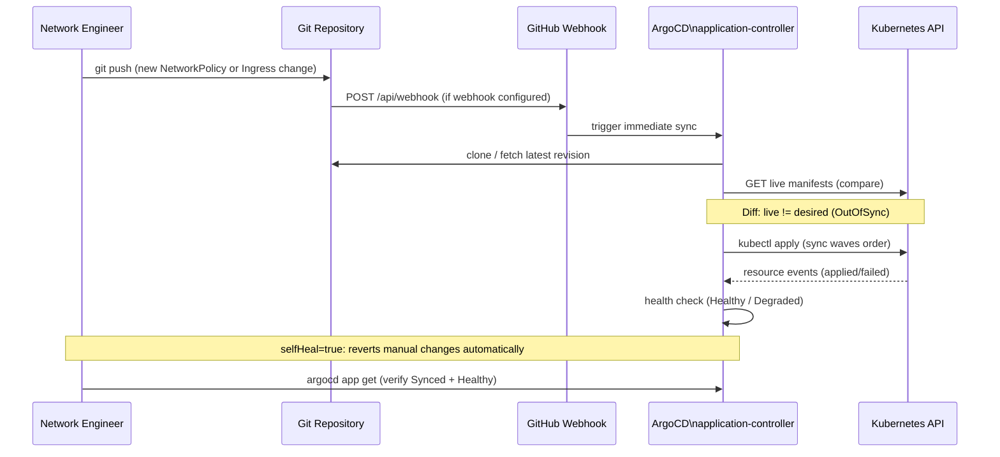

# Lesson 33 — ArgoCD and GitOps for Network Configuration

> **Track:** GitOps & Delivery  
> **Prerequisites:** [Lesson 22 — Multi-Cluster Networking](22-multi-cluster-networking.md), [Lesson 16 — Network Policies](16-network-policies.md)  
> **Duration:** ~2 hours

> **Goal:** Use ArgoCD to manage NetworkPolicies, CoreDNS configs, and Ingress rules as code — with sync waves for ordered delivery, ApplicationSets for multi-cluster rollout, and drift auto-remediation.

---

## Practice Setup

```bash
# Terminal 1 — check ArgoCD is running
kubectl get pods -n argocd
kubectl get applications -n argocd

# Terminal 2 — watch sync events
kubectl logs -n argocd -l app.kubernetes.io/name=argocd-application-controller -f
```

---

## 1. ArgoCD Architecture



```bash
# Install ArgoCD
kubectl create namespace argocd
kubectl apply -n argocd -f https://raw.githubusercontent.com/argoproj/argo-cd/stable/manifests/install.yaml

# Wait for all pods
kubectl wait --for=condition=available deployment -l app.kubernetes.io/name=argocd-server -n argocd --timeout=120s

# Get initial admin password
argocd admin initial-password -n argocd

# Port-forward the UI (or expose via Ingress/LoadBalancer)
kubectl port-forward svc/argocd-server -n argocd 8080:443
```

---

## 2. GitOps Sync Flow



---

## 3. Application and ApplicationSet CRDs

### Application — single cluster, single source

```yaml
apiVersion: argoproj.io/v1alpha1
kind: Application
metadata:
  name: network-policies
  namespace: argocd
spec:
  project: default
  source:
    repoURL: https://github.com/your-org/k8s-network-config
    targetRevision: main
    path: network-policies/production
  destination:
    server: https://kubernetes.default.svc
    namespace: default
  syncPolicy:
    automated:
      prune: true        # delete resources removed from Git
      selfHeal: true     # re-apply if someone edits by hand
    syncOptions:
      - CreateNamespace=true
```

```bash
# CLI equivalent
argocd app create network-policies \
  --repo https://github.com/your-org/k8s-network-config \
  --path network-policies/production \
  --dest-server https://kubernetes.default.svc \
  --dest-namespace default \
  --sync-policy automated \
  --auto-prune \
  --self-heal

# Check sync status
argocd app get network-policies
argocd app diff network-policies   # show what would change
argocd app sync network-policies   # force immediate sync
```

### Deploying CoreDNS config from Git

```yaml
# In Git: coredns/configmap.yaml
apiVersion: v1
kind: ConfigMap
metadata:
  name: coredns
  namespace: kube-system
data:
  Corefile: |
    .:53 {
        errors
        health
        kubernetes cluster.local in-addr.arpa ip6.arpa {
          pods insecure
          fallthrough in-addr.arpa ip6.arpa
        }
        hosts /etc/coredns/NodeHosts {
          ttl 60
          fallthrough
        }
        prometheus :9153
        forward . /etc/resolv.conf
        cache 30
        loop
        reload
        loadbalance
    }
    # Custom stub zone for internal services
    internal.corp:53 {
        forward . 10.100.0.53
    }
```

ArgoCD will detect drift the moment someone edits this ConfigMap manually.

---

## 4. Sync Waves for Network-Dependent Resources

Network resources must deploy in a specific order. A NetworkPolicy that blocks traffic must exist *before* the app starts, not after.

```
Sync Wave Order:

Wave -1: CRDs (Gateway API CRDs, Calico CRDs, cert-manager CRDs)
           │
Wave  0: CNI configuration (IPPool, BGPConfiguration, Cilium ConfigMap)
           │
Wave  1: NetworkPolicy (default-deny + allow rules)
           │
Wave  2: Application workloads (Deployments, StatefulSets)
           │
Wave  3: Ingress / Route / HTTPRoute (external access last)
           │
Wave  4: Monitoring (ServiceMonitor — after service exists)
```

```yaml
# Wave -1: CRDs first
apiVersion: apiextensions.k8s.io/v1
kind: CustomResourceDefinition
metadata:
  name: gateways.gateway.networking.k8s.io
  annotations:
    argocd.argoproj.io/sync-wave: "-1"

---
# Wave 0: CNI IP pool
apiVersion: projectcalico.org/v3
kind: IPPool
metadata:
  name: production-pool
  annotations:
    argocd.argoproj.io/sync-wave: "0"
spec:
  cidr: 10.244.0.0/16
  ipipMode: Never
  natOutgoing: true

---
# Wave 1: NetworkPolicy before the app
apiVersion: networking.k8s.io/v1
kind: NetworkPolicy
metadata:
  name: allow-frontend-to-backend
  namespace: production
  annotations:
    argocd.argoproj.io/sync-wave: "1"
spec:
  podSelector:
    matchLabels:
      app: backend
  ingress:
    - from:
        - podSelector:
            matchLabels:
              app: frontend

---
# Wave 2: Application
apiVersion: apps/v1
kind: Deployment
metadata:
  name: backend
  namespace: production
  annotations:
    argocd.argoproj.io/sync-wave: "2"

---
# Wave 3: Ingress (only after pods are ready)
apiVersion: networking.k8s.io/v1
kind: Ingress
metadata:
  name: backend-ingress
  annotations:
    argocd.argoproj.io/sync-wave: "3"
```

```bash
# Watch sync waves progress in real time
argocd app get network-stack --watch

# See which wave each resource is in
argocd app resources network-stack
```

---

## 5. Multi-Cluster Deployment with ApplicationSet

Deploy the same NetworkPolicy baseline to every cluster from a single Application definition.

```yaml
apiVersion: argoproj.io/v1alpha1
kind: ApplicationSet
metadata:
  name: network-baseline
  namespace: argocd
spec:
  generators:
    - clusters:
        selector:
          matchLabels:
            environment: production   # only prod clusters
  template:
    metadata:
      name: "network-baseline-{{name}}"   # name = cluster name
    spec:
      project: network-team
      source:
        repoURL: https://github.com/your-org/k8s-network-config
        targetRevision: main
        path: network-baseline/
        helm:
          values: |
            clusterName: "{{name}}"
            clusterCIDR: "{{metadata.annotations.podCIDR}}"
      destination:
        server: "{{server}}"   # cluster API server URL
        namespace: kube-system
      syncPolicy:
        automated:
          selfHeal: true
```

```bash
# Register clusters with ArgoCD
argocd cluster add production-eu-west-1 --name eu-west-1
argocd cluster add production-us-east-1 --name us-east-1
argocd cluster add production-ap-southeast-1 --name ap-southeast-1

# Label clusters to match the ApplicationSet generator
kubectl label secret -n argocd eu-west-1 environment=production
kubectl label secret -n argocd us-east-1 environment=production

# ApplicationSet creates one Application per cluster automatically
kubectl get applications -n argocd | grep network-baseline

# Check sync status across all clusters
argocd app list | grep network-baseline
```

---

## 6. Health Checks for Network Resources

ArgoCD has built-in health checks for core Kubernetes resources. Network resources vary:

| Resource | ArgoCD Health Behavior |
|----------|----------------------|
| `Service` (ClusterIP) | Healthy immediately |
| `Service` (LoadBalancer) | Healthy when `.status.loadBalancer.ingress` is populated |
| `Ingress` | Healthy when `.status.loadBalancer.ingress` is populated |
| `NetworkPolicy` | Always **Healthy** — ArgoCD cannot verify enforcement |
| `Gateway` (Gateway API) | Healthy when `.status.conditions[Ready]=True` |
| `HTTPRoute` | Healthy when parent Gateway accepts it |
| `Certificate` (cert-manager) | Healthy when `.status.conditions[Ready]=True` |

NetworkPolicy is a critical gap — ArgoCD marks it healthy the moment it's applied, but cannot know if the CNI is actually enforcing it.

### Custom Lua health check for NetworkPolicy

```lua
-- In argocd-cm ConfigMap, resource.customizations section:
-- resource.customizations.health.networking.k8s.io_NetworkPolicy: |
hs = {}
if obj.metadata.creationTimestamp == nil then
  hs.status = "Progressing"
  hs.message = "NetworkPolicy not yet created"
  return hs
end
-- Check for a custom annotation set by a policy verification job
if obj.metadata.annotations ~= nil then
  if obj.metadata.annotations["network-policy/verified"] == "true" then
    hs.status = "Healthy"
    hs.message = "Policy applied and verified"
    return hs
  end
end
hs.status = "Degraded"
hs.message = "Policy applied but not verified — run policy conformance test"
return hs
```

```yaml
# In argocd-cm ConfigMap
apiVersion: v1
kind: ConfigMap
metadata:
  name: argocd-cm
  namespace: argocd
data:
  resource.customizations.health.networking.k8s.io_NetworkPolicy: |
    hs = {}
    hs.status = "Healthy"
    hs.message = "Applied (enforcement depends on CNI)"
    return hs
```

---

## 7. Detecting Network Policy Drift

`selfHeal: true` means ArgoCD detects and reverses any out-of-band change within seconds.

```bash
# Scenario: network engineer manually tightens a firewall rule
kubectl patch networkpolicy allow-frontend-to-backend -n production \
  --type='json' -p='[{"op":"remove","path":"/spec/ingress/0/ports"}]'

# ArgoCD detects the diff within ~3 minutes (or immediately via webhook)
argocd app get network-policies
# STATUS: OutOfSync
# MESSAGE: NetworkPolicy production/allow-frontend-to-backend
#          spec.ingress[0].ports: missing (live) vs [{port:8080}] (desired)

# With selfHeal=true: ArgoCD automatically reverts it
# Without selfHeal: notify and wait for manual sync

# To allow intentional overrides, use ignoreDifferences:
spec:
  ignoreDifferences:
    - group: networking.k8s.io
      kind: NetworkPolicy
      jsonPointers:
        - /metadata/annotations/kubectl.kubernetes.io~1last-applied-configuration
```

```bash
# Webhook setup (GitHub): push-triggered sync instead of poll
argocd app set network-policies --sync-policy automated
# Configure webhook in GitHub repo settings:
# URL: https://argocd.your-domain.com/api/webhook
# Secret: $(kubectl get secret argocd-secret -n argocd -o jsonpath='{.data.webhook\.github\.secret}' | base64 -d)
```

---

## 8. Argo Rollouts: Progressive Delivery with Network Integration

Argo Rollouts enables canary and blue-green deployments with network-layer traffic splitting.

```yaml
apiVersion: argoproj.io/v1alpha1
kind: Rollout
metadata:
  name: backend
spec:
  strategy:
    canary:
      canaryService: backend-canary   # separate Service for canary pods
      stableService: backend-stable   # Service for stable pods
      trafficRouting:
        istio:
          virtualService:
            name: backend-vsvc
            routes:
              - primary
      steps:
        - setWeight: 10    # 10% traffic to canary
        - pause: {duration: 5m}
        - analysis:
            templates:
              - templateName: success-rate
        - setWeight: 50
        - pause: {duration: 5m}
        - setWeight: 100
```

The `VirtualService` is updated automatically by the Rollout controller:

```yaml
# ArgoCD syncs this; Rollouts controller modifies weights during deployment
apiVersion: networking.istio.io/v1beta1
kind: VirtualService
metadata:
  name: backend-vsvc
spec:
  http:
    - name: primary
      route:
        - destination:
            host: backend-stable
          weight: 90      # Rollout controller updates this
        - destination:
            host: backend-canary
          weight: 10
```

> **See also:** [Lesson 31 — AWS Load Balancer Controller](31-aws-load-balancer-controller.md) for weighted ALB target groups as an alternative to Istio for canary traffic splitting.

---

## 9. Practical: Zero-Trust Network Stack via GitOps

### Git repository structure

```
k8s-network-config/
├── network-baseline/
│   ├── default-deny.yaml         # wave 0: deny-all NetworkPolicy
│   ├── allow-dns.yaml            # wave 0: allow CoreDNS egress
│   ├── allow-monitoring.yaml     # wave 0: allow Prometheus scraping
│   └── kustomization.yaml
├── ingress/
│   ├── nginx-values.yaml         # wave 1: NGINX Ingress controller
│   ├── cert-manager.yaml         # wave 1: cert-manager
│   └── cluster-issuer.yaml       # wave 2: Let's Encrypt ClusterIssuer
├── applications/
│   └── frontend/
│       ├── networkpolicy.yaml    # wave 1
│       ├── deployment.yaml       # wave 2
│       ├── service.yaml          # wave 2
│       ├── ingress.yaml          # wave 3
│       └── certificate.yaml      # wave 3
└── applicationset.yaml
```

### Default-deny as wave 0 (foundation of zero-trust)

```yaml
# network-baseline/default-deny.yaml
apiVersion: networking.k8s.io/v1
kind: NetworkPolicy
metadata:
  name: default-deny-all
  namespace: production
  annotations:
    argocd.argoproj.io/sync-wave: "0"
    argocd.argoproj.io/sync-options: SkipDryRunOnMissingResource=true
spec:
  podSelector: {}
  policyTypes:
    - Ingress
    - Egress
---
# Always allow DNS (without this, pods can't resolve service names)
apiVersion: networking.k8s.io/v1
kind: NetworkPolicy
metadata:
  name: allow-dns-egress
  namespace: production
  annotations:
    argocd.argoproj.io/sync-wave: "0"
spec:
  podSelector: {}
  policyTypes:
    - Egress
  egress:
    - ports:
        - port: 53
          protocol: UDP
        - port: 53
          protocol: TCP
```

### ApplicationSet deploying the full stack

```yaml
apiVersion: argoproj.io/v1alpha1
kind: ApplicationSet
metadata:
  name: zero-trust-stack
  namespace: argocd
spec:
  generators:
    - list:
        elements:
          - cluster: production-eu
            url: https://eks-eu.example.com
          - cluster: production-us
            url: https://eks-us.example.com
  template:
    metadata:
      name: "zero-trust-{{cluster}}"
    spec:
      source:
        repoURL: https://github.com/your-org/k8s-network-config
        path: .
        targetRevision: main
      destination:
        server: "{{url}}"
        namespace: production
      syncPolicy:
        automated:
          prune: true
          selfHeal: true
        syncOptions:
          - RespectIgnoreDifferences=true
          - ServerSideApply=true
```

---

## 10. Application Configuration Reference

| Parameter | Default | Effect | When to change |
|-----------|---------|--------|----------------|
| `syncPolicy.automated.prune` | `false` | Delete resources removed from Git | Enable in production — prevents ghost resources |
| `syncPolicy.automated.selfHeal` | `false` | Revert manual out-of-band changes | Enable for security-sensitive resources (NetworkPolicy) |
| `syncPolicy.syncOptions.CreateNamespace` | `false` | Create namespace if missing | Enable for autonomous app deployment |
| `syncPolicy.syncOptions.ServerSideApply` | `false` | Use server-side apply (better conflict handling) | Enable when multiple controllers manage same resource |
| `argocd.argoproj.io/sync-wave` | `"0"` | Integer controlling sync order (-1 to N) | Use -1 for CRDs, 0 for CNI, 1 for NetworkPolicy, 2+ for apps |
| `timeout.reconciliation` (argocd-cm) | `180s` | How often ArgoCD polls Git | Reduce to `30s` or use webhooks for fast drift detection |
| `resource.exclusions` (argocd-cm) | (none) | Exclude resources from management | Use for high-churn resources like Jobs ArgoCD shouldn't sync |

### ApplicationSet Generators

| Generator | Use Case | Example |
|-----------|---------|---------|
| `clusters` | One app per registered ArgoCD cluster | Deploy NetworkPolicy baseline to all prod clusters |
| `git` (directory) | One app per directory in repo | One app per team folder |
| `git` (file) | One app per JSON/YAML config file | One app per cluster config file |
| `list` | Explicit list of values | Fixed set of clusters with custom parameters |
| `matrix` | Cartesian product of two generators | All clusters × all environments |

---

## 11. Hands-On Practice

```bash
# 1. Check ArgoCD application health and sync status
argocd app list
# EXPECTED: NAME=network-policies, STATUS=Synced, HEALTH=Healthy

# 2. See current diff between Git and live cluster
argocd app diff network-policies
# EXPECTED: no output (synced) or +/- lines showing drift

# 3. Simulate drift — manually edit a NetworkPolicy
kubectl patch networkpolicy allow-frontend-to-backend -n production \
  --type='json' -p='[{"op":"add","path":"/spec/ingress/0/ports/0","value":{"port":9999}}]'

# 4. Observe ArgoCD detects OutOfSync within 3 min (or faster with webhook)
argocd app get network-policies
# EXPECTED: STATUS=OutOfSync, details show the spurious port 9999

# 5. Force a dry-run sync to preview changes
argocd app sync network-policies --dry-run
# EXPECTED: shows kubectl apply operations that would run

# 6. Trigger real sync to revert the drift
argocd app sync network-policies
# EXPECTED: Synced, NetworkPolicy restored to Git state

# 7. Watch waves progress in an ApplicationSet sync
argocd app sync zero-trust-production-eu
argocd app get zero-trust-production-eu --watch
# EXPECTED: resources sync in wave order -1, 0, 1, 2, 3

# 8. Verify ArgoCD can manage NetworkPolicies (RBAC check)
kubectl auth can-i create networkpolicies \
  --as=system:serviceaccount:argocd:argocd-application-controller -n production
# EXPECTED: yes
```

> **See also:** [Lesson 16 — Network Policies](16-network-policies.md) for NetworkPolicy syntax and default-deny patterns used in wave 0.

---

## Troubleshooting

| Symptom | Likely Cause | Diagnostic Command | Fix |
|---------|-------------|-------------------|-----|
| Application stuck `OutOfSync` and won't sync | Resource finalizer preventing deletion | `argocd app get <name> --show-operation` | Remove finalizer: `kubectl patch <resource> -p '{"metadata":{"finalizers":[]}}' --type=merge` |
| Sync fails with `CRD not found` | CRD not in wave -1 | `argocd app sync <name> --dry-run` | Add `argocd.argoproj.io/sync-wave: "-1"` to CRD manifests |
| ArgoCD cannot reach cluster API after NetworkPolicy deploy | Default-deny blocked ArgoCD egress | `kubectl logs -n argocd deploy/argocd-application-controller \| grep error` | Add wave -1 NetworkPolicy allowing argocd namespace egress to API server |
| `selfHeal` not reverting manual change | RBAC: ArgoCD service account lacks permission | `kubectl auth can-i update networkpolicies --as=system:serviceaccount:argocd:argocd-application-controller -n <ns>` | Add ClusterRole with network resource permissions to ArgoCD SA |
| ApplicationSet not creating apps for new cluster | Cluster secret missing label | `kubectl get secrets -n argocd -l argocd.argoproj.io/secret-type=cluster` | Label cluster secret: `kubectl label secret <name> -n argocd environment=production` |
| Webhook not triggering sync | ArgoCD server unreachable from GitHub | `kubectl get svc argocd-server -n argocd` | Expose via Ingress or LoadBalancer; verify webhook secret matches |
| `Unknown` health for custom CRDs (BGPPeer, IPPool) | No built-in health check for CNI CRDs | `argocd app get <name> \| grep Unknown` | Add custom Lua health check in `argocd-cm` or mark resource as ignored |

---

## Production Checklist

- [ ] ArgoCD namespace has wave -1 NetworkPolicy allowing egress to all cluster API servers
- [ ] `selfHeal: true` enabled on all NetworkPolicy and security-critical Applications
- [ ] `prune: true` enabled — ghost resources from deleted Git entries are removed
- [ ] AppProject RBAC configured — teams can only sync to their own namespace
- [ ] Webhook configured for sub-minute drift detection (not relying on 3-minute poll)
- [ ] `timeout.reconciliation` tuned or webhooks used for security-sensitive applications
- [ ] All cluster secrets in ArgoCD are labeled correctly for ApplicationSet generators

---

## Common Anti-Patterns

| What people do | Why it breaks | Correct approach |
|----------------|--------------|-----------------|
| Deploy default-deny without wave -1 ArgoCD allow policy | ArgoCD loses access to its own cluster mid-sync | Always put ArgoCD self-allow NetworkPolicy at wave -1 |
| `selfHeal: false` on NetworkPolicies | Manual edits (even accidental `kubectl apply`) persist undetected | Enable `selfHeal: true` for all security-enforcing resources |
| No sync waves — all resources at wave 0 | Ingress created before Deployment, NetworkPolicy after app traffic starts | Annotate with sync-wave: CRDs first, policies before apps, Ingress last |
| One Application per namespace with no AppProject | No team isolation — any ArgoCD user can deploy to any cluster | Create AppProject per team with `destinations` and `sourceRepos` restricted |
| Managing `coredns` ConfigMap manually alongside ArgoCD | ArgoCD reverts manual DNS changes immediately with selfHeal | Commit all CoreDNS changes to Git; use `kubectl edit` only in ArgoCD-managed PRs |

---

## Quick Reference

| Use Case | Command |
|----------|---------|
| List all applications | `argocd app list` |
| Get app status | `argocd app get <name>` |
| Show git-vs-live diff | `argocd app diff <name>` |
| Force immediate sync | `argocd app sync <name>` |
| Dry-run sync | `argocd app sync <name> --dry-run` |
| Watch sync progress | `argocd app get <name> --watch` |
| List app resources and waves | `argocd app resources <name>` |
| Check sync history | `argocd app history <name>` |
| Rollback to previous version | `argocd app rollback <name> <revision-id>` |
| Register a cluster | `argocd cluster add <context-name> --name <label>` |
| List registered clusters | `argocd cluster list` |
| Check RBAC permissions | `kubectl auth can-i create networkpolicies --as=system:serviceaccount:argocd:argocd-application-controller -n <ns>` |

---

## Summary

| Concept | ArgoCD Implementation |
|---------|----------------------|
| Git = source of truth | Application CRD points to repo path |
| Drift detection | application-controller compares live vs desired every 3 min |
| Auto-remediation | `selfHeal: true` reverts out-of-band changes |
| Deployment ordering | `argocd.argoproj.io/sync-wave` annotation |
| Multi-cluster rollout | ApplicationSet with cluster generator |
| NetworkPolicy health | Always "Healthy" — add custom Lua check |
| Progressive delivery | Argo Rollouts + VirtualService/HTTPRoute weights |
| Zero-trust bootstrap | Wave 0: default-deny → Wave 1: explicit allows → Wave 2: apps |
| ArgoCD self-protection | NetworkPolicy wave -1 allowing argocd namespace egress |

---

## Online Resources

| Resource | Cost | What you practice |
|----------|------|-------------------|
| [ArgoCD — Getting Started](https://argo-cd.readthedocs.io/en/stable/getting_started/) | Free | Official tutorial: install ArgoCD on minikube, create your first Application, watch GitOps sync — runs the full lesson flow |
| [Killercoda: ArgoCD Scenarios](https://killercoda.com/) | Free | Browser-based ArgoCD labs with pre-installed clusters — search "ArgoCD" in the Killercoda explore page |
| [ArgoCD Example Apps](https://github.com/argoproj/argocd-example-apps) | Free (GitHub) | Official sample applications including network-policy-heavy configurations; use as your Git repo target |
| [Codefresh: GitOps Fundamentals](https://codefresh.io/learn/argo-cd/) | Free course | Free ArgoCD fundamentals course from Codefresh (Argo maintainers) with hands-on exercises |

---

**Next:** [Lesson 34 — AI Platform Networking](34-ai-platform-networking.md)
