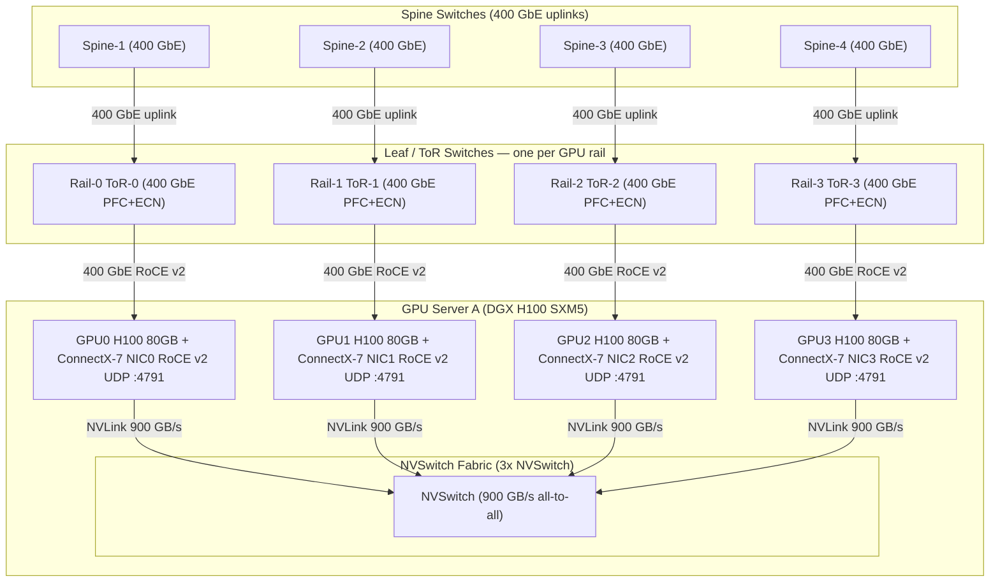
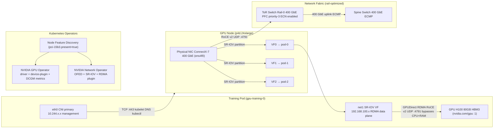
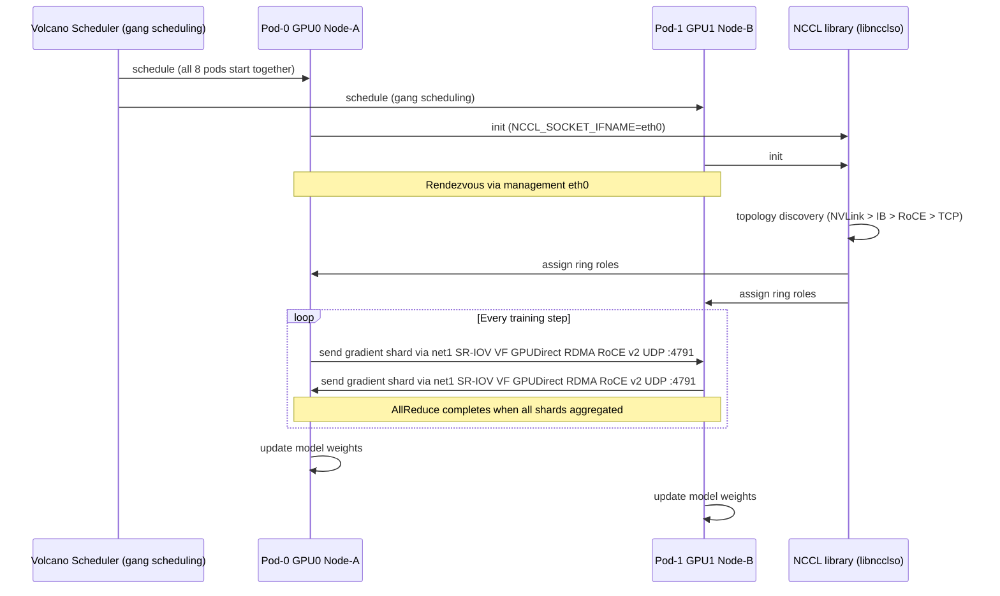
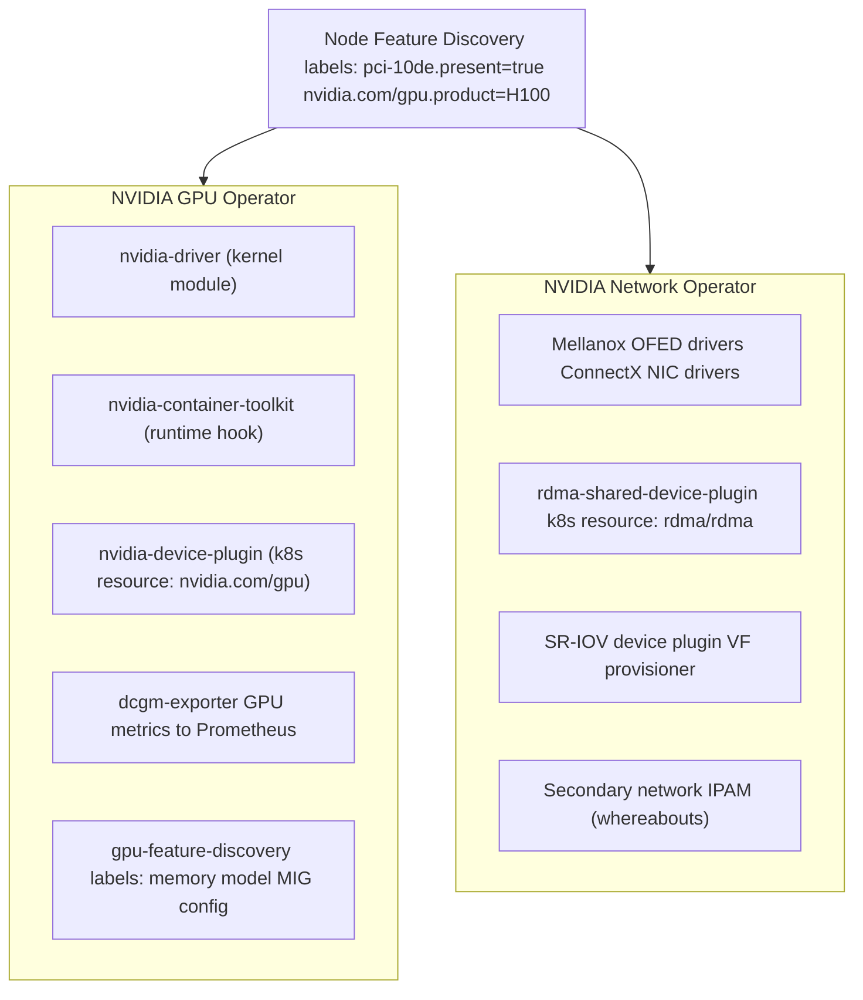

# Lesson 34 — AI Platform Networking on Kubernetes

> **Track:** AI Platform Operations  
> **Prerequisites:** [Lesson 09 — CNI Specification](09-cni-specification.md), [Lesson 07 — Bare Metal Network Infrastructure](07-bare-metal-network-infrastructure.md), [Lesson 10 — eBPF and XDP](10-ebpf-xdp.md)  
> **Duration:** ~3 hours

> **Goal:** Design and operate the network stack for GPU-intensive AI training clusters — including SR-IOV, RDMA via Multus, rail-optimized topology, NCCL tuning, and lossless RoCE configuration with PFC and ECN.


**Jump to:** [Theory](#theory) · [Practice](#practice) · [Troubleshooting](#troubleshooting) · [Production Checklist](#production-checklist) · [Quick Reference](#quick-reference) · [Check Your Understanding](#check-your-understanding)

---

## Theory

## 1. Why Standard Kubernetes Networking Fails for AI

A training job for a large model uses **NCCL** (NVIDIA Collective Communications Library) to perform all-reduce across all GPUs. All-reduce is a collective: every GPU must send and receive simultaneously.

```
AllReduce collective (ring algorithm):

GPU0 → GPU1 → GPU2 → GPU3 → GPU4 → GPU5 → GPU6 → GPU7 → (back to GPU0)

Each GPU sends ~(model_size / N) bytes per step.
GPT-3 (175B params, fp16): 350 GB / 8 GPUs = 43 GB per step per GPU
At 100 Gbps NIC:   43 GB / 12.5 GB/s = 3.4 seconds per step    ← too slow
At 400 Gbps NIC:   43 GB / 50 GB/s   = 0.86 seconds per step
Via NVLink (H100): 43 GB / 450 GB/s  = 0.1 seconds per step    ← need NVLink scale-out

Multi-node all-reduce bottleneck: the network between servers is the bottleneck.
H100 NVLink bandwidth within a node: 900 GB/s bidirectional
H100 required inter-node bandwidth: 400 Gbps × 8 NICs = 3.2 Tbps per server
```

Standard pod networking adds kernel overhead (copy to/from sk_buff, through iptables) that adds microseconds of latency and reduces throughput. RDMA eliminates this.

---

## 2. Network Topologies for AI Clusters

### Rail-Optimized Topology

The standard design for GPU clusters. Each GPU in a server has its own NIC connected to a dedicated ToR switch ("rail"). Within a server, GPUs communicate via NVLink; between servers, all-reduce traffic flows over the rails.



Each NIC connects to a **different** ToR switch (rail). AllReduce between servers: each GPU uses its own NIC, so no congestion on a single switch. Bisection bandwidth = 8 × 400 Gbps = 3.2 Tbps per server (non-blocking).

### Fat-Tree (Classic HPC)

Three-tier Clos topology. Standard for InfiniBand clusters. Provides non-blocking bandwidth for any traffic pattern when all switches are equal capacity.

```
k=4 Fat-Tree: 16 servers, 32 Gbps links

Core switches (k/2)² = 4:   [C1] [C2] [C3] [C4]
Aggregation (k pods × k/2): [A1][A2]  [A3][A4]  [A5][A6]  [A7][A8]
Edge switches (k pods × k/2): [E1..E8]
Servers:                       16 servers, 2 per edge switch
```

---

## 3. InfiniBand vs RoCE vs TCP

| Property | InfiniBand | RoCE v2 | TCP/IP |
|----------|-----------|---------|--------|
| Latency | ~1 μs | ~2–5 μs | ~50–100 μs |
| Bandwidth (single link) | 200 Gbps (HDR) / 400 Gbps (NDR) | 400 Gbps (400GbE) | 400 Gbps |
| CPU overhead | Near zero (RDMA bypasses CPU) | Near zero (RDMA) | ~20% CPU per 100 Gbps |
| Requires PFC/ECN | No (IB has own flow control) | Yes — without it, drops destroy RDMA perf | No |
| Cost | High (dedicated IB switch fabric) | Medium (standard Ethernet ASICs) | Low |
| Kubernetes support | Via Multus + SR-IOV + RDMA plugin | Via Multus + SR-IOV + RoCE config | Standard pod networking |
| Cloud availability | Azure NDv5, rare | AWS EFA (custom), Azure NDv5 | Universal |

**RDMA (Remote Direct Memory Access)** — the key technology behind both IB and RoCE:
```
Traditional TCP send:
  App buffer → kernel copy → socket buffer → NIC → wire → NIC → socket buffer → kernel copy → App buffer
  CPU involved at every step, 2 memory copies

RDMA:
  App buffer ──────────────────────────────────────────────────────► App buffer (remote)
  NIC reads/writes directly from app memory via DMA
  Zero CPU cycles on data path, zero copies
  Requires pinned (non-swappable) memory pages (hugepages)
```

---

## 4. AI Networking Stack Architecture



---

## 5. NCCL AllReduce Training Flow



---

## 6. SR-IOV: Giving Pods Direct NIC Access

SR-IOV (Single Root I/O Virtualization) partitions one physical NIC into multiple Virtual Functions (VFs). Each pod gets a VF — a hardware NIC slice — bypassing the kernel entirely.

```
Physical NIC (ConnectX-7, 400 GbE):
  PF (Physical Function) — managed by host
  ├── VF0 ──► Pod A (training job, GPU0)   direct hardware access
  ├── VF1 ──► Pod B (training job, GPU1)   no kernel, no iptables
  ├── VF2 ──► Pod C (training job, GPU2)
  └── VF3 ──► reserved

Performance: ~95% of bare metal NIC performance from inside a pod
Latency:     microsecond-level (vs millisecond for TCP through kernel)
```

```bash
# Install SR-IOV Network Operator
kubectl apply -f https://github.com/k8snetworkplumbingwg/sriov-network-operator/releases/download/v1.3.0/deploy.yaml

# Check physical functions and VF capacity
kubectl get sriovnetworknodestates -n sriov-network-operator -o yaml

# Example SriovNetworkNodePolicy — create 8 VFs on each node's mlx5_0 NIC
cat <<EOF | kubectl apply -f -
apiVersion: sriovnetwork.openshift.io/v1
kind: SriovNetworkNodePolicy
metadata:
  name: rdma-mlx5-policy
  namespace: sriov-network-operator
spec:
  resourceName: mlx5_rdma           # kubectl resource name
  nodeSelector:
    feature.node.kubernetes.io/pci-15b3.present: "true"   # Mellanox NIC present
  numVfs: 8
  nicSelector:
    pfNames: ["ens4f0"]             # physical function name
  deviceType: netdevice             # or vfio-pci for DPDK
  isRdma: true                      # enable RDMA on VFs
EOF

# Create SriovNetwork (NetworkAttachmentDefinition) for pods to use
cat <<EOF | kubectl apply -f -
apiVersion: sriovnetwork.openshift.io/v1
kind: SriovNetwork
metadata:
  name: rdma-net
  namespace: sriov-network-operator
spec:
  resourceName: mlx5_rdma
  networkNamespace: default
  ipam: |
    {
      "type": "whereabouts",
      "range": "192.168.100.0/24"
    }
EOF
```

---

## 7. Multus: Dual NIC Pods (Management + RDMA)

AI training pods need two networks:
- **eth0** (standard CNI): kubelet health probes, DNS, kubectl exec
- **net1** (SR-IOV RDMA): high-speed inter-GPU traffic, invisible to kube-proxy

```
                        ┌──────────────────────────────────────────┐
                        │  Training Pod (GPU0)                      │
                        │                                          │
                        │  eth0: 10.244.0.5/24   (Calico/Cilium)  │◄─── management
                        │  net1: 192.168.100.5/24 (SR-IOV RDMA)   │◄─── NCCL all-reduce
                        │                                          │
                        │  nvidia.com/gpu: 1                       │
                        │  rdma/rdma: 1                            │
                        └──────────────────────────────────────────┘
```

```yaml
# Pod using Multus to attach SR-IOV RDMA interface
apiVersion: v1
kind: Pod
metadata:
  name: gpu-training-0
  annotations:
    k8s.v1.cni.cncf.io/networks: rdma-net   # second NIC from SriovNetwork above
spec:
  containers:
  - name: trainer
    image: nvcr.io/nvidia/pytorch:24.08-py3
    resources:
      limits:
        nvidia.com/gpu: 1          # one GPU
        rdma/rdma: 1               # one RDMA VF
        hugepages-2Mi: 2Gi         # required for RDMA memory registration
        memory: 32Gi
        cpu: "16"
    volumeMounts:
    - name: hugepages
      mountPath: /dev/hugepages
  volumes:
  - name: hugepages
    emptyDir:
      medium: HugePages
  runtimeClassName: nvidia          # use NVIDIA container runtime
  nodeSelector:
    nvidia.com/gpu.product: NVIDIA-H100-80GB-HBM3
```

```bash
# Verify dual NIC inside the pod
kubectl exec -it gpu-training-0 -- ip addr show
# 2: eth0: ...  inet 10.244.0.5/24     ← standard pod network
# 3: net1: ...  inet 192.168.100.5/24  ← RDMA NIC

# Verify RDMA device is accessible
kubectl exec -it gpu-training-0 -- ls /dev/infiniband/
# uverbs0  rdma_cm

# Test RDMA bandwidth (run ibv_rc_pingpong between two pods)
kubectl exec -it gpu-training-0 -- ibv_rc_pingpong -d mlx5_0 -g 0
```

---

## 8. NVIDIA Operators Stack



```bash
# Install GPU Operator (includes NFD)
helm install gpu-operator nvidia/gpu-operator \
  --namespace gpu-operator \
  --create-namespace \
  --set driver.enabled=true \
  --set mig.strategy=single         # or mixed for per-GPU MIG config

# Install Network Operator
helm install network-operator mellanox/network-operator \
  --namespace network-operator \
  --create-namespace \
  --set deployCR=true               # deploys NicClusterPolicy

# Check GPU allocation across nodes
kubectl get node -o json | jq -r '.items[] | .metadata.name + " GPUs: " + .status.allocatable["nvidia.com/gpu"]'

# Check RDMA resources
kubectl get node -o json | jq -r '.items[] | .metadata.name + " RDMA: " + .status.allocatable["rdma/rdma"]'
```

---

## 9. MIG — Multi-Instance GPU Partitioning

NVIDIA H100/A100 support MIG (Multi-Instance GPU): hardware partitioning of one GPU into up to 7 isolated slices. Network engineers need to understand MIG for resource planning.

```
H100 80GB MIG configurations:

Full GPU:         1×  80GB memory, 100% compute, 1 instance
1g.10gb:          7×  10GB memory, 1/7 compute  (7 instances)
2g.20gb:          3×  20GB memory, 2/7 compute  + leftover
3g.40gb:          2×  40GB memory, 3/7 compute
4g.40gb + 3g.40gb: mixed (1×4g + 1×3g)
7g.80gb:          1×  80GB (full MIG profile = same as no MIG)
```

```bash
# Enable MIG on a node
kubectl label node gpu-node-1 nvidia.com/mig.config=all-1g.10gb

# After operator applies config, see 7 MIG instances:
kubectl get node gpu-node-1 -o json | jq '.status.allocatable | with_entries(select(.key | startswith("nvidia")))'
# "nvidia.com/mig-1g.10gb": "7"

# Pod requesting a MIG slice:
resources:
  limits:
    nvidia.com/mig-1g.10gb: 1   # gets 10GB GPU slice, isolated from others
```

---

## 10. NCCL and All-Reduce Tuning

NCCL is the communication library that PyTorch and TensorFlow use for distributed training. It auto-selects the best transport: NVLink > InfiniBand > RoCE > TCP.

```bash
# NCCL environment variables (set in Pod env or ConfigMap):
env:
- name: NCCL_DEBUG
  value: "INFO"                    # verbose NCCL logging
- name: NCCL_IB_DISABLE
  value: "0"                       # 0 = use InfiniBand/RoCE, 1 = force TCP
- name: NCCL_NET_GDR_LEVEL
  value: "5"                       # GPUDirect RDMA: GPU→NIC without CPU
- name: NCCL_SOCKET_IFNAME
  value: "eth0"                    # management interface (not RDMA) for discovery
- name: NCCL_IB_HCA
  value: "mlx5_0,mlx5_1"          # which RDMA NICs to use
- name: NCCL_TOPO_FILE
  value: "/etc/nccl/topology.xml"  # cluster topology hint for NCCL

# GPUDirect RDMA: data path GPU memory → NIC → wire, bypassing CPU and system RAM
# Requires: nvidia-peermem kernel module + RDMA-capable NIC + CUDA >= 10.1
```

---

## 11. AWS EFA — Elastic Fabric Adapter

AWS's custom RDMA-capable interconnect for P4d/P5 instances running LLM training. See [Lesson 29 — AWS EKS Networking](29-aws-eks-networking.md) for the full VPC and EKS networking context in which EFA operates.

```
AWS EFA Architecture:

  P4d.24xlarge (8× A100 GPU, 4× EFA)
  ┌────────────────────────────────────────────────────────────────┐
  │  GPU0  GPU1  GPU2  GPU3  GPU4  GPU5  GPU6  GPU7                │
  │   ↕ NVLink (600 GB/s peer-to-peer within instance)            │
  │  EFA0  EFA1  EFA2  EFA3   (100 Gbps each = 400 Gbps total)    │
  └──────────────────────────────────────────────────────────────-─┘
         ↓ Placement Group (Cluster)
  P4d instance 2  P4d instance 3  ... (all in same AZ, low-latency fabric)

EFA is not Ethernet/IP at the app level — uses libfabric + aws-ofi-nccl plugin
```

```yaml
# EKS Pod with EFA (AWS-specific resource)
resources:
  limits:
    hugepages-2Mi: 5120Mi
    vpc.amazonaws.com/efa: 4       # request 4 EFA interfaces
    nvidia.com/gpu: 8
    memory: 320Gi
    cpu: "96"
  requests:
    hugepages-2Mi: 5120Mi
    vpc.amazonaws.com/efa: 4

# Node selector for P4d instances
nodeSelector:
  node.kubernetes.io/instance-type: p4d.24xlarge
```

```bash
# Install EFA device plugin on EKS
kubectl apply -f https://raw.githubusercontent.com/aws/amazon-eks-node-problem-detector/main/config/efa-device-plugin.yaml

# Verify EFA allocatable
kubectl get node -l node.kubernetes.io/instance-type=p4d.24xlarge \
  -o jsonpath='{.items[0].status.allocatable.vpc\.amazonaws\.com/efa}'
# 4
```

---

## 12. Distributed Training Job Patterns

### PyTorchJob (Kubeflow)

```yaml
apiVersion: "kubeflow.org/v1"
kind: PyTorchJob
metadata:
  name: llm-finetune
spec:
  pytorchReplicaSpecs:
    Master:
      replicas: 1
      template:
        spec:
          containers:
          - name: pytorch
            image: nvcr.io/nvidia/pytorch:24.08-py3
            resources:
              limits:
                nvidia.com/gpu: 8
                rdma/rdma: 8
            env:
            - name: NCCL_IB_DISABLE
              value: "0"
    Worker:
      replicas: 7                  # 8 total nodes × 8 GPUs = 64 GPUs
      template:
        spec:
          containers:
          - name: pytorch
            image: nvcr.io/nvidia/pytorch:24.08-py3
            resources:
              limits:
                nvidia.com/gpu: 8
                rdma/rdma: 8
  # Volcano gang scheduling: all 8 replicas start together or not at all
  schedulingPolicy:
    minAvailable: 8
```

### Ray Cluster

```yaml
apiVersion: ray.io/v1
kind: RayCluster
metadata:
  name: llm-cluster
spec:
  headGroupSpec:
    serviceType: ClusterIP
    rayStartParams:
      num-cpus: "0"              # head node: no compute, only scheduling
  workerGroupSpecs:
  - groupName: gpu-workers
    replicas: 16
    rayStartParams:
      num-gpus: "8"
      resources: '{"RDMA": 8}'
    template:
      spec:
        containers:
        - name: ray-worker
          image: rayproject/ray-ml:2.9.0-gpu
          resources:
            limits:
              nvidia.com/gpu: 8
              rdma/rdma: 8
```

---

## 13. Network Policy Considerations for AI Clusters

AI training pods have different network requirements than web services:

```yaml
# Allow all-to-all within the training job (NCCL needs direct pod-to-pod)
apiVersion: networking.k8s.io/v1
kind: NetworkPolicy
metadata:
  name: allow-training-job
spec:
  podSelector:
    matchLabels:
      training-job: llm-finetune
  policyTypes:
  - Ingress
  - Egress
  ingress:
  - from:
    - podSelector:
        matchLabels:
          training-job: llm-finetune   # allow within job
  egress:
  - to:
    - podSelector:
        matchLabels:
          training-job: llm-finetune
  - to:                               # allow DNS
    - namespaceSelector:
        matchLabels:
          kubernetes.io/metadata.name: kube-system
    ports:
    - port: 53
      protocol: UDP
```

**Important**: RDMA traffic on the secondary network (net1) is NOT subject to Kubernetes NetworkPolicy — NetworkPolicy only applies to the primary pod interface (eth0). To restrict RDMA-plane traffic, use SR-IOV VF admission control or InfiniBand subnet manager partitions (PKeys).

---

## 14. Observability for AI Networks

```bash
# DCGM metrics (GPU Operator deploys dcgm-exporter automatically)
# Key network-relevant metrics:
#   DCGM_FI_DEV_NVLINK_BANDWIDTH_TOTAL  — NVLink utilization
#   DCGM_FI_DEV_PCIE_TX_BYTES           — PCIe bandwidth (CPU↔GPU)

# View GPU metrics
kubectl port-forward -n gpu-operator svc/dcgm-exporter 9400:9400 &
curl -s localhost:9400/metrics | grep NVLINK

# Network congestion on IB fabric:
kubectl exec -n network-operator ds/mofed-ubuntu22.04 -- \
  perfquery -x 0 1  # port counters: check PortRcvErrors, PortXmitDiscards

# NCCL bandwidth test between two pods
kubectl exec -it gpu-training-0 -- \
  /opt/nccl-tests/build/all_reduce_perf -b 1G -e 16G -f 2 -g 1
# Out-of-band reference: H100×8 DGX on IB NDR should see ~350 GB/s all-reduce
```

---

## 15. Topology-Aware Scheduling

The scheduler must place training pods to minimize network hops. Use topology hints and affinity rules.

```yaml
# Volcano TopologyPolicy — place pods on same rack if possible
apiVersion: scheduling.volcano.sh/v1beta1
kind: Queue
metadata:
  name: ai-training
spec:
  weight: 10
  capability:
    nvidia.com/gpu: "64"
---
# Gang scheduling: all pods start simultaneously (critical for NCCL init)
# In PyTorchJob: schedulingPolicy.minAvailable = total replicas

# Node labels for topology:
#   topology.kubernetes.io/zone: us-east-1a
#   topology.kubernetes.io/hostname: gpu-node-07
#   network.topology/rack: rack-03
#   network.topology/rail-switch: tor-07

# Pod affinity: prefer same rack (1 hop) over cross-rack (2 hops)
affinity:
  podAffinity:
    preferredDuringSchedulingIgnoredDuringExecution:
    - weight: 100
      podAffinityTerm:
        topologyKey: network.topology/rack
        labelSelector:
          matchLabels:
            training-job: llm-finetune
```

---

## 16. PFC and ECN for RoCE Stability

RoCE requires lossless Ethernet. Without Priority Flow Control (PFC), a single dropped packet can stall RDMA for hundreds of milliseconds.

```
RoCE Traffic Flow:

Sender NIC → ToR switch buffer fills → 
  WITHOUT PFC: drop packet → RDMA retry (200ms+) → training stall
  WITH PFC:    switch sends PAUSE frame → sender pauses → no drop

Switch configuration (vendor-specific, e.g. Arista EOS):
  interface Ethernet1
    priority-flow-control mode on
    priority-flow-control priority 3 no-drop    # CoS 3 = RDMA/RoCE traffic

ECN (Explicit Congestion Notification) + DCQCN:
  Congested switch marks packets with ECN CE bit (instead of dropping)
  Receiver's NIC sends CNP (Congestion Notification Packet) to sender
  Sender's NIC rate-reduces → backpressure without drops

Both PFC and ECN must be configured end-to-end: ToR + spine + server NIC
```

```bash
# On ConnectX NIC (Mellanox): set trust DSCP for RoCE traffic class
mlnx_qos -i ens4f0 --trust dscp
# Set PFC on priority 3
mlnx_qos -i ens4f0 -f 0,0,0,1,0,0,0,0   # enable PFC on priority 3 only

# Verify ECN config
ethtool -A ens4f0   # check pause frames
cat /sys/class/net/ens4f0/ecn_enable   # 1 = ECN enabled
```

### Industry Applications

| Company / Project | Context | Technology from this lesson | Outcome |
|---|---|---|---|
| AWS (p4d.24xlarge) | GPT-scale LLM training for Amazon Bedrock | 400 Gbps EFA (Elastic Fabric Adapter) with 8x A100 GPUs | 400 Gbps per node inter-node bandwidth enables training 175B-param models in days |
| Meta AI Research SuperCluster (RSC) | 16000-GPU cluster for LLaMA training | RoCE v2 on 400G Ethernet with PFC+ECN, NVSwitch within server | Sub-2 μs latency AllReduce across racks; 36 Tbps bisection bandwidth |
| Google TPU Pod | JAX/XLA distributed training (Gemini) | ICI (Inter-Chip Interconnect) fabric at 4800 Gbps per chip | Custom silicon interconnect eliminates Ethernet bottleneck entirely for ultra-scale jobs |
| Stability AI | Stable Diffusion and SDXL training | H100 DGX clusters with rail-optimized topology and Volcano gang scheduling | Eliminated training stalls from partial pod starts; 40% utilization improvement |
| Big Tech (LLM training) | Multi-node GPU training job for a large language model | NCCL all-reduce routing misconfigured to use eth0 instead of the dedicated RDMA interface | Effective bandwidth dropped from 400 Gbps to 25 Gbps, increasing a 2-hour training run to 32 hours; fix was setting `NCCL_IB_HCA` and `NCCL_SOCKET_IFNAME` explicitly to target the RDMA interface |

---

## Practice

### Environment Setup

```bash
# Terminal 1 — check GPU and RDMA resources on minikube node
minikube ssh
ls /dev/infiniband/ 2>/dev/null || echo "No IB devices (expected in minikube)"
lspci | grep -i "mellanox\|infiniband\|ConnectX" 2>/dev/null || echo "No RDMA NICs"

# Terminal 2 — Mac (kubectl)
kubectl get nodes -o json | jq '.items[].status.allocatable | with_entries(select(.key | test("nvidia|rdma|hugepages")))'
kubectl get pods -n nvidia-operator 2>/dev/null || echo "NVIDIA Operator not installed"
```

> **Note:** Most labs in this lesson require real GPU/RDMA hardware. Use the commands to understand the patterns; the architecture diagrams are the core learning objective here.

### Hands-On Lab

```bash
# 1. Check allocatable GPU and RDMA resources per node
kubectl get nodes -o json | jq -r '
  .items[] |
  .metadata.name as $name |
  .status.allocatable |
  "\($name): GPU=\(.["nvidia.com/gpu"] // "0") RDMA=\(.["rdma/rdma"] // "0") hugepages=\(.["hugepages-2Mi"] // "0")"'

# 2. Verify SR-IOV VFs are created on the node
kubectl get sriovnetworknodestates -n sriov-network-operator -o json | \
  jq '.items[].status.interfaces[] | {name:.name, numVfs:.numVfs, totalvfs:.totalvfs}'

# 3. Confirm Multus is active (secondary networks available)
kubectl get network-attachment-definitions -A
# EXPECTED: rdma-net in the namespace where training pods run

# 4. Launch a test pod with dual NIC and verify interfaces
kubectl apply -f - <<EOF
apiVersion: v1
kind: Pod
metadata:
  name: rdma-test
  annotations:
    k8s.v1.cni.cncf.io/networks: rdma-net
spec:
  containers:
  - name: test
    image: nicolaka/netshoot
    command: ["sleep","infinity"]
    resources:
      limits:
        rdma/rdma: 1
        hugepages-2Mi: 2Gi
        memory: 4Gi
EOF

kubectl exec rdma-test -- ip addr show
# EXPECTED: eth0 (CNI address) + net1 (SR-IOV RDMA address)

kubectl exec rdma-test -- ls /dev/infiniband/
# EXPECTED: uverbs0 (if RDMA NIC present on node)

# 5. Run NCCL bandwidth test (requires GPU nodes)
kubectl exec -it gpu-training-0 -- \
  /opt/nccl-tests/build/all_reduce_perf -b 128M -e 4G -f 2 -g 1
# EXPECTED: >200 GB/s on H100 with IB NDR fabric

# 6. Check DCGM NVLink metrics (GPU Operator required)
kubectl port-forward -n gpu-operator svc/dcgm-exporter 9400:9400 &
curl -s localhost:9400/metrics | grep -E "NVLINK|PCIE" | head -20

# 7. Verify PFC is active on the RDMA NIC
kubectl debug node/<gpu-node> -it --image=nicolaka/netshoot -- \
  ethtool -a ens4f0
# EXPECTED: PFC enabled on priority 3
```

> **See also:** [Lesson 07 — Bare Metal Network Infrastructure](07-bare-metal-network-infrastructure.md) for ToR switch configuration and ECMP fabric design that underpins rail-optimized GPU clusters.

### Configuration Reference

#### SR-IOV and RDMA Parameters

| Parameter | Default | Effect | When to change |
|-----------|---------|--------|----------------|
| `numVfs` in SriovNetworkNodePolicy | 0 | Number of VFs to create on the PF | Set to 1 per GPU (8 for 8-GPU servers) |
| `deviceType` | `netdevice` | `vfio-pci` for DPDK/userspace; `netdevice` for kernel + RDMA | Use `netdevice` for RDMA; `vfio-pci` for DPDK only |
| `isRdma` | `false` | Expose RDMA resource alongside VF | Always true for AI training workloads |
| `hugepages-2Mi` limit | (none) | Pre-allocates huge pages for RDMA pinned memory | Required for RDMA; set to 2–8 Gi per pod |
| `NCCL_IB_DISABLE` env | (auto) | `0` forces IB/RoCE; `1` forces TCP | Force `0` to prevent NCCL falling back to slow TCP |
| `NCCL_NET_GDR_LEVEL` | `0` | `5` enables GPUDirect RDMA (GPU mem directly to NIC) | Set `5` on nodes with nvidia-peermem loaded |
| `NCCL_SOCKET_IFNAME` | (auto) | Interface for NCCL rendezvous (use management eth0, not RDMA) | Always set explicitly on dual-NIC pods |

#### PFC/ECN Switch Configuration

| Parameter | Recommended Value | Effect | Risk if wrong |
|-----------|------------------|--------|--------------|
| PFC priority | 3 (CoS 3 = RDMA) | Marks RDMA traffic class as no-drop | Wrong priority = PFC not protecting RDMA flows |
| ECN threshold | 150–200 KB | Buffer fill level that triggers ECN marking | Too low = excessive CNPs; too high = too many drops |
| DCQCN alpha | 0.0625 | Rate reduction factor per congestion event | Too high = oscillation; too low = slow convergence |
| MTU (jumbo frames) | 9000 bytes | Reduces header overhead for large RDMA messages | Must match end-to-end: NIC, switch, and remote NIC |

---

## Troubleshooting

| Symptom | Likely Cause | Diagnostic Command | Fix |
|---------|-------------|-------------------|-----|
| NCCL falls back to TCP, training very slow | RDMA NIC not visible inside pod or `NCCL_IB_DISABLE=1` | `kubectl exec <pod> -- env \| grep NCCL` and `ls /dev/infiniband/` | Set `NCCL_IB_DISABLE=0`, verify SR-IOV VF and RDMA resource allocated |
| Pod stuck in Pending with `rdma/rdma: 0` available | SR-IOV device plugin not running or VFs not created | `kubectl get pods -n sriov-network-operator` | Check SriovNetworkNodePolicy and node labels; verify VF count with `ip link show` on node |
| RDMA bandwidth test shows ~10% of expected | PFC not enabled — packet drops causing RDMA retries | `kubectl exec <pod> -- ibv_devinfo -v \| grep port_state` and `ethtool -S <nic> \| grep discard` | Enable PFC on switch and NIC for RDMA traffic class (CoS 3) |
| Training job hangs at NCCL init | Gang scheduling failure — not all pods started together | `kubectl get pods -l training-job=<name>` | Use Volcano with `minAvailable=total_replicas` for gang scheduling |
| GPU Operator pods CrashLooping | Kernel version incompatible with NVIDIA driver | `kubectl logs -n gpu-operator <driver-pod>` | Use GPU Operator with `driver.version` matching node kernel; use pre-installed driver mode |
| `hugepages-2Mi` allocation fails | Hugepages not pre-allocated on node | `kubectl describe node <node> \| grep hugepages` | Add `--max-pods=110 --reserved-memory` or configure hugepages via NodeFeatureDiscovery |
| NCCL topology file error | Pods cannot find topology XML | `kubectl exec <pod> -- cat $NCCL_TOPO_FILE` | Mount topology file via ConfigMap or bake into training image |

---

## Production Checklist

- [ ] Rail-optimized topology: each GPU's NIC is on a separate ToR switch (no two GPUs per server share a ToR)
- [ ] PFC enabled on priority 3 end-to-end: server NIC, ToR switch, and spine switch
- [ ] ECN + DCQCN configured on all switches; jumbo frames (MTU 9000) enabled end-to-end
- [ ] SR-IOV VFs created equal to max GPUs per node (1 VF per GPU); `isRdma: true`
- [ ] NVIDIA GPU Operator and Network Operator both healthy; DCGM exporter shipping metrics
- [ ] Volcano scheduler deployed; all training jobs use `schedulingPolicy.minAvailable=total_replicas`
- [ ] NCCL env vars set explicitly: `NCCL_SOCKET_IFNAME=eth0`, `NCCL_IB_DISABLE=0`, `NCCL_NET_GDR_LEVEL=5`

---

## Common Anti-Patterns

| What people do | Why it breaks | Correct approach |
|----------------|--------------|-----------------|
| Use standard pod networking (eth0 only) for training | Kernel overhead and 10 Gbps limits reduce AllReduce bandwidth by 10-40x | Add SR-IOV secondary interface via Multus for RDMA traffic |
| Apply NetworkPolicy to RDMA interface (net1) | NetworkPolicy only applies to eth0 — net1 is unmanaged by Kubernetes CNI | Use SR-IOV VF ACLs or InfiniBand PKeys for RDMA-plane access control |
| Place multiple GPUs from same server on same ToR | AllReduce between servers all competes for one switch uplink | Rail-optimized topology: one ToR per GPU rail, never share a ToR within a server |
| No gang scheduling for multi-node jobs | Pods start at different times; first pods idle-wait, wasting GPU compute budget | Use Volcano gang scheduling with `minAvailable = total replicas` |
| Disable jumbo frames to avoid MTU mismatches | RDMA SEND/RECV efficiency drops 30-50% at 1500 MTU | Set MTU 9000 end-to-end: NIC, switch ports, and pod network interface |

---

## Quick Reference

| Use Case | Command |
|----------|---------|
| Check allocatable GPUs per node | `kubectl get nodes -o custom-columns='NODE:.metadata.name,GPU:.status.allocatable.nvidia\.com/gpu'` |
| Check allocatable RDMA per node | `kubectl get nodes -o custom-columns='NODE:.metadata.name,RDMA:.status.allocatable.rdma/rdma'` |
| List SR-IOV node states | `kubectl get sriovnetworknodestates -n sriov-network-operator` |
| List NetworkAttachmentDefinitions | `kubectl get network-attachment-definitions -A` |
| Get GPU Operator pod status | `kubectl get pods -n gpu-operator` |
| Get Network Operator pod status | `kubectl get pods -n network-operator` |
| Run NCCL AllReduce benchmark | `kubectl exec -it <pod> -- /opt/nccl-tests/build/all_reduce_perf -b 1G -e 16G -f 2 -g 1` |
| Check NVLink bandwidth (DCGM) | `curl -s localhost:9400/metrics \| grep NVLINK_BANDWIDTH` |
| Verify RDMA device in pod | `kubectl exec <pod> -- ls /dev/infiniband/` |
| Check IB port state | `kubectl exec <pod> -- ibv_devinfo -v \| grep -E 'port_state\|active_mtu'` |
| Enable MIG profile on node | `kubectl label node <node> nvidia.com/mig.config=all-1g.10gb` |
| Inspect GPU topology on node | `kubectl exec <pod> -- nvidia-smi topo -m` |

---

## Summary

| Concept | Detail |
|---------|--------|
| Rail-optimized topology | Each GPU's NIC on a separate ToR switch — no congestion |
| SR-IOV | Hardware NIC partitioning into VFs — pod gets direct NIC access |
| RDMA | Zero-copy, zero-CPU data path between GPU memory across nodes |
| InfiniBand | Purpose-built RDMA fabric, 200–400 Gbps, used in HPC/AI |
| RoCE v2 | RDMA over standard Ethernet, needs PFC+ECN, cheaper than IB |
| Multus | Pod gets eth0 (management) + net1 (RDMA) simultaneously |
| NVIDIA GPU Operator | Manages GPU drivers, device plugin, MIG, DCGM metrics |
| NVIDIA Network Operator | Manages OFED drivers, SR-IOV, RDMA device plugin |
| NCCL | AllReduce library — auto-selects NVLink > IB > RoCE > TCP |
| EFA (AWS) | AWS-custom RDMA for P4d/P5 instances, 400 Gbps per node |
| NetworkPolicy + RDMA | NP only applies to eth0 — RDMA plane needs separate controls |
| PFC + ECN | Required for lossless RoCE — configure on every switch and NIC |

---

## Check Your Understanding

1. **[Concept question]** How does RDMA eliminate CPU overhead for GPU-to-GPU communication, and why does this matter for distributed training workloads?

   <details><summary>Answer</summary>

   RDMA (Remote Direct Memory Access) allows the NIC to read from and write directly into application memory (registered GPU or host buffers) using DMA, completely bypassing the CPU and OS kernel. In contrast, conventional TCP communication requires the CPU to copy data into a kernel socket buffer, process TCP/IP headers, and copy again into the application buffer — multiple CPU cycles and memory copies per message. For AllReduce operations in NCCL during distributed training, each rank exchanges gigabytes of gradient data per step; RDMA reduces that exchange latency from microseconds (TCP) to sub-microsecond, and frees GPU-local CPUs to stay focused on the training computation rather than network I/O.

   </details>

2. **[Scenario question]** An NCCL AllReduce operation falls back to TCP/IP instead of RDMA, dramatically slowing a multi-node GPU training job. What two things would you check first to diagnose whether RDMA is unavailable in the pod?

   <details><summary>Answer</summary>

   First, check the `NCCL_IB_DISABLE` environment variable inside the pod: if it is set to `1`, NCCL explicitly skips InfiniBand/RDMA. Set it to `0` or remove it. Second, check whether the InfiniBand device is present in the pod by running `ls /dev/infiniband/` — if no devices appear (such as `uverbs0` or `rdma_cm`), the SR-IOV virtual function or RDMA device was not passed through to the pod. Verify that the pod's resource request includes the RDMA resource (e.g. `rdma/hca_shared_devices_a: 1`) and that the RDMA device plugin DaemonSet is running.

   </details>

3. **[Practical question]** What command would you run inside a GPU training pod to verify that InfiniBand RDMA devices are available and accessible to the workload?

   <details><summary>Answer</summary>

   ```bash
   kubectl exec -it gpu-training-0 -- ls /dev/infiniband/
   ```
   You should see character devices such as `uverbs0`, `rdma_cm`, and `issm0`. If the directory is empty or does not exist, the RDMA device was not allocated to the pod. Also run `kubectl exec -it gpu-training-0 -- ibv_devinfo` (if `libibverbs` is installed) to list all RDMA devices with their ports and GIDs — a device in `PORT_ACTIVE` state with a valid GID confirms end-to-end RDMA capability.

   </details>

---

## Online Resources

| Resource | Cost | What you practice |
|----------|------|-------------------|
| [NVIDIA GPU Operator Quick Start](https://docs.nvidia.com/datacenter/cloud-native/gpu-operator/getting-started.html) | Free | Official tutorial: deploy GPU Operator on Kubernetes, verify GPU resources, run a test workload |
| [NVIDIA Network Operator Quick Start](https://docs.nvidia.com/networking/display/kubernetes2410/getting-started-with-kubernetes-nvidia-network-operator) | Free | Deploy OFED drivers, SR-IOV device plugin, and RDMA resource manager on Kubernetes |
| [NCCL Tests (GitHub)](https://github.com/NVIDIA/nccl-tests) | Free | AllReduce/AllGather bandwidth benchmarks — run inside GPU pods to validate network fabric performance |
| [AWS EKS with EFA Workshop](https://www.eksworkshop.com/) | Free workshop | Configure EFA device plugin on P4d instances, run NCCL tests to verify 400 Gbps EFA throughput |
| [Kubeflow — Getting Started](https://www.kubeflow.org/docs/started/getting-started/) | Free | Deploy distributed training with PyTorchJob on a local cluster; observe NCCL traffic patterns |

---

**Previous:** [Lesson 33 — ArgoCD and GitOps](33-argocd-gitops.md)  
**Next:** [Lesson 35 — Tetragon: eBPF Runtime Security](35-tetragon-ebpf-runtime-security.md)  
**See also:** [Lesson 29 — AWS EKS Networking](29-aws-eks-networking.md) · [Lesson 38 — Multus CNI](38-multus-cni.md)
