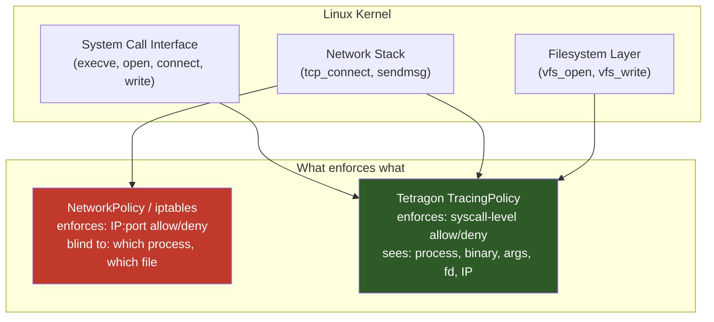
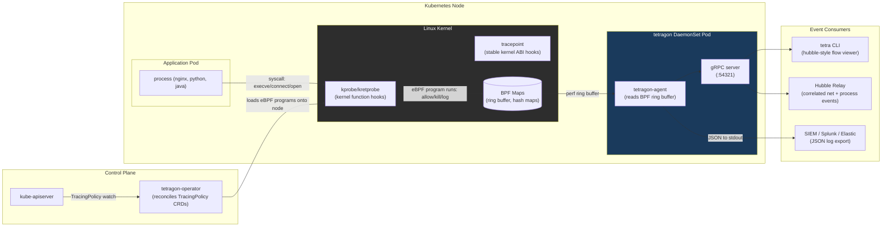
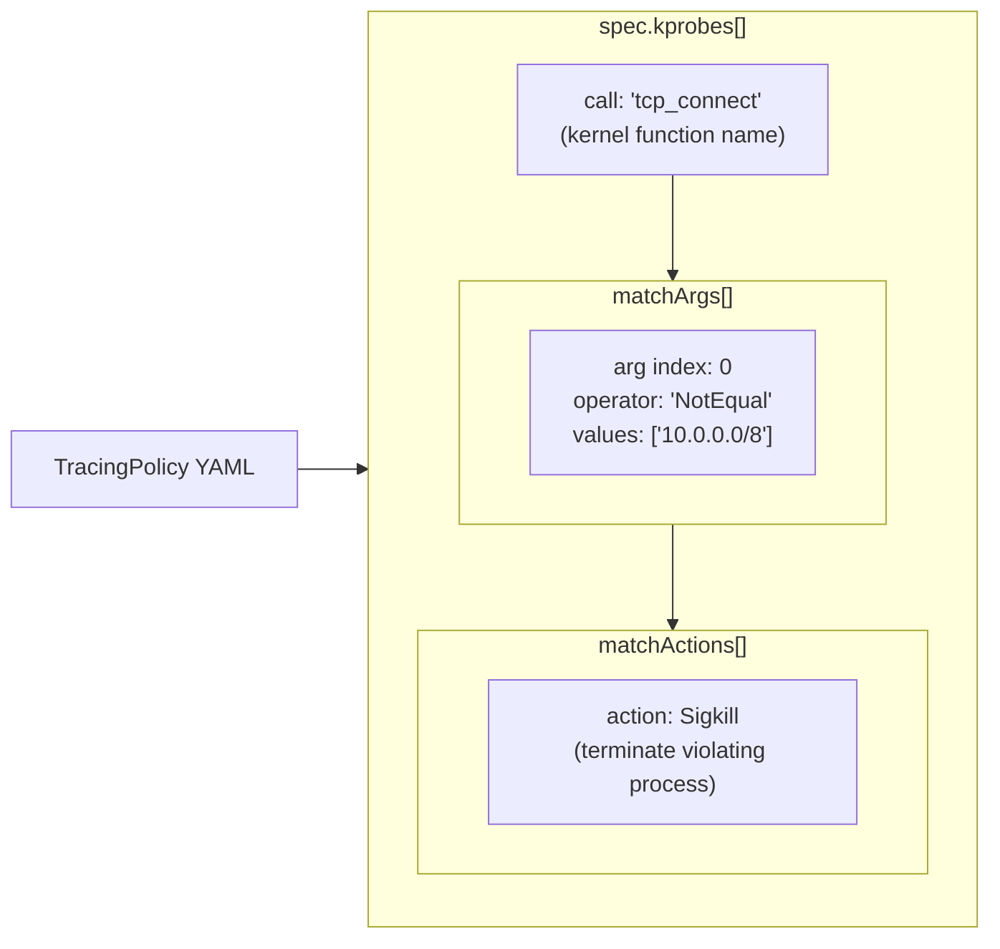

# Lesson 35 — Tetragon: eBPF Runtime Security

> **Track:** Security & Compliance · **Prereqs:** [Lesson 10 — eBPF and XDP](10-ebpf-xdp.md), [Lesson 12 — Cilium CNI and eBPF Dataplane](12-cilium-cni-ebpf.md), [Lesson 23 — Network Security Hardening](23-network-security-hardening.md) · **Time:** ~2.5 hours

> **Goal:** Deploy Tetragon, write TracingPolicy to enforce syscall and network access controls at the kernel level, correlate runtime security events with Hubble network flows, and produce audit-trail output suitable for HIPAA/PCI-DSS/banking compliance review.

**Jump to:** [Theory](#theory) · [Practice](#practice) · [Troubleshooting](#troubleshooting) · [Production Checklist](#production-checklist) · [Quick Reference](#quick-reference) · [Check Your Understanding](#check-your-understanding)

---

## Theory

## 1. Why NetworkPolicy Is Not Enough

NetworkPolicy enforces at the network layer: it can allow or deny connections between pods. It cannot answer questions like:

- Did a process inside this pod call `execve("/bin/sh")`?
- Did a container open `/etc/shadow`?
- Did a pod establish a TCP connection to an unexpected external IP *from a specific binary*?
- Did a privileged process attempt to load a kernel module?

These are runtime security questions. They require observability and enforcement inside the kernel, below the network layer.



Tetragon fills this gap. It hooks into the Linux kernel using **eBPF kprobes and tracepoints**, intercepting syscalls and kernel functions at the source — before they execute — and can enforce policy with a `Sigkill` or `Override` action without modifying any application code.

---

## 2. Architecture



Key components:

| Component | Role |
|---|---|
| `tetragon` DaemonSet | Runs on every node; loads eBPF programs; exports events via gRPC and stdout JSON |
| `tetragon-operator` | Reconciles `TracingPolicy` and `PodInfo` CRDs with the API server |
| `TracingPolicy` CRD | Declares which kernel functions to hook, what to match, and what action to take |
| `tetra` CLI | Like `hubble observe` but for process/syscall events; supports filtering by namespace/pod/binary |
| BPF ring buffer | Kernel-to-userspace event delivery — zero-copy, low overhead |

---

## 3. The TracingPolicy CRD

A `TracingPolicy` hooks one or more kernel functions or tracepoints and applies match rules. When a match fires, an action runs: `Post` (log it), `Sigkill` (terminate the process), or `Override` (return an error to the syscall).



The three action types:

| Action | Effect | Use case |
|---|---|---|
| `Post` | Log the event, allow execution | Audit / detection mode |
| `Sigkill` | Send SIGKILL to the process | Enforcement — block and terminate |
| `Override` | Return error code to syscall | Enforcement — deny without kill (e.g., return EPERM) |

---

## 4. Sector Use Cases

### Banking / Financial Services (PCI-DSS, MaRisk, FINMA)

PCI-DSS Requirement 10 mandates audit trails of all access to cardholder data. Tetragon provides kernel-level evidence:

- Which binary accessed which file (vfs_read/vfs_write on PCI-scoped paths)
- Which process established network connections to payment processors
- Any shell spawn inside a container (`execve` with `argv[0] = /bin/sh`)

### Medtech / Healthcare (HIPAA)

HIPAA Security Rule §164.312(b) requires audit controls. Tetragon satisfies this at the process level — no application-level logging needed.

### SRE / Platform Engineering (all sectors)

Tetragon events correlate with Hubble network flows: you can see "this specific nginx process (PID 12345, in pod frontend-6d7b8) opened a connection to 10.0.1.5:5432 at 14:03:22.001" — microsecond-resolution, process-attributed, kernel-verified.

---

## 5. Event Schema

Every Tetragon event is a JSON object with a consistent envelope:

```json
{
  "process_exec": {
    "process": {
      "exec_id": "node-1:1234567890:12345",
      "pid": 12345,
      "uid": 0,
      "binary": "/bin/bash",
      "arguments": "-c whoami",
      "flags": "execve",
      "start_time": "2026-11-25T14:03:22.001Z",
      "auid": 4294967295,
      "pod": {
        "namespace": "production",
        "name": "frontend-6d7b8-xk9p2",
        "container": {
          "id": "containerd://abc123",
          "name": "nginx",
          "image": { "name": "nginx:1.25" }
        }
      },
      "host_name": "node-1"
    },
    "parent": { "pid": 1, "binary": "/usr/sbin/nginx" }
  },
  "time": "2026-11-25T14:03:22.001Z",
  "node_name": "node-1"
}
```

---

## Practice

### Prerequisites

```bash
# Terminal 2 (Mac) — Cilium must be installed (Lesson 12)
cilium status
# Ensure cilium-operator and agents are Running

# Install Tetragon via Helm
helm repo add cilium https://helm.cilium.io
helm repo update

helm install tetragon cilium/tetragon \
  --namespace kube-system \
  --set tetragon.enableProcessCred=true \
  --set tetragon.enableProcessNs=true

# Verify DaemonSet is running
kubectl get ds -n kube-system tetragon
kubectl rollout status ds/tetragon -n kube-system
```

---

### Lab 1 — Observe process execution (audit mode)

```bash
# Terminal 2: Install tetra CLI
GOOS=linux GOARCH=amd64 curl -L \
  https://github.com/cilium/tetragon/releases/latest/download/tetra-linux-amd64.tar.gz \
  | tar xz -C /usr/local/bin

# Stream all process exec events across the cluster
kubectl exec -n kube-system ds/tetragon -c tetragon -- \
  tetra getevents -o compact --pods frontend

# Terminal 1 (minikube ssh): trigger an exec event
kubectl exec -it deploy/frontend -- /bin/sh -c "id && whoami"

# You will see in Terminal 2:
# 🚀 process production/frontend-xxx /bin/sh -c "id && whoami"
# 📬 process production/frontend-xxx /usr/bin/id
# 📬 process production/frontend-xxx /usr/bin/whoami
# 💥 exit    production/frontend-xxx /bin/sh -c "id && whoami" 0
```

---

### Lab 2 — Detect and kill shell spawns (enforcement mode)

This TracingPolicy blocks any shell binary executed inside pods with label `app=payment-processor` — a common banking hardening requirement.

```yaml
# manifests/35/no-shell-exec.yaml
apiVersion: cilium.io/v1alpha1
kind: TracingPolicy
metadata:
  name: no-shell-exec
spec:
  kprobes:
  - call: "security_bprm_check"
    syscall: false
    args:
    - index: 0
      type: "linux_binprm"
    selectors:
    - matchArgs:
      - index: 0
        operator: "Equal"
        values:
        - "/bin/sh"
        - "/bin/bash"
        - "/usr/bin/sh"
        - "/usr/bin/bash"
        - "/bin/dash"
      matchNamespaces:
      - operator: In
        values:
        - "production"
      matchCapabilities:
      - type: Effective
        operator: NotIn
        values:
        - "CAP_SYS_ADMIN"
      matchActions:
      - action: Sigkill
```

```bash
kubectl apply -f manifests/35/no-shell-exec.yaml

# Verify policy loaded
kubectl get tracingpolicy no-shell-exec

# Try to exec a shell in a production pod — it will be killed
kubectl exec -n production deploy/payment-processor -- /bin/sh
# Output: command terminated with exit code 137 (SIGKILL)

# Tetragon event shows the kill:
kubectl exec -n kube-system ds/tetragon -c tetragon -- \
  tetra getevents -o compact --namespaces production
# 🚀 process production/payment-xxx /bin/sh
# 🔴 Sigkill  production/payment-xxx /bin/sh (security_bprm_check)
```

---

### Lab 3 — Network egress enforcement by binary identity

This policy kills any process other than `nginx` that attempts outbound TCP connections on port 443. Useful in medtech to prevent data exfiltration from compromised containers.

```yaml
# manifests/35/egress-by-binary.yaml
apiVersion: cilium.io/v1alpha1
kind: TracingPolicy
metadata:
  name: restrict-egress-by-binary
spec:
  kprobes:
  - call: "tcp_connect"
    syscall: false
    args:
    - index: 0
      type: "sock"
    selectors:
    - matchArgs:
      - index: 0
        operator: "DPort"
        values:
        - "443"
      matchBinaries:
      - operator: NotIn
        values:
        - "/usr/sbin/nginx"
        - "/usr/bin/curl"      # allow curl for health checks
      matchNamespaces:
      - operator: In
        values:
        - "production"
      matchActions:
      - action: Sigkill
```

```bash
kubectl apply -f manifests/35/egress-by-binary.yaml

# This will be ALLOWED (nginx making upstream request)
kubectl exec -n production deploy/frontend -- \
  curl -sk https://upstream-api/health

# This will be KILLED (python script attempting unexpected egress)
kubectl exec -n production deploy/frontend -- \
  python3 -c "import urllib.request; urllib.request.urlopen('https://evil.example')"
# terminated with exit code 137
```

---

### Lab 4 — File access audit (HIPAA / PCI-DSS)

Track all reads of sensitive files — no enforcement, audit-only (`Post` action).

```yaml
# manifests/35/file-access-audit.yaml
apiVersion: cilium.io/v1alpha1
kind: TracingPolicy
metadata:
  name: sensitive-file-audit
spec:
  kprobes:
  - call: "security_file_open"
    syscall: false
    args:
    - index: 0
      type: "file"
    selectors:
    - matchArgs:
      - index: 0
        operator: "Prefix"
        values:
        - "/etc/ssl/"
        - "/var/run/secrets/"
        - "/proc/1/"
      matchActions:
      - action: Post
        rateLimit: "1m"    # deduplicate: at most 1 event per path per minute
```

```bash
kubectl apply -f manifests/35/file-access-audit.yaml

# Trigger a secret read
kubectl exec -n production deploy/frontend -- \
  cat /var/run/secrets/kubernetes.io/serviceaccount/token

# See the audit event
kubectl exec -n kube-system ds/tetragon -c tetragon -- \
  tetra getevents --event-types PROCESS_KPR -o json \
  | jq 'select(.process_kprobe.function_name == "security_file_open")'
```

---

### Lab 5 — Hubble + Tetragon correlation

```bash
# Terminal 2: watch Hubble flows for a pod
hubble observe --pod production/frontend-xxx --follow &

# Terminal 2: watch Tetragon events for the same pod
kubectl exec -n kube-system ds/tetragon -c tetragon -- \
  tetra getevents --pods frontend-xxx --follow &

# Terminal 1: trigger a database connection
kubectl exec -n production deploy/frontend -- \
  python3 -c "import psycopg2; psycopg2.connect(host='postgres', port=5432)"

# Hubble shows: network flow frontend → postgres:5432 (policy: forwarded)
# Tetragon shows: tcp_connect from python3 PID 9876 to 10.0.1.5:5432
# Combined: you now know WHICH PROCESS made WHICH network call
```

---

## Troubleshooting

| Symptom | Likely cause | Fix |
|---|---|---|
| `TracingPolicy` applied but no events | Tetragon agent not running on that node | `kubectl get pods -n kube-system -l app.kubernetes.io/name=tetragon` |
| Pods being killed unexpectedly | Overly broad `Sigkill` policy | Switch to `Post` mode first to audit before enforcing |
| `tetra getevents` returns nothing | Wrong namespace/pod filter | Omit filters first: `tetra getevents -o compact` |
| High CPU on tetragon-agent | Too many kprobe hooks | Add `matchNamespaces` or `matchCapabilities` selectors to narrow scope |
| `kprobe: 'xyz' not found` | Kernel function name varies by kernel version | Use tracepoints (`tracepoints:` key) for stable ABI; check `/proc/kallsyms` for exact name |
| TracingPolicy stuck in `NotReady` | Incompatible Tetragon/kernel version | Check `kubectl describe tracingpolicy <name>` for error message |

---

## Production Checklist

- [ ] Deploy Tetragon as DaemonSet on all nodes (including control plane if relevant)
- [ ] Start in `Post` (audit) mode — never enforce before you understand your baseline
- [ ] Add `rateLimit` to high-frequency kprobes to avoid event flood
- [ ] Export events to SIEM (Splunk/Elastic) via stdout JSON — Tetragon events are structured
- [ ] Write a default policy detecting shell spawns in production namespaces (audit only initially)
- [ ] Correlate Tetragon process events with Hubble network flows for incident investigation
- [ ] Review and tune TracingPolicies after 2 weeks of audit data
- [ ] For PCI-DSS: retain Tetragon events for 12 months (Requirement 10.7)
- [ ] For HIPAA: document Tetragon as your "audit control" in the Security Rule §164.312(b) implementation
- [ ] Pin Tetragon version — kernel hook compatibility must be tested before upgrades

---

## Quick Reference

```bash
# Install Tetragon
helm install tetragon cilium/tetragon -n kube-system

# Stream all events (compact)
kubectl exec -n kube-system ds/tetragon -c tetragon -- tetra getevents -o compact

# Filter by namespace
kubectl exec -n kube-system ds/tetragon -c tetragon -- \
  tetra getevents -o compact --namespaces production

# Filter by pod
kubectl exec -n kube-system ds/tetragon -c tetragon -- \
  tetra getevents -o compact --pods frontend-xxx

# Filter by event type (exec only)
kubectl exec -n kube-system ds/tetragon -c tetragon -- \
  tetra getevents --event-types PROCESS_EXEC -o compact

# List TracingPolicies
kubectl get tracingpolicy

# Describe a policy (see load status)
kubectl describe tracingpolicy no-shell-exec

# Delete a policy
kubectl delete tracingpolicy no-shell-exec

# Check Tetragon agent logs
kubectl logs -n kube-system ds/tetragon -c tetragon --tail=50
```

---

## Check Your Understanding

1. What is the difference between a `kprobe` and a `tracepoint` in a TracingPolicy, and when would you prefer each?

2. A pod in namespace `payment` is killed with exit code 137 and you find it correlates with a `Sigkill` action in a TracingPolicy. How do you identify which exact TracingPolicy and which kernel function triggered the kill?

3. You need to meet HIPAA §164.312(b) audit control requirements using Tetragon. Write the TracingPolicy skeleton that would audit all opens of files under `/var/run/secrets/` without killing any processes. What `rateLimit` would you set and why?

4. Explain how Tetragon's `matchBinaries` selector provides a stronger security guarantee than a Kubernetes NetworkPolicy for restricting which processes can make outbound network connections.

5. A security audit asks: "Can you prove no shell was executed inside pod X between 09:00 and 10:00 on 2026-11-20?" What Tetragon configuration and log retention strategy enables you to answer this question?

---

**Next:** [Lesson 36 — KubeEdge and Industrial Edge Networking](36-kubeedge-industrial-edge-networking.md)  
**See also:** [Lesson 37 — Compliance Networking](37-compliance-networking.md) for how Tetragon events map to specific HIPAA/PCI-DSS controls
