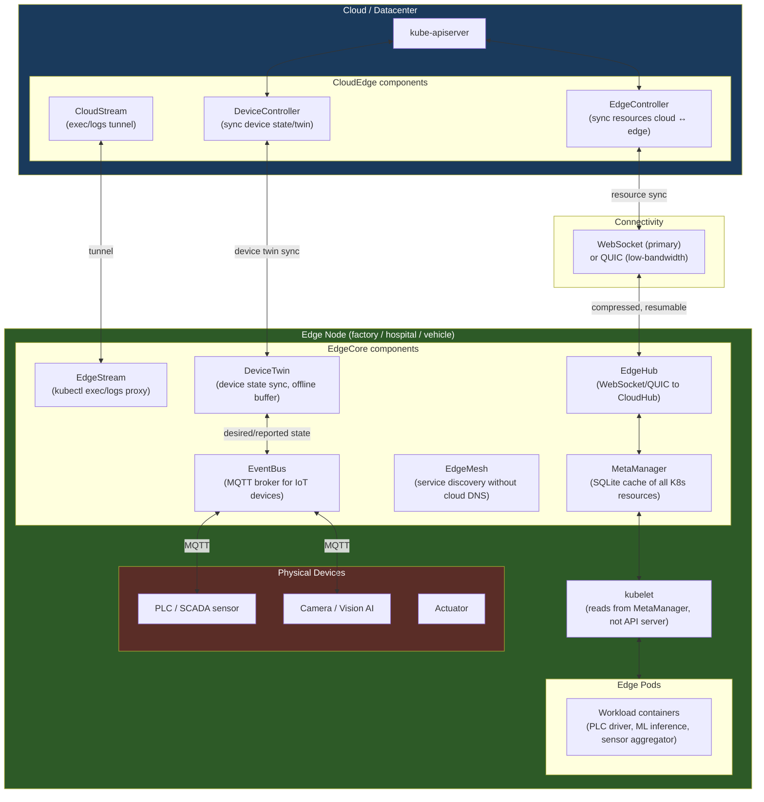
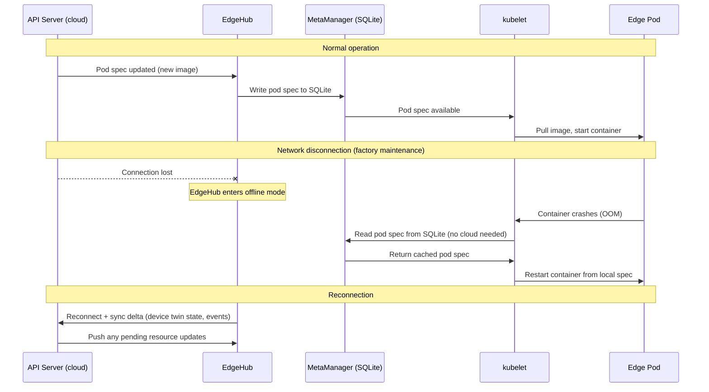
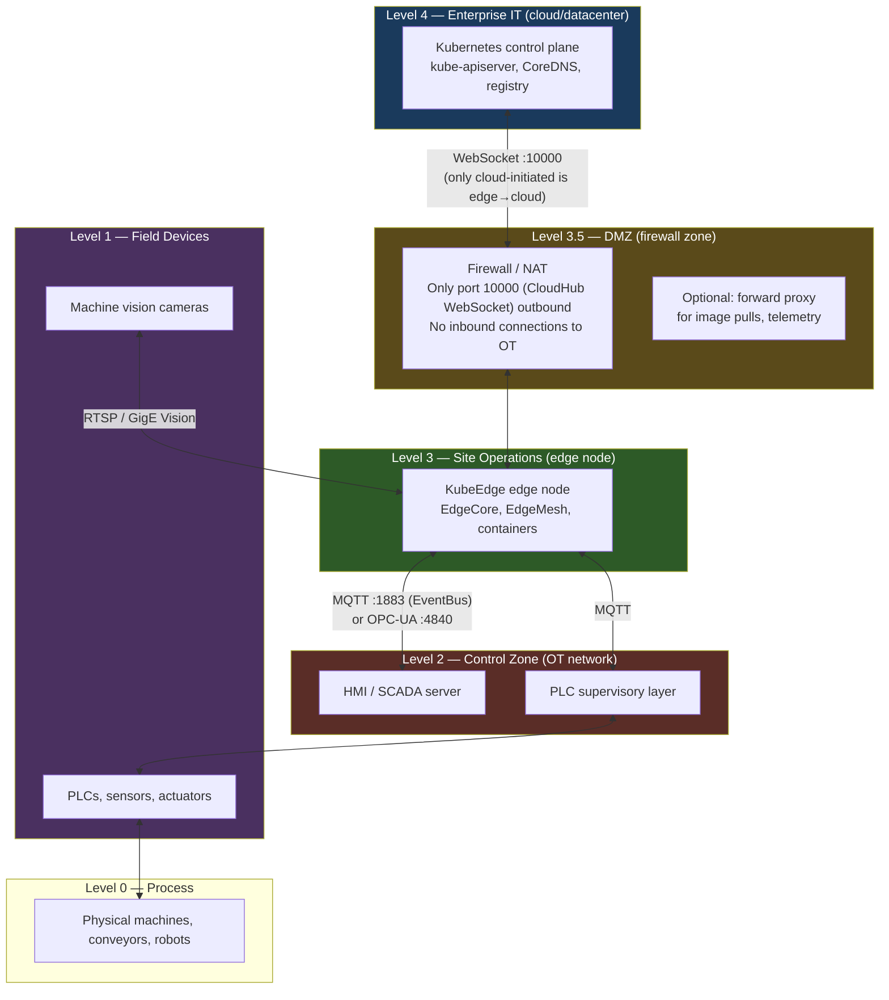
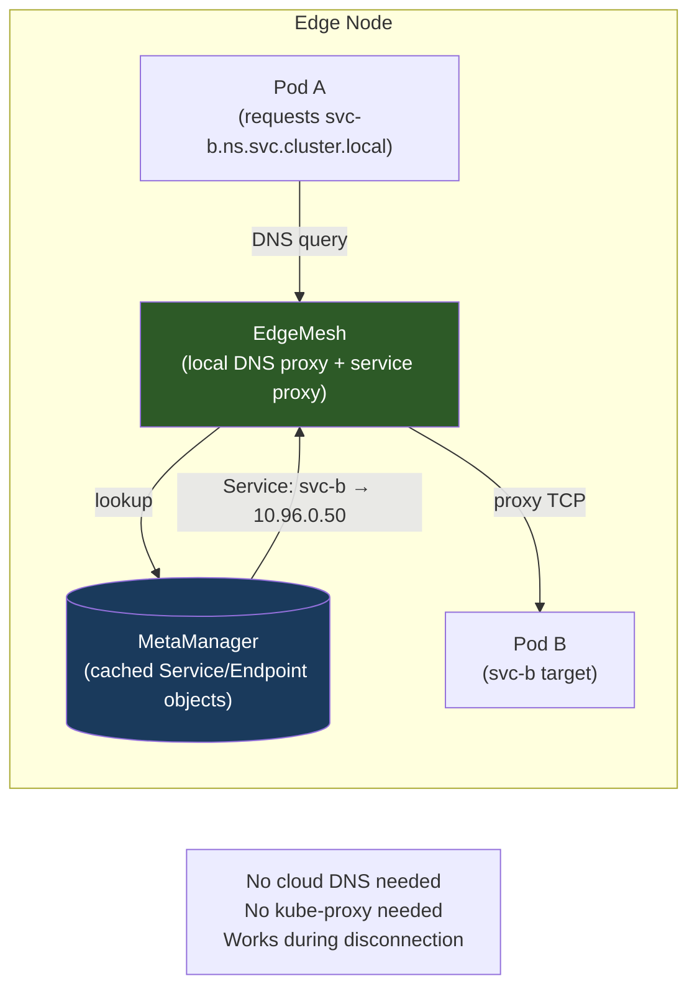

# Lesson 36 — KubeEdge and Industrial Edge Networking

> **Track:** Manufacturing / IoT / Industry 4.0 · **Prereqs:** [Lesson 09 — CNI Specification](09-cni-specification.md), [Lesson 04 — Network Namespaces Deep Dive](04-network-namespaces-deep-dive.md), [Lesson 16 — Network Policies](16-network-policies.md) · **Time:** ~3 hours

> **Goal:** Deploy KubeEdge, run workloads on edge nodes that survive cloud disconnection, understand how edge networking differs from datacenter networking, and apply IEC 62443–aware network segmentation to an OT/IT boundary.

**Jump to:** [Theory](#theory) · [Practice](#practice) · [Troubleshooting](#troubleshooting) · [Production Checklist](#production-checklist) · [Quick Reference](#quick-reference) · [Check Your Understanding](#check-your-understanding)

---

## Theory

## 1. Why Standard Kubernetes Networking Fails at the Edge

A standard Kubernetes node assumes:
- Persistent, low-latency connectivity to the API server
- Full list-watch capability for all resources
- kube-proxy or Cilium can reach cluster DNS

In industrial environments (factory floors, medical devices, wind turbines, logistics warehouses), the network looks different:

```
Standard DC:              Industrial Edge:

API server ←─ 1ms ─→ node    API server ←─ 200ms ─→ 4G router ←─ intermittent ─→ edge device
Uptime: 99.99%               Uptime: 95% (maintenance windows, RF interference, power events)
Bandwidth: 10 Gbps           Bandwidth: 10–100 Mbps (shared LTE, single fiber)
Topology: flat               Topology: hierarchical (cloud → regional hub → factory → machine)
```

When an edge node loses connectivity to the API server, standard K8s behavior:
- kube-proxy stops getting Service/Endpoint updates
- CoreDNS may become unreachable
- kubelet cannot list pods → cannot restart crashed pods
- DaemonSets cannot reconcile
- Workloads stop functioning within minutes

KubeEdge solves this with **edge autonomy**: the edge node continues operating using a local metadata store, even with no cloud connectivity.

---

## 2. KubeEdge Architecture



### Key components explained

| Component | Location | Role |
|---|---|---|
| `EdgeHub` | Edge | Single WebSocket/QUIC connection to cloud. All sync goes through here. |
| `MetaManager` | Edge | SQLite database storing all K8s objects (pods, ConfigMaps, Secrets, Services) for the node. kubelet reads from here, not from API server. |
| `EdgeMesh` | Edge | Distributed service proxy. Handles DNS and load balancing for Services, locally, without cloud CoreDNS. |
| `EventBus` | Edge | MQTT broker. Bridges IoT device messages into K8s DeviceTwin events. |
| `DeviceTwin` | Edge | Maintains `desired` and `reported` state for physical devices. Buffers state changes during disconnection. |
| `EdgeController` | Cloud | Watches API server; pushes resource changes to edge nodes via CloudHub. |
| `DeviceController` | Cloud | Syncs device twin state between cloud and edge. |
| `CloudStream` | Cloud | Tunnels `kubectl exec` and `kubectl logs` through the WebSocket connection. |

---

## 3. Disconnected Operation — The Core Value



During disconnection:
- Existing pods restart normally using cached specs from MetaManager SQLite
- DeviceTwin buffers device state changes and syncs them when reconnected
- New pods cannot be scheduled (scheduler runs in cloud)
- `kubectl exec` and `kubectl logs` will fail (CloudStream is down)

---

## 4. Edge Networking Topology

Industrial edge networks follow a **purdue model** or **ISA-95 hierarchy**, with strict layer separation between OT (operational technology) and IT networks.



**Critical networking rules for industrial edge:**

1. **OT network is never directly reachable from IT.** The edge node is dual-homed: one NIC on the IT network (for K8s control plane), one NIC on the OT network (for MQTT/OPC-UA to PLCs).
2. **Only outbound connections from edge to cloud.** Cloud-to-edge communication piggybacks on the edge-initiated WebSocket. No inbound ports are opened on the edge firewall.
3. **Edge node must function without NAT hairpin.** KubeEdge uses a WebSocket tunnel specifically to avoid this.
4. **Pod-to-PLC communication uses MQTT EventBus**, not standard K8s Services — PLC devices are not Kubernetes endpoints.

---

## 5. EdgeMesh — Service Discovery Without Cloud CoreDNS

Standard Kubernetes service discovery: pod queries CoreDNS → CoreDNS queries kube-apiserver → returns ClusterIP → kube-proxy routes packet.

This chain breaks when the cloud is unreachable. EdgeMesh replaces it:



EdgeMesh intercepts DNS queries via iptables rules, resolves from the local MetaManager cache, and proxies traffic — entirely within the edge node, with zero cloud dependency.

---

## 6. IEC 62443 and Kubernetes Networking

IEC 62443 (ISA/IEC 62443) is the international standard for industrial automation and control system (IACS) cybersecurity. It defines **zones** and **conduits**:

- **Zone**: a grouping of assets with the same security level (Security Level 1–4)
- **Conduit**: a controlled communication path between zones

Mapping to Kubernetes:

| IEC 62443 concept | Kubernetes equivalent |
|---|---|
| Zone | Namespace + NetworkPolicy |
| Conduit | NetworkPolicy `egress`/`ingress` rules between namespaces |
| Security Level (SL) | Combination of NetworkPolicy + mTLS + Tetragon enforcement |
| DMZ | A dedicated namespace with strict ingress/egress policies |
| Zone boundary enforcement | Cilium L7 policy or NetworkPolicy + CNI |

> **See also:** [Lesson 37 — Compliance Networking](37-compliance-networking.md) for explicit IEC 62443 → NetworkPolicy YAML mappings.

---

## Practice

### Prerequisites

```bash
# Terminal 2 (Mac): Install KubeEdge tooling
# Option A: Use a VM as edge node (recommended for local dev)
# minikube start --driver=virtualbox --nodes=1 --profile=cloud
# OR use an existing K8s cluster as cloud

# Install keadm (KubeEdge admin CLI)
KEADM_VERSION=v1.17.0
curl -LO https://github.com/kubeedge/kubeedge/releases/download/${KEADM_VERSION}/keadm-${KEADM_VERSION}-linux-amd64.tar.gz
tar xzf keadm-${KEADM_VERSION}-linux-amd64.tar.gz
sudo mv keadm-${KEADM_VERSION}-linux-amd64/keadm /usr/local/bin/

# Terminal 1 (minikube ssh / cloud node):
keadm --version
```

---

### Lab 1 — Initialize the cloud side (CloudCore)

```bash
# Terminal 2 (Mac): Initialize CloudCore on the K8s cluster
# This installs the KubeEdge CRDs and CloudCore deployment
keadm init --advertise-address=$(kubectl get nodes -o jsonpath='{.items[0].status.addresses[0].address}') \
  --set cloudCore.service.type=NodePort \
  --kubeedge-version=1.17.0

# Verify CloudCore is running
kubectl get pods -n kubeedge
# NAME                         READY   STATUS    RESTARTS   AGE
# cloudcore-7d9b8f6c5d-xk2p9   1/1     Running   0          2m

# Get the join token for edge nodes
keadm gettoken
# Returns a token like: <hash>.<cert-fingerprint>
# Save this token for Lab 2
TOKEN=$(keadm gettoken)
echo $TOKEN
```

---

### Lab 2 — Join an edge node

```bash
# Terminal 1 (minikube ssh OR a separate VM acting as edge node):

# Install EdgeCore on the edge node
# Replace CLOUD_IP and TOKEN with values from Lab 1
CLOUD_IP="<your-cloud-node-ip>"
TOKEN="<token-from-Lab1>"

keadm join \
  --cloudcore-ipport=${CLOUD_IP}:10000 \
  --token=${TOKEN} \
  --kubeedge-version=1.17.0 \
  --cgroupdriver=systemd

# Verify EdgeCore is running on the edge node
systemctl status edgecore

# Terminal 2 (Mac): Verify edge node appears in kubectl
kubectl get nodes
# NAME         STATUS   ROLES        AGE   VERSION
# cloud-node   Ready    control-plane  5m   v1.29.0
# edge-node    Ready    agent,edge     1m   v1.29.0+kubeedge
```

---

### Lab 3 — Deploy a workload to the edge node

```yaml
# manifests/36/edge-deployment.yaml
apiVersion: apps/v1
kind: Deployment
metadata:
  name: sensor-aggregator
  namespace: iot
spec:
  replicas: 1
  selector:
    matchLabels:
      app: sensor-aggregator
  template:
    metadata:
      labels:
        app: sensor-aggregator
    spec:
      nodeSelector:
        node-role.kubernetes.io/edge: ""    # schedule only on edge nodes
      tolerations:
      - key: "node-role.kubernetes.io/edge"
        operator: "Exists"
        effect: "NoSchedule"
      containers:
      - name: aggregator
        image: busybox:1.36
        command: ["/bin/sh", "-c"]
        args:
        - |
          while true; do
            echo "$(date): sensor reading: $((RANDOM % 100))°C"
            sleep 5
          done
        resources:
          requests:
            memory: "16Mi"
            cpu: "10m"
          limits:
            memory: "32Mi"
            cpu: "50m"
```

```bash
kubectl create namespace iot
kubectl label nodes edge-node node-role.kubernetes.io/edge=""
kubectl apply -f manifests/36/edge-deployment.yaml

# Verify pod runs on edge node
kubectl get pods -n iot -o wide
# NAME                                READY   STATUS    NODE
# sensor-aggregator-xxx               1/1     Running   edge-node

# Check logs (routed through CloudStream tunnel)
kubectl logs -n iot deploy/sensor-aggregator
```

---

### Lab 4 — Simulate disconnection and verify autonomy

```bash
# Terminal 1 (edge node): block the WebSocket port to simulate disconnection
sudo iptables -I OUTPUT -p tcp --dport 10000 -j DROP

# Wait 30 seconds, then crash the pod manually
kubectl delete pod -n iot -l app=sensor-aggregator --grace-period=0

# Terminal 2 (Mac): kubectl will appear to hang (can't reach edge node)
# But on the edge node itself:

# Terminal 1: check EdgeCore logs — should show reconnect attempts
journalctl -u edgecore -f | grep -E "connect|reconnect|offline"

# Check MetaManager SQLite cache
sqlite3 /var/lib/kubeedge/edgecore.db ".tables"
# Should show: meta, metaV2 tables with cached pod specs

# After ~60 seconds, check if pod restarted
# Terminal 1: list containers directly via containerd
crictl pods
# You should see sensor-aggregator has restarted LOCALLY without cloud

# Restore connectivity
sudo iptables -D OUTPUT -p tcp --dport 10000 -j DROP

# Terminal 2: kubectl recovers
kubectl get pods -n iot
```

---

### Lab 5 — IoT device twin (simulated sensor)

```yaml
# manifests/36/device-model.yaml
apiVersion: devices.kubeedge.io/v1beta1
kind: DeviceModel
metadata:
  name: temperature-sensor
  namespace: iot
spec:
  properties:
  - name: temperature
    description: "Current temperature reading"
    type:
      int:
        accessMode: ReadOnly
        defaultValue: 25
        unit: "°C"
  - name: status
    description: "Sensor operational status"
    type:
      string:
        accessMode: ReadOnly
        defaultValue: "online"
---
# manifests/36/device-instance.yaml
apiVersion: devices.kubeedge.io/v1beta1
kind: Device
metadata:
  name: factory-temp-sensor-01
  namespace: iot
  labels:
    zone: "assembly-line-1"
spec:
  deviceModelRef:
    name: temperature-sensor
  nodeName: edge-node
  protocol:
    mqtt:
      topic: "factory/sensors/temp/01"
  propertyVisitors:
  - propertyName: temperature
    mqtt:
      topic: "factory/sensors/temp/01/data"
```

```bash
kubectl apply -f manifests/36/device-model.yaml
kubectl apply -f manifests/36/device-instance.yaml

# Verify device created
kubectl get devices -n iot
# NAME                      AGE
# factory-temp-sensor-01    10s

# Simulate device reporting state via MQTT (from edge node)
# Terminal 1 (edge node):
mosquitto_pub -h localhost -t "factory/sensors/temp/01/data" \
  -m '{"temperature": 73}'

# Terminal 2 (Mac): read device twin state
kubectl get device factory-temp-sensor-01 -n iot -o jsonpath='{.status.twins}'
```

---

## Troubleshooting

| Symptom | Likely cause | Fix |
|---|---|---|
| Edge node shows `NotReady` after join | CloudCore not reachable on port 10000 | Check firewall: `telnet <cloud-ip> 10000` from edge node |
| `kubectl logs` hangs | CloudStream not configured or edge offline | Check `kubectl get pods -n kubeedge` — ensure cloudcore is running |
| Pod not scheduled on edge node | Missing `nodeSelector` or taint not tolerated | Add `nodeSelector: node-role.kubernetes.io/edge: ""` and toleration |
| Pod crashes on edge, doesn't restart | MetaManager SQLite corrupted | Check `/var/lib/kubeedge/edgecore.db`; restart edgecore: `systemctl restart edgecore` |
| EdgeMesh DNS not resolving | EdgeMesh not installed or iptables rules missing | `helm install edgemesh edgemesh/edgemesh -n kubeedge`; check `iptables -t nat -L` |
| Device twin not syncing | EventBus MQTT topic mismatch | Verify `spec.protocol.mqtt.topic` matches what the device publishes to |
| High latency on edge pod comms | Using cluster ClusterIP service (routes via cloud) | Use EdgeMesh for edge-local services; label service with `service.edgemesh.kubeedge.io/loadbalancer-mode: random` |

---

## Production Checklist

- [ ] Edge nodes use dedicated hardware (industrial PC, fanless x86) — not shared with OT control systems
- [ ] Edge node has two NICs: one for IT (K8s control plane), one for OT (PLCs/sensors)
- [ ] Firewall allows only outbound port 10000 (CloudHub WebSocket) from edge to cloud — no inbound
- [ ] MetaManager SQLite on persistent storage (not tmpfs) — survives node reboot
- [ ] EdgeMesh installed for in-cluster service discovery without cloud dependency
- [ ] Container images pre-pulled or mirrored locally — do not pull from cloud registries during operation
- [ ] NetworkPolicy applied to isolate `iot` namespace from other namespaces
- [ ] DeviceTwin state includes sensor health / last-seen timestamp for dead-sensor detection
- [ ] Tetragon deployed on edge nodes for runtime security (see [Lesson 35](35-tetragon-ebpf-runtime-security.md))
- [ ] Alerting on `edgecore` service failure (systemd watchdog + cloud-side device availability metrics)
- [ ] Test disconnection scenario: unplug WAN cable, verify workloads keep running for >1 hour
- [ ] Document zone/conduit mapping (IEC 62443) — which namespaces correspond to which security level

---

## Quick Reference

```bash
# Install keadm
curl -LO https://github.com/kubeedge/kubeedge/releases/download/v1.17.0/keadm-v1.17.0-linux-amd64.tar.gz

# Initialize cloud side
keadm init --advertise-address=<IP>

# Get join token
keadm gettoken

# Join edge node
keadm join --cloudcore-ipport=<IP>:10000 --token=<TOKEN>

# Check edge node status
kubectl get nodes -l node-role.kubernetes.io/edge

# View EdgeCore logs on edge node
journalctl -u edgecore -f

# Check MetaManager SQLite cache
sqlite3 /var/lib/kubeedge/edgecore.db "select * from meta limit 10;"

# Reset edge node
keadm reset

# Install EdgeMesh
helm repo add edgemesh https://raw.githubusercontent.com/kubeedge/edgemesh/main/build/helm/edgemesh
helm install edgemesh edgemesh/edgemesh -n kubeedge

# List devices
kubectl get devices -A

# Watch device twin state
kubectl get device <name> -n iot -o jsonpath='{.status.twins}' -w
```

---

## Check Your Understanding

1. A factory edge node loses connectivity to the cloud API server for 4 hours due to a fiber cut. A pod on that node crashes. What happens, step by step? Which component is responsible for restarting it, and where does it get the pod spec from?

2. Explain the role of the WebSocket connection in KubeEdge. Why is it initiated from the edge to the cloud rather than the other way around? What industrial networking constraint does this satisfy?

3. You are designing a network for an edge node that processes camera feeds from an assembly line. The node needs to: (a) receive new pod deployments from the cloud Kubernetes cluster, (b) pull OPC-UA data from PLCs on the OT network, (c) never allow OT devices to initiate connections to the IT network. How many NICs do you need, and what firewall rules do you apply?

4. Map the following IEC 62443 requirements to specific KubeEdge/Kubernetes constructs: (a) Zone isolation between cloud and edge, (b) Conduit with controlled data flow between OT and IT, (c) Availability during partial network failure.

5. EdgeMesh provides service discovery without cloud CoreDNS. What does it use instead, and what is the operational implication for pod-to-pod communication during a 24-hour cloud disconnection?

---

**Next:** [Lesson 37 — Compliance Networking](37-compliance-networking.md)  
**See also:** [Lesson 34 — AI Platform Networking](34-ai-platform-networking.md) for Multus CNI multi-interface patterns that also apply to industrial edge
