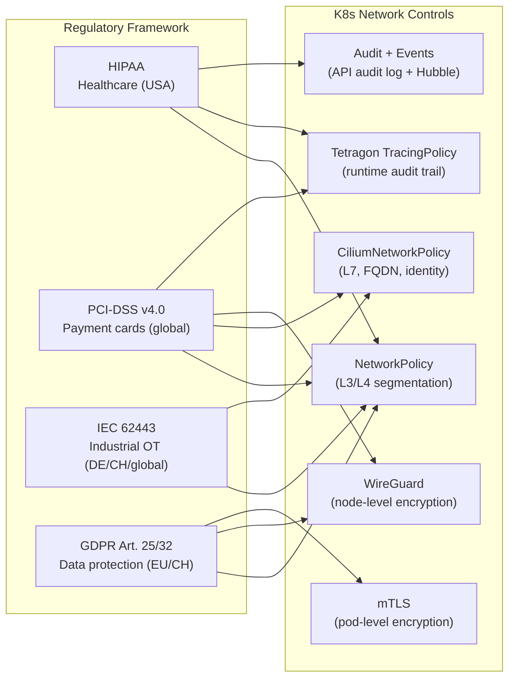
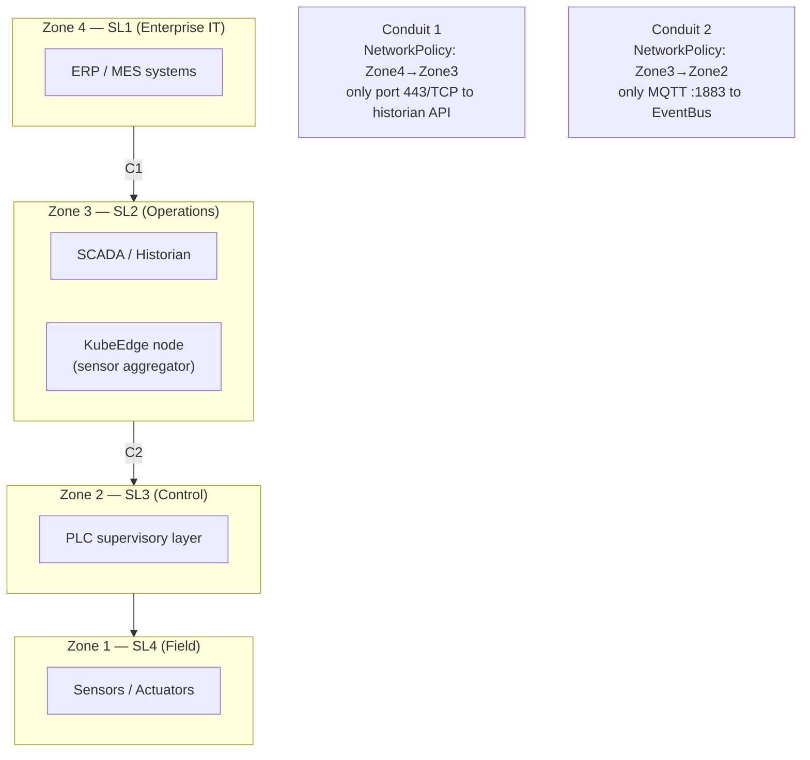

# Lesson 37 — Compliance Networking

> **Track:** Security & Compliance · **Prereqs:** [Lesson 16 — Network Policies](16-network-policies.md), [Lesson 12 — Cilium CNI and eBPF Dataplane](12-cilium-cni-ebpf.md), [Lesson 23 — Network Security Hardening](23-network-security-hardening.md), [Lesson 35 — Tetragon Runtime Security](35-tetragon-ebpf-runtime-security.md) · **Time:** ~3 hours

> **Goal:** Map specific Kubernetes network controls to audit requirements in HIPAA, PCI-DSS, IEC 62443, and GDPR. Produce the exact YAML, CLI commands, and evidence artifacts that satisfy each control — ready to show an auditor.

**Jump to:** [Theory](#theory) · [HIPAA](#hipaa) · [PCI-DSS](#pci-dss) · [IEC-62443](#iec-62443) · [GDPR](#gdpr) · [Practice](#practice) · [Production Checklist](#production-checklist) · [Quick Reference](#quick-reference)

---

## Theory

## 1. The Compliance Gap No Course Covers

Every K8s security course teaches NetworkPolicy syntax. No course explains *which policy satisfies which audit requirement*. The result: platform engineers pass CKS but can't answer an auditor's question.

This lesson closes that gap. For each framework, we provide:
1. The exact regulatory text (control number and wording)
2. The K8s network control that implements it
3. The YAML that proves it
4. The evidence artifact an auditor accepts



## 2. The CNI Enforcement Prerequisite

**Before any compliance claim can be made, verify your CNI enforces NetworkPolicy.**

```bash
# Test: apply a default-deny policy and verify it works
kubectl apply -f - <<EOF
apiVersion: networking.k8s.io/v1
kind: NetworkPolicy
metadata:
  name: compliance-prereq-test
  namespace: default
spec:
  podSelector: {}
  policyTypes: [Ingress, Egress]
EOF

# From another pod, try to reach a pod in default namespace
# If the connection succeeds → your CNI does NOT enforce NetworkPolicy → STOP
# If the connection is refused → CNI enforces policy → proceed

kubectl delete networkpolicy compliance-prereq-test -n default
```

CNI plugins that enforce NetworkPolicy: **Cilium, Calico, Antrea, WeaveNet**  
CNI plugins that do NOT: **Flannel, kubenet** (policies are silently ignored)

---

## HIPAA

### Applicable rules

HIPAA Security Rule (45 CFR Part 164) covers three safeguard categories. The network controls in this lesson address:

| Rule reference | Title | Network control |
|---|---|---|
| §164.312(a)(1) | Access Control | NetworkPolicy (least-privilege pod access) |
| §164.312(b) | Audit Controls | Tetragon TracingPolicy (process + network audit trail) |
| §164.312(e)(1) | Transmission Security | WireGuard / mTLS (encryption in transit) |
| §164.312(a)(2)(iv) | Encryption/Decryption | WireGuard node encryption |

---

### HIPAA §164.312(a)(1) — Access Control

**Requirement:** Implement technical policies that allow only authorized persons or software to access ePHI.

**K8s control:** Default-deny NetworkPolicy + explicit allow rules scoped to pods that handle ePHI.

```yaml
# manifests/37/hipaa-default-deny.yaml
# Step 1: Deny all ingress and egress in the ePHI namespace
apiVersion: networking.k8s.io/v1
kind: NetworkPolicy
metadata:
  name: hipaa-default-deny
  namespace: phi-workloads          # namespace containing ePHI-handling pods
  annotations:
    compliance.hipaa/control: "164.312(a)(1)"
    compliance.hipaa/description: "Default-deny: only explicitly authorized pods access ePHI"
spec:
  podSelector: {}                   # applies to ALL pods in namespace
  policyTypes:
  - Ingress
  - Egress
---
# Step 2: Allow only the EHR application pod to reach the ePHI database
apiVersion: networking.k8s.io/v1
kind: NetworkPolicy
metadata:
  name: hipaa-allow-ehr-to-db
  namespace: phi-workloads
  annotations:
    compliance.hipaa/control: "164.312(a)(1)"
spec:
  podSelector:
    matchLabels:
      app: phi-database             # the ePHI datastore
  policyTypes:
  - Ingress
  ingress:
  - from:
    - podSelector:
        matchLabels:
          app: ehr-application      # only the authorized EHR app
          compliance/phi-access: "approved"
    ports:
    - port: 5432
      protocol: TCP
---
# Step 3: Allow ePHI pods to reach DNS and nothing else by default
apiVersion: networking.k8s.io/v1
kind: NetworkPolicy
metadata:
  name: hipaa-allow-dns
  namespace: phi-workloads
  annotations:
    compliance.hipaa/control: "164.312(a)(1)"
spec:
  podSelector: {}
  policyTypes:
  - Egress
  egress:
  - to:
    - namespaceSelector:
        matchLabels:
          kubernetes.io/metadata.name: kube-system
      podSelector:
        matchLabels:
          k8s-app: kube-dns
    ports:
    - port: 53
      protocol: UDP
    - port: 53
      protocol: TCP
```

**Auditor evidence:** `kubectl get networkpolicy -n phi-workloads -o yaml` — show the policies are present, then demonstrate with a denied connection test.

---

### HIPAA §164.312(b) — Audit Controls

**Requirement:** Implement hardware, software, and/or procedural mechanisms that record and examine activity in information systems containing ePHI.

**K8s control:** Tetragon TracingPolicy logging all file access and process execution in the ePHI namespace.

```yaml
# manifests/37/hipaa-audit-tracingpolicy.yaml
apiVersion: cilium.io/v1alpha1
kind: TracingPolicy
metadata:
  name: hipaa-phi-audit
  annotations:
    compliance.hipaa/control: "164.312(b)"
spec:
  kprobes:
  - call: "security_file_open"
    syscall: false
    args:
    - index: 0
      type: "file"
    selectors:
    - matchNamespaces:
      - operator: In
        values:
        - "phi-workloads"
      matchActions:
      - action: Post
        rateLimit: "5m"
  - call: "security_bprm_check"
    syscall: false
    args:
    - index: 0
      type: "linux_binprm"
    selectors:
    - matchNamespaces:
      - operator: In
        values:
        - "phi-workloads"
      matchActions:
      - action: Post
```

```bash
# Export Tetragon events to a file for audit retention (90-day minimum per HIPAA)
kubectl exec -n kube-system ds/tetragon -c tetragon -- \
  tetra getevents --namespaces phi-workloads -o json \
  >> /var/log/hipaa-audit/$(date +%Y%m%d).jsonl

# Verify the audit log contains required fields
# HIPAA requires: date/time, user/process ID, type of access, description of data
cat /var/log/hipaa-audit/$(date +%Y%m%d).jsonl | \
  jq '{time: .time, pid: .process_exec.process.pid, binary: .process_exec.process.binary, pod: .process_exec.process.pod.name}'
```

**Auditor evidence:** Show the TracingPolicy is running, then show 30 days of JSON log files with timestamps, process identities, and accessed resources.

---

### HIPAA §164.312(e)(1) — Transmission Security

**Requirement:** Implement technical security measures to guard against unauthorized access to ePHI transmitted over electronic communications networks.

**K8s control:** WireGuard transparent encryption between all nodes in the ePHI cluster.

```bash
# Enable WireGuard encryption in Cilium (encrypts all inter-node pod traffic)
# Requires: Cilium 1.14+, Linux kernel 5.6+
cilium encrypt status    # check current status

helm upgrade cilium cilium/cilium \
  --namespace kube-system \
  --set encryption.enabled=true \
  --set encryption.type=wireguard \
  --set encryption.nodeEncryption=true   # encrypt node-to-node traffic too

# Verify encryption is active
cilium encrypt status
# Encryption: Wireguard
# Keys in use: 1
# Max Seq. Number: 0x0/never
# Errors: 0

# Verify on a specific node
kubectl exec -n kube-system ds/cilium -c cilium-agent -- \
  cilium encrypt status
```

**Auditor evidence:** `cilium encrypt status` output on each node. Optionally: packet capture showing ESP (Encapsulating Security Payload) protocol between nodes.

---

## PCI-DSS

### Applicable requirements (v4.0)

| Req | Title | Network control |
|---|---|---|
| 1.3.1 | Inbound traffic to CDE restricted | NetworkPolicy default-deny + allow rules |
| 1.3.2 | Outbound traffic from CDE restricted | NetworkPolicy egress rules |
| 1.4.1 | NSC between trusted and untrusted networks | Namespace isolation + CiliumNetworkPolicy |
| 2.2.1 | No unnecessary services/ports | NetworkPolicy limiting allowed ports |
| 4.2.1 | Strong cryptography for PAN in transit | WireGuard / mTLS |
| 7.2.1 | Access control based on need-to-know | NetworkPolicy + RBAC |
| 10.2.1 | Audit log all access to CDE | Tetragon + Hubble |

The **Cardholder Data Environment (CDE)** = the namespace(s) containing payment data.

---

### PCI-DSS Req 1.3 — CDE Network Segmentation

```yaml
# manifests/37/pci-cde-segmentation.yaml
# Namespace label: kubernetes.io/metadata.name=payment-cde

# Deny all by default in CDE
apiVersion: networking.k8s.io/v1
kind: NetworkPolicy
metadata:
  name: pci-default-deny
  namespace: payment-cde
  annotations:
    compliance.pci-dss/requirement: "1.3.1, 1.3.2"
spec:
  podSelector: {}
  policyTypes: [Ingress, Egress]
---
# Allow only the payment API (from DMZ namespace) to reach card processor
apiVersion: networking.k8s.io/v1
kind: NetworkPolicy
metadata:
  name: pci-allow-payment-api
  namespace: payment-cde
  annotations:
    compliance.pci-dss/requirement: "1.3.1"
spec:
  podSelector:
    matchLabels:
      app: card-processor
  ingress:
  - from:
    - namespaceSelector:
        matchLabels:
          zone: dmz
      podSelector:
        matchLabels:
          app: payment-api
    ports:
    - port: 8443
      protocol: TCP
---
# Allow CDE to reach external payment network (Visa/Mastercard) only via FQDN
# Requires Cilium CiliumNetworkPolicy (standard NetworkPolicy cannot filter by FQDN)
apiVersion: cilium.io/v2
kind: CiliumNetworkPolicy
metadata:
  name: pci-cde-egress-fqdn
  namespace: payment-cde
  annotations:
    compliance.pci-dss/requirement: "1.3.2"
spec:
  endpointSelector:
    matchLabels:
      app: card-processor
  egress:
  - toFQDNs:
    - matchPattern: "*.visa.net"
    - matchPattern: "*.mastercard.com"
    - matchName: "api.stripe.com"
    toPorts:
    - ports:
      - port: "443"
        protocol: TCP
  - toEndpoints:
    - matchLabels:
        k8s:io.kubernetes.pod.namespace: kube-system
        k8s-app: kube-dns
    toPorts:
    - ports:
      - port: "53"
        protocol: UDP
```

---

### PCI-DSS Req 4.2.1 — Encryption of PAN in Transit

```bash
# Option A: WireGuard node-level encryption (encrypts all pod-to-pod traffic transparently)
# (same as HIPAA §164.312(e)(1) above — same cilium encrypt command)

# Option B: mTLS at pod level using Cilium (requires Cilium 1.18+ + ACNS on AKS)
# This provides per-connection cryptographic identity proof
kubectl apply -f - <<EOF
apiVersion: cilium.io/v2
kind: CiliumNetworkPolicy
metadata:
  name: pci-require-mtls
  namespace: payment-cde
spec:
  endpointSelector:
    matchLabels:
      app: card-processor
  ingress:
  - fromEndpoints:
    - matchLabels:
        app: payment-api
    authentication:
      mode: required      # reject connections without valid mTLS certificate
EOF

# Verify mTLS is active between pods
kubectl exec -n payment-cde deploy/payment-api -- \
  cilium monitor --type policy-verdict | grep "card-processor"
```

---

### PCI-DSS Req 10.2 — Audit Log Access to CDE

```yaml
# manifests/37/pci-audit-tracingpolicy.yaml
# PCI-DSS Req 10.2.1.1–10.2.1.7 requires logging:
# - All access by individuals with root/admin privileges
# - All access to audit logs
# - Invalid logical access attempts
# - Use of and changes to identification/auth mechanisms
# - Initialization/stopping/pausing of audit logs
# - Creation/deletion of system-level objects

apiVersion: cilium.io/v1alpha1
kind: TracingPolicy
metadata:
  name: pci-cde-audit
  annotations:
    compliance.pci-dss/requirement: "10.2.1"
spec:
  kprobes:
  # Log all privileged process execution (Req 10.2.1.1)
  - call: "security_bprm_check"
    syscall: false
    args:
    - index: 0
      type: "linux_binprm"
    selectors:
    - matchCapabilities:
      - type: Effective
        operator: In
        values:
        - "CAP_SYS_ADMIN"
        - "CAP_NET_ADMIN"
        - "CAP_DAC_OVERRIDE"
      matchNamespaces:
      - operator: In
        values:
        - "payment-cde"
      matchActions:
      - action: Post
  # Log all network connections from CDE pods (Req 10.2.1.3 — invalid access attempts)
  - call: "tcp_connect"
    syscall: false
    args:
    - index: 0
      type: "sock"
    selectors:
    - matchNamespaces:
      - operator: In
        values:
        - "payment-cde"
      matchActions:
      - action: Post
        rateLimit: "1m"
```

```bash
# Verify audit log retention: PCI-DSS Req 10.5.1 requires 12 months (3 months immediately available)
# Configure log rotation:
kubectl create configmap audit-retention -n kube-system \
  --from-literal=retention-days=365 \
  --from-literal=min-available-days=90
```

**Auditor evidence:** TracingPolicy spec + 12 months of JSON log files + demonstration that a denied connection attempt appears in logs within 60 seconds.

---

## IEC 62443

### Standard structure relevant to K8s networking

| Part | Title | K8s relevance |
|---|---|---|
| IEC 62443-2-1 | Security management system | Namespace policies as security zones |
| IEC 62443-3-3 | System security requirements | Zone/conduit model, SL 1–4 |
| IEC 62443-4-2 | Component security requirements | Pod-level security (NetworkPolicy, Tetragon) |

---

### Zone and Conduit Model

IEC 62443-3-3 SR 5.1 (Network Segmentation): "Segment the control system from other systems using boundaries."



```yaml
# manifests/37/iec62443-zones.yaml
# Zone = Namespace, Conduit = NetworkPolicy

# Zone 3 → Zone 4 conduit: only historian query (read-only, port 8443)
apiVersion: networking.k8s.io/v1
kind: NetworkPolicy
metadata:
  name: iec62443-conduit-z4-to-z3
  namespace: zone-operations           # Zone 3
  annotations:
    compliance.iec62443/requirement: "SR 5.1"
    compliance.iec62443/conduit: "C1"
    compliance.iec62443/security-level: "SL2"
spec:
  podSelector:
    matchLabels:
      app: scada-historian
  ingress:
  - from:
    - namespaceSelector:
        matchLabels:
          iec62443/zone: "enterprise"  # Zone 4 namespace
      podSelector:
        matchLabels:
          app: erp-reporting
    ports:
    - port: 8443
      protocol: TCP
---
# Zone 3 egress to Zone 2: only MQTT to KubeEdge EventBus
apiVersion: networking.k8s.io/v1
kind: NetworkPolicy
metadata:
  name: iec62443-conduit-z3-to-z2
  namespace: zone-operations
  annotations:
    compliance.iec62443/requirement: "SR 5.1"
    compliance.iec62443/conduit: "C2"
spec:
  podSelector:
    matchLabels:
      app: edge-aggregator
  egress:
  - to:
    - namespaceSelector:
        matchLabels:
          iec62443/zone: "control"     # Zone 2 namespace
    ports:
    - port: 1883
      protocol: TCP                    # MQTT to PLC supervisory layer
```

```bash
# Label namespaces with zone metadata for auditing
kubectl label namespace zone-enterprise iec62443/zone=enterprise iec62443/sl=1
kubectl label namespace zone-operations iec62443/zone=operations iec62443/sl=2
kubectl label namespace zone-control    iec62443/zone=control    iec62443/sl=3
kubectl label namespace zone-field      iec62443/zone=field       iec62443/sl=4
```

---

### IEC 62443-4-2 CR 2.1 — Authorization Enforcement

Require authentication before allowing communication between zones:

```yaml
# manifests/37/iec62443-mtls-conduit.yaml
# Use Cilium mTLS to require cryptographic identity for conduit C1
apiVersion: cilium.io/v2
kind: CiliumNetworkPolicy
metadata:
  name: iec62443-conduit-c1-mtls
  namespace: zone-operations
  annotations:
    compliance.iec62443/requirement: "CR 2.1"
spec:
  endpointSelector:
    matchLabels:
      app: scada-historian
  ingress:
  - fromEndpoints:
    - matchLabels:
        io.kubernetes.pod.namespace: zone-enterprise
        app: erp-reporting
    authentication:
      mode: required
    toPorts:
    - ports:
      - port: "8443"
        protocol: TCP
```

---

## GDPR

### Applicable articles

| Article | Title | Network control |
|---|---|---|
| Art. 25 | Data Protection by Design and by Default | Default-deny NetworkPolicy |
| Art. 32(1)(a) | Encryption of personal data | WireGuard / mTLS |
| Art. 32(1)(b) | Ongoing confidentiality/integrity | Network segmentation + Tetragon |
| Art. 44–49 | Transfers to third countries | FQDN-based egress control (block non-EU endpoints) |

---

### GDPR Art. 25 — Data Protection by Design

```yaml
# manifests/37/gdpr-privacy-by-design.yaml
# Default-deny for any namespace processing personal data
apiVersion: networking.k8s.io/v1
kind: NetworkPolicy
metadata:
  name: gdpr-default-deny
  namespace: user-data
  annotations:
    compliance.gdpr/article: "25"
    compliance.gdpr/description: "Privacy by design: deny all, allow only necessary flows"
spec:
  podSelector: {}
  policyTypes: [Ingress, Egress]
```

---

### GDPR Art. 44 — Cross-Border Data Transfer Restriction

Personal data must not leave the EU/EEA unless specific conditions are met. Use Cilium FQDN egress policy to enforce this:

```yaml
# manifests/37/gdpr-data-residency.yaml
apiVersion: cilium.io/v2
kind: CiliumNetworkPolicy
metadata:
  name: gdpr-eu-only-egress
  namespace: user-data
  annotations:
    compliance.gdpr/article: "44"
    compliance.gdpr/description: "Block egress to non-EU endpoints for personal data pods"
spec:
  endpointSelector:
    matchLabels:
      gdpr/personal-data: "true"
  egress:
  # Allow only EU-hosted services (by FQDN)
  - toFQDNs:
    - matchPattern: "*.eu-central-1.amazonaws.com"    # AWS Frankfurt
    - matchPattern: "*.europe-west3.gcp.com"           # GCP Frankfurt
    - matchPattern: "*.northeurope.azure.com"           # Azure Northern Europe
    - matchPattern: "*.westeurope.azure.com"            # Azure Western Europe
    toPorts:
    - ports:
      - port: "443"
        protocol: TCP
  # Block everything else implicitly (no other egress rules = deny)
  # Allow DNS
  - toEndpoints:
    - matchLabels:
        k8s:io.kubernetes.pod.namespace: kube-system
        k8s-app: kube-dns
    toPorts:
    - ports:
      - port: "53"
        protocol: UDP
```

```bash
# Verify FQDN policy is enforced
kubectl exec -n user-data deploy/user-service -- \
  curl -sk https://api.us-east-1.amazonaws.com/  # should be DENIED
# curl: (28) Connection timed out

kubectl exec -n user-data deploy/user-service -- \
  curl -sk https://api.eu-central-1.amazonaws.com/health  # should be ALLOWED
```

---

## Practice

### Lab — Full compliance audit run

```bash
# 1. Verify CNI enforces NetworkPolicy
kubectl apply -f manifests/37/hipaa-default-deny.yaml
kubectl run test-pod --image=busybox --rm -it --restart=Never \
  -n phi-workloads -- wget -qO- http://phi-database:5432
# Expected: wget: download timed out (policy enforced)

# 2. Verify WireGuard encryption is active
cilium encrypt status | grep -E "Encryption|Keys"

# 3. Verify Tetragon audit is capturing events
kubectl exec -n kube-system ds/tetragon -c tetragon -- \
  tetra getevents --namespaces phi-workloads -o compact | head -20

# 4. Generate a compliance evidence report
kubectl get networkpolicy -A -o json | \
  jq '.items[] | {namespace: .metadata.namespace, name: .metadata.name, annotation: .metadata.annotations}' \
  > compliance-evidence/networkpolicies-$(date +%Y%m%d).json

kubectl get ciliumnetworkpolicy -A -o json | \
  jq '.items[] | {namespace: .metadata.namespace, name: .metadata.name}' \
  >> compliance-evidence/networkpolicies-$(date +%Y%m%d).json

# 5. Test data residency (GDPR)
kubectl apply -f manifests/37/gdpr-data-residency.yaml
kubectl exec -n user-data deploy/user-service -- \
  curl -sk --max-time 5 https://api.us-west-2.amazonaws.com/ || echo "BLOCKED (expected)"
```

---

## Production Checklist

- [ ] CNI enforces NetworkPolicy — verify with a deny test, not just `kubectl get networkpolicy`
- [ ] Default-deny NetworkPolicy in every namespace containing regulated data
- [ ] Namespace labels include compliance annotations (framework, control number)
- [ ] WireGuard encryption enabled for all inter-node traffic (HIPAA §164.312(e)(1), PCI-DSS Req 4.2.1)
- [ ] Tetragon TracingPolicies deployed with `Post` action — audit before enforcing
- [ ] Log retention: 90 days immediately accessible, 12 months total (PCI-DSS Req 10.5.1)
- [ ] FQDN egress policies deployed for GDPR data residency requirements
- [ ] IEC 62443 zone/conduit model documented and namespace labels match
- [ ] Quarterly audit: run `kubectl get networkpolicy -A` and validate against control matrix
- [ ] Change management: NetworkPolicy changes require compliance review annotation
- For sector-specific learning paths, see [docs/compliance-paths.md](../compliance-paths.md)

---

## Quick Reference — Control Matrix

| Control | Framework | YAML file | Evidence command |
|---|---|---|---|
| Default-deny | HIPAA 164.312(a)(1), PCI 1.3, GDPR Art.25 | `hipaa-default-deny.yaml` | `kubectl get netpol -n <ns>` |
| ePHI access control | HIPAA 164.312(a)(1) | `hipaa-allow-ehr-to-db.yaml` | Denied connection test |
| Audit trail | HIPAA 164.312(b), PCI 10.2 | `hipaa-audit-tracingpolicy.yaml` | `tetra getevents -o json` |
| Encryption in transit | HIPAA 164.312(e)(1), PCI 4.2.1, GDPR 32(1)(a) | `cilium encrypt` | `cilium encrypt status` |
| CDE segmentation | PCI 1.3.1, 1.3.2 | `pci-cde-segmentation.yaml` | Denied connection test |
| FQDN egress control | PCI 1.3.2, GDPR Art.44 | `pci-cde-egress-fqdn.yaml` | `curl` denied test |
| Zone isolation | IEC 62443 SR 5.1 | `iec62443-zones.yaml` | `kubectl get netpol` |
| Data residency | GDPR Art.44 | `gdpr-data-residency.yaml` | FQDN blocked test |

---

## Check Your Understanding

1. A PCI-DSS auditor asks: "Show me evidence that cardholder data cannot leave the CDE namespace and reach a non-approved external endpoint." Walk through the exact commands and output you would show them.

2. You are deploying a medtech application in Germany that must comply with both GDPR and IEC 62443. The application processes patient vital signs from hospital bedside monitors over MQTT. Design the namespace structure and write the two most critical NetworkPolicy objects.

3. Flannel is the CNI plugin in your cluster. A NetworkPolicy default-deny object exists in the `payment-cde` namespace. Is PCI-DSS Requirement 1.3 satisfied? Explain your reasoning and what action you must take.

4. Your HIPAA audit requires proof of "access control" for ePHI. You have NetworkPolicy limiting which pods can reach the ePHI database. The auditor also asks: "What prevents a compromised container inside an allowed pod from exfiltrating data to an external IP?" What additional control do you add, and which YAML in this lesson implements it?

5. A GDPR data subject requests deletion of their data. During the deletion process, a pod in `user-data` namespace attempts to call `https://backup.us-east-2.amazonaws.com` to remove a backup copy. The GDPR egress policy blocks this call. How do you temporarily allow this specific egress while maintaining the data residency posture for all other traffic?

---

**Previous:** [Lesson 36 — KubeEdge and Industrial Edge Networking](36-kubeedge-industrial-edge-networking.md)  
**See also:** [Lesson 35 — Tetragon Runtime Security](35-tetragon-ebpf-runtime-security.md) for the runtime audit trail controls referenced in HIPAA §164.312(b) and PCI-DSS Req 10.2  
**Next:** [Lesson 38 — Multus CNI](38-multus-cni.md)
