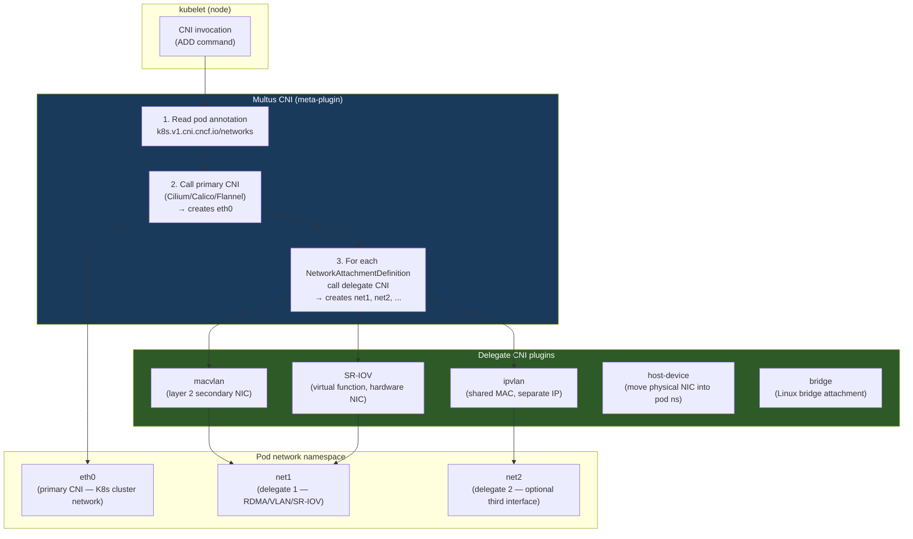
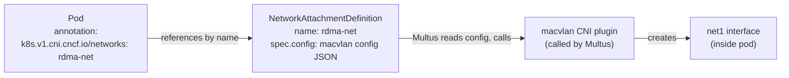
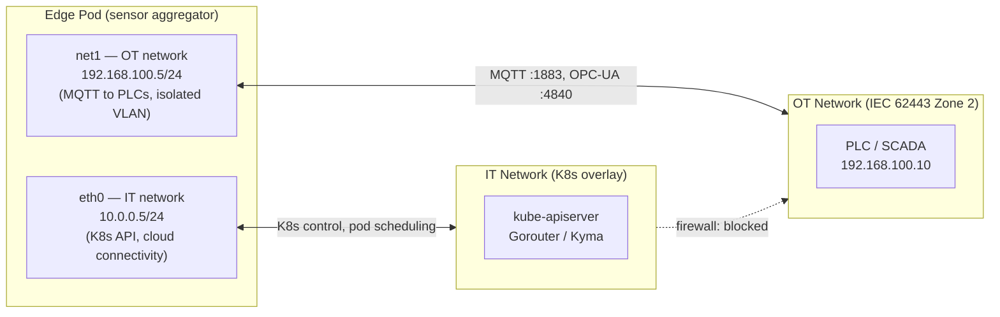

# Lesson 38 — Multus CNI and Multi-Homed Pods

> **Track:** Track J — Security & Compliance · **Prereqs:** [Lesson 09 — CNI Specification](09-cni-specification.md), [Lesson 12 — Cilium CNI and eBPF Dataplane](12-cilium-cni-ebpf.md) · **Time:** ~2.5 hours

> **Goal:** Deploy Multus CNI, attach secondary network interfaces to pods using NetworkAttachmentDefinitions, and apply multi-homed networking to AI/GPU training workloads, industrial edge nodes, and telco CNFs — covering CKNE Domain 1 (Core Infrastructure & CNI, 15%).

**Jump to:** [Theory](#theory) · [Practice](#practice) · [Troubleshooting](#troubleshooting) · [Production Checklist](#production-checklist) · [Quick Reference](#quick-reference) · [Check Your Understanding](#check-your-understanding)

---

## Theory

## 1. Why Standard Kubernetes Single-NIC Pods Are Not Enough

Every standard Kubernetes pod gets exactly one network interface (`eth0`) managed by the primary CNI plugin. This is sufficient for most web services. It fails for:

| Use case | Why single NIC fails | What Multus enables |
|---|---|---|
| **AI/GPU training (NCCL/RDMA)** | RDMA requires a dedicated NIC on a separate network; mixing RDMA and control-plane traffic on `eth0` causes head-of-line blocking | Separate `eth0` (K8s control) + `net1` (RDMA/RoCE on 400 GbE) |
| **Industrial edge (OT/IT separation)** | OT network (MQTT/OPC-UA to PLCs) must be isolated from IT network (K8s API server) | `eth0` (K8s control, IT network) + `net1` (OT network, isolated VLAN) |
| **Telco CNFs (5G UPF, vRouter)** | User-plane and control-plane traffic must be separated; DPDK (Data Plane Development Kit — bypass kernel networking for line-rate packet processing) requires dedicated NIC | `eth0` (management) + `net1` (N3/N6 user-plane) + `net2` (N4 control) |
| **Network appliances (firewall, IDS)** | Need multiple interfaces to sit inline between network segments | Arbitrary number of interfaces with different subnets |

---

## 2. Multus Architecture

Multus is a **meta-CNI plugin** — it does not implement networking itself. Instead, it calls other CNI plugins (delegates) in sequence, attaching one interface per plugin call.



### The NetworkAttachmentDefinition CRD

`NetworkAttachmentDefinition` (NAD) is a Kubernetes CRD from the CNCF [Network Plumbing Working Group](https://github.com/k8snetworkplumbingwg/network-attachment-definition-client). It describes one secondary network interface — which CNI plugin to use and its configuration.



---

## 3. Delegate CNI Plugin Comparison

| Plugin | MAC address | Performance | Use case |
|---|---|---|---|
| `macvlan` | Each pod gets unique MAC | Near-wire speed | RDMA, storage traffic, secondary VLAN |
| `ipvlan L2` | Shared parent MAC | Near-wire speed | DPDK, environments where multiple MACs are blocked |
| `ipvlan L3` | Shared parent MAC, L3 routing | Near-wire speed | Multi-subnet pod routing without ARP |
| `sr-iov` | Hardware VF MAC | Wire speed, RDMA-capable | AI/GPU training, telco, latency-critical |
| `host-device` | Moves physical NIC into pod | Wire speed | Single-tenant pods needing full NIC access |
| `bridge` | Connects to Linux bridge | Moderate | Dev/test, internal VLAN switching |

---

## 4. Use Case: AI/GPU Training (NCCL/RDMA)

NCCL all-reduce across GPU nodes requires all-to-all bandwidth at 400 Gbps. Pod `eth0` on the K8s overlay adds latency and bandwidth overhead. The pattern:

```
eth0 (Cilium/Calico overlay) → used for K8s API, DNS, management
net1 (SR-IOV VF on 400 GbE RDMA NIC) → used exclusively for NCCL all-reduce
```

Training pods select `net1` for NCCL via environment variables:
```
NCCL_SOCKET_IFNAME=net1
NCCL_IB_HCA=mlx5_0        # Mellanox HCA on net1
```

See [Lesson 34 — AI Platform Networking](34-ai-platform-networking.md) for SR-IOV device plugin setup and rail topology.

---

## 5. Use Case: Industrial Edge (OT/IT Separation)



This isolates OT traffic completely from the K8s overlay — no CNI policy or iptables rule can accidentally bridge them, because they are on physically separate network paths. See [Lesson 36 — KubeEdge](36-kubeedge-industrial-edge-networking.md) for the full IEC 62443 zone model.

---

## Practice

### Prerequisites

```bash
# Terminal 2 (Mac): Install Multus
kubectl apply -f https://raw.githubusercontent.com/k8snetworkplumbingwg/multus-cni/master/deployments/multus-daemonset.yml

# Verify Multus DaemonSet is running
kubectl get ds -n kube-system kube-multus-ds
kubectl rollout status ds/kube-multus-ds -n kube-system

# Verify NetworkAttachmentDefinition CRD installed
kubectl get crd network-attachment-definitions.k8s.cni.cncf.io
```

---

### Lab 1 — macvlan secondary interface

```yaml
# manifests/38/macvlan-nad.yaml
apiVersion: k8s.cni.cncf.io/v1
kind: NetworkAttachmentDefinition
metadata:
  name: macvlan-conf
  namespace: default
spec:
  config: |
    {
      "cniVersion": "0.3.1",
      "type": "macvlan",
      "master": "eth0",
      "mode": "bridge",
      "ipam": {
        "type": "host-local",
        "subnet": "192.168.1.0/24",
        "rangeStart": "192.168.1.200",
        "rangeEnd": "192.168.1.250",
        "gateway": "192.168.1.1"
      }
    }
```

```bash
kubectl apply -f manifests/38/macvlan-nad.yaml

# Deploy a pod requesting the secondary interface
kubectl apply -f - <<EOF
apiVersion: v1
kind: Pod
metadata:
  name: multus-test
  annotations:
    k8s.v1.cni.cncf.io/networks: macvlan-conf   # attach net1
spec:
  containers:
  - name: test
    image: busybox:1.36
    command: [sleep, "3600"]
EOF

# Verify pod has two interfaces
kubectl exec multus-test -- ip addr
# Should show: eth0 (K8s overlay) + net1 (macvlan, 192.168.1.x)

# Check Multus annotation status
kubectl get pod multus-test -o jsonpath='{.metadata.annotations.k8s\.v1\.cni\.cncf\.io/network-status}' | python3 -m json.tool
```

---

### Lab 2 — Multiple secondary interfaces

```yaml
# manifests/38/multi-nad.yaml
apiVersion: k8s.cni.cncf.io/v1
kind: NetworkAttachmentDefinition
metadata:
  name: vlan100
  namespace: default
spec:
  config: |
    {
      "cniVersion": "0.3.1",
      "type": "macvlan",
      "master": "eth0",
      "mode": "bridge",
      "ipam": {
        "type": "host-local",
        "subnet": "10.100.0.0/24"
      }
    }
---
apiVersion: k8s.cni.cncf.io/v1
kind: NetworkAttachmentDefinition
metadata:
  name: vlan200
  namespace: default
spec:
  config: |
    {
      "cniVersion": "0.3.1",
      "type": "macvlan",
      "master": "eth0",
      "mode": "bridge",
      "ipam": {
        "type": "host-local",
        "subnet": "10.200.0.0/24"
      }
    }
```

```bash
kubectl apply -f manifests/38/multi-nad.yaml

# Pod with 3 interfaces: eth0 + net1 (vlan100) + net2 (vlan200)
kubectl apply -f - <<EOF
apiVersion: v1
kind: Pod
metadata:
  name: triple-homed
  annotations:
    k8s.v1.cni.cncf.io/networks: vlan100,vlan200
spec:
  containers:
  - name: test
    image: busybox:1.36
    command: [sleep, "3600"]
EOF

kubectl exec triple-homed -- ip addr
# eth0: K8s overlay
# net1: 10.100.0.x
# net2: 10.200.0.x
```

---

### Lab 3 — Interface naming and static IP assignment

```yaml
# manifests/38/static-ip-nad.yaml
# Assign a specific interface name and static IP via annotation
apiVersion: k8s.cni.cncf.io/v1
kind: NetworkAttachmentDefinition
metadata:
  name: rdma-static
  namespace: gpu-workloads
spec:
  config: |
    {
      "cniVersion": "0.3.1",
      "type": "macvlan",
      "master": "eth1",
      "mode": "bridge",
      "ipam": {
        "type": "static"
      }
    }
```

```bash
# Use annotation to specify interface name and static IP
kubectl apply -f - <<EOF
apiVersion: v1
kind: Pod
metadata:
  name: gpu-worker-0
  namespace: gpu-workloads
  annotations:
    # name the interface "rdma0", assign static IP
    k8s.v1.cni.cncf.io/networks: '[
      {
        "name": "rdma-static",
        "interface": "rdma0",
        "ips": ["192.168.100.10/24"],
        "gateway": ["192.168.100.1"]
      }
    ]'
spec:
  containers:
  - name: trainer
    image: busybox:1.36
    command: [sleep, "3600"]
    env:
    - name: NCCL_SOCKET_IFNAME
      value: rdma0
EOF

kubectl exec -n gpu-workloads gpu-worker-0 -- ip addr show rdma0
# inet 192.168.100.10/24
```

---

### Lab 4 — Verify network-status annotation

```bash
# After pod is running, Multus writes results back to annotation
kubectl get pod multus-test \
  -o jsonpath='{.metadata.annotations.k8s\.v1\.cni\.cncf\.io/network-status}' \
  | python3 -m json.tool

# Output shows each interface with name, mac, IPs:
# [
#   {"name": "", "interface": "eth0", "ips": ["10.244.0.5"], "mac": "...", "default": true},
#   {"name": "default/macvlan-conf", "interface": "net1", "ips": ["192.168.1.200"], "mac": "..."}
# ]
```

---

## Troubleshooting

| Symptom | Likely cause | Fix |
|---|---|---|
| Pod stuck in `ContainerCreating` | NAD not found in pod's namespace | NADs are namespace-scoped — create NAD in same namespace as pod |
| `net1` interface missing | Multus DaemonSet not running on that node | `kubectl get ds -n kube-system kube-multus-ds` — check node readiness |
| `master: eth0 not found` in macvlan config | The parent interface name differs on the node | `ip link show` on the node — find actual interface name (may be `ens3`, `enp2s0`) |
| IP not assigned on `net1` | IPAM range exhausted | Check `host-local` IPAM state: `ls /var/lib/cni/networks/<net-name>/` on the node |
| NCCL not using `net1` | `NCCL_SOCKET_IFNAME` not set or wrong | Set `NCCL_SOCKET_IFNAME=net1` (or the custom interface name) in pod env |
| `network-status` annotation missing | Pod came up before Multus was ready | Delete and recreate pod; Multus writes the annotation after successful attachment |
| SR-IOV VFs not available | SR-IOV not enabled in BIOS or VF count not set | `echo 8 > /sys/class/net/ens2f0/device/sriov_numvfs` on node; check BIOS SR-IOV setting |
| Medtech: OT device-bus traffic leaking onto hospital IT network, audit trail for device commands invalidated (FDA 21 CFR Part 11) | NAD `master` interface set to the shared K8s NIC (`eth0`) instead of the isolated OT VLAN interface — medical device gateway pod mixes device-bus (`net1`) and hospital IT on the same physical link | Set NAD `master` to the dedicated OT VLAN interface (e.g. `eth1`) that is physically isolated; verify with `ip link show` on the node and test OT/IT path separation before deployment |

---

## Production Checklist

- [ ] Multus DaemonSet deployed on all nodes that run multi-homed pods
- [ ] NetworkAttachmentDefinitions are namespace-scoped — create them in every namespace that needs them
- [ ] Parent interface name (`master`) in NAD config matches actual node interface name
- [ ] SR-IOV VF count configured via node feature discovery or operator — not manually
- [ ] IPAM (IP Address Management) ranges per NAD do not overlap between nodes (use `whereabouts` for cluster-wide IPAM instead of `host-local`)
- [ ] GPU training pods set `NCCL_SOCKET_IFNAME` to the RDMA interface name
- [ ] OT/IT isolation: OT interface NAD uses a master that is physically on the OT VLAN — not the K8s overlay NIC
- [ ] NetworkPolicy on `eth0` still applies — Multus secondary interfaces are NOT controlled by K8s NetworkPolicy
- [ ] Monitor Multus logs on node: `journalctl -u kubelet | grep multus`

---

## Quick Reference

```bash
# Install Multus
kubectl apply -f https://raw.githubusercontent.com/k8snetworkplumbingwg/multus-cni/master/deployments/multus-daemonset.yml

# List NetworkAttachmentDefinitions in a namespace
kubectl get network-attachment-definitions -n <namespace>

# Describe a NAD
kubectl describe network-attachment-definition <name> -n <namespace>

# Check pod interface attachment status
kubectl get pod <name> -o jsonpath='{.metadata.annotations.k8s\.v1\.cni\.cncf\.io/network-status}' | python3 -m json.tool

# Check interfaces inside pod
kubectl exec <pod> -- ip addr
kubectl exec <pod> -- ip route

# Check Multus logs on a node
kubectl logs -n kube-system -l app=multus --tail=50

# List SR-IOV VFs on a node (run via bosh ssh or node shell)
ls /sys/class/net/ens2f0/device/virtfn*

# Set SR-IOV VF count
echo 8 | sudo tee /sys/class/net/ens2f0/device/sriov_numvfs
```

---

## Check Your Understanding

1. A pod annotated with `k8s.v1.cni.cncf.io/networks: rdma-net` is stuck in `ContainerCreating`. The NAD `rdma-net` exists in namespace `default` but the pod is in namespace `gpu-workloads`. What is the problem and how do you fix it?

2. You are deploying an edge pod that must communicate with PLCs on a 192.168.100.0/24 OT VLAN (via `eth1` on the node) and also receive K8s scheduling from the cloud control plane (via `eth0`). Write the NAD and pod annotation you would use.

3. Explain why K8s NetworkPolicy does NOT apply to traffic on Multus secondary interfaces (`net1`, `net2`). What can you use instead to control traffic on those interfaces?

4. A GPU training job uses NCCL for all-reduce across 8 nodes. Despite Multus attaching an SR-IOV VF as `net1`, NCCL is still routing traffic over `eth0`. What environment variable is missing from the pod spec, and what value should it have?

5. You are using `host-local` IPAM for a macvlan NAD across 20 nodes. After 2 weeks, some pods cannot get an IP on `net1`. What is the likely cause, and what IPAM plugin should you migrate to?

---

**Previous:** [Lesson 37 — Compliance Networking](37-compliance-networking.md)  
**See also:** [Lesson 34 — AI Platform Networking](34-ai-platform-networking.md) for SR-IOV and RDMA context, [Lesson 36 — KubeEdge and Industrial Edge Networking](36-kubeedge-industrial-edge-networking.md) for OT/IT separation patterns
