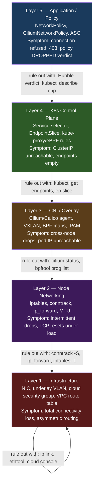
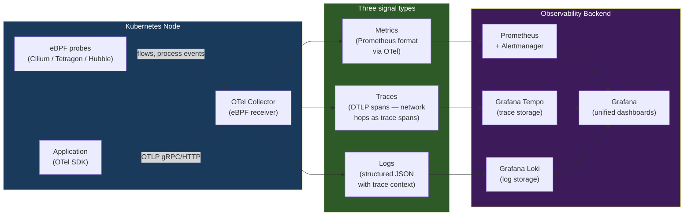

# Lesson 39 — Network Incident Management, SLOs, and RCA

> **Track:** Track J — Security & Compliance · **Prereqs:** [Lesson 24 — Network Observability and Troubleshooting](24-network-observability-troubleshooting.md), [Lesson 12 — Cilium CNI and eBPF Dataplane](12-cilium-cni-ebpf.md) · **Time:** ~3 hours

> **Goal:** Define network SLOs with error budgets, instrument Prometheus/OTel alerting rules for the top K8s network failure patterns, run a structured RCA using the five-layer model, and write a blameless postmortem that satisfies PCI-DSS Req 12.10, HIPAA breach response, and IEC 62443 incident reporting requirements.

**Jump to:** [Theory](#theory) · [Practice](#practice) · [RCA Playbooks](#rca-playbooks) · [Postmortem Template](#postmortem-template) · [Alerting Reference](#alerting-reference) · [Production Checklist](#production-checklist) · [Check Your Understanding](#check-your-understanding)

---

## Theory

## 1. Why Networking Needs Its Own SLOs

Generic availability SLOs (uptime %) miss the network-specific failure modes that cause the most user pain:

| Generic SLO | What it misses | Network SLO that catches it |
|---|---|---|
| HTTP 5xx error rate < 0.1% | DNS NXDOMAIN storm (200ms latency, no 5xx) | DNS success rate ≥ 99.9% |
| Pod availability ≥ 99.9% | Policy-dropped packets (pod runs, traffic silently dropped) | Policy verdict: FORWARDED ≥ 99.95% |
| Deployment success rate | NetworkPolicy sync lag during rollout | NetworkPolicy convergence time < 5s p99 |
| Service uptime | conntrack exhaustion under burst (TCP resets, no 5xx) | TCP connection establishment rate / conntrack headroom |

**The Google SRE model applied to networking:**

```
SLI (what you measure)     → Hubble flow FORWARDED ratio, DNS p99 latency, conntrack fill %
SLO (target)               → FORWARDED ≥ 99.95%, DNS p99 < 50ms, conntrack < 80% capacity
Error budget               → 0.05% of flows may drop per 30-day window = ~21 min of total drop budget
Burn rate alert            → Alert at 2× burn rate (consuming budget 2× faster than allowed)
```

---

## 2. The Five-Layer Network RCA Model

Every K8s network incident maps to exactly one of five layers. Working top-down eliminates entire hypotheses in seconds:



**Decision rule:** Start at L5 (most common). If L5 tools return clean (no policy drops, correct NetworkPolicy), move to L4. Never skip layers — a misconfigured AWS security group (L1) can look identical to a NetworkPolicy block (L5) until you check both.

---

## 3. Structured RCA: The 5-Why Method for Network Incidents

Standard 5-why applied to a real network incident pattern:

**Incident:** Payment API returning intermittent TCP resets under load, 2% error rate, PCI-DSS scope

```
Why 1: Why are clients seeing TCP resets?
        → conntrack table is full; kernel drops new connections silently

Why 2: Why is conntrack full?
        → nf_conntrack_max set to 131072 (default); Black Friday burst hit 128000 entries

Why 3: Why wasn't the limit raised?
        → conntrack headroom was never added to capacity planning or alerting

Why 4: Why was there no alert?
        → Prometheus scrapes node_nf_conntrack_entries but no alert rule was defined

Why 5: Why was no alert rule defined?
        → Network SLOs exist for HTTP error rate but not for kernel-layer conntrack resources

Root cause: Missing network SLO tier covering kernel resources
Corrective action: Add conntrack headroom SLO + alert rule (see Section 5)
Preventive action: Add conntrack to capacity-planning template for all PCI-scoped clusters
```

**The 5-why stops when the answer is a process gap, not a technical one.** "conntrack was full" is a symptom. "No alert rule" is a cause. "No SLO tier covering kernel resources" is the root cause.

---

## 4. OpenTelemetry + eBPF: The 2025/2026 Observability Stack

The state of the art in 2025/2026 combines three signal types in a single pipeline:



**Key 2025 developments that change the picture:**

| Capability | What changed | Why it matters |
|---|---|---|
| **Cilium native OTel export** | Cilium 1.15+ exports Hubble flows as OTLP traces | Network hops appear as spans in Grafana Tempo — no sidecar |
| **OTel network semantic conventions (stable)** | `network.type`, `network.transport`, `net.peer.ip` are stable attributes | Cross-vendor correlation: Cilium spans + app spans share the same attribute names |
| **eBPF OTel Collector receiver** | OTel Collector gains an eBPF receiver (kernel 5.8+) | L4 TCP events become OTel spans without code changes |
| **Tetragon + OTel** | Tetragon 1.1+ emits process/network events as OTel logs | Security events and network events in the same trace context |
| **Continuous profiling (Parca/Pyroscope)** | eBPF CPU profiles linked to trace IDs | Correlate a network latency spike with a CPU-bound kernel function |

**What this enables for RCA:** A single Grafana trace shows: app span → Cilium policy verdict span → kernel conntrack lookup → eBPF XDP decision — without touching application code.

---

## 5. Network SLOs: Definitions and Alert Rules

### Tier 1 — Availability SLOs (every cluster)

```yaml
# prometheus-network-slos.yaml
groups:
  - name: network-slo-availability
    rules:
      # SLI: fraction of Hubble flows that are FORWARDED
      - record: slo:hubble_forward_ratio:rate5m
        expr: |
          sum(rate(hubble_flows_processed_total{verdict="FORWARDED"}[5m]))
          /
          sum(rate(hubble_flows_processed_total[5m]))

      # SLO: 99.95% of flows forwarded
      # Alert: burn rate > 14.4x (1-hour window consuming 2% of monthly budget)
      - alert: NetworkFlowDropBudgetBurn
        expr: |
          (1 - slo:hubble_forward_ratio:rate5m) > (14.4 * 0.0005)
        for: 2m
        labels:
          severity: page
          slo: network-availability
        annotations:
          summary: "Network flow drop burn rate critical"
          description: "{{ $value | humanizePercentage }} of flows dropping — consuming error budget at 14.4x"

      # SLO: DNS success rate ≥ 99.9%
      - alert: DNSErrorBudgetBurn
        expr: |
          rate(coredns_dns_responses_total{rcode=~"SERVFAIL|NXDOMAIN"}[5m])
          /
          rate(coredns_dns_requests_total[5m])
          > 0.001
        for: 5m
        labels:
          severity: page
        annotations:
          summary: "DNS error rate exceeds SLO"
```

### Tier 2 — Capacity SLOs (kernel resources)

```yaml
      # conntrack headroom — alert at 80% to prevent silent TCP resets
      - alert: ConntrackHeadroomLow
        expr: |
          node_nf_conntrack_entries / node_nf_conntrack_entries_limit > 0.80
        for: 5m
        labels:
          severity: warning
        annotations:
          summary: "conntrack table {{ $value | humanizePercentage }} full on {{ $labels.instance }}"
          description: "At current growth rate, table exhaustion in ~{{ with query 'predict_linear(node_nf_conntrack_entries[10m], 300)' }}{{ . | first | value | humanize }}{{ end }} seconds"

      # NetworkPolicy convergence — CiliumEndpoint regeneration lag
      - alert: CiliumPolicyConvergenceSlow
        expr: |
          histogram_quantile(0.99,
            rate(cilium_policy_regeneration_time_stats_seconds_bucket[5m])
          ) > 5
        for: 3m
        labels:
          severity: warning
        annotations:
          summary: "NetworkPolicy p99 convergence {{ $value }}s — SLO is 5s"
```

### Tier 3 — Compliance SLOs (regulated sectors)

```yaml
      # HIPAA / PCI-DSS: encryption in transit
      # Alert if any node loses WireGuard encryption
      - alert: WireGuardEncryptionGap
        expr: |
          cilium_encryption_wireguard_interfaces < 1
        for: 1m
        labels:
          severity: page
          compliance: "HIPAA-164.312e1,PCI-DSS-4.2.1"
        annotations:
          summary: "WireGuard encryption lost on {{ $labels.instance }}"

      # IEC 62443: Tetragon audit trail continuity
      - alert: TetragonAuditGap
        expr: |
          increase(tetragon_events_total[5m]) == 0
        for: 5m
        labels:
          severity: warning
          compliance: "IEC62443-SR5.1"
        annotations:
          summary: "No Tetragon events for 5 minutes — audit trail may be broken"
```

---

## 6. The Blameless Postmortem Structure

A postmortem that satisfies both SRE principles and compliance requirements (PCI-DSS Req 12.10.2, HIPAA 45 CFR §164.308(a)(6), IEC 62443 Section 4.2):

```
## Incident: [Short title] — [Date] — [Severity P1/P2/P3]

### Impact
- Duration: [start] → [end] = [X] minutes
- Affected: [namespaces / services / users / transactions]
- Error budget consumed: [X]% of monthly allowance
- Compliance scope: [HIPAA PHI / PCI CDE / IEC 62443 Zone 2 / none]

### Timeline (UTC)
| Time | Event | Who detected |
|------|-------|-------------|
| 14:03 | First Alertmanager page (ConntrackHeadroomLow) | PagerDuty → on-call SRE |
| 14:07 | Acknowledged; began five-layer RCA | SRE-1 |
| 14:09 | L5 clear (no policy drops in Hubble) | SRE-1 |
| 14:11 | L4 clear (endpoints healthy) | SRE-1 |
| 14:12 | L2: conntrack at 97% — root cause identified | SRE-1 |
| 14:14 | Mitigation: sysctl nf_conntrack_max raised to 524288 | SRE-1 |
| 14:15 | Error rate returned to baseline | Alertmanager resolved |

### Root Cause (5-Why)
[paste 5-why chain here]

### Contributing Factors
- [Factor 1 — process gap]
- [Factor 2 — missing alert]

### What Went Well
- Alert fired before user-visible impact reached SLO breach
- Five-layer model gave structured elimination path

### Action Items
| Action | Owner | Due | Prevents |
|--------|-------|-----|---------|
| Add conntrack alert tier 2 | SRE | +3d | Recurrence |
| Add conntrack to capacity template | Platform | +1w | Systemic gap |
| Add conntrack SLO to SLO doc | SRE | +3d | Missing coverage |

### Compliance Evidence
- Hubble flow logs archived to S3: [link]
- Tetragon audit trail: [link]
- Incident ticket: [link]
```

---

## Practice

### Lab 1 — Define and query a network SLO

```bash
# Terminal 2 (Mac): Port-forward Prometheus
kubectl port-forward -n monitoring svc/prometheus 9090:9090 &

# Query current flow drop rate (should be near 0)
curl -s 'http://localhost:9090/api/v1/query' \
  --data-urlencode 'query=1 - sum(rate(hubble_flows_processed_total{verdict="FORWARDED"}[5m])) / sum(rate(hubble_flows_processed_total[5m]))' \
  | python3 -m json.tool

# Check conntrack headroom on each node
kubectl get nodes -o name | while read node; do
  kubectl debug -it $node --image=busybox -- \
    sh -c "cat /proc/sys/net/netfilter/nf_conntrack_count; cat /proc/sys/net/netfilter/nf_conntrack_max" 2>/dev/null
done
```

---

### Lab 2 — Apply alert rules

```bash
# Apply the SLO alert rules
kubectl apply -f manifests/39/network-slo-alerts.yaml

# Verify rules loaded
kubectl exec -n monitoring deploy/prometheus -- \
  promtool check rules /etc/prometheus/rules/network-slo-alerts.yaml

# List active alerts
curl -s http://localhost:9090/api/v1/alerts | python3 -m json.tool | grep -A5 '"name"'
```

---

### Lab 3 — Run a five-layer RCA drill

```bash
# Simulate a policy drop: deploy a pod and block its egress
kubectl apply -f - <<EOF
apiVersion: networking.k8s.io/v1
kind: NetworkPolicy
metadata:
  name: rca-drill-block
  namespace: default
spec:
  podSelector:
    matchLabels:
      app: rca-target
  policyTypes: [Egress]
EOF

kubectl run rca-target --image=busybox --labels="app=rca-target" -- sleep 3600

# Layer 5 — check Hubble for policy drops
hubble observe --namespace default --verdict DROPPED --follow &
kubectl exec rca-target -- wget -qO- http://httpbin.org/get

# Expected: Hubble shows DROPPED verdict with reason "Policy denied"
# This confirms the fault is at Layer 5 — no need to check L4-L1

# Clean up
kubectl delete networkpolicy rca-drill-block
kubectl delete pod rca-target
```

---

### Lab 4 — OTel Collector with eBPF receiver (Cilium native export)

```bash
# Deploy OTel Collector configured to receive Cilium Hubble OTLP flows
kubectl apply -f manifests/39/otel-collector.yaml

# Verify Cilium is exporting to OTel Collector
kubectl exec -n kube-system ds/cilium -- \
  cilium status | grep -i "hubble\|otel\|export"

# Check OTel Collector is receiving spans
kubectl logs -n monitoring deploy/otel-collector --tail=20 | grep "spans\|flows"

# Port-forward Grafana and open the Explore view
kubectl port-forward -n monitoring svc/grafana 3000:3000
# → http://localhost:3000/explore → select Tempo → search for trace with network.type=ipv4
```

---

### Lab 5 — Write and review a postmortem

```bash
# After completing Lab 3, write a postmortem using the template
cat manifests/39/postmortem-template.md

# Check it covers required fields for PCI-DSS Req 12.10.2:
# - incident detection time
# - root cause
# - containment actions with timestamps
# - corrective actions with owners and due dates
grep -c "Owner\|Due\|Timeline\|Root Cause\|Action Items" manifests/39/postmortem-template.md
# Expected: 5+ matches
```

---

## RCA Playbooks

### Playbook A — Pod cannot reach another pod (cross-node)

```
1. L5: hubble observe --pod <src> --verdict DROPPED
        → drops? fix NetworkPolicy or CiliumNetworkPolicy
2. L4: kubectl get endpoints <svc-name>
        → empty? fix pod labels or selector
3. L3: kubectl exec -n kube-system ds/cilium -- cilium status
        → not OK? restart cilium DaemonSet; check BPF map pressure
4. L2: minikube ssh → sysctl net.ipv4.ip_forward
        → 0? set to 1; check conntrack headroom
5. L1: ip link show; check cloud security group / VPC route table
        → missing route? add it; wrong SG? fix it
```

### Playbook B — DNS intermittent timeouts (5s delay)

```
1. Confirm: kubectl exec <pod> -- time nslookup kubernetes.default
            → exactly 5s timeout = ndots:5 exhaustion or CoreDNS restart
2. kubectl get pods -n kube-system -l k8s-app=kube-dns
            → not Running? describe pod for OOMKilled
3. hubble observe --protocol dns --verdict DROPPED
            → drops to port 53? check NetworkPolicy allows kube-system egress
4. kubectl exec -n kube-system deploy/coredns -- cat /etc/coredns/Corefile
            → check for forward . <upstream> loop or misconfigured stub zones
5. kubectl get cm -n kube-system coredns -o yaml
            → check ndots setting; consider NodeLocal DNSCache (169.254.20.10)
```

### Playbook C — Service returns connection refused (not timeout)

```
1. kubectl get endpoints <svc> — empty = selector mismatch
2. kubectl get pods -l <selector> — not Running = pod crash
3. kubectl describe pod <pod> — OOMKilled, CrashLoopBackOff?
4. kubectl exec <pod> -- ss -tlnp — service not listening on expected port?
5. hubble observe --service <svc> — policy denying inbound?
6. kubectl get svc <svc> -o yaml — targetPort matches containerPort?
```

### Playbook D — Intermittent TCP resets under load

```
1. minikube ssh → conntrack -S | grep max_entries — table headroom?
2. sysctl net.ipv4.tcp_tw_reuse — TIME_WAIT exhaustion?
3. ip -s link show eth0 — TX/RX errors, dropped counters?
4. ethtool -S eth0 | grep -i miss — NIC ring buffer overflow?
5. cilium monitor --type drop — eBPF drop reason?
6. MTU: ip link show | grep mtu — mismatch with VXLAN overhead (need -50 bytes)?
```

### Playbook E — NetworkPolicy not taking effect

```
1. kubectl get networkpolicy -n <ns> — policy exists?
2. kubectl describe networkpolicy <name> — selector matches pods?
3. kubectl get pods -n <ns> --show-labels — labels match selector?
4. cilium status | grep "policy enforcement" — CNI enforcing policies?
5. hubble observe --namespace <ns> — flows showing allowed, not dropped?
   → If flows pass despite policy: CNI does not enforce NetworkPolicy (e.g. Flannel)
   → Switch to Calico or Cilium for enforcement
6. kubectl get ciliumnetworkpolicy — Cilium policy conflicts with K8s policy?
```

---

## Postmortem Template

```markdown
## Network Incident Postmortem

**Title:**
**Date (UTC):**
**Severity:** P1 / P2 / P3
**Incident Commander:**
**Duration:**
**Compliance scope:** HIPAA PHI / PCI CDE / IEC 62443 / None

---

### Impact
- Services affected:
- Users / transactions affected:
- Error budget consumed (% of monthly):

---

### Timeline (UTC)

| Time | Event | Source |
|------|-------|--------|

---

### Five-Layer RCA

| Layer | Checked | Finding |
|-------|---------|---------|
| L5 Policy | Yes/No | |
| L4 K8s control plane | Yes/No | |
| L3 CNI/overlay | Yes/No | |
| L2 Node networking | Yes/No | |
| L1 Infrastructure | Yes/No | |

**Root cause (5-Why):**

1. Why …?
2. Why …?
3. Why …?
4. Why …?
5. Why …? ← process/SLO gap

---

### What went well

###  What went wrong

### Action items

| Action | Owner | Due | SLO/alert it closes |
|--------|-------|-----|---------------------|

### Compliance evidence

- Flow logs:
- Audit trail (Tetragon):
- Ticket:
```

---

## Alerting Reference

Complete alert rule set for network SLOs — apply to all production clusters:

| Alert | Expr (simplified) | Threshold | Severity | Compliance |
|---|---|---|---|---|
| `NetworkFlowDropBudgetBurn` | `hubble DROPPED / total flows` | > 0.05% for 2m | page | — |
| `DNSErrorBudgetBurn` | `coredns NXDOMAIN+SERVFAIL rate` | > 0.1% for 5m | page | — |
| `ConntrackHeadroomLow` | `conntrack_entries / max` | > 80% for 5m | warning | PCI-DSS |
| `ConntrackExhaustion` | `conntrack_entries / max` | > 95% for 1m | page | PCI-DSS |
| `CiliumPolicyConvergenceSlow` | `policy regen p99` | > 5s for 3m | warning | — |
| `CiliumAgentDown` | `up{job="cilium-agent"}` | == 0 for 1m | page | — |
| `WireGuardEncryptionGap` | `cilium_encryption_wireguard_interfaces` | < 1 for 1m | page | HIPAA, PCI |
| `TetragonAuditGap` | `increase(tetragon_events_total[5m])` | == 0 for 5m | warning | IEC 62443, PCI |
| `CoreDNSDown` | `kube_deployment_status_replicas_available{deployment="coredns"}` | < 1 for 1m | page | — |
| `PodNetworkLatencyHigh` | `histogram_quantile(0.99, pod_network_latency_seconds_bucket)` | > 100ms for 5m | warning | — |
| `EgressPolicyViolation` | `cilium_drop_count_total{reason="Policy denied",direction="egress"}` | rate > 10/s for 2m | warning | PCI-DSS |
| `NodeNetworkErrors` | `rate(node_network_receive_errs_total[5m]) + rate(node_network_transmit_errs_total[5m])` | > 0 for 5m | warning | — |

---

## Production Checklist

- [ ] Network SLOs documented: flow drop rate, DNS success rate, conntrack headroom
- [ ] Error budgets calculated per SLO: `(1 - SLO_target) × window_seconds`
- [ ] All Tier 1 alert rules deployed and firing to PagerDuty / Alertmanager
- [ ] Tier 2 conntrack headroom alert in place with `predict_linear` for proactive capacity
- [ ] Compliance alert rules deployed for all regulated namespaces (HIPAA/PCI/IEC 62443)
- [ ] OTel Collector deployed; Cilium OTLP export configured
- [ ] Hubble Relay enabled with persistent flow log export (S3 / GCS / Azure Blob)
- [ ] Tetragon events streamed to SIEM or object storage for 12-month retention (PCI Req 10.7)
- [ ] Postmortem template stored in team runbook wiki
- [ ] RCA five-layer playbooks linked from on-call handbook
- [ ] Quarterly SLO review: adjust targets based on error budget burn trend
- [ ] Chaos drill scheduled: inject a network fault (policy block / conntrack fill) and run five-layer RCA against the clock

---

## Check Your Understanding

1. A payment service shows a 2% TCP reset rate under Black Friday load. HTTP 5xx error rate is 0%. Your standard availability SLO shows no breach. What K8s network SLO would have caught this, and what Prometheus metric drives it?

2. You are on-call and receive a `NetworkFlowDropBudgetBurn` page at 14:03. Walk through the five-layer RCA model step by step. At which layer would you first check Hubble, and what command would you run?

3. A bank's PCI-DSS auditor requests evidence that network segmentation was enforced continuously for the past 12 months. Name three data sources that satisfy this requirement and explain how each is collected in a Cilium cluster.

4. What is the difference between a burn rate alert and a threshold alert? Why does a burn rate alert at 14.4× burn rate correspond to consuming 2% of your monthly error budget in one hour?

5. After an incident where a misconfigured NetworkPolicy exposed a PHI namespace for 6 hours, your HIPAA security officer asks for a postmortem. List the five sections required by HIPAA 45 CFR §164.308(a)(6) and map each to the postmortem template in this lesson.

6. Cilium is exporting Hubble flows to an OTel Collector. A developer asks why they can see network hops as trace spans in Grafana Tempo without any code changes to their application. Explain the mechanism.

---

**Previous:** [Lesson 38 — Multus CNI and Multi-Homed Pods](38-multus-cni.md)  
**See also:** [Lesson 24 — Network Observability and Troubleshooting](24-network-observability-troubleshooting.md) · [Lesson 35 — Tetragon: eBPF Runtime Security](35-tetragon-ebpf-runtime-security.md) · [Lesson 37 — Compliance Networking](37-compliance-networking.md) · [docs/compliance-paths.md](../compliance-paths.md)
