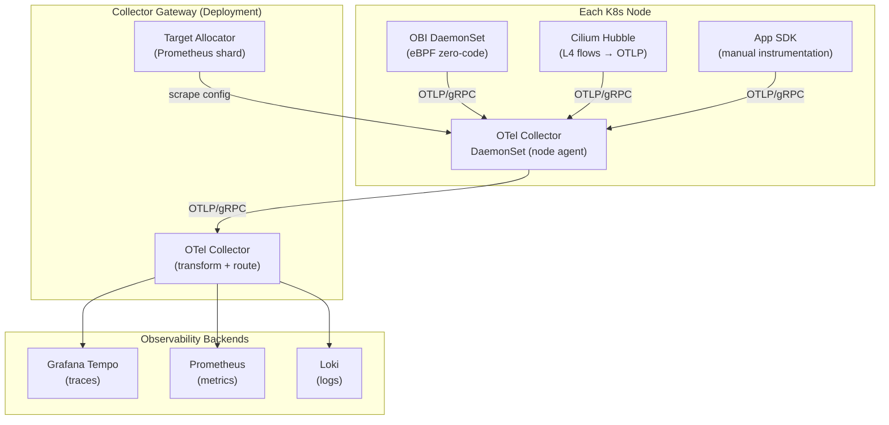
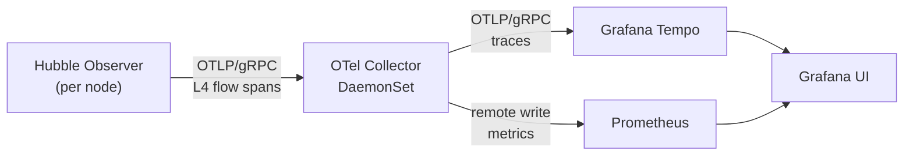
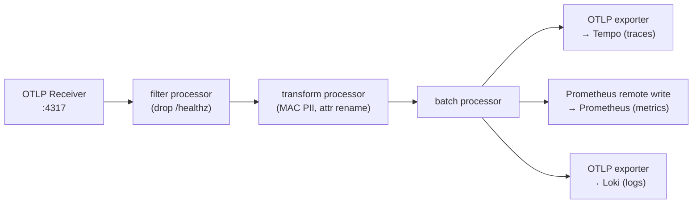
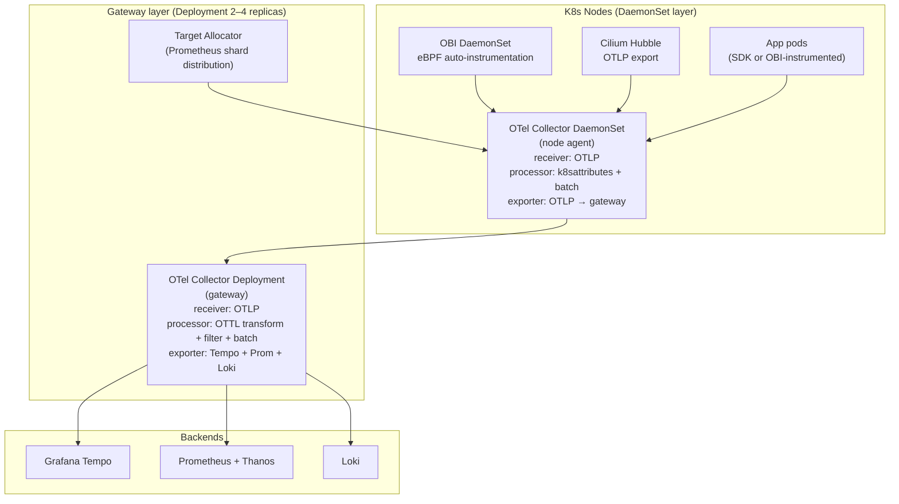

# Lesson 40 — OpenTelemetry for Kubernetes Network Engineers

> **Track:** Track I — AI Platform & Observability · **Prerequisites:** Lessons 10 (eBPF), 12 (Cilium), 21 (Istio), 24 (Observability), 39 (Incident Management) · **Duration:** ~90 minutes
>
> **Goal:** Understand and deploy the full 2026 OpenTelemetry stack for Kubernetes: OBI v1.0 eBPF auto-instrumentation, the K8s Operator with `Instrumentation` CRD, Cilium Hubble OTLP export, OTTL-based Collector pipelines, and network semantic conventions — including what is production-ready today versus what is still Alpha.

---

## Practice Setup

**Terminal 1 — cluster node (minikube ssh):**
```bash
minikube ssh
# inspect eBPF programs loaded by OBI
sudo bpftool prog list | grep obi
# watch kernel uprobes
sudo cat /sys/kernel/debug/tracing/uprobe_events | head -20
```

**Terminal 2 — Mac/local (kubectl, helm, otel tooling):**
```bash
# verify OTel Operator is running
kubectl get pods -n opentelemetry-operator-system
# check Instrumentation CRDs
kubectl get instrumentation -A
# check Collector instances
kubectl get opentelemetrycollector -A
```

---

## 1. OTel Architecture for Platform Engineers

OpenTelemetry is the CNCF standard for vendor-neutral telemetry. As a network engineer you care about it because it defines how network flows, L4/L7 spans, and kernel metrics are labelled, routed, and stored.

### Four signals

| Signal | Stability (2026) | Network relevance |
|--------|-----------------|-------------------|
| **Traces** | Stable — all major languages | Distributed request path, latency per hop |
| **Metrics** | Stable — Go, Java, Python, .NET, PHP, C++ | Packet rates, connection counts, retransmits |
| **Logs** | Stable in .NET/PHP; RC in Go; Dev in JS/Python | Flow logs, security events, audit trails |
| **Profiles** | **Alpha** — not production-ready | CPU/memory per network-path code; future eBPF integration |

### Collector pipeline model

Every signal flows through the same three-stage pipeline inside the OTel Collector:

```
receivers  →  processors  →  exporters
```

Receivers accept data (OTLP, Prometheus scrape, Hubble, Fluentd, Jaeger, Zipkin).  
Processors transform or filter it (OTTL, batch, memory limiter, k8sattributes).  
Exporters send to backends (Prometheus, Tempo, Loki, OTLP/gRPC to another Collector).

### Full-cluster OTel stack diagram



---

## 2. OBI v1.0 — eBPF Zero-Code Instrumentation

> **K8s Engineer's Translation:** OBI is what happens when you apply eBPF to distributed tracing. Instead of patching every app to import an OTel SDK, a single DaemonSet instruments every process on every node at the kernel level — no sidecars, no redeployments, no code changes.

### History

| Year | Event |
|------|-------|
| 2023 | Grafana releases Beyla — eBPF auto-instrumentation for Go/HTTP |
| 2024 | Beyla 1.x adds gRPC, Redis, SQL, Kafka support |
| 2025 | Grafana donates Beyla to CNCF; project moves into OTel project; renamed **OBI** (OpenTelemetry eBPF Instrumentation) |
| 2026 | **OBI v1.0 GA** — 10 protocol categories, full trace context propagation for Go/Node/Python/NGINX/PHP |

### How it works

OBI attaches eBPF probes to two layers simultaneously:

```
user space:  uprobes on library symbols
             (e.g. http.(*Transport).roundTrip in Go stdlib)
             → extract request path, headers, trace context

kernel space: kprobes on tcp_sendmsg / tcp_recvmsg
             → extract src/dst IP:port, bytes, latency
```

No sidecar. No initContainer. No pod restart. OBI runs as a DaemonSet with elevated privileges and instruments every process on the node.

### DaemonSet deployment

```yaml
apiVersion: apps/v1
kind: DaemonSet
metadata:
  name: obi
  namespace: opentelemetry
spec:
  selector:
    matchLabels:
      app: obi
  template:
    metadata:
      labels:
        app: obi
    spec:
      hostPID: true          # required: attach uprobes to host-namespace PIDs
      hostNetwork: false
      tolerations:
        - operator: Exists   # instrument all nodes including control plane
      containers:
        - name: obi
          image: ghcr.io/open-telemetry/opentelemetry-ebpf-instrumentation/obi:1.0.0
          securityContext:
            privileged: true
          env:
            - name: OTEL_EXPORTER_OTLP_ENDPOINT
              value: "http://otel-collector:4317"
            - name: BEYLA_OPEN_PORT           # instrument processes on these ports
              value: "8080,8443,50051,6379,5432,9092"
            - name: OTEL_SERVICE_NAME         # fallback when K8s metadata unavailable
              value: "auto"
            - name: OTEL_RESOURCE_ATTRIBUTES
              value: "k8s.node.name=$(NODE_NAME)"
          env:
            - name: NODE_NAME
              valueFrom:
                fieldRef:
                  fieldPath: spec.nodeName
          volumeMounts:
            - mountPath: /sys/kernel/debug
              name: debugfs
              readOnly: false
            - mountPath: /sys/fs/bpf
              name: bpffs
      volumes:
        - name: debugfs
          hostPath:
            path: /sys/kernel/debug
        - name: bpffs
          hostPath:
            path: /sys/fs/bpf
```

### Supported protocols (v1.0)

| Protocol | Auto-trace | Context propagation | Notes |
|----------|-----------|--------------------|-|
| HTTP/1.1 | Yes | Yes (W3C TraceContext, B3) | All languages |
| HTTPS | Yes | Yes | TLS-aware via SSL uprobes |
| HTTP/2 | Yes | Yes | Multiplexed streams tracked |
| gRPC | Yes | Yes | Unary + streaming |
| SQL (MySQL, Postgres, SQLite) | Yes | No (server-side) | Query as span attribute |
| Redis | Yes | No | Command + key tracked |
| MongoDB | Yes | No | Collection + operation tracked |
| Apache Kafka | Yes | Yes (producer→consumer) | Topic + partition tracked |
| GraphQL | Yes | Yes | Query operation name tracked |
| Elasticsearch / OpenSearch | Yes | No | Index + method tracked |
| AWS S3 | Yes | No | Bucket + key tracked |

### Key environment variables

| Variable | Purpose |
|----------|---------|
| `OTEL_EXPORTER_OTLP_ENDPOINT` | Where to send spans (Collector gRPC endpoint) |
| `BEYLA_OPEN_PORT` | Comma-separated ports OBI will instrument |
| `BEYLA_SERVICE_NAME` | Service name for spans; `auto` = derive from K8s labels |
| `OTEL_RESOURCE_ATTRIBUTES` | Additional resource attrs (node name, cluster name) |
| `BEYLA_TRACE_PRINTER` | Set to `text` for local stdout debugging |

### Lab: deploy OBI and verify spans

```bash
# 1. deploy OBI
kubectl apply -f obi-daemonset.yaml

# 2. wait for pods
kubectl rollout status daemonset/obi -n opentelemetry

# 3. generate traffic to any HTTP service on port 8080
kubectl run curl-test --image=curlimages/curl --restart=Never -- \
  curl -s http://my-service:8080/api/users

# 4. in Terminal 1: confirm eBPF probes loaded
minikube ssh
sudo bpftool prog list | grep uprobe | wc -l   # should be > 0

# 5. in Grafana Tempo (port-forward or ingress)
# Search for service.name=my-service, http.route=/api/users
# You should see spans with network.peer.address, network.transport=tcp
```

---

## 3. K8s Operator — Declarative OTel Management

> **K8s Engineer's Translation:** The OTel Operator turns Collector deployments and SDK injection into CRD-managed resources. You declare what you want; the Operator handles pods, ConfigMaps, and service accounts. For network engineers, the most valuable feature is annotation-based discovery — a pod annotates itself and the Collector automatically configures the right receiver.

### OpenTelemetryCollector CRD

Deploy a Collector as a Deployment, DaemonSet, or StatefulSet via CRD:

```yaml
apiVersion: opentelemetry.io/v1beta1
kind: OpenTelemetryCollector
metadata:
  name: otel-gateway
  namespace: opentelemetry
spec:
  mode: deployment          # or: daemonset, statefulset, sidecar
  replicas: 2
  targetAllocator:
    enabled: true           # see section 3.4
    prometheusCR:
      enabled: true
  config:
    receivers:
      otlp:
        protocols:
          grpc:
            endpoint: 0.0.0.0:4317
          http:
            endpoint: 0.0.0.0:4318

    processors:
      batch:
        timeout: 5s
      memory_limiter:
        limit_mib: 512
        spike_limit_mib: 128
      k8sattributes:        # enrich spans with pod/namespace/node labels
        auth_type: serviceAccount
        passthrough: false
        extract:
          metadata:
            - k8s.pod.name
            - k8s.namespace.name
            - k8s.node.name
            - k8s.deployment.name

    exporters:
      otlp/tempo:
        endpoint: tempo:4317
        tls:
          insecure: true
      prometheusremotewrite:
        endpoint: http://prometheus:9090/api/v1/write

    service:
      pipelines:
        traces:
          receivers: [otlp]
          processors: [memory_limiter, k8sattributes, batch]
          exporters: [otlp/tempo]
        metrics:
          receivers: [otlp]
          processors: [memory_limiter, k8sattributes, batch]
          exporters: [prometheusremotewrite]
```

### Instrumentation CRD — zero-code SDK injection

The `Instrumentation` CRD defines which SDK to inject and what exporters to use. When a pod carries the matching annotation the Operator mutates the pod spec to add an initContainer that copies the SDK libraries in.

```yaml
apiVersion: opentelemetry.io/v1alpha1
kind: Instrumentation
metadata:
  name: python-instrumentation
  namespace: default
spec:
  exporter:
    endpoint: http://otel-collector:4318
  propagators:
    - tracecontext
    - baggage
  sampler:
    type: parentbased_traceidratio
    argument: "0.1"       # 10% sampling rate
  python:
    env:
      - name: OTEL_LOGS_EXPORTER
        value: otlp
  java:
    env:
      - name: OTEL_INSTRUMENTATION_JDBC_ENABLED
        value: "true"
```

Inject into a pod with a single annotation:

```yaml
# Python app
metadata:
  annotations:
    instrumentation.opentelemetry.io/inject-python: "true"

# Java app
metadata:
  annotations:
    instrumentation.opentelemetry.io/inject-java: "true"

# NGINX (HTTP tracing headers)
metadata:
  annotations:
    instrumentation.opentelemetry.io/inject-nginx: "true"
```

Supported runtimes: `.NET`, `Java`, `Node.js`, `Python`, `Go`, `Apache HTTPD`, `NGINX`.

### Annotation-based Collector discovery

Pods can self-describe which metrics receiver the Collector should use:

```yaml
# In pod spec annotations — no Collector ConfigMap edit needed
metadata:
  annotations:
    io.opentelemetry.discovery.metrics/enabled: "true"
    io.opentelemetry.discovery.metrics/scraper: nginx
    # Collector will auto-instantiate an nginx receiver pointed at this pod
```

This works for metrics (Receiver Creator) and logs (filelog receiver). When the pod is deleted the receiver is torn down automatically.

### Target Allocator

In large clusters a single Collector instance cannot scrape thousands of Prometheus targets without becoming a bottleneck. The Target Allocator (TA) distributes scrape targets across a pool of Collector instances:

```
Prometheus CRs (ServiceMonitor, PodMonitor)
       ↓
Target Allocator  →  divides targets across N Collectors
       ↓
Collector-0  Collector-1  Collector-N
(scrapes its assigned targets)
```

Enable with `targetAllocator.enabled: true` in the `OpenTelemetryCollector` CRD (see example above). The TA itself is deployed as a Deployment alongside the Collector.

---

## 4. Cilium Hubble OTLP Integration

> **K8s Engineer's Translation:** Hubble already knows every L4 flow in the cluster. OTLP export converts those flow records into spans so network paths appear in Tempo exactly like application traces — but at the network layer. You can correlate an application 500 error with the upstream TCP RST that caused it, in the same trace view.

### What Hubble exports

Each Hubble flow becomes an OTLP span with:
- `network.peer.address` / `network.local.address` — src/dst IPs
- `network.peer.port` / `network.local.port` — src/dst ports
- `network.transport` — `tcp` or `udp`
- `network.type` — `ipv4` or `ipv6`
- K8s workload labels: `k8s.pod.name`, `k8s.namespace.name`, `k8s.deployment.name`
- Verdict: `FORWARDED`, `DROPPED`, `REDIRECTED`

### Helm configuration

```bash
helm upgrade cilium cilium/cilium \
  --reuse-values \
  --set hubble.enabled=true \
  --set hubble.export.opentelemetry.enabled=true \
  --set hubble.export.opentelemetry.endpoint="otel-collector.opentelemetry.svc:4317" \
  --set hubble.export.opentelemetry.insecure=true
```

Or in `values.yaml`:

```yaml
hubble:
  enabled: true
  export:
    opentelemetry:
      enabled: true
      endpoint: "otel-collector.opentelemetry.svc:4317"
      insecure: true
      # optional: filter to only export dropped flows
      allowList:
        - '{"verdict":["DROPPED","ERROR"]}'
```

### Hubble → Tempo flow



### Lab: query Hubble flows as traces

```bash
# 1. enable Hubble OTLP (helm upgrade above)
# 2. port-forward Tempo
kubectl port-forward -n monitoring svc/tempo 3100:3100

# 3. in Grafana → Explore → Tempo data source
#    TraceQL query to find dropped flows:
#    { span.verdict = "DROPPED" && span.network.peer.address =~ "10.0.*" }

# 4. correlate with application trace
#    find a trace ID from your app → Tempo → look for Hubble spans
#    with the same source IP as the app pod
```

---

## 5. Network Semantic Conventions

The OTel semantic conventions define the standard attribute names for network telemetry. Using these names ensures your data works with any OTel-compatible backend without mapping.

### Full attribute table

| Attribute | Stability | Type | Example | Notes |
|-----------|-----------|------|---------|-------|
| `network.local.address` | **Stable** | string | `10.0.0.5` | Local IP (source) |
| `network.local.port` | **Stable** | int | `54321` | Local port |
| `network.peer.address` | **Stable** | string | `10.0.0.10` | Remote IP (destination) |
| `network.peer.port` | **Stable** | int | `8080` | Remote port |
| `network.protocol.name` | **Stable** | string | `http`, `grpc` | Application protocol |
| `network.protocol.version` | **Stable** | string | `1.1`, `2` | Protocol version |
| `network.transport` | **Stable** | string | `tcp`, `udp` | L4 transport |
| `network.type` | **Stable** | string | `ipv4`, `ipv6` | IP version |
| `network.connection.state` | **RC** | string | `established`, `close_wait` | TCP state |
| `network.interface.name` | **RC** | string | `eth0`, `cilium_vxlan` | Network interface |
| `network.io.direction` | **RC** | string | `transmit`, `receive` | I/O direction |
| `network.peer.as.number` | **Experimental** | int | `64512` | Peer BGP AS number |
| `network.peer.as.organization` | **Experimental** | string | `"My ISP"` | Peer AS org name |
| `network.local.as.number` | **Experimental** | int | `64513` | Local BGP AS number |
| `network.local.as.organization` | **Experimental** | string | `"My Cluster"` | Local AS org name |
| `network.local.mac.address` | **Experimental** | string | `00:1A:2B:3C:4D:5E` | ⚠️ PII — anonymize in prod |
| `network.peer.mac.address` | **Experimental** | string | `00:1A:2B:3C:4D:5F` | ⚠️ PII — anonymize in prod |
| `network.carrier.*` | **Experimental** | — | — | Mobile carrier attrs |

### BGP/ASN attrs and lesson 06

The `network.peer.as.number` and `network.local.as.number` attributes are especially useful when you operate a multi-AS Kubernetes cluster (see [Lesson 06 — BGP Fundamentals](06-bgp-fundamentals.md)). By emitting these attrs from a custom BGP exporter or Calico/Cilium BGP metrics, you can correlate routing events (prefix withdrawals, flaps) with application-level latency spikes in the same Tempo trace view.

### PII warning on MAC attrs

MAC addresses are considered personally identifiable information in several jurisdictions (GDPR, CCPA). If your OTel pipeline captures `network.local.mac.address` or `network.peer.mac.address`, add an OTTL transform to hash or drop them before exporting to any long-term storage:

```yaml
# In Collector transform processor
transform/mac_pii:
  trace_statements:
    - context: span
      statements:
        - delete_key(attributes, "network.local.mac.address")
        - delete_key(attributes, "network.peer.mac.address")
```

---

## 6. OTTL v1 — Transform and Filter at the Collector

OTTL (OpenTelemetry Transformation Language) reached v1 stability in 2026. It is the query language used inside the `transform` and `filter` processors. Because it runs at the Collector layer, transformations apply to all signals regardless of which SDK or instrumentation produced them.

### Common use cases for network engineers

| Use case | OTTL statement |
|----------|---------------|
| Drop high-cardinality `http.url` (contains query params) | `set(attributes["http.url"], "/redacted")` |
| Drop health-check spans | Filter: `route() where attributes["http.route"] == "/healthz"` |
| Rename `network.peer.address` to legacy `net.peer.ip` | `set(attributes["net.peer.ip"], attributes["network.peer.address"])` |
| Drop MAC PII attrs | `delete_key(attributes, "network.local.mac.address")` |
| Route dropped-flow spans to separate exporter | `route() where attributes["verdict"] == "DROPPED"` |

### Complete Collector config with OTTL



```yaml
receivers:
  otlp:
    protocols:
      grpc:
        endpoint: 0.0.0.0:4317

processors:
  filter/drop_healthz:
    traces:
      span:
        - 'attributes["http.route"] == "/healthz"'
        - 'attributes["http.route"] == "/readyz"'
        - 'attributes["http.route"] == "/livez"'

  transform/network_cleanup:
    trace_statements:
      - context: span
        statements:
          # Drop PII MAC attrs
          - delete_key(attributes, "network.local.mac.address")
          - delete_key(attributes, "network.peer.mac.address")
          # Redact query strings from URLs
          - replace_pattern(attributes["http.url"], "\\?.*", "?<redacted>")
    metric_statements:
      - context: datapoint
        statements:
          # Rename legacy attr to stable sem-conv
          - set(attributes["network.peer.address"], attributes["net.peer.ip"])
            where attributes["net.peer.ip"] != nil
          - delete_key(attributes, "net.peer.ip")

  batch:
    timeout: 5s
    send_batch_size: 1000

  memory_limiter:
    limit_mib: 512

exporters:
  otlp/tempo:
    endpoint: tempo:4317
    tls:
      insecure: true
  prometheusremotewrite:
    endpoint: http://prometheus:9090/api/v1/write
  otlp/loki:
    endpoint: loki:3100
    tls:
      insecure: true

service:
  pipelines:
    traces:
      receivers: [otlp]
      processors: [memory_limiter, filter/drop_healthz, transform/network_cleanup, batch]
      exporters: [otlp/tempo]
    metrics:
      receivers: [otlp]
      processors: [memory_limiter, transform/network_cleanup, batch]
      exporters: [prometheusremotewrite]
    logs:
      receivers: [otlp]
      processors: [memory_limiter, batch]
      exporters: [otlp/loki]
```

### Key OTTL operators

| Operator | Description |
|----------|-------------|
| `set(target, value)` | Set attribute to value |
| `delete_key(map, key)` | Remove an attribute |
| `replace_pattern(attr, regex, replacement)` | Regex replace on string attr |
| `where <condition>` | Conditional: statement only applies if condition is true |
| `route() where <condition>` | In filter processor: drop item if condition is true |

---

## 7. Profiling Signal (Alpha)

### Current state

The OTel Profiles signal is **Alpha** as of late 2026. This means:
- The data model is defined (pprof-based proto)
- An eBPF CPU profiler for Linux is available from the OTel project
- **No major observability backend has GA support** for the OTel profile data model yet
- The spec itself is still evolving

Do **not** rely on the OTel Profiles signal for production workloads in 2026.

### Existing profiling tools (not OTel-spec)

| Tool | What it is | OTel integration status |
|------|-----------|------------------------|
| **Grafana Pyroscope** | Continuous profiling backend | Accepts pprof; supports exemplar links to Tempo traces; not OTel-spec profiles |
| **Parca** | Open-source continuous profiling (eBPF-based) | No native OTel integration; trace ID linking is manual |
| **Elastic Universal Profiling** | eBPF profiler + ES backend | Proprietary; partial OTel attrs |

Parca and Pyroscope are **separate projects** from OTel. They do not implement the OTel Profiles spec pipeline. Linking profiles to traces today requires manually passing a trace ID as a label — it is not automatic correlation via the OTel context propagation API.

### How to link profiles to traces today (manual approach)

```python
# In your app: propagate current trace ID as a Parca label
from opentelemetry import trace
tracer = trace.get_tracer(__name__)

with tracer.start_as_current_span("my-operation") as span:
    trace_id = format(span.get_span_context().trace_id, "032x")
    # Pass trace_id to your profiling client label
    profiler.start(labels={"trace_id": trace_id})
```

### When to revisit

Watch the [OTel Profiling SIG](https://opentelemetry.io/docs/specs/otel/profiles/) and backend support in Grafana Tempo and Elasticsearch. When a backend ships GA support and a compatible eBPF profiler is available, the full correlation story (trace → profile → flame graph) will be compelling for network performance engineering.

---

## 8. Production Deployment Pattern

### Recommended full-cluster topology



**Two-tier rationale:** The node-agent Collector is lightweight (k8sattributes enrichment + batch only). It keeps per-node memory bounded. All heavy processing (OTTL transforms, routing, fan-out) happens in the gateway Deployment where replicas can scale independently.

### Collector resource sizing

| Deployment | Throughput | Memory | CPU |
|-----------|-----------|--------|-----|
| Node agent (DaemonSet) | ~5k spans/s per node | 256 MiB limit | 0.5 core |
| Gateway (Deployment) | ~50k spans/s per replica | 1 GiB limit | 2 cores |
| Target Allocator | — | 128 MiB limit | 0.1 core |

Set `memory_limiter` processor on both tiers. The `limit_mib` should be ~80% of your container memory limit.

### Collector health metrics to monitor

| Metric | Alert threshold | Meaning |
|--------|----------------|---------|
| `otelcol_processor_dropped_metric_points` | > 0 sustained | Processor is dropping data — increase memory or reduce ingestion rate |
| `otelcol_exporter_queue_size` | > 80% of `queue_size` | Exporter is falling behind — backend slow or unreachable |
| `otelcol_receiver_refused_spans` | > 0 | Backpressure: Collector cannot accept spans fast enough |
| `otelcol_process_memory_rss` | > 90% of limit | OOM risk — increase limit or reduce batch size |

```bash
# scrape Collector health metrics (Collector exposes on :8888)
curl -s http://otel-collector:8888/metrics | grep otelcol_exporter_queue_size
```

---

## Check Your Understanding

1. **OBI uses uprobes and kprobes — what is the difference in what each intercepts, and why are both needed for distributed tracing?**

2. **The `Instrumentation` CRD auto-injects an OTel SDK as an initContainer. What would you check if spans from an annotated pod are not appearing in Tempo?** (Hint: think about the Operator webhook, the exporter endpoint, and sampling rate.)

3. **You receive a Hubble OTLP span with `verdict=DROPPED`. Which `network.*` attributes would you examine first to identify the source of the drop, and what policy type (NetworkPolicy, Cilium policy, ASG) would you correlate it with?**

4. **Write an OTTL `filter` statement that drops all spans where `network.transport` is `udp` AND `network.peer.port` is `53` (DNS health-check noise from CoreDNS).**

5. **Why is it incorrect to say "Parca integrates with OpenTelemetry Profiles"? What would need to change for that statement to be true?**

---

## See Also

- [Lesson 10 — eBPF and XDP](10-ebpf-xdp.md) — kernel probe mechanics underpinning OBI
- [Lesson 12 — Cilium CNI and eBPF Dataplane](12-cilium-cni-ebpf.md) — Cilium architecture; Hubble observer internals
- [Lesson 21 — Service Mesh with Istio](21-service-mesh-istio.md) — OTel trace context propagation with Envoy
- [Lesson 24 — Network Observability and Troubleshooting](24-network-observability-troubleshooting.md) — Hubble CLI, Prometheus, tcpdump baseline tooling
- [Lesson 39 — Network Incident Management, SLOs, and RCA](39-network-incident-management-slo-rca.md) — OTel + eBPF stack in an SLO/RCA workflow

---

## Online Resources

- [OpenTelemetry Collector documentation](https://opentelemetry.io/docs/collector/)
- [OpenTelemetry K8s Operator documentation](https://opentelemetry.io/docs/platforms/kubernetes/operator/)
- [OTel eBPF Instrumentation (OBI) repository](https://opentelemetry.io/docs/zero-code/ebpf/)
- [OTel Network Semantic Conventions](https://opentelemetry.io/docs/specs/semconv/network/)
- [OTTL (OTel Transformation Language) reference](https://opentelemetry.io/docs/collector/transforming-telemetry/)
